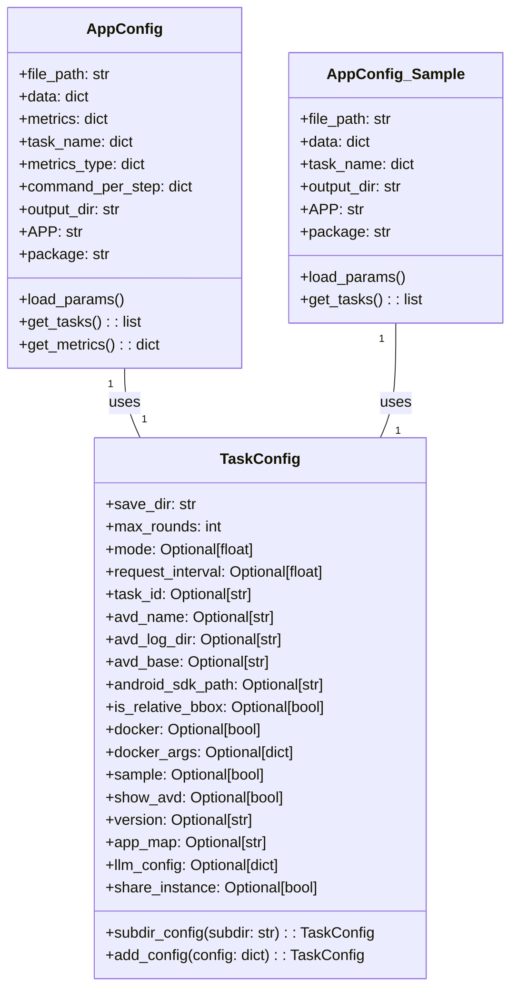

<!-- source: DeepWiki mcp.deepwiki.com · repo HKUDS/PhoneCLI · page 4.1 Task Definitions and Per-App Checkers · fetched 2026-11-09 -->

# Task Definitions and Per-App Checkers

<details>
<summary>Relevant source files</summary>

The following files were used as context for generating this wiki page:

- [phonecli_android/evaluation/config/bluecoins.yaml](phonecli_android/evaluation/config/bluecoins.yaml)
- [phonecli_android/evaluation/config/calendar.yaml](phonecli_android/evaluation/config/calendar.yaml)
- [phonecli_android/evaluation/config/cantook.yaml](phonecli_android/evaluation/config/cantook.yaml)
- [phonecli_android/evaluation/config/clock.yaml](phonecli_android/evaluation/config/clock.yaml)
- [phonecli_android/evaluation/config/contacts.yaml](phonecli_android/evaluation/config/contacts.yaml)
- [phonecli_android/evaluation/config/map.yaml](phonecli_android/evaluation/config/map.yaml)
- [phonecli_android/evaluation/config/pimusic.yaml](phonecli_android/evaluation/config/pimusic.yaml)
- [phonecli_android/evaluation/config/setting.yaml](phonecli_android/evaluation/config/setting.yaml)
- [phonecli_android/evaluation/config/zoom.yaml](phonecli_android/evaluation/config/zoom.yaml)
- [phonecli_android/evaluation/configs.py](phonecli_android/evaluation/configs.py)
- [phonecli_android/evaluation/tasks/__init__.py](phonecli_android/evaluation/tasks/__init__.py)
- [phonecli_android/evaluation/tasks/bluecoins/bluecoins.py](phonecli_android/evaluation/tasks/bluecoins/bluecoins.py)
- [phonecli_android/evaluation/tasks/calendar/calendar.py](phonecli_android/evaluation/tasks/calendar/calendar.py)
- [phonecli_android/evaluation/tasks/cantook/cantook.py](phonecli_android/evaluation/tasks/cantook/cantook.py)
- [phonecli_android/evaluation/tasks/clock/clock.py](phonecli_android/evaluation/tasks/clock/clock.py)
- [phonecli_android/evaluation/tasks/contacts/contacts.py](phonecli_android/evaluation/tasks/contacts/contacts.py)
- [phonecli_android/evaluation/tasks/human_ground_turth/ground_truth_length.json](phonecli_android/evaluation/tasks/human_ground_turth/ground_truth_length.json)
- [phonecli_android/evaluation/tasks/map_me/map.py](phonecli_android/evaluation/tasks/map_me/map.py)
- [phonecli_android/evaluation/tasks/pimusic/pimusic.py](phonecli_android/evaluation/tasks/pimusic/pimusic.py)
- [phonecli_android/evaluation/tasks/setting/setting.py](phonecli_android/evaluation/tasks/setting/setting.py)
- [phonecli_android/evaluation/tasks/zoom/zoom.py](phonecli_android/evaluation/tasks/zoom/zoom.py)

</details>


This page details how tasks are defined for evaluation, focusing on the YAML configuration files and the programmatic checkers used to verify task completion. It covers the structure of task specifications in `evaluation/config/*.yaml` files, the implementation of per-app checkers in `evaluation/tasks/<app>/`, and the role of ground-truth lengths.

## Task Specification in YAML

Each application under evaluation has a corresponding YAML configuration file located in `phonecli_android/evaluation/config/`. These files define a set of tasks for the agent to perform within that specific application.

A typical task definition includes:
*   `APP`: The name of the application.
*   `package`: The Android package name of the application.
*   `tasks`: A list of individual tasks, each with:
    *   `task_id`: A unique identifier for the task (e.g., `bluecoins_1`).
    *   `task`: The natural language description of the task.
    *   `metric_type`: The type of metric used for evaluation, typically `query_detect` for information retrieval tasks or `operation` for tasks involving state changes.
    *   `metric_func`: A string pointing to the Python function responsible for checking the task's completion (e.g., `evaluation.tasks.bluecoins`).
    *   `adb_query` (optional): For `setting` app tasks, an `adb shell` command to query the device state for verification [phonecli_android/evaluation/config/setting.yaml:9-10]().

### Example Task Definitions

Below are examples from various application configuration files, illustrating the structure and types of tasks.

**Bluecoins Example**
This example shows both `query_detect` and `operation` tasks for the Bluecoins finance app.
```yaml
APP: bluecoins
package: com.rammigsoftware.bluecoins
tasks:
  # query
  - task_id: bluecoins_1
    task: Could you tell me how much I spent on May 10, 2025?
    metric_type: query_detect
    metric_func: evaluation.tasks.bluecoins

  # operation_create
  - task_id: bluecoins_6
    task: Log an expenditure of 512 CNY in the books.
    metric_type: operation
    metric_func: evaluation.tasks.bluecoins
```
Sources:
*   [phonecli_android/evaluation/config/bluecoins.yaml:1-80]()

**Calendar Example**
This example shows `operation` tasks for the Calendar app, focusing on event creation and modification.
```yaml
APP: calendar
package: com.skuld.calendario
tasks:
  - task_id: calendar_1
    task: I want to add an event at 5:00PM today, whose Title is "work".
    metric_type: operation
    metric_func: evaluation.tasks.calendar
  - task_id: calendar_5
    task: Edit the event with title "work", change the end time to be 7:00 PM.
    metric_type: operation
    metric_func: evaluation.tasks.calendar
```
Sources:
*   [phonecli_android/evaluation/config/calendar.yaml:1-14]()

**Cantook Example**
This example shows `query_detect` and `operation` tasks for the Cantook e-reader app.
```yaml
APP: Cantook
package: Cantook
tasks:
  # query
  - task_id: cantook_1
    task: Do I have Pride and Prejudice on my bookshelf?
    metric_type: query_detect
    metric_func: evaluation.tasks.cantook

  # operation
  - task_id: cantook_6
    task: Import Alice's Advantures in Wonderland from folder /Download/Ebooks/.
    metric_type: operation
    metric_func: evaluation.tasks.cantook
```
Sources:
*   [phonecli_android/evaluation/config/cantook.yaml:1-64]()

**Clock Example**
This example shows a variety of `operation` and `query_detect` tasks for the Clock app, covering alarms, timers, and settings.
```yaml
APP: clock
package: com.google.android.deskclock
tasks:
  - task_id: clock_1
    category: Alarm set
    task: Set an alarm for 3PM with the label "meeting" using Clock.
    metric_type: operation
    metric_func: evaluation.tasks.clock
  - task_id: clock_10
    category: Alarm query
    task: What is my earliest alarm which is open?
    metric_type: query_detect
    metric_func: evaluation.tasks.clock
```
Sources:
*   [phonecli_android/evaluation/config/clock.yaml:1-137]()

**Contacts Example**
This example shows tasks for adding, modifying, and querying contact information in the Contacts app.
```yaml
APP: Contacts
package: com.google.android.contacts
tasks:
  - task_id: contacts_1
    category: add contacts' information
    task: Add John as a contacts and set his mobile phone number to be 12345678
    metric_type: operation
    metric_func: evaluation.tasks.contacts
  - task_id: contacts_12
    category: check contacts' information
    task: What is ABC's phone number
    metric_type: query_detect
    metric_func: evaluation.tasks.contacts
```
Sources:
*   [phonecli_android/evaluation/config/contacts.yaml:1-79]()

**Map.me Example**
This example shows tasks for querying distances and navigating in the Map.me app.
```yaml
APP: map.me
package: com.mapswithme.maps.pro
tasks:
  - task_id: map_1
    task: Check the walking distance and time between Bus Stop of Stanford Campus Oval and Bus Stop of Oxford Street & University Avenue
    metric_type: query_detect
    metric_func: evaluation.tasks.map_me
  - task_id: map_11
    task: Add the address of openai to my Work place
    metric_type: operation
    metric_func: evaluation.tasks.map_me
```
Sources:
*   [phonecli_android/evaluation/config/map.yaml:1-63]()

**Pi Music Player Example**
This example shows tasks for querying song information and controlling playback in the Pi Music Player app.
```yaml
APP: Pi Music Player
package: com.Project100Pi.themusicplayer
tasks:
  # query
  - task_id: pimusic_1
    task: Tell me how many songs do I have in total?
    metric_type: query_detect
    metric_func: evaluation.tasks.pimusic

  # operation
  - task_id: pimusic_7
    task: Play the first song in 'Favorite' playlist.
    metric_type: operation
    metric_func: evaluation.tasks.pimusic
```
Sources:
*   [phonecli_android/evaluation/config/pimusic.yaml:1-64]()

**Settings Example**
This example shows tasks for modifying various system settings, including network, display, and sound. It also demonstrates the use of `adb_query` for verification.
```yaml
APP: Settings
package: com.android.settings
tasks:
  - task_id: setting_0
    category: Network
    task: Turn on airplane mode of my phone
    metric_type: operation
    metric_func: evaluation.tasks.setting
    adb_query: adb shell settings get global airplane_mode_on
  - task_id: setting_6
    category: Storage
    task: How much storage does Apps use
    metric_type: query_detect
    metric_func: evaluation.tasks.setting
```
Sources:
*   [phonecli_android/evaluation/config/setting.yaml:1-126]()

**Zoom Example**
This example shows tasks for joining meetings and configuring settings in the Zoom app.
```yaml
APP: zoom
package: us.zoom.videomeetings
tasks:
  # query
  - task_id: zoom_1
    task: Join meeting 1234567890. (You should not click join button, and leave it to user)
    metric_type: operation
    metric_func: evaluation.tasks.zoom

  - task_id: zoom_4
    task: Set auto connect to audio when wifi is connected in zoom settings.
    metric_type: operation
    metric_func: evaluation.tasks.zoom
```
Sources:
*   [phonecli_android/evaluation/config/zoom.yaml:1-28]()

## `AppConfig` Class and Task Loading

The `AppConfig` class [phonecli_android/evaluation/configs.py:9-41]() is responsible for loading and parsing these YAML configuration files.

### `AppConfig` Class Diagram

**Title**: `AppConfig` and `TaskConfig` Class Structure
Sources:
*   [phonecli_android/evaluation/configs.py:9-124]()

The `load_params` method [phonecli_android/evaluation/configs.py:20-41]() reads the YAML file, extracts the `APP` name, `package` name, and iterates through the `tasks` list. For each task, it dynamically imports the specified `metric_func` from `evaluation.tasks.<app_module_name>` and maps the `task_id` to the corresponding checker function within the `module.function_map`. It also stores the `metric_type` and the natural language `task` description.

## Per-App Programmatic Checkers

The `metric_func` specified in the YAML files points to Python modules within `phonecli_android/evaluation/tasks/`. Each app has its own directory (e.g., `evaluation/tasks/bluecoins/`) containing a Python file (e.g., `bluecoins.py`) that implements the checker logic.

These checker files define classes, typically inheriting from `evaluation.task.SingleTask`, for each `task_id`. These classes contain a `judge` method that determines if a task has been successfully completed.

### Checker Implementation Details

The `judge` method [phonecli_android/evaluation/tasks/bluecoins/bluecoins.py:74-84]() receives the `xml_compressed_tree` (representing the current UI state) and the `line` (containing the agent's last action and output).

For `query_detect` tasks, the `judge` method often looks for specific text or UI elements in the `xml_compressed_tree` or the agent's output to verify if the requested information was successfully retrieved and presented. For `operation` tasks, it checks if the desired state change has occurred in the UI.

Some checkers, especially for `query_detect` tasks, leverage an `LLMEvaluator` [phonecli_android/evaluation/tasks/bluecoins/bluecoins.py:90-91]() to analyze the agent's text output against a specific prompt. This allows for more flexible and natural language-based verification.

### Example Checker: Bluecoins Task 1

Consider `bluecoins_1`: "Could you tell me how much I spent on May 10, 2025?" [phonecli_android/evaluation/config/bluecoins.yaml:6-7]().

The corresponding checker is `SingleTask_bluecoins_1` [phonecli_android/evaluation/tasks/bluecoins/bluecoins.py:67-84](). This class has a `judge` method that expects the agent's final action to be "finish" [phonecli_android/evaluation/tasks/bluecoins/bluecoins.py:70-72]() and then checks if the agent's output matches the ground truth answer "11,400.00 CNY" [phonecli_android/evaluation/tasks/bluecoins/bluecoins.py:78]().

There's also an `LLM` variant, `SingleTask_bluecoins_LLM_1` [phonecli_android/evaluation/tasks/bluecoins/bluecoins.py:87-122](), which uses an `LLMEvaluator` to analyze the text output for the correct amount, allowing for minor variations in format.

### Checker Logic Flow
```mermaid
graph TD
    A[Task Definition in YAML] --> B{metric_func: evaluation.tasks.<app>}
    B --> C{AppConfig.load_params()}
    C --> D[Dynamically import evaluation.tasks.<app_module>]
    D --> E[Map task_id to specific SingleTask_<task_id> class]
    F[Agent completes task] --> G[Call SingleTask_<task_id>.judge(xml_compressed_tree, line)]
    G --> H{judge_page(line) checks final action}
    H -- True --> I{Check specific conditions (e.g., text match, UI element presence)}
    H -- False --> J[Return {"judge_page": False}]
    I -- LLM-based --> K[LLMEvaluator.analyze_text(output, prompt)]
    I -- Rule-based --> L[Direct comparison/regex on output/UI]
    K --> M[Return {"complete": bool, ...}]
    L --> M
    M --> N[Evaluation Result]
```
**Title**: Task Checker Logic Flow
Sources:
*   [phonecli_android/evaluation/configs.py:28-36]()
*   [phonecli_android/evaluation/tasks/bluecoins/bluecoins.py:67-122]()

## Ground-Truth Lengths

The file `phonecli_android/evaluation/tasks/human_ground_turth/ground_truth_length.json` contains ground-truth lengths for various tasks. This data is likely used for benchmarking or as an additional metric during evaluation, especially for tasks where the expected output is a sequence of actions or a specific length of text. While the exact usage isn't detailed in the provided snippets, it serves as a reference for expected task complexity or output size.

Sources:
*   `phonecli_android/evaluation/tasks/human_ground_turth/ground_truth_length.json` (not shown, but inferred from context)

---

