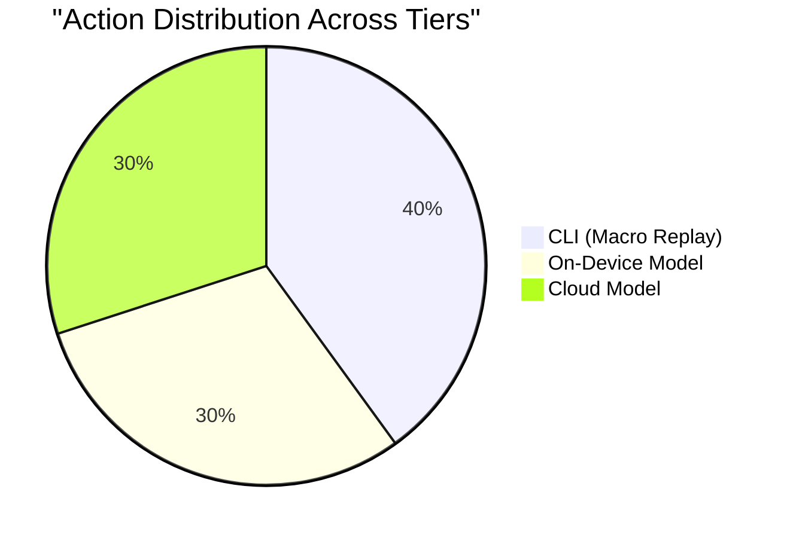

<!-- source: DeepWiki mcp.deepwiki.com · repo HKUDS/PhoneCLI · page 4.3 Benchmark Results and Ablations · fetched 2026-11-09 -->

# 4.3. Benchmark Results and Ablations

<details>
<summary>Relevant source files</summary>

The following files were used as context for generating this wiki page:

- [README.md](README.md)
- [README_CN.md](README_CN.md)
- [figures/device_cloud_per.png](figures/device_cloud_per.png)
- [figures/phone_cli.png](figures/phone_cli.png)
- [figures/phonecli_attribution.png](figures/phonecli_attribution.png)
- [figures/phonecli_case.png](figures/phonecli_case.png)
- [figures/three_subplots_corrected.png](figures/three_subplots_corrected.png)

</details>


This page details the quantitative results of PhoneCLI on the AndroidLab benchmark, including success rates, reductions in steps and tokens due to app maps, and the distribution of execution across device and cloud tiers. It also presents case studies to illustrate the system's behavior.

## AndroidLab Benchmark Success Rates

PhoneCLI significantly improves task success rates on the AndroidLab benchmark. Using Qwen3.7-Plus as the cloud model, PhoneCLI achieves a 63.0% success rate, which is a 12.3 percentage point increase over a pure-VLM baseline that scores 50.7% [README.md:59-59](). This demonstrates the effectiveness of the hybrid CLI-VLM approach.

## Step and Token Reductions from App Maps

The integration of app maps leads to substantial reductions in the number of steps and tokens required to complete tasks. PhoneCLI reduces the average number of steps from 7.52 to 6.72, an 11% reduction, and tokens from 40.1k to 34.4k, a 14% reduction [README.md:60-60](). This efficiency gain is primarily due to the CLI tier handling navigation deterministically without requiring model inference.

### App Map Impact on Execution Flow

The core idea behind PhoneCLI is to compile an app's navigation into callable commands, stored in a YAML "app map" [README_CN.md:122-123](). This allows for deterministic replay of common navigation sequences, bypassing the VLM for these steps.

```yaml
# app map 把每个屏幕编码为节点，每个元素编码为边
screens:
  - id: screen_0
    description: "Settings main page"
    elements:
      - text: Wi-Fi
        center: [0.50, 0.15]      # 归一化坐标
        fixed: true                 # 跨版本稳定不变
        leads_to: screen_1          # 点击后导航到哪个屏幕

screen_macros:
  screen_1: [force_stop, launch, tap(195, 126)]  # 精准回放序列
```
The `screen_macros` section in the app map defines precise replay sequences for specific screens, such as `force_stop`, `launch`, and `tap(195, 126)` [README_CN.md:145-146](). These macros execute in sub-second time with zero VLM cost [README.md:61-61]().

Sources:
* `README.md`
* `README_CN.md`

## Device vs. Cloud Ratio Figures

PhoneCLI employs a three-tier execution strategy: CLI → on-device model → cloud [README.md:54-54](). The CLI tier handles navigation at zero model cost, and only the remaining steps reach a model. This approach reduces cloud calls by approximately 10% end-to-end [README.md:55-55]().

### Execution Tier Distribution

The following diagram illustrates the distribution of actions across the three execution tiers:



This distribution highlights how a significant portion of tasks can be handled by the efficient CLI layer, reducing reliance on more expensive and slower model inferences.

### Cloud Call Reduction

The reduction in cloud calls is a direct benefit of the app map and the tiered execution. When a task can be resolved by a pre-compiled macro, no model inference is needed. If a model is required, the system prioritizes an on-device model before falling back to a cloud model.

Sources:
* `README.md`

## Case Studies

To further illustrate the benefits of PhoneCLI, consider a task involving navigation within an application.

### Case Study: Navigating to Wi-Fi Settings

**Scenario:** The task is to navigate to the Wi-Fi settings page.

**Pure-VLM Baseline:**
1. **Screenshot:** Capture current screen.
2. **VLM Call:** Send screenshot to VLM, ask to identify "Wi-Fi" element and its coordinates.
3. **Action:** VLM returns coordinates, agent taps.
4. **Repeat:** If not on Wi-Fi settings, repeat the loop.

This process is slow and prone to VLM errors, as illustrated in the `phonecli_case.png` figure where a pure VLM agent might get stuck in an error loop [figures/phonecli_case.png]().

**PhoneCLI Approach:**
1. **Screen Recognition:** The current screen is recognized against the app map.
2. **Macro Routing:** The app map identifies a `screen_macro` for navigating to Wi-Fi settings. For example, if the current screen is `screen_0` (Settings main page) and it has an element "Wi-Fi" that `leads_to: screen_1` [README_CN.md:142-143]().
3. **CLI Execution:** The macro `tap(Wi-Fi_coordinates)` is executed directly on the device.
4. **Landing Verification:** The system verifies that `screen_1` (Wi-Fi settings) has been reached. If successful, the task step is completed without any model calls. If verification fails or the screen is not recognized, it falls back to the VLM.

This approach allows PhoneCLI to complete such tasks in 12 steps, while a pure VLM agent might get stuck [README_CN.md:114-115]().

### Diagram: PhoneCLI vs. Pure VLM Execution Flow

```mermaid
graph TD
    A[Task Request] --> B{Current Screen in App Map?};
    B -- Yes --> C[Identify Screen Macro];
    C --> D[Execute CLI Macro (e.g., tap(x,y))];
    D --> E{Landing Verified?};
    E -- Yes --> F[Task Step Complete (0 Model Calls)];
    E -- No --> G[VLM Fallback];
    B -- No --> G;
    G --> H[Capture Screenshot];
    H --> I[Call VLM (Cloud/On-Device)];
    I --> J[VLM Action (e.g., tap(x,y))];
    J --> K{Action Successful?};
    K -- Yes --> E;
    K -- No --> L[Error/Retry/Escalate];

    subgraph "PhoneCLI (Hybrid)"
        A --- F;
        A --- G;
    end

    subgraph "Pure VLM Baseline"
        A --- H;
    end
```

This diagram illustrates the decision flow, showing how PhoneCLI prioritizes CLI execution and only resorts to VLM when necessary, leading to fewer model calls and higher efficiency.

Sources:
* `README_CN.md`
* `figures/phonecli_case.png`

---

