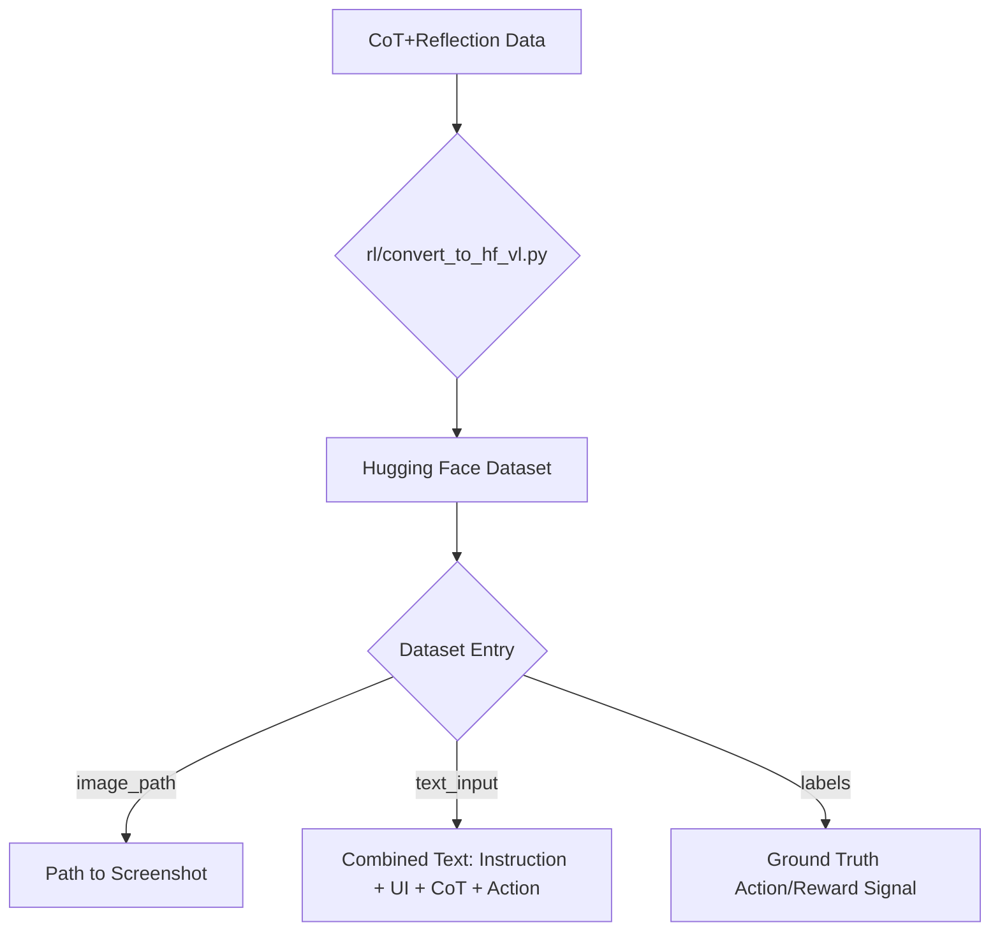

<!-- source: DeepWiki mcp.deepwiki.com · repo HKUDS/PhoneCLI · page 5.1 Training Data Preparation (prepare_data/) · fetched 2026-11-09 -->

# Training Data Preparation (prepare_data/)

<details>
<summary>Relevant source files</summary>

The following files were used as context for generating this wiki page:

- [README.md](README.md)
- [README_CN.md](README_CN.md)
- [figures/phone_cli.png](figures/phone_cli.png)

</details>


This page details the processes and scripts within the `prepare_data/` directory, which are crucial for generating the training datasets used by the OpenPhone model. The primary goal is to create high-quality data for Supervised Fine-Tuning (SFT) and Generative Reinforcement Learning with Policy Optimization (GRPO). This involves generating detailed Chain-of-Thought (CoT) and reflection data, converting it into the Alpaca format for SFT, and preparing a Hugging Face Vision-Language (VL) dataset for GRPO.

Sources:
- [README.md:84-84]()
- [README.md:437]()
- [README_CN.md:84-84]()
- [README_CN.md:409]()

## Overview of Data Preparation Workflow

The data preparation workflow involves three main stages, each handled by a dedicated script:

1.  **CoT+Reflection Generation**: `data_maker.py` generates detailed Chain-of-Thought and reflection data, which is essential for training models to reason and self-correct.
2.  **Alpaca Conversion for SFT**: `sft_data_maker.py` converts the generated data into the Alpaca format, suitable for Supervised Fine-Tuning.
3.  **Hugging Face VL Dataset for GRPO**: `rl/convert_to_hf_vl.py` transforms the data into a Hugging Face Vision-Language dataset, specifically designed for GRPO training.

This structured approach ensures that the training data is comprehensive, well-formatted, and optimized for the specific training methodologies employed by OpenPhone.

### Data Preparation Pipeline

```mermaid
graph TD
    subgraph "Data Generation"
        A[Raw Interaction Data] --> B(data_maker.py: CoT+Reflection Generation)
        B --> C{CoT+Reflection Data}
    end

    subgraph "SFT Data Preparation"
        C --> D(sft_data_maker.py: Alpaca Conversion)
        D --> E[SFT Dataset (Alpaca Format)]
    end

    subgraph "GRPO Data Preparation"
        C --> F(rl/convert_to_hf_vl.py: HF VL Dataset Conversion)
        F --> G[GRPO Dataset (HF VL Format)]
    end

    E --> H[SFT Training]
    G --> I[GRPO Training]
```
Sources:
- [prepare_data/data_maker.py]()
- [prepare_data/sft_data_maker.py]()
- [prepare_data/rl/convert_to_hf_vl.py]()

## CoT+Reflection Generation (`data_maker.py`)

The `data_maker.py` script is responsible for generating Chain-of-Thought (CoT) and reflection data. This data is crucial for training models that can not only perform actions but also explain their reasoning and learn from their mistakes. The script likely processes raw interaction logs or task definitions to produce structured data containing steps, observations, actions, and self-correction mechanisms.

The core idea behind CoT+Reflection is to provide the model with examples of how an agent would think through a problem, including intermediate thoughts and adjustments based on feedback or unexpected outcomes. This helps the model develop better reasoning capabilities.

Sources:
- [prepare_data/data_maker.py]()

## Alpaca Conversion for SFT (`sft_data_maker.py`)

The `sft_data_maker.py` script takes the CoT+Reflection data generated by `data_maker.py` and converts it into the Alpaca format. The Alpaca format is a widely used instruction-following dataset format, making it compatible with various SFT frameworks, including LLaMA-Factory, which is used for OpenPhone's SFT training [README.md:84-84]().

The Alpaca format typically consists of `instruction`, `input`, and `output` fields. For OpenPhone, the `instruction` would be the task description, the `input` would include the current state of the mobile device (e.g., screenshot, UI hierarchy), and the `output` would be the generated CoT, reflection, and the final action.

### Alpaca Data Structure

```json
{
  "instruction": "Perform task X on app Y.",
  "input": {
    "screenshot": "base64_encoded_image",
    "ui_hierarchy": "xml_or_json_representation",
    "history": [
      {"role": "user", "content": "previous instruction"},
      {"role": "assistant", "content": "previous action and observation"}
    ]
  },
  "output": "Thought: I need to find element Z. Action: tap(Z_coordinates). Reflection: Element Z was not found, I will try searching for text A instead."
}
```
Sources:
- [prepare_data/sft_data_maker.py]()
- [README.md:84-84]()

## Hugging Face VL Dataset for GRPO (`rl/convert_to_hf_vl.py`)

The `rl/convert_to_hf_vl.py` script is dedicated to preparing data for Generative Reinforcement Learning with Policy Optimization (GRPO). It converts the processed data into a Hugging Face Vision-Language (VL) dataset format. This format is optimized for models that process both visual (screenshots) and textual (instructions, UI elements) information.

GRPO training requires data that can be used to evaluate policies and compute rewards. The HF VL dataset typically includes:
*   **Images**: Screenshots of the mobile device state.
*   **Text**: Task instructions, UI element descriptions, and agent's generated thoughts and actions.
*   **Metadata**: Information about the task, episode, and ground truth actions for reward calculation.

This script ensures that the visual and textual components are correctly paired and formatted according to Hugging Face's dataset standards, facilitating seamless integration with GRPO training pipelines.

### HF VL Dataset Structure


Sources:
- [prepare_data/rl/convert_to_hf_vl.py]()

---

