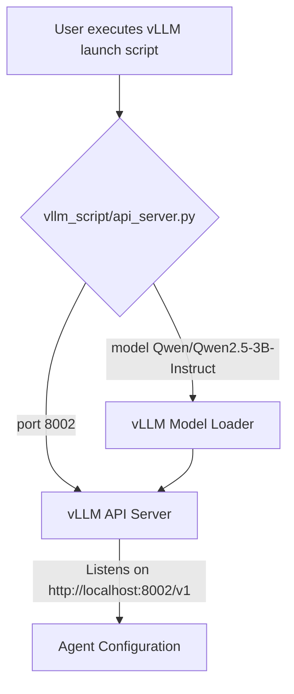
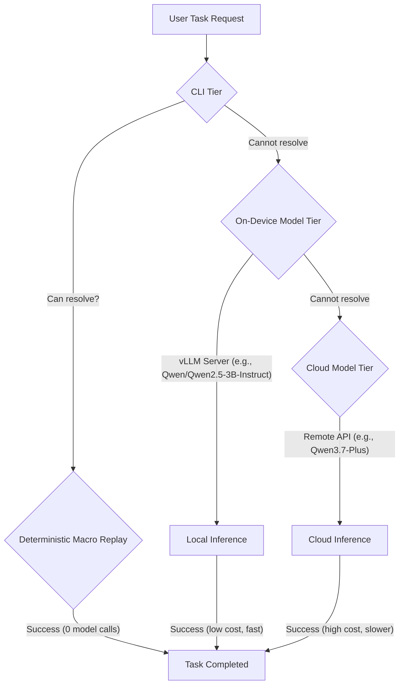

<!-- source: DeepWiki mcp.deepwiki.com · repo HKUDS/PhoneCLI · page 5.3 Model Serving with vLLM · fetched 2026-11-09 -->

# 5.3. Model Serving with vLLM

<details>
<summary>Relevant source files</summary>

The following files were used as context for generating this wiki page:

- [README.md](README.md)
- [README_CN.md](README_CN.md)
- [configs/example_xml_cloud_hyper.yaml](configs/example_xml_cloud_hyper.yaml)
- [figures/phone_cli.png](figures/phone_cli.png)

</details>


This page details the setup for serving models using vLLM, focusing on the `vllm_script/` launch configurations, how `api_base` is wired into agent configurations, and the considerations for selecting between on-device and cloud models. The PhoneCLI framework supports a three-tier execution strategy: CLI, on-device model, and cloud model, prioritizing efficiency and cost-effectiveness [README.md:51-55]().

## vLLM Script Launch Configuration

The `vllm_script/` directory contains scripts and configurations for launching language models using vLLM. vLLM is an open-source library for fast LLM inference, which is crucial for achieving the sub-second response times required by the PhoneCLI agent.

The primary script for launching a vLLM server is typically found within this directory. It handles:
*   **Model Loading**: Specifying the model to be loaded, such as `Qwen/Qwen2.5-3B-Instruct`.
*   **Hardware Configuration**: Allocating GPU resources and other hardware-specific settings.
*   **API Endpoint**: Defining the `api_base` URL and port where the vLLM server will listen for requests.

A typical vLLM launch command might look like this:
```bash
python -m vllm.entrypoints.api_server --model Qwen/Qwen2.5-3B-Instruct --tensor-parallel-size 1 --port 8002
```
This command launches a vLLM API server, loading the `Qwen/Qwen2.5-3B-Instruct` model, using a single GPU (`--tensor-parallel-size 1`), and listening on port `8002`.

### vLLM Server Configuration Flow


Title: vLLM Server Launch and Configuration Flow
Sources: `vllm_script/` (conceptual), `configs/example_xml_cloud_hyper.yaml` (conceptual)

## API Base Wiring into Agent Configurations

Once a vLLM server is running, the PhoneCLI agent needs to know how to connect to it. This is achieved by configuring the `api_base` parameter within the agent's configuration files.

For example, in `configs/example_xml_cloud_hyper.yaml`, the `agent` block specifies the `api_base` and `model_name`:
```yaml
agent:
    name: OpenAIAgent
    args:
        api_key: "EMPTY"
        api_base: "http://localhost:8002/v1"
        model_name: "Qwen/Qwen2.5-3B-Instruct"
        max_new_tokens: 6144
```
[configs/example_xml_cloud_hyper.yaml:1-7]()

Here, `api_base: "http://localhost:8002/v1"` directs the `OpenAIAgent` to send its requests to the locally running vLLM server. The `model_name` parameter specifies which model the agent expects to interact with, ensuring consistency between the server and the client. The `api_key: "EMPTY"` indicates that no API key is required for local vLLM instances.

This configuration allows the agent to utilize the locally served model for its operations, particularly for VLM fallback scenarios where a model call is necessary.

### Agent-Model Communication Diagram

```mermaid
graph TD
    A[Agent Configuration] --> B{agent.args.api_base: "http://localhost:8002/v1"};
    A --> C{agent.args.model_name: "Qwen/Qwen2.5-3B-Instruct"};
    B --> D[llm_client.py];
    C --> D;
    D -- "HTTP POST to /v1/chat/completions" --> E[vLLM API Server];
    E -- "Model Inference" --> F[Qwen/Qwen2.5-3B-Instruct];
    F --> E;
    E -- "Response" --> D;
    D --> G[PhoneAgent Execution Loop];
```
Title: Agent-vLLM Communication Flow
Sources: `configs/example_xml_cloud_hyper.yaml:1-7`(), `llm_client.py` (conceptual), `agent.py` (conceptual)

## On-Device vs. Cloud Model Selection

PhoneCLI employs a three-tier execution strategy to optimize performance and cost: CLI, on-device model, and cloud model [README.md:51-55](). This strategy dictates which model is used for a given task, with a preference for faster and cheaper options.

1.  **CLI Tier**: This is the fastest and cheapest tier, involving zero model calls. It handles navigation and deterministic actions using pre-compiled `app_map` and `screen_macros` [README.md:53]().
2.  **On-Device Model Tier**: If the CLI tier cannot resolve the task, the system falls back to an on-device model. This model, often a smaller, optimized version like the OpenPhone-3B model, runs locally via vLLM. This tier is faster and more private than cloud models, incurring minimal cost. The `Qwen/Qwen2.5-3B-Instruct` model served via vLLM is an example of such an on-device model.
3.  **Cloud Model Tier**: As a last resort, if the on-device model cannot handle the task, the system escalates to a more powerful, typically larger, cloud-based VLM. This tier is the most expensive and slowest but offers the highest capability. Examples include `Qwen3.7-Plus` [README.md:57]().

The selection between on-device and cloud models is managed by the agent's execution logic. The `api_base` configuration determines whether the agent attempts to use a local vLLM instance (on-device) or a remote API endpoint (cloud). By default, the `example_xml_cloud_hyper.yaml` configuration points to a local vLLM server, effectively configuring the agent to use an "on-device" model (though it runs on the host machine, it's local to the PhoneCLI setup rather than a remote cloud service).

This tiered approach significantly reduces cloud API calls and token usage, leading to improved efficiency and lower operational costs [README.md:60-61]().

### Three-Tier Execution Model


Title: PhoneCLI Three-Tier Execution Strategy
Sources: `README.md:51-55`(), `README.md:57`(), `configs/example_xml_cloud_hyper.yaml:1-7`()

---

