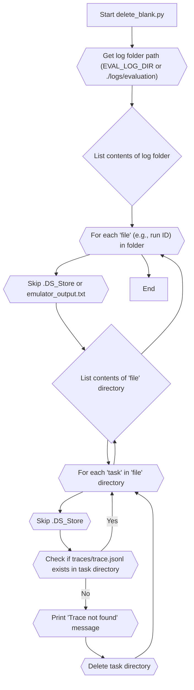

<!-- source: DeepWiki mcp.deepwiki.com · repo HKUDS/PhoneCLI · page 6.2 Test Scripts and Utilities · fetched 2026-11-09 -->

# Test Scripts and Utilities

Relevant source files

The following files were used as context for generating this wiki page:

- [.gitignore](.gitignore)
- [phonecli_android/.gitignore](phonecli_android/.gitignore)
- [tools/delete_blank.py](tools/delete_blank.py)

This page details the various test scripts and utility tools available in the PhoneCLI codebase. It covers the batch execution scripts found in `test_script/`, helper utilities in `tools/`, the logging directory structure under `logs/`, and the `.gitignore` conventions used throughout the project.

## Batch Test Execution

The `test_script/` directory contains various shell scripts designed for batch execution of tests and other operations. These scripts automate common workflows, making it easier to run multiple tasks or perform repetitive actions.

## Utility Tools

The `tools/` directory houses helper scripts that assist in development and maintenance. One such utility is `delete_blank.py`, which helps in cleaning up incomplete test logs.

### `delete_blank.py`

The `delete_blank.py` script is used to remove directories corresponding to incomplete test runs. It iterates through the log directories and deletes any task directory that does not contain a `traces/trace.jsonl` file, indicating an incomplete or failed run.

**Diagram: `delete_blank.py` Workflow**

The script takes an optional command-line argument for the folder path, defaulting to the `EVAL_LOG_DIR` environment variable or `./logs/evaluation` if not provided [tools/delete_blank.py:5-5](). It then iterates through subdirectories, which typically represent different test runs or configurations [tools/delete_blank.py:8-11](). For each task within these runs, it checks for the existence of `traces/trace.jsonl` [tools/delete_blank.py:15-15](). If this file is missing, the entire task directory is removed [tools/delete_blank.py:17-18]().

Sources:
* [tools/delete_blank.py:1-18]()

## Logging Layout

The project organizes its logs under the `logs/` directory. This structure is crucial for managing and analyzing the output of various test runs and agent executions. The `delete_blank.py` script, for instance, operates on this directory structure [tools/delete_blank.py:5-5]().

## `.gitignore` Conventions

The project utilizes `.gitignore` files to specify intentionally untracked files that Git should ignore. This helps keep the repository clean and focused on source code.

The main `.gitignore` file at the project root includes common patterns for macOS-specific files like `.DS_Store` and Python bytecode/cache files such as `__pycache__/` and `*.py[cod]` [.gitignore:1-6]().

The `phonecli_android/` subdirectory has its own `.gitignore` file, which specifies additional patterns relevant to the Android harness. This includes runtime artifacts like `logs/`, `.env` files, and `*.log` files, which are typically generated during execution and should not be committed to the repository [phonecli_android/.gitignore:1-7]().

Sources:
* [.gitignore:1-6]()
* [phonecli_android/.gitignore:1-7]()

---

