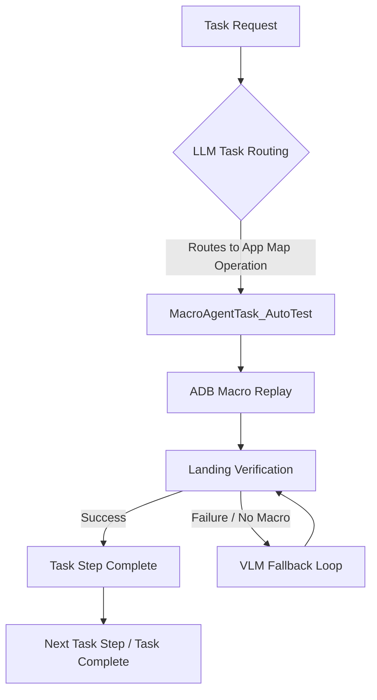

<!-- source: DeepWiki mcp.deepwiki.com · repo HKUDS/PhoneCLI · page 7 Glossary · fetched 2026-11-09 -->

# Glossary

<details>
<summary>Relevant source files</summary>

The following files were used as context for generating this wiki page:

- [README.md](README.md)
- [README_CN.md](README_CN.md)
- [config_env.py](config_env.py)
- [figures/phone_cli.png](figures/phone_cli.png)
- [phonecli/README.md](phonecli/README.md)
- [phonecli_android/README.md](phonecli_android/README.md)
- [phonecli_android/README_CN.md](phonecli_android/README_CN.md)

</details>


This page provides definitions for key terms and concepts used throughout the PhoneCLI codebase and documentation. It aims to clarify technical jargon and provide pointers to relevant files and symbols for deeper understanding.

## App Map

An `app map` is a YAML file that encodes an application's navigation structure. It represents screens as nodes and interactive elements as edges, detailing their coordinates, stability, and navigation targets. This map allows the agent to perform deterministic actions without relying on a VLM, significantly speeding up navigation and reducing model calls.

**Implementation Details:**
App maps are generated by a Breadth-First Search (BFS) crawler that explores an app's UI. For Android, this is handled by `build_android_map.py` [phonecli_android/README.md:34-36](). For iOS, a 5-stage pipeline involving `profile_builder.py`, `build_map.py`, `validate_map.py`, and `sanitize_map.py` is used [phonecli/README.md:23-27](). The structure includes `screens` with `id`, `description`, and `elements`, and `screen_macros` for precise replay sequences [README_CN.md:134-147]().

**Example Structure:**
```yaml
app: Clock
package: com.google.android.deskclock
screen_w: 1440
screen_h: 3120
launch_behavior: resume_last
screens:
  - id: screen_0
    description: "Main Alarm screen with the alarm list and bottom navigation."
    elements:
      - text: Alarm
        center: [0.1295, 0.0821]      # Normalized coordinates
        fixed: false
        found_at_scroll: 0
        leads_to: screen_0            # Self-loop = no navigation
        aliases: [闹钟, alarms, alarm tab]
        semantic_type: tab
screen_macros:                        # Full replay path from screen_0, absolute pixels
  screen_1:
    - {action: force_stop, package: com.google.android.deskclock, wait: 0.5}
    - {action: launch,     package: com.google.android.deskclock, wait: 3.0}
    - {action: tap, x: 1370, y: 256, wait: 1.5}
common_tasks:
  - Create and configure a new alarm
  - Use the stopwatch to track elapsed time
known_limitations:
  - Bedtime feature requires completing an onboarding flow before it can be used
```

**Diagram: App Map Generation and Usage**
```mermaid
graph TD
    subgraph "Offline Phase"
        A[BFS Crawler] --> B{Device UI}
        B --> C[Element Classification & Enrichment (LLM)]
        C --> D[App Map YAML]
    end

    subgraph "Online Phase"
        E[Agent Task] --> F{App Map Lookup}
        F -- "Match Found" --> G[Macro Replay (ADB/WDA)]
        G --> H[Landing Verification]
        H -- "Success" --> I[Task Complete]
        F -- "No Match / Failure" --> J[VLM Fallback]
        J --> H
    end

    D -- "Loaded by evaluation/app_map.py" --> F
    G -- "Uses ADB/WDA" --> B
```
Sources: [README.md:51-53](), [README_CN.md:49-53](), [phonecli_android/README.md:8-10](), [phonecli_android/README.md:14-15](), [phonecli_android/README.md:34-36](), [phonecli_android/README_CN.md:108-111](), [phonecli_android/README_CN.md:145-176](), [phonecli/README.md:23-27]()

## Screen Macro

A `screen_macro` is a sequence of deterministic actions (e.g., `tap`, `scroll`, `type`) recorded for a specific screen within an app map. These macros allow the agent to navigate and interact with the UI at sub-second speeds and zero VLM cost, as they are direct replays of predefined actions. They are stored within the `app map` YAML under the `screen_macros` key [README_CN.md:164-168]().

**Implementation Details:**
Macros are generated during the app map building process. For Android, they involve ADB commands [phonecli_android/README.md:8-10](), and for iOS, they use WebDriverAgent (WDA) commands [phonecli/README.md:5-7](). The `MacroAgentTask` utilizes these macros for initial task execution.

Sources: [README.md:51-53](), [README_CN.md:49-53](), [phonecli_android/README.md:8-10](), [phonecli_android/README_CN.md:164-168](), [phonecli/README.md:5-7]()

## Landing Verification

`Landing verification` is a process where the agent checks if it has successfully reached the expected screen after executing a `screen_macro` or a VLM action. This step is crucial for ensuring the reliability of the agent's navigation and interaction. If verification fails, the agent might fall back to a VLM-driven approach.

**Implementation Details:**
In the Android harness, `MacroAgentTask_AutoTest` performs landing verification after an ADB macro replay [phonecli_android/README.md:28-29](). This typically involves comparing the current screen's state (e.g., UI elements, screen ID) against the expected state defined in the app map.

Sources: [phonecli_android/README.md:28-29]()

## MacroAgentTask

`MacroAgentTask` (specifically `MacroAgentTask_AutoTest` in the Android harness) is an agent implementation that leverages `app maps` and `screen_macros` for efficient task execution. It attempts to fulfill a task by first routing to a deterministic ADB `macro replay`. If the macro execution is successful and passes `landing verification`, the task proceeds. If not, it falls back to a VLM-driven approach.

**Implementation Details:**
The `MacroAgentTask_AutoTest` class is defined within the `evaluation/` directory and is a core component of the PhoneCLI agent in the AndroidLab benchmark [phonecli_android/README.md:25-31](). It orchestrates the two-phase execution: macro replay followed by VLM fallback.

**Diagram: MacroAgentTask Execution Flow**

Sources: [phonecli_android/README.md:25-31]()

## VLM Fallback

`VLM fallback` is a mechanism where the agent switches from using deterministic `screen_macros` to a Vision-Language Model (VLM) when the `app map` cannot handle the current screen or task. This typically occurs if a macro fails `landing verification`, or if the task requires interacting with dynamic or previously unseen UI elements. This ensures robustness by allowing the agent to adapt to unexpected situations.

**Implementation Details:**
In the Android harness, `MacroAgentTask_AutoTest` explicitly mentions a "Round 2+ VLM loop (fallback)" [phonecli_android/README.md:29](). This means that after attempting macro replay, if the task is not completed or an error occurs, the agent will resort to VLM calls to analyze the screen and determine the next action.

Sources: [README.md:51-53](), [README_CN.md:49-53](), [phonecli_android/README.md:29]()

## AVD/Cold-Boot Snapshot

An `AVD/cold-boot snapshot` refers to the process of cloning an Android Virtual Device (AVD) and booting it from a clean state for each task or app map building process. This ensures a consistent and isolated environment, preventing state leakage between runs and providing a reproducible starting point. "Cold-boot" implies starting the AVD from a completely powered-off state.

**Implementation Details:**
The `eval.py` script in `phonecli_android` clones an AVD per task and restores a clean snapshot [phonecli_android/README.md:63](). Similarly, `build_android_map.py` manages the AVD lifecycle, including cloning and headless booting [phonecli_android/README.md:124-126](). The default AVD name is `Pixel_7_Pro_API_33` [phonecli_android/README.md:142]().

Sources: [phonecli_android/README.md:63](), [phonecli_android/README.md:124-126](), [phonecli_android/README.md:142]()

## Trace

A `trace` is a detailed log of an agent's execution for a specific task. It records every step taken, including observations (screenshots, UI hierarchies), agent decisions (macro replay, VLM calls), and actions performed. These traces are crucial for debugging, analysis, and `LLM judging` of task success.

**Implementation Details:**
Traces are typically stored as `trace.jsonl` files [evaluation/README.md:100](). The `run_eval_judge.py` script processes these traces for evaluation [phonecli_android/README.md:101-103]().

Sources: [phonecli_android/README.md:101-103]()

## OP/NEED_VLM Routing Tags

`OP` and `NEED_VLM` are routing tags used by the agent to categorize and prioritize actions.
*   **OP (Operation)**: This tag indicates that an action can be handled by a deterministic `screen_macro` from the `app map`. These actions are executed quickly and without VLM involvement.
*   **NEED_VLM**: This tag signifies that an action requires the use of a Vision-Language Model (VLM) because it cannot be resolved by an existing `screen_macro` or involves dynamic content. This triggers the `VLM fallback` mechanism.

**Implementation Details:**
These tags are part of the agent's internal decision-making process, guiding whether to use the CLI/macro path or escalate to a VLM. The `MacroAgentTask` in the Android harness uses a two-phase routing that implicitly handles these distinctions [phonecli_android/README.md:27-29]().

Sources: [phonecli_android/README.md:27-29]()

## PII Sanitization

`PII sanitization` is the process of detecting and redacting Personally Identifiable Information (PII) from collected data, particularly from screenshots and UI element texts, before it is used for `app map` building or model training. This is a critical step for privacy and security.

**Implementation Details:**
For iOS, `sanitize_map.py` is the fifth stage in the `app map` build pipeline, where an LLM batch-detects and replaces personal data [phonecli/README.md:209](). This ensures that sensitive information is not inadvertently stored in the app maps or used in subsequent processes.

Sources: [phonecli/README.md:209]()

## Profile

A `profile` in the context of iOS `app map` building is an app-specific configuration generated by an LLM. It contains information such as `dynamic_patterns` (patterns for dynamic UI elements) and `preserve_navigation` rules, which help the BFS crawler and element classification process.

**Implementation Details:**
`profile_builder.py` is responsible for generating these profiles, which is the second stage in the iOS `app map` auto-build pipeline [phonecli/README.md:206](). These profiles guide the subsequent crawling and enrichment stages.

Sources: [phonecli/README.md:206]()

## WDA (WebDriverAgent)

`WDA` stands for WebDriverAgent, an open-source iOS test automation framework developed by Facebook. It exposes an HTTP API that allows programmatic control of iOS devices, including taking screenshots, tapping elements, and interacting with the UI. PhoneCLI uses WDA as its primary device control mechanism for iOS.

**Implementation Details:**
The `phonecli/` directory contains the iOS harness, which is built on top of WDA [phonecli/README.md:5-7](). Installation and setup instructions for WDA are detailed in the iOS README [phonecli/README.md:41-102](). The `cli.py` interacts with WDA via HTTP [phonecli/README.md:16]().

**Diagram: WDA in PhoneCLI (iOS)**
```mermaid
graph TD
    A[PhoneCLI Agent (agent.py)] --> B[cli.py]
    B -- "HTTP Commands" --> C[WebDriverAgent (on iOS device)]
    C -- "UI Actions / Screenshots" --> D[iOS Device UI]
    D -- "UI State" --> C
    C -- "HTTP Responses" --> B
```
Sources: [phonecli/README.md:5-7](), [phonecli/README.md:16](), [phonecli/README.md:41-102]()

## GRPO (Gradient-based Reward Policy Optimization)

`GRPO` is a reinforcement learning algorithm used for training the OpenPhone model. It is a policy optimization method that aims to improve the agent's decision-making by optimizing a reward function based on gradients. In the context of PhoneCLI, GRPO is used for fine-tuning the model to better perform mobile tasks.

**Implementation Details:**
The `model_training/` directory contains the GRPO setup, and `grpo_agent.py` is involved in the reward design for this training phase [README.md:84]().

Sources: [README.md:84]()

## SFT (Supervised Fine-Tuning)

`SFT` refers to Supervised Fine-Tuning, a common technique in machine learning where a pre-trained model is further trained on a labeled dataset to adapt it to a specific task. In PhoneCLI, SFT is used as an initial training step for the OpenPhone model, leveraging synthetic data generated by `data_maker.py` and `sft_data_maker.py`.

**Implementation Details:**
The `model_training/` directory includes LLaMA-Factory SFT scripts for models like Qwen2.5-VL-3B [README.md:84](). The `prepare_data/` directory contains scripts like `sft_data_maker.py` for preparing the SFT dataset [README.md:84]().

Sources: [README.md:84]()

## OpenPhone-3B

`OpenPhone-3B` is the open 3-billion parameter on-device model shipped with PhoneCLI. It serves as the engine for the VLM fallback path and is designed to be efficient enough to run on mobile devices. While the CLI path requires no model, OpenPhone-3B handles situations where VLM capabilities are needed.

**Implementation Details:**
The model is trained using a combination of SFT and GRPO [README.md:84](). It is designed to be open and replaceable, allowing users to substitute it with other LLMs or GUI-tuned models [README.md:55]().

Sources: [README.md:55](), [README.md:84]()

## AndroidLab

`AndroidLab` is a benchmark suite consisting of 9 Android applications and 138 tasks, used to evaluate the performance of mobile agents. PhoneCLI's Android harness is specifically designed to run and evaluate agents against this benchmark.

**Implementation Details:**
The `phonecli_android/` directory contains the Android GUI-agent harness for the AndroidLab benchmark [phonecli_android/README.md:5-7](). The `evaluation/config/` directory holds task specifications for the 9 benchmark apps [phonecli_android/README_CN.md:180-181]().

Sources: [README.md:57](), [phonecli_android/README.md:5-7](), [phonecli_android/README_CN.md:180-181]()

## Judge Model

A `judge model` is an LLM used to automatically evaluate the success or failure of an agent's execution of a task. After an agent completes a task and generates a `trace`, the judge model analyzes the trace and determines if the task's objectives were met.

**Implementation Details:**
The `llm_evaluator.py` script is responsible for `LLM judging`, and the `run_eval_judge.py` script orchestrates the judging pipeline [evaluation/README.md:100](). This process generates `results.jsonl` and `total.jsonl` reports.

Sources: [evaluation/README.md:100]()

## Cloud Step

A `cloud step` refers to an action or decision made by the agent that requires an API call to a cloud-hosted Vision-Language Model (VLM) or Large Language Model (LLM). These steps are typically slower and more expensive than local, deterministic actions. PhoneCLI aims to minimize cloud steps by leveraging `app maps` and `screen_macros`.

**Implementation Details:**
The PhoneCLI architecture prioritizes `CLI → on-device model → cloud` execution, with the CLI tier absorbing navigation at zero model cost, thus reducing cloud calls [README.md:54](). The `ScreenshotCloudTask_AutoTest` in the Android harness represents a baseline agent that performs one VLM call per round, effectively making every step a cloud step [phonecli_android/README.md:27-29]().

Sources: [README.md:54](), [phonecli_android/README.md:27-29]()