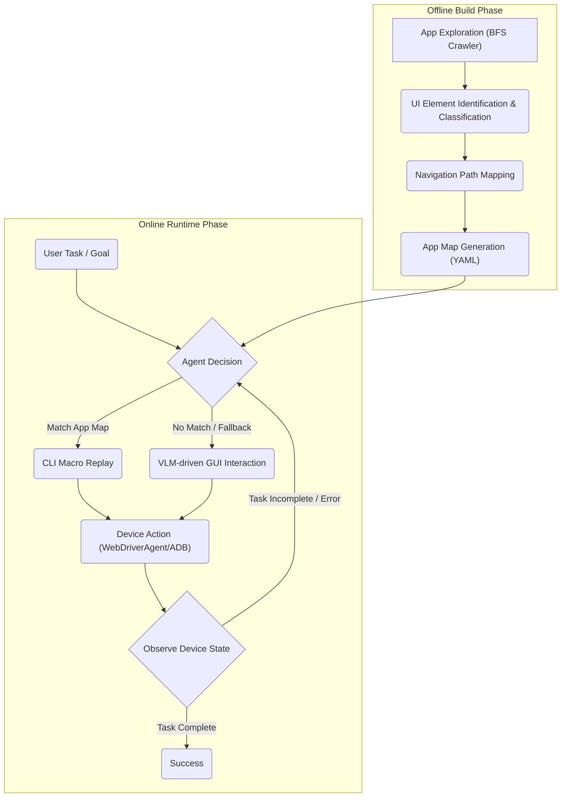
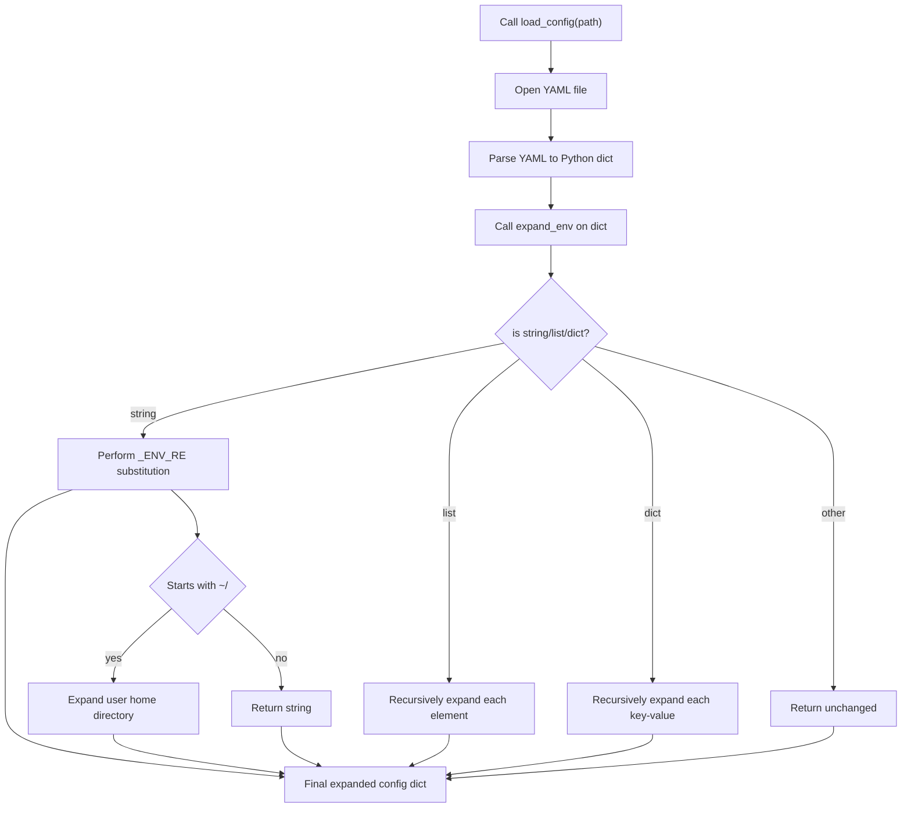
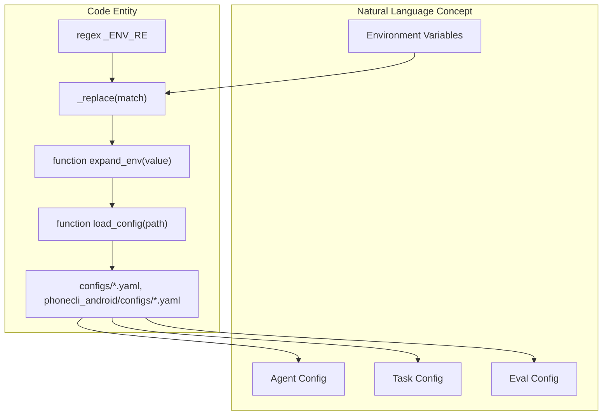
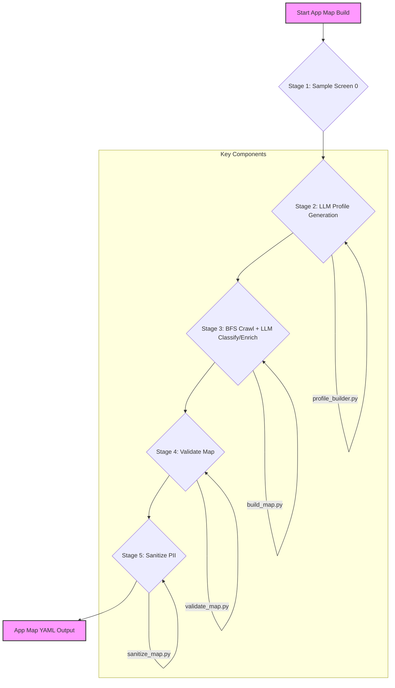
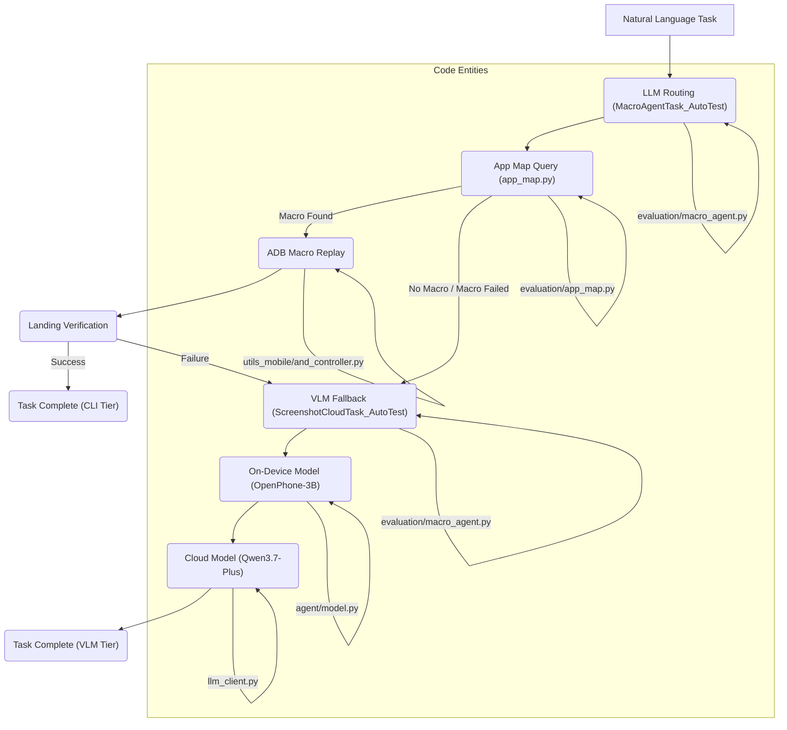
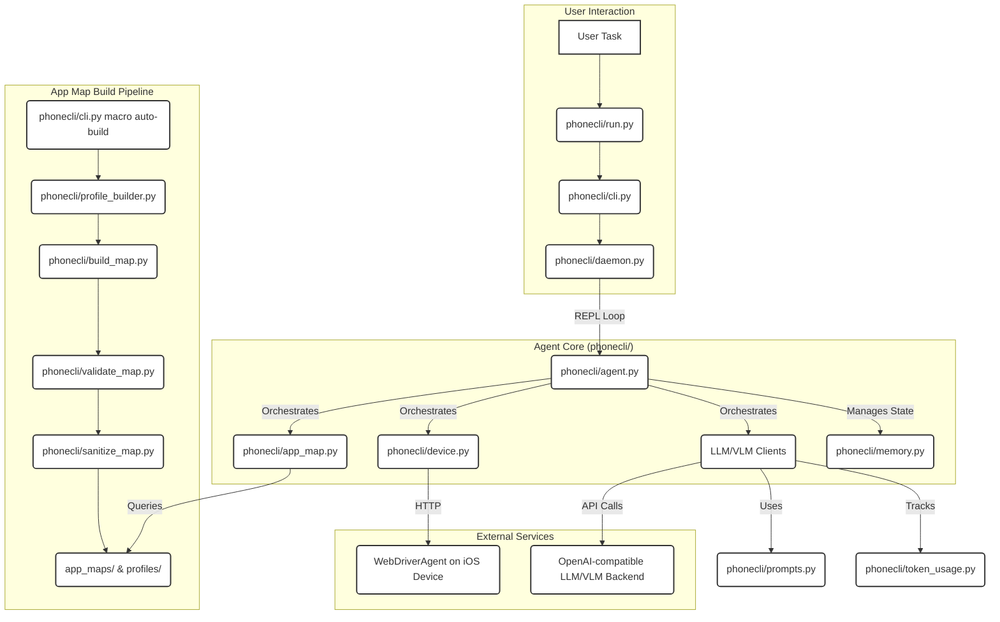
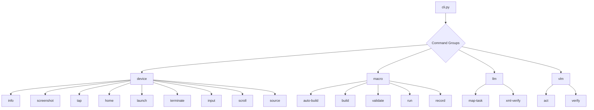
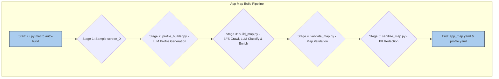
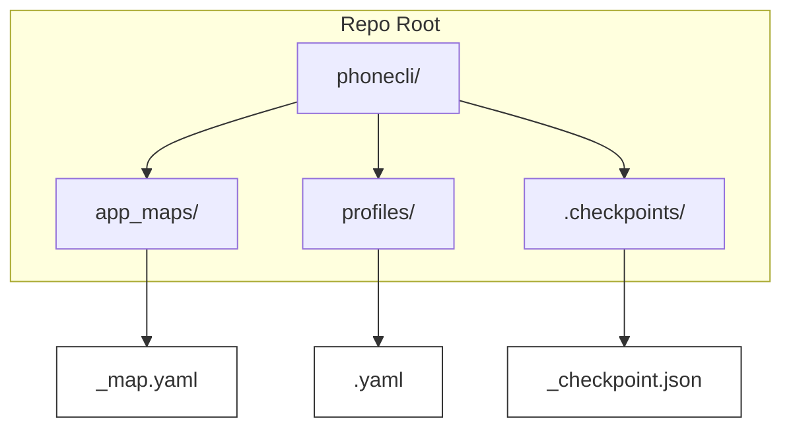

# Page: Overview

# Overview

<details>
<summary>Relevant source files</summary>

The following files were used as context for generating this wiki page:

- [README.md](README.md)
- [README_CN.md](README_CN.md)
- [figures/phone_cli.png](figures/phone_cli.png)
- [figures/phonecli_attribution.png](figures/phonecli_attribution.png)
- [figures/phonecli_case.png](figures/phonecli_case.png)
- [figures/phonecli_framework.png](figures/phonecli_framework.png)
- [figures/phonecli_log.png](figures/phonecli_log.png)

</details>


PhoneCLI, also known as OpenPhone, is a novel approach to mobile agent development that combines the efficiency of Command Line Interface (CLI) macro replay with the robustness of Visual Language Model (VLM) fallback. This dual-modality system aims to make all mobile applications "agent-native" by compiling app navigation into deterministic commands, significantly reducing reliance on costly and slow VLM calls for routine tasks. This page provides a high-level overview of PhoneCLI's architecture, its core components, and key results, with links to dedicated child pages for in-depth technical details.

Sources:
- [README.md:9-10]()
- [README.md:47-55]()

## What PhoneCLI/OpenPhone Is

PhoneCLI addresses the limitations of traditional GUI agents that rely solely on VLM for every step, which is often slow, expensive, and prone to errors [README.md:47-47](). Instead, it introduces a hybrid approach:

1.  **Harness (GUI + CLI, two modalities)**: An offline process uses a BFS crawler to build a YAML-based "app map" of an application's navigation. Each screen in the app map corresponds to a deterministic command. During online execution, these commands are replayed on the device (via WebDriverAgent on iOS or ADB on Android) in sub-second time with zero VLM cost. If a CLI path fails or encounters an unmapped screen, it falls back to a GUI mode, which can utilize a VLM. This compilation strategy ensures that routine navigation is handled efficiently, while novel situations can still be addressed by a VLM [README.md:51-53]().
2.  **On-device first (one request, three tiers)**: Requests are processed through a three-tier system: CLI → on-device model → cloud. The CLI tier handles navigation without any model calls. Only the remaining, more complex steps are passed to an on-device model, and finally to a cloud-based VLM if needed. This tiered approach significantly reduces cloud API calls and leverages an efficient memory system to maintain context over 10-20 steps [README.md:54-54]().
3.  **Open and replaceable model**: The CLI path requires no model. The VLM fallback path can use any general LLM or a GUI-tuned model. PhoneCLI ships with an open 3B on-device model, emphasizing that the harness and compilation are the core innovation, not just the model size [README.md:55-55]().

### PhoneCLI Framework Overview

The PhoneCLI framework operates in two main phases: an offline build phase and an online runtime phase. The build phase constructs an "app map" by systematically exploring the application's UI. The runtime phase then leverages this app map for efficient, deterministic command execution, falling back to VLM-driven GUI interaction when necessary.


Sources:
- [README.md:44-45]()
- [README_CN.md:128-130]()
- [figures/phonecli_framework.png]()

## Repository Layout

The PhoneCLI codebase is organized into several key directories, each responsible for a specific aspect of the system:

*   `phonecli/`: Contains the core iOS harness, including the CLI, agent execution loop, and app map build pipeline for iOS devices.
*   `phonecli_android/`: Houses the Android agent harness, which includes components for task execution, macro agents, device control via ADB, and Android app map building. This directory also integrates with the AndroidLab benchmark.
*   `evaluation/`: Dedicated to the evaluation framework, including task definitions, LLM judging, and result aggregation for benchmark runs.
*   `model_training/`: Contains scripts and configurations for training the OpenPhone model, covering SFT and GRPO training.
*   `prepare_data/`: Responsible for data preparation, including data synthesis and conversion for model training.
*   `docs/`: Provides documentation, including setup guides and developer resources.

## Key Results

PhoneCLI demonstrates significant improvements over pure VLM-based approaches, particularly on the AndroidLab benchmark (9 apps / 138 tasks). Using Qwen3.7-Plus as the cloud model, PhoneCLI achieved:

*   **63.0% vs 50.7% task success**: A **+12.3 percentage point** improvement over the pure-VLM baseline.
*   **7.52 → 6.72 steps (-11%)**: Fewer model calls for the same tasks.
*   **40.1k → 34.4k tokens (-14%)**: Reduced token usage.
*   **0 model calls** for executing compiled commands, enabling sub-second, deterministic navigation replay.

These results highlight the efficiency gains and improved reliability offered by the dual-modality approach [README.md:57-62]().

## Getting Started & Environment Setup

To begin using PhoneCLI, you'll need to set up your environment, including installing necessary requirements, configuring Android SDK/AVD for Android development, or WebDriverAgent for iOS. Detailed instructions are available in the child pages, covering environment variables and how to run your first task.

For details, see [Getting Started & Environment Setup](#1.1).

## Configuration System

PhoneCLI utilizes a flexible configuration system, primarily managed through `config_env.py` [phonecli_android/config_env.py](). This system allows for loading and expanding environment variables within configuration files, supporting `${VAR:-default}` syntax for default values. Configurations are typically defined in YAML files, with schemas for agent, task, and evaluation blocks.

For details, see [Configuration System](#1.2).

## Core Concepts: App Maps, Macros, Three-Tier Execution

At the heart of PhoneCLI are several core concepts that enable its efficient operation:

*   **App Maps**: These are YAML-based representations of an application's navigation structure, encoding screens, interactive elements, and transition paths [README_CN.md:134-147]().
*   **Screen Macros**: Deterministic sequences of actions associated with specific screens, allowing for rapid, model-free execution of common navigation patterns.
*   **Landing Verification**: Mechanisms to ensure that the agent has successfully navigated to the expected screen after an action.
*   **VLM Fallback**: The system's ability to switch to VLM-driven GUI interaction when app map-based navigation is insufficient.
*   **Three-Tier Execution**: The hierarchical routing of requests through CLI, on-device model, and cloud model tiers to optimize performance and cost.

For details, see [Core Concepts: App Maps, Macros, Three-Tier Execution](#1.3).

Sources:
- [README_CN.md:134-147]()

---

# Page: Getting Started & Environment Setup

# 1.1. Getting Started & Environment Setup

<details>
<summary>Relevant source files</summary>

The following files were used as context for generating this wiki page:

- [README.md](README.md)
- [README_CN.md](README_CN.md)
- [figures/phone_cli.png](figures/phone_cli.png)
- [phonecli_android/README.md](phonecli_android/README.md)
- [phonecli_android/README_CN.md](phonecli_android/README_CN.md)
- [phonecli_android/requirements.txt](phonecli_android/requirements.txt)

</details>


This page provides a comprehensive guide to setting up your development environment for PhoneCLI, covering essential prerequisites, Android SDK/AVD configuration, iOS WebDriverAgent setup, environment variables, and a quick start to running your first task.

## Prerequisites and Environment Setup

To begin, you need to set up a Python environment and install the necessary dependencies. PhoneCLI supports both Android and iOS platforms, each with specific setup requirements.

### Python Environment

It is recommended to use `conda` for managing your Python environment.

1.  **Create a new conda environment**:
    ```bash
    conda create -n Android-Lab python=3.11
    ```
    [phonecli_android/README.md:56-56]()
2.  **Activate the environment**:
    ```bash
    conda activate Android-Lab
    ```
    [phonecli_android/README.md:57-57]()
3.  **Install Python dependencies**:
    ```bash
    pip install -r requirements.txt
    ```
    [phonecli_android/README.md:58-58]()

The `requirements.txt` file [phonecli_android/requirements.txt:1-39]() lists all Python packages needed, including `backoff`, `InquirerPy`, `lxml`, `openai`, `numpy`, `protobuf`, `BeautifulSoup4`, `toml`, `aioconsole`, `python-dotenv`, `gymnasium`, `Pillow`, `evaluate`, `types-tqdm`, `tiktoken`, `aiolimiter`, `beartype`, `flask`, `nltk`, `text-generation`, `opencv-python`, `argparse`, `colorama`, `dashscope`, `pyshine`, `pyyaml`, `requests`, `Levenshtein`, `zhipuai`, `xmltodict`, `google.auth`, `docker`, `fuzzywuzzy`, `openpyxl`, `pandas`, and `datasets`.

Sources:
- [phonecli_android/README.md:56-58]()
- [phonecli_android/requirements.txt:1-39]()

### Android SDK and AVD Setup

For Android development, you need the Android SDK and a configured Android Virtual Device (AVD).

1.  **Android SDK**: Ensure you have the Android SDK installed.
2.  **Android Virtual Device (AVD)**:
    *   An Android 13 (API 33) AVD named `Pixel_7_Pro_API_33` is required. This AVD should be located under `~/.android/avd/`. The `eval.py` script clones this AVD for each task and restores a clean snapshot [phonecli_android/README.md:61-64]().
    *   The pre-built app maps are designed for a device resolution of **1440 × 3120** [phonecli_android/README.md:65-66]().
    *   Detailed step-by-step instructions for SDK/AVD setup can be found in `docs/prepare_for_mac.md` and `docs/prepare_for_linux.md` [phonecli_android/README.md:67-67]().

Sources:
- [phonecli_android/README.md:61-67]()

### iOS WebDriverAgent Setup

For iOS, PhoneCLI leverages WebDriverAgent for device control. Detailed setup instructions are available in the iOS-specific documentation.

*   Refer to `phonecli/README.md` for comprehensive setup, WebDriverAgent configuration, app map building, CLI reference, and troubleshooting for iOS real devices [README.md:63-63]().

Sources:
- [README.md:63-63]()

## Environment Variables

Model API keys and other sensitive information are managed through environment variables.

*   **Model API Key**: Set your `OPENROUTER_API_KEY` environment variable.
    ```bash
    export OPENROUTER_API_KEY="sk-or-v1-..."
    ```
    [phonecli_android/README.md:71-71]()
*   **Secret-free Configuration**: Agent configurations are designed to be secret-free. The API key is referenced as `"${OPENROUTER_API_KEY}"` within configuration files and is expanded by `config_env.load_config()` when the configuration is loaded. If an environment variable is unset, it expands to an empty string [phonecli_android/README.md:73-76]().

Sources:
- [phonecli_android/README.md:71-76]()

## Running Your First Task (Android)

This section guides you through running a basic task on Android using PhoneCLI. Ensure you are in the `phonecli_android/` directory before executing these commands, as all paths are relative to this working directory [phonecli_android/README.md:39-42]().

1.  **Activate your conda environment and set the API key**:
    ```bash
    conda activate Android-Lab
    export OPENROUTER_API_KEY="sk-or-v1-..."
    ```
    [phonecli_android/README.md:90-91]()
2.  **Run a PhoneCLI task**: This command executes a task using the MacroAgent, which leverages pre-built app maps.
    ```bash
    python eval.py -c configs/test_macro.yaml -n macro_smoke \
      --task_config evaluation/config/setting.yaml --task_id setting_0
    ```
    [phonecli_android/README.md:94-96]()
    *   `-c configs/test_macro.yaml`: Specifies the configuration file for the MacroAgent. This file points to `app_maps/settings_android.yaml` for the app map [phonecli_android/README.md:106-107]().
    *   `-n macro_smoke`: Names the evaluation run.
    *   `--task_config evaluation/config/setting.yaml`: Specifies the task definition for the "Settings" app.
    *   `--task_id setting_0`: Identifies a specific task within the `setting.yaml` configuration.

3.  **Run the same task without PhoneCLI (baseline)**: This demonstrates the performance of a pure VLM loop without app maps or macro replay.
    ```bash
    python eval.py -c configs/test_screen_cloud.yaml -n cloud_smoke \
      --task_config evaluation/config/setting.yaml --task_id setting_0
    ```
    [phonecli_android/README.md:98-100]()
    *   `-c configs/test_screen_cloud.yaml`: Specifies the configuration for the baseline agent.

4.  **Score the recorded traces**: After running tasks, you can evaluate their performance.
    ```bash
    python run_eval_judge.py --traces logs/evaluation/macro_smoke \
      --config evaluation/config/setting.yaml --test-config configs/test_macro.yaml
    ```
    [phonecli_android/README.md:102-104]()
    *   `--traces logs/evaluation/macro_smoke`: Points to the directory containing the recorded traces from the `macro_smoke` run.
    *   `--config evaluation/config/setting.yaml`: Provides the task configuration for judging.
    *   `--test-config configs/test_macro.yaml`: Provides the agent configuration used during the test.

### Working Directory Importance

It is crucial to run all commands from the `phonecli_android/` directory. The codebase uses absolute imports rooted at the process working directory, and all configured paths (e.g., `./app_maps/...`, `./logs/...`, `./evaluation/config`) are relative. Running from the repository root using `python -m phonecli_android.eval` will cause import errors, such as `AttributeError: Class MacroAgentTask_AutoTest not found`, because `import evaluation` would resolve to the repository's own `evaluation/` package instead of the intended one within `phonecli_android/` [phonecli_android/README.md:39-48]().

Sources:
- [phonecli_android/README.md:39-48]()
- [phonecli_android/README.md:90-104]()
- [phonecli_android/README.md:106-107]()

## System Architecture for Android Task Execution

The Android task execution flow involves `eval.py` as the entry point, which orchestrates the cloning and booting of AVDs, and then runs tasks using either the `MacroAgentTask_AutoTest` (PhoneCLI) or `ScreenshotCloudTask_AutoTest` (baseline) agents.

### Android Task Execution Flow

The `eval.py` script acts as the primary task runner. It interacts with `evaluation/auto_test.py` to manage the AVD lifecycle, including cloning, booting, and running multiple tasks. Depending on the configuration, it instantiates either a `MacroAgentTask_AutoTest` for PhoneCLI-enabled execution or a `ScreenshotCloudTask_AutoTest` for the VLM-only baseline.

**MacroAgentTask_AutoTest (PhoneCLI)**:
*   **Round 1**: An LLM routes the task to an appropriate app map operation. This is followed by a deterministic ADB macro replay, which is sub-second and incurs zero VLM cost. Landing verification ensures the macro executed as expected.
*   **Round 2+**: If the initial macro replay fails or the task requires further interaction not covered by the app map, it falls back to a VLM loop.

**ScreenshotCloudTask_AutoTest (Baseline)**:
*   This agent operates purely on a VLM loop, making one VLM call per round. It does not utilize app maps or macro replay.

The `app_maps/<app>_android.yaml` files, which contain the screen, element, and screen macro definitions, are read by the `MacroAgentTask_AutoTest`. These app maps are built by `build_android_map.py`, which performs a BFS crawl of the app on a cloned AVD and enriches the discovered elements using an LLM.

```mermaid
graph TD
    A[eval.py "Task Runner"] --> B{Agent Selection};
    B -- "configs/test_macro.yaml" --> C[MacroAgentTask_AutoTest "PhoneCLI Agent"];
    B -- "configs/test_screen_cloud.yaml" --> D[ScreenshotCloudTask_AutoTest "Baseline Agent"];

    C -- "Round 1: LLM Task Routing" --> C1[ADB Macro Replay];
    C1 --> C2[Landing Verification];
    C2 -- "Success" --> E[Task Completion];
    C2 -- "Failure / Further Interaction Needed" --> C3[Round 2+: VLM Loop (Fallback)];
    C3 --> E;

    D -- "One VLM Call Per Round" --> D1[No App Map, No Replay];
    D1 --> E;

    C -- "Reads" --> F[app_maps/<app>_android.yaml "App Map"];
    G[build_android_map.py "App Map Builder"] -- "Builds" --> F;
    G -- "Clones AVD, BFS Crawl, LLM Enrich" --> F;

    subgraph AVD Management
        H[evaluation/auto_test.py] --> B;
        H -- "Clone AVD -> Boot -> N Tasks" --> C;
        H -- "Clone AVD -> Boot -> N Tasks" --> D;
    end

    style A fill:#f9f,stroke:#333,stroke-width:2px
    style C fill:#bbf,stroke:#333,stroke-width:2px
    style D fill:#fbb,stroke:#333,stroke-width:2px
    style F fill:#ccf,stroke:#333,stroke-width:2px
    style G fill:#cfc,stroke:#333,stroke-width:2px
    style H fill:#ffc,stroke:#333,stroke-width:2px
```
**Diagram: Android Task Execution Flow**

Sources:
- [phonecli_android/README.md:17-37]()

### App Map Building

The `build_android_map.py` script is responsible for creating the YAML app maps.

```bash
# Auto lifecycle: clone AVD → headless boot → BFS crawl → clean up
python build_android_map.py -p com.android.settings -a Settings \
  -o ./app_maps/settings_android.yaml

# Against an already-running device
python build_android_map.py -p com.android.settings -a Settings \
  -o ./app_maps/settings_android.yaml --device emulator-5554 \
  --max-screens 50 --max-depth 3 --scroll-pages 3
```
[phonecli_android/README.md:116-123]()

Key parameters for `build_android_map.py`:
*   `-p, --package`: Android package name (required).
*   `-a, --app`: Human-readable app name (required).
*   `-o, --output`: Output path for the YAML app map (default: `./app_maps/app_map.yaml`).
*   `-c, --config`: YAML config for AVD/SDK paths.
*   `-d, --device`: Use an existing device, skipping emulator lifecycle management.
*   `--avd-name`: Source AVD to clone (default: `Pixel_7_Pro_API_33`).
*   `--avd-base`: AVD home directory (default: `~/.android/avd`).
*   `--show-avd`: Display the emulator window (default: headless).
*   `--max-screens`: Cap on discovered screens (default: `50`).
*   `--max-depth`: Maximum navigation depth (default: `3`).
*   `--scroll-pages`: Number of scroll pages collected per screen (default: `3`).
*   `--no-classify`: Skip LLM stable/dynamic element classification.
*   `--no-enrich`: Skip LLM enrichment (aliases, semantic types, descriptions).
*   `--llm-api-key/base/model`: Override the LLM used for map building.
[phonecli_android/README.md:137-152]()

The structure of an app map YAML file includes `app`, `package`, `screen_w`, `screen_h`, `launch_behavior`, `screens` (with `id`, `description`, `elements` containing `text`, `center`, `fixed`, `leads_to`, `aliases`, `semantic_type`), `screen_macros` (sequences of actions like `force_stop`, `launch`, `tap` with absolute pixel coordinates), `common_tasks`, and `known_limitations` [phonecli_android/README.md:155-176]().

```mermaid
graph TD
    subgraph "App Map Building Process"
        A[Start build_android_map.py] --> B{AVD Management};
        B -- "No --device specified" --> C[Clone AVD: Pixel_7_Pro_API_33];
        C --> D[Headless Boot AVD];
        B -- "--device emulator-5554" --> E[Use Existing Device];
        D --> F[BFS Crawl App via ADB];
        E --> F;
        F --> G[Collect Screens and Elements];
        G --> H[LLM Classification & Enrichment];
        H --> I[Generate app_maps/<app>_android.yaml];
        I --> J[Cleanup AVD (if auto-managed)];
        J --> K[End];
    end

    subgraph "App Map YAML Structure (Example: settings_android.yaml)"
        L["app: Settings"] --> M["package: com.android.settings"];
        M --> N["screen_w: 1440"];
        N --> O["screen_h: 3120"];
        O --> P["screens:"];
        P --> Q["- id: screen_0"];
        Q --> R["description: 'Settings main page'"];
        R --> S["elements:"];
        S --> T["- text: Wi-Fi"];
        T --> U["center: [0.50, 0.15]"];
        U --> V["fixed: true"];
        V --> W["leads_to: screen_1"];
        P --> X["screen_macros:"];
        X --> Y["screen_1: [force_stop, launch, tap(195, 126)]"];
    end

    style A fill:#f9f,stroke:#333,stroke-width:2px
    style I fill:#ccf,stroke:#333,stroke-width:2px
    style L fill:#ccf,stroke:#333,stroke-width:2px
```
**Diagram: App Map Building and Structure**

Sources:
- [phonecli_android/README.md:116-123]()
- [phonecli_android/README.md:137-152]()
- [phonecli_android/README.md:155-176]()

---

# Page: Configuration System

# Configuration System

<details>
<summary>Relevant source files</summary>

The following files were used as context for generating this wiki page:

- [config_env.py](config_env.py)
- [configs/example_xml_cloud_hyper.yaml](configs/example_xml_cloud_hyper.yaml)
- [configs/glm-4-plus-mac-XML.yaml](configs/glm-4-plus-mac-XML.yaml)
- [configs/gpt-4o-mac-SoM.yaml](configs/gpt-4o-mac-SoM.yaml)
- [phonecli_android/config_env.py](phonecli_android/config_env.py)
- [phonecli_android/configs/test_macro.yaml](phonecli_android/configs/test_macro.yaml)
- [phonecli_android/configs/test_screen_cloud.yaml](phonecli_android/configs/test_screen_cloud.yaml)

</details>


This page documents the configuration system used throughout the PhoneCLI/OpenPhone codebase. It covers the `config_env.py` module responsible for loading and preprocessing YAML configuration files with environment variable expansion, the `${VAR:-default}` syntax semantics, and the common YAML schema structure used in the `configs/` directory for specifying agent, task, and evaluation blocks. Additionally, it highlights the Android-specific config usage under `phonecli_android/configs`.

---

## Purpose and Scope

The configuration system standardizes how runtime parameters, API keys, paths, and runtime toggles are defined for PhoneCLI/OpenPhone experiments and agent runs. The key goals are:

- **Portability:** Config files are secret-free and machine-independent by design.
- **Environment Variable Expansion:** Variables like `${OPENROUTER_API_KEY}`, `${ANDROID_SDK_PATH:-~/Library/Android/sdk}`, or user home `~` directory prefixes are dynamically resolved at load time.
- **Declarative YAML Structure:** All configurations adopt a three-block schema—`agent`, `task`, and `eval`—to modularly specify different aspects of an experiment run.
- **Reuse and Consistency** across iOS and Android agents with slight variations (e.g., `phonecli_android/config_env.py` reimplements the same logic for Android).

---

## Implementation and Data Flow

### 1. Environment Variable Expansion (`config_env.py`, `phonecli_android/config_env.py`)

Both `config_env.py` files (one at root and one for Android) provide the core logic to parse YAML config files and expand embedded environment variables inside strings. These files are nearly identical and centralize the config loading logic.

- The key regex `_ENV_RE` matches environment variable placeholders of the forms:
  - `${VAR}` - expanded to the corresponding env var or empty string if unset.
  - `${VAR:-default}` - expanded to the env var or uses `"default"` fallback value.
- On loading a YAML file, `load_config(path)` reads it and recursively calls `expand_env` to replace all such placeholders in strings, lists, and dictionaries.
- Also expands leading `~/` to the user home directory via `os.path.expanduser`.
- This mechanism allows config YAML files to remain static and generic, with secrets and machine-specific paths supplied dynamically via environment variables.

#### Key functions:

```python
def _replace(match):
    # Return environment variable or fallback default or empty string

def expand_env(value):
    # Recursively replace placeholders with actual strings or defaults

def load_config(path):
    # Read file, parse YAML, expand environment variables recursively
```

### Mermaid Diagram 1: Environment Variable Expansion Flow



### 2. Configuration YAML Schema (`configs/*.yaml` and `phonecli_android/configs/*.yaml`)

Config YAML files are organized in three main blocks:

- `agent`: Specifies the agent class name and initialization arguments.
- `task`: Specifies the task class and its arguments.
- `eval`: Specifies evaluation parameters like Android emulator setup, output directories, and runtime flags.

#### Example (excerpt from `configs/example_xml_cloud_hyper.yaml`):

```yaml
agent:
    name: OpenAIAgent
    args:
        api_key: "EMPTY"
        api_base: "http://localhost:8002/v1"
        model_name: "Qwen/Qwen2.5-3B-Instruct"
        max_new_tokens: 6144

task:
    class: ScreenReactTask_AutoTest_Cloud_hyper
    args:
        save_dir: "./logs/evaluation"
        max_rounds: 25
        request_interval: 3

eval:
    avd_base: "${ANDROID_AVD_BASE:-~/.android/avd}"
    avd_name: Pixel_7_Pro_API_33
    avd_log_dir: ./logs/avd
    android_sdk_path: "${ANDROID_SDK_PATH:-~/Library/Android/sdk}"
    show_avd: true
```

- `agent` includes parameters like API keys, model names, and token limits.
- `task` governs task execution settings like output logs, round limits, and polling intervals.
- `eval` includes runtime environment configuring the Android Virtual Device (AVD), SDK path, and UI flags.

#### Variability

- Different agent classes can be specified, for example `OpenAIAgent`, `GLM4Agent`.
- Different task classes, such as `MacroAgentTask_AutoTest` or `ScreenshotCloudTask_AutoTest`.
- The Android-specific configs use the placeholders extensively in `eval` block, referencing keys like `${HOME}` or `${ANDROID_SDK_PATH}` for portability.

---

### 3. Android-Specific Configuration (`phonecli_android/configs/`)

Configurations under `phonecli_android/configs` apply the same schema but accommodate the Android evaluation framework:

- Example: `test_macro.yaml` configures a hybrid macro agent using `"${OPENROUTER_API_KEY}"` for API keys.
- Android-specific paths for AVD and SDK are typically overridden or resolved with environment variables.

This pattern ensures consistent config semantics across platform-specific implementations.

---

## Key Classes and Functions

| Symbol                      | Location                     | Role                                              |
|-----------------------------|------------------------------|--------------------------------------------------|
| `_ENV_RE`                   | `config_env.py:21-21`        | Regex for matching env var placeholders           |
| `_replace(match)`           | `config_env.py:24-28`        | Substitute env var/fallback                       |
| `expand_env(value)`         | `config_env.py:31-42`        | Recursively expand placeholders and `~`          |
| `load_config(path)`         | `config_env.py:45-48`        | Load YAML and apply `expand_env`                  |

---

## Summary Diagram 2: Configuration System Overview Bridging Natural and Code Entities



---

## How Configuration is Loaded and Used

1. When a PhoneCLI or OpenPhone run starts, a command or script loads a specified YAML config file.
2. `load_config(path)` is called, which reads the file then calls `expand_env` on the parsed YAML object.
3. `expand_env` recursively traverses the config structure:
   - Applies environment variable substitution per matched `${VAR}` or `${VAR:-default}` entries.
   - Resolves user directory `~` prefixes.
4. After this transformation, the returned dictionary contains all resolved strings and structured config.
5. The resulting config dictionary is passed to agent, task, and eval modules within the framework, governing runtime behavior.

---

## Practical Example of `${VAR:-default}` Syntax

- `${OPENROUTER_API_KEY}` expands to the environment variable `OPENROUTER_API_KEY` or to empty string if unset. This is suitable when the variable **must** be set externally.
- `${ANDROID_SDK_PATH:-~/Library/Android/sdk}` expands to the env var `ANDROID_SDK_PATH` if set, else falls back to `~/Library/Android/sdk` automatically expanded to the user’s home directory.
- This syntax is critical for portability and secret handling without hardcoding sensitive data in versioned YAML.

---

## Summary Table: Built-in YAML Config Blocks

| Block Name | Description                                     | Typical Fields/Keys                               |
|------------|------------------------------------------------|--------------------------------------------------|
| `agent`    | Defines the LLM or VLM agent class and params | `name`, `args` (e.g. `api_key`, `model_name`)    |
| `task`     | Defines task/experiment class and runtime args | `class`, `args` (e.g. `save_dir`, `max_rounds`)  |
| `eval`     | Defines environment and evaluation settings     | Paths (`avd_base`, `android_sdk_path`), flags    |

---

## Cross-References to Other Wiki Sections

- The `agent` and `task` classes referenced in config files correspond closely to core concepts described later:
  - Agent execution loop and CLI integration in sections **2.1** and **2.2**.
  - Android harness and benchmark config in section **3**.
- The environment variables resolved here are preconditions for **1.1 Getting Started & Environment Setup**.
- YAML config validation and usage in evaluation pipeline covered in **4.1 Task Definitions and Per-App Checkers**.

---

# Sources

- `config_env.py:1-49`  
- `phonecli_android/config_env.py:1-49`  
- `configs/example_xml_cloud_hyper.yaml:1-21`  
- `configs/glm-4-plus-mac-XML.yaml:1-23`  
- `configs/gpt-4o-mac-SoM.yaml:1-23`  
- `phonecli_android/configs/test_macro.yaml:1-36`  
- `phonecli_android/configs/test_screen_cloud.yaml:1-28`

---

# Page: Core Concepts: App Maps, Macros, Three-Tier Execution

# Core Concepts: App Maps, Macros, Three-Tier Execution

<details>
<summary>Relevant source files</summary>

The following files were used as context for generating this wiki page:

- [README.md](README.md)
- [README_CN.md](README_CN.md)
- [figures/phone_cli.png](figures/phone_cli.png)
- [phonecli/README.md](phonecli/README.md)
- [phonecli_android/README.md](phonecli_android/README.md)
- [phonecli_android/README_CN.md](phonecli_android/README_CN.md)

</details>


This page details the core architectural concepts behind PhoneCLI, focusing on how app maps are constructed and utilized, the role of screen macros, the mechanism of landing verification, the VLM fallback strategy, and the three-tier execution model (CLI, on-device model, cloud model). These concepts are fundamental to understanding how PhoneCLI achieves efficient and robust mobile agent operation.

## App Map Graph

The "app map" is a central concept in PhoneCLI. It represents a compiled navigation graph of a mobile application. Instead of treating every task as a new GUI exploration, PhoneCLI compiles an app's navigation into callable commands stored within this map [README.md:123-124]().

An app map is a YAML file that encodes each screen as a node and each interactive element as an edge [README_CN.md:134-135](). It contains:
*   **`screens`**: A list of screen definitions. Each screen has an `id`, a `description`, and a list of `elements`.
*   **`elements`**: Within each screen, elements are defined with properties like `text`, normalized `center` coordinates, a `fixed` boolean indicating stability across versions, and `leads_to` specifying the next screen ID upon interaction [README_CN.md:136-144](). Elements can also have `aliases` and `semantic_type` for richer understanding [phonecli_android/README_CN.md:162-163]().
*   **`screen_macros`**: These define precise replay sequences for navigating to specific screens [README_CN.md:146-147]().

The app map is built offline by a BFS crawler that systematically explores the app via WebDriverAgent (iOS) or ADB (Android). During this process, it records clickable elements, their coordinates, and navigation paths between screens. An LLM is used to classify elements (stable/dynamic) and enrich them with semantic metadata [README_CN.md:132-133]().

### App Map Structure Example

```yaml
app: Clock
package: com.google.android.deskclock
screen_w: 1440
screen_h: 3120
launch_behavior: resume_last
screens:
  - id: screen_0
    description: "Main Alarm screen with the alarm list and bottom navigation."
    elements:
      - text: Alarm
        center: [0.1295, 0.0821]      # Normalized coordinates
        fixed: false
        found_at_scroll: 0
        leads_to: screen_0            # Self-loop = no navigation
        aliases: [闹钟, alarms, alarm tab]
        semantic_type: tab
screen_macros:                        # Full replay path from screen_0, absolute pixels
  screen_1:
    - {action: force_stop, package: com.google.android.deskclock, wait: 0.5}
    - {action: launch,     package: com.google.android.deskclock, wait: 3.0}
    - {action: tap, x: 1370, y: 256, wait: 1.5}
common_tasks:
  - Create and configure a new alarm
  - Use the stopwatch to track elapsed time
  # … 另有 7 条
known_limitations:
  - Bedtime feature requires completing an onboarding flow before it can be used
  # … 另有 3 条
```
Sources: [README_CN.md:134-147](), [phonecli_android/README_CN.md:147-175]()

### App Map Building Process

The app map building process is a multi-stage pipeline:
1.  **Sampling**: Collects visible element texts from an initial screen.
2.  **Profile Generation**: An LLM generates an app-specific profile, including `dynamic_patterns` and `preserve_navigation` rules.
3.  **BFS Crawl**: A Breadth-First Search (BFS) crawler explores the app, using the generated profile. An LLM classifies and enriches elements during this stage.
4.  **Validation**: The generated map is validated for errors, data quality, and the effectiveness of the profile.
5.  **Sanitization**: An LLM batch-detects and redacts personal identifiable information (PII) from the map.
Sources: [phonecli/README.md:204-210]()

### Diagram: App Map Build Pipeline


Sources: [phonecli/README.md:204-210]()

## Screen Macros

`screen_macros` are deterministic sequences of ADB (Android) or WebDriverAgent (iOS) commands that can navigate to a specific screen or perform a specific action within an app [README_CN.md:146-147](). These macros are pre-compiled and stored within the app map. When a task can be mapped to an existing macro, it is replayed deterministically on the device, offering sub-second execution time and zero VLM cost [README.md:53-54]().

For Android, a macro might include actions like `force_stop`, `launch`, and `tap` with absolute pixel coordinates [phonecli_android/README_CN.md:165-168](). This allows for precise and repeatable execution of common navigation patterns.

## Landing Verification

After a macro is executed, "landing verification" is performed. This step ensures that the macro successfully navigated to the intended screen or achieved the desired state. If the verification fails, it indicates that the compiled CLI path was unsuccessful, triggering a fallback mechanism.
Sources: [phonecli_android/README.md:29]()

## VLM Fallback

PhoneCLI operates with a dual-modality approach: CLI macro replay and GUI VLM fallback [README.md:49-51](). If a task cannot be handled by a pre-compiled macro (e.g., the app map doesn't cover the required navigation, or landing verification fails), the system falls back to a Vision-Language Model (VLM) loop. In this mode, the agent captures screenshots, calls a VLM to understand the screen and determine the next action, and then executes that action [README.md:47](). This ensures that compilation can only help, as a failed CLI path will always fall back to the more general (but slower and more expensive) VLM approach [README.md:54]().

## Three-Tier Execution: On-Device vs. Cloud Routing

PhoneCLI implements a three-tier execution strategy to optimize performance, cost, and privacy: **CLI → on-device model → cloud model** [README.md:55]().

1.  **CLI Tier**: This is the first and most efficient tier. If a task can be resolved by an existing `screen_macro` in the app map, it is executed directly on the device using deterministic commands (ADB for Android, WebDriverAgent for iOS). This tier incurs zero model cost and executes in sub-second time [README.md:53-54]().
2.  **On-Device Model Tier**: If the CLI tier cannot handle the task, the request is routed to an on-device model. This model is typically a smaller, optimized LLM/VLM (e.g., OpenPhone-3B) that can process the task locally, reducing latency and maintaining privacy compared to cloud models [README.md:55]().
3.  **Cloud Model Tier**: As a final fallback, if the on-device model is insufficient or unavailable, the request is sent to a more powerful, but slower and more expensive, cloud-based VLM [README.md:55]().

This tiered approach significantly reduces cloud API calls and token usage, leading to improved efficiency and lower operational costs [README.md:59-60]().

### Diagram: Three-Tier Execution Flow

```mermaid
graph TD
    A[User Task Request] --> B{Can CLI handle?};
    B -- "Yes (App Map Match)" --> C[CLI Macro Replay];
    C --> D{Landing Verification?};
    D -- "Success" --> E[Task Complete (CLI)];
    D -- "Failure" --> F[VLM Fallback];

    B -- "No" --> F;

    F --> G{On-Device Model Available?};
    G -- "Yes" --> H[On-Device Model Execution];
    H --> I{Task Complete (On-Device)?};
    I -- "Yes" --> E;
    I -- "No" --> J[Cloud Model Execution];

    G -- "No" --> J;

    J --> K{Task Complete (Cloud)?};
    K -- "Yes" --> E;
    K -- "No" --> L[Task Failed];

    subgraph "Execution Tiers"
        C, D, E, F, H, J, K, L
    end

    style C fill:#ccffcc,stroke:#333,stroke-width:2px
    style H fill:#ffffcc,stroke:#333,stroke-width:2px
    style J fill:#ffcccc,stroke:#333,stroke-width:2px
    style E fill:#99ff99,stroke:#333,stroke-width:2px
    style L fill:#ff9999,stroke:#333,stroke-width:2px
```
Sources: [README.md:53-55](), [phonecli_android/README.md:27-30]()

### Diagram: Natural Language to Code Entity Mapping


Sources: [README.md:53-55](), [phonecli_android/README.md:27-30](), [phonecli_android/README.md:10](), [phonecli_android/README.md:110]()

---

# Page: iOS Harness (phonecli/)

# iOS Harness (phonecli/)

<details>
<summary>Relevant source files</summary>

The following files were used as context for generating this wiki page:

- [phonecli/README.md](phonecli/README.md)
- [phonecli/README_CN.md](phonecli/README_CN.md)

</details>


The `phonecli/` directory houses the core components for controlling iOS devices, primarily leveraging WebDriverAgent (WDA) for device interaction. This section provides a high-level overview of the iOS agent toolkit, its command-line interface, the agent's execution loop, and the automated app map build pipeline. For detailed information on each topic, please refer to the linked child pages.

Sources:
- [phonecli/README.md:1-7]()
- [phonecli/README_CN.md:1-6]()

## 2.1 CLI and Entrypoints

The `phonecli/` module provides a comprehensive command-line interface (CLI) for interacting with iOS devices and managing the agent's operations. The `cli.py` script organizes commands into distinct groups: `device` for direct device control (e.g., screenshots, taps), `macro` for building, running, and validating app maps, `llm` for map-related tasks and XML verification, and `vlm` for visual actions and verification [phonecli/README.md:10-15]().

Beyond the CLI, the system offers various entry points for different modes of operation. The `run.py` script facilitates one-shot task execution and interactive sessions, while `daemon.py` provides a Read-Eval-Print Loop (REPL) for continuous interaction [phonecli/README.md:17-18](). Session state and memory management are handled by `memory.py`.

For details, see [CLI and Entrypoints](#2.1).

Sources:
- [phonecli/README.md:10-18]()
- [phonecli/README_CN.md:9-19]()

## 2.2 PhoneAgent Execution Loop

The `agent.py` script orchestrates the PhoneAgent's execution loop, managing the flow of control and decision-making on the iOS device [phonecli/README.md:10-11](). This loop involves several key stages: screen recognition, macro routing, task decomposition by a planner, loop detection to prevent infinite actions, and escalation to Visual Language Models (VLMs) when macros are insufficient.

Screen recognition is performed using `app_map.py`, which queries pre-built app maps to identify the current screen and available elements. Device control, including actions like tapping and swiping, is handled through HTTP commands sent to WebDriverAgent via `device.py`.

For details, see [PhoneAgent Execution Loop](#2.2).

Sources:
- [phonecli/README.md:10-11]()
- [phonecli/README_CN.md:9-11]()

## 2.3 App Map Build Pipeline (iOS)

The iOS app map build pipeline is a five-stage automated process designed to create detailed navigation graphs for applications. This pipeline is crucial for enabling deterministic macro routing and efficient screen recognition.

The stages include:
1.  **Sampling**: Initial collection of visible element texts from a starting screen [phonecli/README.md:205]().
2.  **Profile Building**: `profile_builder.py` generates an app-specific profile, including dynamic patterns and navigation preservation rules, often with LLM assistance [phonecli/README.md:206]().
3.  **BFS Crawl**: `build_map.py` performs a Breadth-First Search (BFS) crawl of the app, using the generated profile, classifying elements with LLMs, and enriching the map data [phonecli/README.md:207]().
4.  **Validation**: `validate_map.py` checks the generated map for errors, data quality, and the effectiveness of the profile [phonecli/README.md:208]().
5.  **Sanitization**: `sanitize_map.py` redacts Personally Identifiable Information (PII) by batch-detecting and replacing sensitive data using LLMs [phonecli/README.md:209]().

The output of this pipeline is stored in `app_maps/` and `profiles/` directories, with checkpoints managed to allow for resuming interrupted builds [phonecli/README_CN.md:208-210]().

For details, see [App Map Build Pipeline (iOS)](#2.3).

Sources:
- [phonecli/README.md:205-209]()
- [phonecli/README_CN.md:194-210]()

## 2.4 LLM/VLM Clients, Prompts and Token Accounting

The `phonecli/` harness integrates with various Large Language Models (LLMs) and Visual Language Models (VLMs) to enable intelligent decision-making and screen understanding. The `llm_client.py` module provides an interface for OpenAI-compatible backends, allowing flexibility in choosing different models [phonecli/README.md:106-119]().

System prompts, which guide the behavior and responses of the LLMs, are managed within `prompts.py`. These prompts are essential for tasks such as screen classification, element enrichment, and PII redaction. To monitor and manage operational costs, `token_usage.py` handles token accounting, tracking the usage of LLM/VLM services.

For details, see [LLM/VLM Clients, Prompts and Token Accounting](#2.4).

Sources:
- [phonecli/README.md:106-119]()
- [phonecli/README_CN.md:102-115]()

### iOS Harness Architecture


Sources:
- [phonecli/README.md:10-27]()
- [phonecli/README_CN.md:9-26]()

---

# Page: CLI and Entrypoints

# CLI and Entrypoints

<details>
<summary>Relevant source files</summary>

The following files were used as context for generating this wiki page:

- [phonecli/README.md](phonecli/README.md)
- [phonecli/README_CN.md](phonecli/README_CN.md)

</details>


This page details the command-line interface (CLI) and various entry points for interacting with the PhoneCLI system. It covers the `cli.py` utility for direct device and macro control, the `run.py` script for one-shot task execution and interactive mode, the `daemon.py` for a persistent REPL, and how `memory.py` manages session state.

## CLI Command Groups (`cli.py`)

The `cli.py` script provides a comprehensive command-line interface for direct interaction with the iOS device and various PhoneCLI functionalities. It is structured into several command groups, each focusing on a specific area of control or operation. The `cli.py` acts as a subprocess target for `agent.py` for certain operations [phonecli/README.md:9-15]().

### Device Commands

The `device` command group allows for low-level interaction with the connected iOS device via WebDriverAgent (WDA). These commands are essential for debugging and direct control.

| Command | Description |
|---|---|
| `info` | Retrieves device information (e.g., screen dimensions) [phonecli/README.md:124-125](). |
| `screenshot` | Takes a screenshot of the device. |
| `tap <x> <y>` | Performs a tap gesture at specified coordinates. |
| `home` | Navigates to the device's home screen. |
| `launch <bundle_id>` | Launches an application by its bundle ID. |
| `terminate <bundle_id>` | Terminates an application by its bundle ID. |
| `input <text>` | Inputs text into the currently focused element. |
| `scroll <direction>` | Scrolls the screen in a specified direction. |
| `source` | Dumps the XML source hierarchy of the current screen. |

Sources:
* [phonecli/README.md:9-15]()
* [phonecli/README.md:124-125]()

### Macro Commands

The `macro` command group is dedicated to building, running, and validating app maps and screen macros. This is a core component for automating interactions within applications.

| Command | Description |
|---|---|
| `auto-build` | Runs the 5-stage app map auto-build pipeline [phonecli/README.md:165-166](). This includes sampling, profile generation, BFS crawl, validation, and PII redaction [phonecli/README.md:195-210](). |
| `build` | Performs the main BFS crawl to build an app map. |
| `validate` | Validates an existing app map for errors and data quality. |
| `run <macro_name>` | Executes a specific screen macro. |
| `record` | Starts a recording session to create a new macro. |

Sources:
* [phonecli/README.md:9-15]()
* [phonecli/README.md:165-166]()
* [phonecli/README.md:195-210]()

### LLM Commands

The `llm` command group provides utilities for interacting with Language Model (LLM) functionalities, primarily for tasks related to app map generation and verification.

| Command | Description |
|---|---|
| `map-task` | Uses an LLM to map a natural language task to a sequence of screen macros. |
| `xml-verify` | Verifies the state of the UI using LLM analysis of the XML source. |

Sources:
* [phonecli/README.md:9-15]()

### VLM Commands

The `vlm` command group focuses on Visual Language Model (VLM) capabilities, used for visual understanding, action, and verification.

| Command | Description |
|---|---|
| `act` | Uses a VLM to determine and execute an action based on a visual input. |
| `verify` | Verifies the success of an action or state using VLM analysis of a screenshot. |

Sources:
* [phonecli/README.md:9-15]()

### CLI Command Structure

**Figure 1: `cli.py` Command Structure**

Sources:
* [phonecli/README.md:9-15]()

## One-Shot and Interactive Modes (`run.py`)

The `run.py` script serves as the primary entry point for executing tasks with the PhoneCLI agent. It supports both one-shot task execution and an interactive mode for continuous interaction.

### One-Shot Mode

In one-shot mode, `run.py` takes a natural language task as an argument and attempts to complete it. The agent automatically discovers built app maps, decomposes the task, replays macros, and uses VLM for verification [phonecli/README.md:177-178]().

Example:
```bash
python phonecli/run.py --task "Turn on airplane mode"
```
[phonecli/README.md:174-174]()

### Interactive Mode

The interactive mode allows for a continuous conversation with the agent, where it can process multiple tasks or follow-up instructions. This mode is useful for complex scenarios requiring iterative refinement or multi-step operations.

Sources:
* [phonecli/README.md:174-174]()
* [phonecli/README.md:177-178]()

## Daemon REPL (`daemon.py`)

The `daemon.py` script provides a persistent Read-Eval-Print Loop (REPL) for the PhoneCLI agent. It maintains state across multiple interactions and can manage multiple app maps [phonecli/README.md:17-20](). This is particularly useful for long-running sessions or when developing and testing complex sequences of operations. The daemon communicates with `agent.py` via JSON over subprocess [phonecli/README.md:9-15]().

```mermaid
graph TD
    User[User Input] --> Daemon[daemon.py REPL]
    Daemon --> Memory[memory.py (Session State)]
    Daemon --> Agent[agent.py (Agent Logic)]
    Agent -- JSON --> CLI[cli.py (Device/Macro/LLM/VLM)]
    CLI -- HTTP --> WDA[WebDriverAgent on iOS Device]
    WDA --> iOS[iOS Device]
    iOS --> WDA
    WDA --> CLI
    CLI -- JSON --> Agent
    Agent --> Daemon
    Daemon --> User[User Output]
```
**Figure 2: Daemon REPL Interaction Flow**

Sources:
* [phonecli/README.md:9-15]()
* [phonecli/README.md:17-20]()

## Session State (`memory.py`)

The `memory.py` module is responsible for managing the session state of the PhoneCLI agent. It stores information relevant to the current interaction, such as loaded app maps, current screen context, and historical actions. This allows the `daemon.py` REPL to maintain continuity across commands and enables the agent to make informed decisions based on past interactions.

Sources:
* [phonecli/README.md:17-20]()

---

# Page: PhoneAgent Execution Loop

# PhoneAgent Execution Loop

<details>
<summary>Relevant source files</summary>

The following files were used as context for generating this wiki page:

- [phonecli/README.md](phonecli/README.md)
- [phonecli/README_CN.md](phonecli/README_CN.md)

</details>


This page details the `PhoneAgent`'s execution loop, focusing on how it orchestrates screen recognition, macro routing, task decomposition, loop detection, VLM escalation, and device control via WebDriverAgent (WDA). The `agent.py` module is central to this process, integrating various components to enable robust mobile automation.

## Overview of the PhoneAgent Loop

The `PhoneAgent` acts as the central coordinator for executing tasks on an iOS device. It continuously observes the device screen, identifies its state using pre-built app maps, and decides on the next action. This decision-making process involves routing to known macros, decomposing complex tasks, and escalating to a Vision-Language Model (VLM) when no direct macro or plan is available. Device interactions are handled through the `device.py` module, which communicates with WebDriverAgent (WDA) over HTTP.

Sources:
- [phonecli/README.md:5-7]()
- [phonecli/README_CN.md:5-7]()

## Core Components and Data Flow

The `PhoneAgent` execution loop integrates several key modules:

*   **`app_map.py`**: Provides screen recognition capabilities by matching the current device screen against a database of known screens and their associated macros.
*   **Macro Routing**: Determines if a pre-defined sequence of actions (macro) can achieve the current sub-goal.
*   **Planner Decomposition**: Breaks down complex user tasks into smaller, manageable sub-goals.
*   **Loop Detection**: Identifies repetitive or unproductive sequences of actions to prevent infinite loops.
*   **VLM Escalation**: When automated methods fail, the agent escalates to a VLM for visual understanding and action generation.
*   **`device.py`**: Abstracts interactions with the iOS device via WebDriverAgent (WDA), handling screenshots, taps, text input, and other low-level operations.

The overall flow can be visualized as follows:

```mermaid
graph TD
    A[User Task] --> B{PhoneAgent.run()};
    B --> C[device.py: Get Screenshot & XML];
    C --> D[app_map.py: Recognize Screen];
    D -- "Screen ID" --> E{Macro Routing};
    E -- "Macro Found?" --> F{Execute Macro};
    F -- "Success?" --> G[Verify Landing];
    G -- "Verified" --> H[Next Sub-goal];
    E -- "No Macro" --> I{Planner Decomposition};
    I -- "Sub-goals" --> H;
    H -- "Sub-goal Achieved?" --> B;
    H -- "Sub-goal Not Achieved" --> J{Loop Detection};
    J -- "Loop Detected?" --> K[VLM Escalation];
    K -- "VLM Action" --> L[device.py: Perform Action];
    L --> C;
    J -- "No Loop" --> K;
    G -- "Not Verified" --> K;
    K -- "VLM Fails" --> M[Report Failure];
    H -- "All Sub-goals Achieved" --> N[Task Complete];
```

**Diagram: PhoneAgent Execution Flow**

Sources:
- [phonecli/README.md:9-15]()
- [phonecli/README_CN.md:9-15]()

## Screen Recognition via `app_map.py`

At the beginning of each iteration, the `PhoneAgent` captures the current screen state of the iOS device. This involves taking a screenshot and retrieving the UI element hierarchy (XML). The `app_map.py` module then uses this information to identify the current screen.

The `app_map.py` module contains a database of known screens, each with a unique identifier and associated metadata. Screen recognition typically involves:
1.  **Screenshot Capture**: `device.py` captures a screenshot of the device.
2.  **XML Hierarchy Retrieval**: `device.py` fetches the XML representation of the UI elements.
3.  **Matching**: `app_map.py` compares the current screen's visual and structural features (e.g., element texts, positions, and hierarchy) against its stored app maps to determine the current `screen_id`.

This `screen_id` is crucial for subsequent macro routing and planning.

Sources:
- [phonecli/README.md:13]()
- [phonecli/README_CN.md:13]()

## Macro Routing and Execution

Once the current screen is recognized, the `PhoneAgent` attempts to route the current sub-goal to a pre-defined macro. Macros are sequences of actions associated with specific screens and intended to achieve particular sub-goals.

The routing process involves:
1.  **Goal Matching**: The agent checks if any available macro on the current `screen_id` can fulfill the current sub-goal.
2.  **Macro Execution**: If a suitable macro is found, the agent executes its sequence of actions using `device.py` primitives (e.g., `tap`, `type_text`, `scroll`).
3.  **Landing Verification**: After executing a macro, the agent verifies that the device has landed on the expected screen or achieved the desired state. This often involves re-running screen recognition and checking for specific elements or screen IDs. If verification fails, it might trigger VLM escalation.

Sources:
- [phonecli/README.md:12]()
- [phonecli/README_CN.md:12]()

## Planner Decomposition

For complex tasks that cannot be directly mapped to a single macro, the `PhoneAgent` employs a planner to decompose the task into a series of smaller, achievable sub-goals. This decomposition is typically handled by an LLM (Large Language Model) which understands the overall task and the capabilities of the agent.

The planner's role is to:
1.  **Analyze Task**: Understand the user's high-level task.
2.  **Generate Sub-goals**: Break down the task into a logical sequence of intermediate steps.
3.  **Contextualize**: Provide context for each sub-goal, guiding the macro router or VLM.

This iterative decomposition allows the agent to tackle tasks that span multiple screens or require complex navigation.

## Loop Detection

To prevent the agent from getting stuck in repetitive or unproductive cycles, the `PhoneAgent` incorporates loop detection mechanisms. This involves monitoring the sequence of visited screens and executed actions.

Common loop detection strategies include:
*   **Screen History**: Keeping track of recently visited `screen_id`s. If the agent repeatedly returns to the same screen without making progress towards the goal, a loop might be detected.
*   **Action Repetition**: Identifying sequences of identical or very similar actions performed multiple times.

Upon detecting a loop, the agent typically escalates to the VLM, providing it with the context of the loop and the overall goal, hoping the VLM can break the cycle with a novel approach.

## VLM Escalation

When macro routing fails, planning is insufficient, or a loop is detected, the `PhoneAgent` escalates to a Vision-Language Model (VLM). The VLM acts as a powerful fallback mechanism, capable of understanding the visual state of the screen and generating appropriate actions based on the current goal.

The VLM escalation process involves:
1.  **Context Provision**: The agent provides the VLM with the current screenshot, XML hierarchy, the overall task, and the immediate sub-goal.
2.  **VLM Analysis**: The VLM analyzes the visual and textual information on the screen, understands the context, and proposes an action (e.g., tap coordinates, text input, scroll direction).
3.  **Action Execution**: The proposed VLM action is then executed via `device.py`.

This VLM fallback ensures that the agent can handle novel or unmapped screens and recover from unexpected states.

Sources:
- [phonecli/README.md:12]()
- [phonecli/README_CN.md:12]()

## Device Control via `device.py` and WDA

All interactions with the iOS device are mediated by the `device.py` module. This module provides a high-level API for common mobile actions, which internally translates to HTTP requests sent to a running WebDriverAgent (WDA) instance on the iOS device.

Key functionalities provided by `device.py` include:
*   `screenshot()`: Captures the current screen as an image.
*   `get_xml()`: Retrieves the UI element hierarchy in XML format.
*   `tap(x, y)`: Taps at specified coordinates.
*   `type_text(text)`: Inputs text into a focused element.
*   `scroll(direction)`: Scrolls the screen in a given direction.
*   `launch_app(bundle_id)`: Launches an application by its bundle ID.

WDA is an iOS test runner that exposes an HTTP API, making it the foundation for all device control. `iproxy` is used to forward the WDA port from the device to `localhost`, allowing `device.py` to communicate with it.

```mermaid
graph TD
    A[PhoneAgent] --> B[device.py];
    B -- "HTTP Requests" --> C[iproxy];
    C -- "Port Forwarding" --> D[WebDriverAgent (WDA)];
    D -- "Device Control" --> E[iOS Device];

    subgraph device.py
        B1[screenshot()]
        B2[get_xml()]
        B3[tap(x,y)]
        B4[type_text(text)]
        B5[scroll(direction)]
        B6[launch_app(bundle_id)]
    end

    B --> B1;
    B --> B2;
    B --> B3;
    B --> B4;
    B --> B5;
    B --> B6;
```

**Diagram: Device Control Stack**

Sources:
- [phonecli/README.md:5-6]()
- [phonecli/README.md:10-11]()
- [phonecli/README.md:40-42]()
- [phonecli/README.md:78-84]()
- [phonecli/README.md:90-93]()
- [phonecli/README_CN.md:5-6]()
- [phonecli/README_CN.md:10-11]()
- [phonecli/README_CN.md:40-42]()
- [phonecli/README_CN.md:78-84]()
- [phonecli/README_CN.md:90-93]()

---

# Page: App Map Build Pipeline (iOS)

# App Map Build Pipeline (iOS)

<details>
<summary>Relevant source files</summary>

The following files were used as context for generating this wiki page:

- [phonecli/README.md](phonecli/README.md)
- [phonecli/README_CN.md](phonecli/README_CN.md)

</details>


This page details the five-stage automated pipeline for building iOS app maps. App maps are crucial for the `PhoneCLI` agent, providing a structured representation of an application's UI, enabling deterministic macro routing and reducing reliance on costly VLM operations. The pipeline involves sampling, profile generation, a Breadth-First Search (BFS) crawl, validation, and PII redaction.

## Overview of the Five-Stage Pipeline

The app map build process is an automated pipeline designed to systematically explore an iOS application, identify its screens and interactive elements, and generate a structured YAML representation. This process is initiated via the `phonecli/cli.py macro auto-build` command [phonecli/README.md:191-200]().

The pipeline consists of five distinct stages:
1.  **Sampling**: Initial screen capture and text extraction.
2.  **Profile Generation**: LLM-driven creation of an app-specific profile for dynamic content handling.
3.  **BFS Crawl**: The main exploration phase, using the generated profile, LLM classification, and enrichment.
4.  **Validation**: Checking the generated app map for errors, data quality, and profile effectiveness.
5.  **Sanitization**: Redacting Personally Identifiable Information (PII) using an LLM.

This pipeline outputs an app map YAML file to `phonecli/app_maps/<app>_map.yaml` and a profile YAML file to `phonecli/profiles/<App>.yaml` [phonecli/README_CN.md:208-210](). Checkpoints are used for resuming interrupted builds, stored in `.checkpoints/<app>_checkpoint.json` [phonecli/README_CN.md:211]().

### App Map Build Pipeline Flow

Sources:
- [phonecli/README.md:191-210]()
- [phonecli/README_CN.md:187-211]()

## Stage 1: Sampling

The first stage involves capturing the initial screen (`screen_0`) of the target application and extracting visible element texts [phonecli/README.md:205](). This initial data is crucial for the subsequent profile generation.

Sources:
- [phonecli/README.md:205]()

## Stage 2: Profile Generation (`profile_builder.py`)

After initial sampling, an LLM is used to generate an app-specific profile. This profile contains rules for `dynamic_patterns` and `preserve_navigation`, which are essential for handling dynamic content and maintaining navigation integrity during the BFS crawl [phonecli/README.md:206](). The `profile_builder.py` script is responsible for this stage [phonecli/README.md:23]().

The generated profile is stored in `phonecli/profiles/<App>.yaml` [phonecli/README_CN.md:209]().

Sources:
- [phonecli/README.md:23]()
- [phonecli/README.md:206]()
- [phonecli/README_CN.md:209]()

## Stage 3: BFS Crawl (`build_map.py`)

This is the core of the app map generation. The `build_map.py` script performs a Breadth-First Search (BFS) crawl of the application's UI [phonecli/README.md:24](). During the crawl, it utilizes the profile generated in Stage 2 to identify and classify UI elements. An LLM is employed for classifying elements as stable or dynamic, and for enriching the map with aliases, semantic types, and descriptions [phonecli/README.md:207]().

Key parameters for the crawl include:
*   `--max-screens`: Maximum number of screens to explore (default: 50) [phonecli/README_CN.md:238]().
*   `--max-depth`: Maximum navigation depth (default: 3) [phonecli/README_CN.md:239]().
*   `--scroll-pages`: Number of times to scroll on each screen (default: 3) [phonecli/README_CN.md:240]().

The `build_map.py` script interacts with the iOS device via WebDriverAgent (WDA) to capture screenshots, tap elements, and retrieve UI hierarchies.

### BFS Crawl Data Flow
```mermaid
graph TD
    A[Start build_map.py] --> B{Initialize with Profile};
    B --> C{Queue: [Initial Screen]};
    C --> D{While Queue not empty AND max_screens/max_depth not reached};
    D --> E{Dequeue Screen};
    E --> F[Capture Screenshot & UI Hierarchy via WDA];
    F --> G{Identify Interactive Elements};
    G --> H{LLM: Classify Elements (Stable/Dynamic)};
    H --> I{LLM: Enrich Elements (Aliases, Semantic Types, Descriptions)};
    I --> J{For each interactive element};
    J --> K{Simulate Tap via WDA};
    K --> L{Capture New Screen};
    L --> M{If New Screen not visited AND not dynamic (per profile)};
    M --> N{Add New Screen to App Map};
    N --> O{Enqueue New Screen};
    O --> D;
    D --> P[Output Intermediate App Map];
```
Sources:
- [phonecli/README.md:24]()
- [phonecli/README.md:207]()
- [phonecli/README_CN.md:238-240]()

## Stage 4: Validation (`validate_map.py`)

After the BFS crawl, the generated app map undergoes a validation process using `validate_map.py` [phonecli/README.md:24](). This stage checks for errors, assesses data quality, and evaluates the effectiveness of the generated profile [phonecli/README.md:208](). This ensures the app map is robust and accurate before being used by the agent.

Sources:
- [phonecli/README.md:24]()
- [phonecli/README.md:208]()

## Stage 5: Sanitization (`sanitize_map.py`)

The final stage involves redacting Personally Identifiable Information (PII) from the app map. The `sanitize_map.py` script uses an LLM to batch-detect and replace sensitive personal data within the map [phonecli/README.md:25](). This is crucial for privacy and security, especially when sharing or storing app maps.

Sources:
- [phonecli/README.md:25]()
- [phonecli/README.md:209]()

## Output Files and Checkpoints

The pipeline generates several important files:
*   **App map**: `phonecli/app_maps/<app>_map.yaml` - The complete navigation graph, including screens, elements, and macros [phonecli/README_CN.md:208]().
*   **Profile**: `phonecli/profiles/<App>.yaml` - Contains rules for filtering dynamic content [phonecli/README_CN.md:209]().
*   **Checkpoint**: `.checkpoints/<app>_checkpoint.json` - Used for resuming interrupted builds. This file is automatically deleted upon successful completion [phonecli/README_CN.md:211]().

The `auto-build` command supports checkpointing with the `-c` or `--checkpoint` flag, and resuming from a checkpoint with `-r` or `--resume` [phonecli/README_CN.md:243-255]().

### File Layout

Sources:
- [phonecli/README_CN.md:208-211]()
- [phonecli/README_CN.md:243-255]()

## CLI Usage

The entire pipeline can be run with a single `auto-build` command:
```bash
python phonecli/cli.py macro auto-build \
    -b com.apple.mobilecal \
    -a Calendar \
    -o phonecli/app_maps/calendar_map.yaml \
    --classify --enrich --redact
```
This command specifies the bundle ID (`-b`), app name (`-a`), output path (`-o`), and enables the classification, enrichment, and redaction steps [phonecli/README.md:191-200]().

Common bundle IDs for various iOS apps are provided in the `README_CN.md` [phonecli/README_CN.md:213-225](). The `ideviceinstaller -l` command can be used to list installed app bundle IDs [phonecli/README_CN.md:227]().

Sources:
- [phonecli/README.md:191-200]()
- [phonecli/README_CN.md:213-227]()

---

# Page: LLM/VLM Clients, Prompts and Token Accounting

# LLM/VLM Clients, Prompts and Token Accounting

<details>
<summary>Relevant source files</summary>

The following files were used as context for generating this wiki page:

- [phonecli/token_usage.py](phonecli/token_usage.py)
- [phonecli_android/phonecli/llm_client.py](phonecli_android/phonecli/llm_client.py)
- [phonecli_android/phonecli/prompts.py](phonecli_android/phonecli/prompts.py)
- [phonecli_android/phonecli/token_usage.py](phonecli_android/phonecli/token_usage.py)

</details>


This page details the components responsible for interacting with Large Language Models (LLMs) and Vision-Language Models (VLMs) within the PhoneCLI codebase. It covers the `llm_client.py` module, which provides an OpenAI-compatible interface for model inference, the `prompts.py` module, which defines the various system prompts used for different agent tasks, and the `token_usage.py` module, which tracks and reports token consumption for all LLM/VLM interactions.

## LLM/VLM Clients

The `llm_client.py` module [phonecli_android/phonecli/llm_client.py:1-115]() provides a unified interface for making requests to OpenAI-compatible LLM and VLM backends. It abstracts away the specifics of the API calls, allowing the rest of the codebase to interact with models consistently.

### `_get_client` Function

The `_get_client` function [phonecli_android/phonecli/llm_client.py:10-13]() is a utility function that lazily imports the `OpenAI` client from the `openai` library. This ensures that the `openai` library is only loaded when an LLM/VLM call is actually made. It initializes the client with the provided `api_key` and `api_base` URL.

### `_encode_image` Function

For VLM calls, images need to be encoded into a base64 string. The `_encode_image` function [phonecli_android/phonecli/llm_client.py:16-18]() handles this by reading an image file and converting it to a base64-encoded string.

### `_record_usage` Function

The `_record_usage` function [phonecli_android/phonecli/llm_client.py:21-34]() is crucial for token accounting. After each successful LLM/VLM API call, this function extracts token usage information (prompt tokens, completion tokens, cache read/write tokens) from the model's response and adds it to the global `token_usage` tracker.

### `text_completion` Function

The `text_completion` function [phonecli_android/phonecli/llm_client.py:36-77]() sends a text-only completion request to an LLM. It takes a `system_prompt`, `user_prompt`, model parameters (`api_key`, `api_base`, `model`, `max_tokens`, `temperature`), and an optional `label` for token tracking. It constructs the messages array with "system" and "user" roles and handles potential variations in how different models return content (e.g., `reasoning_content`, `reasoning`, `model_extra`).

### `vision_completion` Function

The `vision_completion` function [phonecli_android/phonecli/llm_client.py:79-115]() handles requests to VLMs, which involve both text and images. It takes a `system_prompt`, `user_text`, a list of `image_paths`, and model parameters. It encodes each image path into a base64 string and constructs the `content` array for the user message, combining text and image URLs.

### LLM/VLM Client Interaction Flow

The following diagram illustrates the interaction between the PhoneCLI agent and the LLM/VLM clients.

```mermaid
graph TD
    A[PhoneCLI Agent] --> B{LLM/VLM Client};
    B -- "text_completion()" --> C[LLM Backend (e.g., Qwen2.5-3B-Instruct)];
    B -- "vision_completion()" --> D[VLM Backend (e.g., Qwen2.5-3B-Instruct)];
    C -- "Response with usage" --> B;
    D -- "Response with usage" --> B;
    B -- "_record_usage()" --> E[token_usage.py TokenUsage];
    E -- "add()" --> E;
    B --> A;
```
Sources:
- [phonecli_android/phonecli/llm_client.py:1-115]()
- [phonecli_android/phonecli/llm_client.py:10-13]()
- [phonecli_android/phonecli/llm_client.py:16-18]()
- [phonecli_android/phonecli/llm_client.py:21-34]()
- [phonecli_android/phonecli/llm_client.py:36-77]()
- [phonecli_android/phonecli/llm_client.py:79-115]()

## Prompts

The `prompts.py` module [phonecli_android/phonecli/prompts.py:1-150]() centralizes the system prompts used for various LLM and VLM operations. These prompts are carefully crafted to guide the models in performing specific tasks within the PhoneCLI agent's workflow.

### `MACRO_PLAN_PROMPT`

This prompt [phonecli_android/phonecli/prompts.py:7-32]() is used by the text LLM to map a given task to an operation from a provided catalog. It instructs the LLM to output one of four actions: `OP` (navigate to screen, task complete), `MACRO_VLM` (navigate, then VLM interaction needed), `NEED_VLM` (no matching operation), or `FINISH` (query answerable without action). It provides detailed rules for choosing the correct action, especially emphasizing `MACRO_VLM` for any interaction beyond simple viewing.

### `MACRO_VERIFY_PROMPT`

The `MACRO_VERIFY_PROMPT` [phonecli_android/phonecli/prompts.py:38-47]() is used to verify if a selected navigation operation's target screen is relevant to the task. The LLM is asked to respond with "YES", "NO", or "UNCLEAR" based on the task, the selected operation's description, and the target page's description.

### `VLM_VERIFY_PROMPT`

This prompt [phonecli_android/phonecli/prompts.py:57-64]() is used by the VLM to determine if a task is complete based on a screenshot. The VLM is expected to output either "COMPLETE: <brief confirmation>" or "INCOMPLETE: <what still needs to be done>".

### `ELEMENT_CLASSIFY_PROMPT`

Used during app map crawling, the `ELEMENT_CLASSIFY_PROMPT` [phonecli_android/phonecli/prompts.py:73-90]() instructs the LLM to classify UI elements as "STABLE" (fixed UI chrome) or "DYNAMIC" (variable content). This helps in identifying stable navigation elements versus changing content.

### `ELEMENT_ENRICH_PROMPT`

The `ELEMENT_ENRICH_PROMPT` [phonecli_android/phonecli/prompts.py:95-123]() is used to enrich app map data by generating aliases and semantic types for UI elements. The LLM is asked to output JSON objects for each element, including common synonyms and a semantic type (e.g., `toggle`, `button`, `input`).

### `SCREEN_ENRICH_PROMPT`

This prompt [phonecli_android/phonecli/prompts.py:129-149]() is used to generate descriptions for screens during app map building. The LLM provides a one-sentence summary of the screen's purpose and indicates if it is scrollable and in which direction.

### Prompt Usage Flow

```mermaid
graph TD
    A[User Task] --> B[Agent Loop];
    B -- "Task, Operations Catalog, Memory" --> C{MACRO_PLAN_PROMPT};
    C --> D[LLM (text_completion)];
    D -- "OP/MACRO_VLM/NEED_VLM/FINISH" --> B;

    B -- "Task, Op Description, Screen Description" --> E{MACRO_VERIFY_PROMPT};
    E --> D;
    D -- "YES/NO/UNCLEAR" --> B;

    B -- "Task, Screenshot" --> F{VLM_VERIFY_PROMPT};
    F --> G[VLM (vision_completion)];
    G -- "COMPLETE/INCOMPLETE" --> B;

    H[App Map Builder] -- "App Name, Element List" --> I{ELEMENT_CLASSIFY_PROMPT};
    I --> D;
    D -- "STABLE/DYNAMIC Classification" --> H;

    H -- "App Name, Element List" --> J{ELEMENT_ENRICH_PROMPT};
    J --> D;
    D -- "Aliases, Semantic Types (JSON)" --> H;

    H -- "App Name, Screen ID, Element List" --> K{SCREEN_ENRICH_PROMPT};
    K --> D;
    D -- "Screen Description, Scrollability (JSON)" --> H;
```
Sources:
- [phonecli_android/phonecli/prompts.py:1-150]()
- [phonecli_android/phonecli/prompts.py:7-32]()
- [phonecli_android/phonecli/prompts.py:38-47]()
- [phonecli_android/phonecli/prompts.py:57-64]()
- [phonecli_android/phonecli/prompts.py:73-90]()
- [phonecli_android/phonecli/prompts.py:95-123]()
- [phonecli_android/phonecli/prompts.py:129-149]()

## Token Accounting

The `token_usage.py` module [phonecli/token_usage.py:1-174]() (and its identical counterpart `phonecli_android/phonecli/token_usage.py` [phonecli_android/phonecli/token_usage.py:1-174]()) provides a global mechanism for tracking token consumption across all LLM/VLM calls. This is essential for monitoring costs and analyzing model efficiency.

### `TokenUsage` Class

The `TokenUsage` class [phonecli/token_usage.py:27-35]() is a dataclass that acts as a global accumulator. It stores:
*   `prompt_tokens`: Total tokens sent in prompts.
*   `completion_tokens`: Total tokens received in completions.
*   `cache_read_tokens`: Tokens read from cache.
*   `cache_write_tokens`: Tokens written to cache.
*   `total_calls`: Total number of LLM/VLM calls.
*   `per_label`: A dictionary to store usage statistics categorized by a `label` (e.g., "classify", "vision").

### `add` Method

The `add` method [phonecli/token_usage.py:37-61]() is used to increment the token counts after each LLM/VLM API call. It takes `prompt_tokens`, `completion_tokens`, `cache_read_tokens`, `cache_write_tokens`, and an optional `label` as arguments. If a `label` is provided, the usage is also accumulated specifically for that label.

### `snapshot` and `diff` Methods

For per-task tracking, the `snapshot` method [phonecli/token_usage.py:70-79]() creates a lightweight copy of the current `TokenUsage` state. The `diff` method [phonecli/token_usage.py:81-110]() then calculates the difference between the current state and a previous snapshot, providing a report of token usage for a specific task or period.

### Persistence and Reporting

The `TokenUsage` class includes methods for persistence and reporting:
*   `to_dict()`: Converts the current usage statistics to a dictionary [phonecli/token_usage.py:112-121]().
*   `save(path)`: Saves the aggregate usage to a JSON file [phonecli/token_usage.py:127-132]().
*   `save_task_report(snap, path)`: Saves the per-task token usage (diff from a snapshot) to a JSON file [phonecli/token_usage.py:134-138]().
*   `report()`: Generates a formatted string report of the token usage [phonecli/token_usage.py:143-167]().
*   `print_report()`: Prints the generated report to the console [phonecli/token_usage.py:169-170]().
*   `reset()`: Resets all token counts to zero [phonecli/token_usage.py:172-174]().

### Token Accounting Flow

```mermaid
graph TD
    A[LLM/VLM Call Initiated] --> B[llm_client.py];
    B -- "API Request" --> C[LLM/VLM Backend];
    C -- "API Response (with usage data)" --> B;
    B -- "_record_usage(response, label)" --> D[token_usage.py TokenUsage];
    D -- "add(prompt_tokens, completion_tokens, ...)" --> D;
    E[Agent Task Start] --> F[TokenUsage.snapshot()];
    F -- "Snapshot State" --> G[Agent Task Execution];
    G -- "LLM/VLM Calls" --> D;
    G --> H[Agent Task End];
    H -- "TokenUsage.diff(snapshot)" --> I[Task-specific Usage Report];
    I -- "save_task_report(snapshot, path)" --> J[JSON File];
    K[End of Run] --> L[TokenUsage.report()];
    L --> M[Console Output];
    L -- "save(path)" --> N[Aggregate JSON File];
```
Sources:
- [phonecli/token_usage.py:1-174]()
- [phonecli_android/phonecli/token_usage.py:1-174]()
- [phonecli/token_usage.py:27-35]()
- [phonecli/token_usage.py:37-61]()
- [phonecli/token_usage.py:70-79]()
- [phonecli/token_usage.py:81-110]()
- [phonecli/token_usage.py:112-121]()
- [phonecli/token_usage.py:127-132]()
- [phonecli/token_usage.py:134-138]()
- [phonecli/token_usage.py:143-167]()
- [phonecli/token_usage.py:169-170]()
- [phonecli/token_usage.py:172-174]()

---

# Page: Android Harness & AndroidLab Benchmark

# Android Harness & AndroidLab Benchmark

<details>
<summary>Relevant source files</summary>

The following files were used as context for generating this wiki page:

- [eval.py](eval.py)
- [phonecli_android/README.md](phonecli_android/README.md)
- [phonecli_android/README_CN.md](phonecli_android/README_CN.md)

</details>


This page provides a high-level overview of the Android agent harness, which is central to the AndroidLab benchmark. It covers the core components involved in running tasks on Android devices, including the evaluation framework, agent implementations, and the process of building app maps. The AndroidLab benchmark evaluates two types of agents: PhoneCLI, which leverages pre-built app maps for efficient macro replay with VLM fallback, and a Baseline agent that relies solely on a VLM loop [phonecli_android/README.md:7-12]().

The `phonecli_android/` directory contains the Android-specific implementation of the PhoneCLI agent and the AndroidLab benchmark. All commands related to this harness should be run from within the `phonecli_android/` directory to ensure correct module imports and relative path resolution [phonecli_android/README.md:39-47]().

## Task Runner and Parallel Execution

The `eval.py` script serves as the primary entry point for running tasks within the Android harness [eval.py:110](). It orchestrates the execution of tasks, either serially or in parallel, against Android emulators (AVDs). The script parses command-line arguments to determine which tasks to run, which configuration to use, and whether to run in debug or parallel mode [eval.py:29-37]().

The `eval.py` script loads configuration from YAML files, expanding environment variables using `config_env.load_config()` [eval.py:41-42](). It then identifies the appropriate `AutoTest` class (e.g., `MacroAgentTask_AutoTest` for PhoneCLI or `ScreenshotCloudTask_AutoTest` for the baseline) based on the loaded configuration [eval.py:47-48]().

For parallel execution, `eval.py` utilizes `evaluation/parallel.py` to distribute tasks across multiple worker processes [eval.py:113](). Each worker manages its own AVD lifecycle, including cloning, booting, and restoring snapshots, ensuring a clean environment for each task.

For details, see [Task Runner and Parallel Execution](#3.1).

### Evaluation Workflow

The following diagram illustrates the high-level workflow of the AndroidLab benchmark, showing how `eval.py` interacts with `auto_test.py` and the different agent types.

```mermaid
graph TD
    A[eval.py: Task Runner] --> B{Load Configs};
    B --> C[agent_config];
    B --> D[task_config];
    B --> E[eval_config];
    C --> F{get_agent(agent_config)};
    D --> G{Resolve Task List};
    E --> H[single_config];
    G --> I[all_task_start_info];
    F --> J[Agent Instance];
    I --> K{Determine AutoTest Class};
    K -- "MacroAgentTask_AutoTest (PhoneCLI)" --> L[MacroAgentTask_AutoTest];
    K -- "ScreenshotCloudTask_AutoTest (Baseline)" --> M[ScreenshotCloudTask_AutoTest];
    J --> L;
    J --> M;
    L --> N{Run Tasks (Serial/Parallel)};
    M --> N;
    N --> O[Logs & Traces];

    subgraph phonecli_android/
        A; B; C; D; E; F; G; H; I; J; K; L; M; N; O;
    end
```
Sources:
- [eval.py:1-114]()
- [phonecli_android/README.md:18-36]()

## MacroAgent: Routing, Replay and Fallback

The `MacroAgentTask_AutoTest` (PhoneCLI) agent, defined in `evaluation/macro_agent.py`, implements a two-phase execution strategy. Initially, it attempts to route tasks to pre-recorded ADB macro replays, which are fast and cost-effective [phonecli_android/README.md:8-10](). These macros are defined within the app maps.

If a task cannot be fully completed by macro replay, or if the agent encounters an unexpected state (e.g., landing verification fails), it falls back to a VLM (Vision-Language Model) loop [phonecli_android/README.md:10](). This VLM loop allows the agent to dynamically interact with the UI based on visual observations and LLM reasoning. The `evaluation/app_map.py` module is crucial for runtime queries against the loaded app map, enabling the agent to understand screen states and available actions.

For details, see [MacroAgent: Routing, Replay and Fallback](#3.2).

## Device Control and Page Executors

Device control for the Android harness is primarily handled via ADB (Android Debug Bridge) commands. The `adb_client.py` module provides the interface for interacting with Android devices. Higher-level control and UI interaction are managed by `utils_mobile/and_controller.py` and `xml_tool.py`, which parse UI hierarchies and execute actions.

The `page_executor/` directory contains various executors that define action primitives. For instance, `text_executor.py` handles text input, while `simple_vision_executor.py` might handle tap or swipe actions based on visual cues. These executors translate agent decisions into concrete device interactions. The `recorder/json_recorder.py` module is responsible for logging all actions and observations, generating detailed traces of each task execution.

For details, see [Device Control and Page Executors](#3.3).

## Model Backends (agent/)

The `agent/model.py` module provides an abstraction layer for integrating various LLM (Large Language Model) and MLLM (Multimodal Large Language Model) backends. This abstraction allows the Android harness to switch between different models without significant code changes.

The `agent/` directory contains implementations for various LLM backends, such as `glm4` and `qwen_llm_model`, and MLLM backends like `claude_model` and `qwen_model`. These models are used for tasks requiring natural language understanding, reasoning, and visual perception, especially during the VLM fallback phase. The `prompt/response` utilities within this module assist in formatting prompts and parsing model outputs.

For details, see [Model Backends (agent/)](#3.4).

## Android App Map Building

App maps are YAML navigation graphs that encode the structure and navigation paths of an Android application [phonecli_android/README.md:15](). These maps are central to the PhoneCLI agent's efficiency. The `build_android_map.py` script is responsible for automatically generating these app maps.

The map building process involves:
1.  **AVD Cloning and Headless Boot**: A clean AVD snapshot is cloned and booted in headless mode to ensure a consistent environment [phonecli_android/README.md:110-111]().
2.  **BFS Crawler**: A Breadth-First Search (BFS) algorithm crawls the target application via ADB, exploring different screens and identifying UI elements [phonecli_android/README.md:110-111]().
3.  **LLM Element Classification and Enrichment**: An LLM is used to classify UI elements as stable or dynamic, and to enrich them with aliases, semantic types, and descriptions [phonecli_android/README.md:111]().

The generated app maps are stored in `app_maps/<app>_android.yaml` and follow a specific YAML schema, detailing screens, elements, and `screen_macros` (pre-recorded action sequences) [phonecli_android/README.md:155-168](). The repository includes pre-built maps for 9 benchmark applications [phonecli_android/README_CN.md:180-194]().

For details, see [Android App Map Building](#3.5).

### App Map Building Workflow

```mermaid
graph TD
    A[build_android_map.py: App Map Builder] --> B{AVD Lifecycle Management};
    B -- "Clone AVD" --> C[AVD Instance];
    C -- "Headless Boot" --> D[Running Emulator];
    D --> E[BFS Crawler (ADB)];
    E -- "Explore App UI" --> F[Discovered Screens & Elements];
    F --> G{LLM Classification & Enrichment};
    G -- "Classify Elements (stable/dynamic)" --> H[Enriched Elements];
    G -- "Add Aliases, Semantic Types, Descriptions" --> H;
    H --> I[Generate app_maps/<app>_android.yaml];
    I --> J[PhoneCLI Agent (Runtime)];

    subgraph phonecli_android/
        A; B; C; D; E; F; G; H; I; J;
    end
```
Sources:
- [phonecli_android/README.md:110-111]()
- [phonecli_android/README.md:155-168]()
- [phonecli_android/README_CN.md:180-194]()

---

# Page: Task Runner and Parallel Execution

# 3.1. Task Runner and Parallel Execution

<details>
<summary>Relevant source files</summary>

The following files were used as context for generating this wiki page:

- [eval.py](eval.py)
- [evaluation/auto_test.py](evaluation/auto_test.py)
- [evaluation/parallel.py](evaluation/parallel.py)
- [evaluation/task.py](evaluation/task.py)
- [phonecli_android/eval.py](phonecli_android/eval.py)
- [phonecli_android/evaluation/docker_utils.py](phonecli_android/evaluation/docker_utils.py)
- [phonecli_android/evaluation/parallel.py](phonecli_android/evaluation/parallel.py)

</details>


This page details the architecture and execution flow for running evaluation tasks, particularly focusing on the Android harness. It covers how `eval.py` orchestrates task execution, the role of `evaluation/task.py` and `evaluation/auto_test.py` in defining and running tasks, and the parallelization mechanism using worker pools in `evaluation/parallel.py`. Additionally, it explains the interaction with Docker containers and the Android Virtual Device (AVD) lifecycle for isolated and reproducible testing environments.

## `eval.py` Argument Flow and Task Orchestration

The `eval.py` script is the primary entry point for running evaluation tasks. It parses command-line arguments, loads configuration files, and prepares a list of tasks to be executed.

The script first attempts to locate task configuration YAML files, defaulting to `./evaluation/config` or `../evaluation/config` [eval.py:16-27](). Command-line arguments allow specifying the run name (`-n`), the main configuration file (`-c`), specific task configurations (`--task_config`), task IDs (`--task_id`), debug mode (`--debug`), target applications (`--app`), and the number of parallel workers (`-p`) [eval.py:30-37]().

The `load_config` function from `config_env.py` is used to load the main configuration file, which can include environment variable placeholders [eval.py:41](). This configuration is then split into `agent_config`, `task_config`, and `eval_config` [eval.py:43-45]().

A `TaskConfig` object is initialized from the `task_config` and `eval_config` sections [eval.py:49-50](). The `autotask_class` is determined from `task_config["class"]`, defaulting to `"ScreenshotMobileTask_AutoTest"` [eval.py:47]().

The script then resolves the list of task files using `find_all_task_files` [eval.py:54](). If no task files are found, it exits [eval.py:55-63](). An agent is initialized using `get_agent` based on `agent_config` [eval.py:65]().

The script iterates through the resolved task files and `AppConfig` objects to build a list of `all_task_start_info` dictionaries, each containing details for a single task, such as the agent, task ID, instruction, package, and app name [eval.py:74-103]().

Finally, based on the `--parallel` argument, it either runs tasks serially using `Auto_Test.run_serial` [eval.py:111-112]() or in parallel using `parallel_worker` [eval.py:113-114]().

### `eval.py` Argument Flow

```mermaid
graph TD
    A[Start eval.py] --> B{Parse CLI Arguments};
    B --> C{Load Main Config (config-mllm-0409.yaml)};
    C --> D{Extract agent_config, task_config, eval_config};
    D --> E{Initialize TaskConfig (single_config)};
    E --> F{Resolve Task Files (find_all_task_files)};
    F{No Task Files?} -- Yes --> G[Exit];
    F -- No --> H{Initialize Agent (get_agent)};
    H --> I{Prepare all_task_start_info};
    I --> J{Determine AutoTest Class};
    J --> K{Check --parallel argument};
    K -- parallel = 1 --> L[Auto_Test.run_serial];
    K -- parallel > 1 --> M[parallel_worker];
    L --> N[End];
    M --> N;
```
Sources: [eval.py:11-114](), [config_env.py]()

## `evaluation/auto_test.py` and `evaluation/task.py`

These modules define the core logic for running and evaluating individual tasks.

### `evaluation/auto_test.py`: Instance Management

The `evaluation/auto_test.py` module defines the `Instance` and `Docker_Instance` classes, which manage the lifecycle of Android Virtual Devices (AVDs) or Docker containers for running tasks.

The `Instance` class handles local AVD management [evaluation/auto_test.py:14-109]().
- `initialize_worker`: Clones the base AVD snapshot to create a new AVD instance for the worker [evaluation/auto_test.py:27-30](). This ensures a clean state for each task.
- `initialize_single_task`: Starts the Android emulator for the AVD, either with or without a graphical window based on `config.show_avd` [evaluation/auto_test.py:33-45](). It then waits for the emulator to boot completely and returns the ADB device name [evaluation/auto_test.py:47-74]().
- `stop_single_task`: Terminates the emulator process and cleans up associated files [evaluation/auto_test.py:76-95]().
- `__del__`: Ensures that cloned AVD directories and `.ini` files are removed upon object destruction [evaluation/auto_test.py:96-108]().

The `Docker_Instance` class extends `Instance` to manage AVDs within Docker containers [evaluation/auto_test.py:111-165]().
- `initialize_worker`: Finds a free local port for Docker port mapping [evaluation/auto_test.py:121-124]().
- `initialize_single_task`: Creates a Docker container, copies `adb_client.py` into it, and starts the AVD within the container using `start_avd` via an HTTP request to the Docker container's `adb_client.py` server [evaluation/auto_test.py:128-142](). It also creates necessary directories within the container for task data [evaluation/auto_test.py:146-149]().
- `stop_single_task`: Removes the Docker container [evaluation/auto_test.py:154-157]().
- `__del__`: Ensures the Docker container is removed [evaluation/auto_test.py:160-164]().

The `AutoTest` class (not fully shown in the provided snippet, but its `__init__` is [evaluation/auto_test.py:167-170]()) is responsible for preparing the environment for a task, including creating necessary directories [evaluation/auto_test.py:172-173]().

### `evaluation/task.py`: Evaluation Logic

The `evaluation/task.py` module defines the `Evaluation_Task` class, which is responsible for evaluating the performance of an agent on a set of tasks.

- `Evaluation_Task.__init__`: Initializes the evaluator with a configuration, traces, and arguments. It loads task definitions and metrics from the configuration [evaluation/task.py:76-91]().
- `evaluate`: Orchestrates the evaluation of multiple tasks, potentially in parallel using a `ThreadPoolExecutor` [evaluation/task.py:93-104](). It calls `_evaluate_single_task` for each task.
- `_evaluate_single_task`: Judges a single task by iterating through its trace file (`trace.jsonl`). For each step in the trace, it loads the corresponding XML snapshot, calls the task-specific `metric.judge` function, and collects results [evaluation/task.py:112-187](). It also handles image similarity calculations and repetition detection.

### AVD Cloning/Snapshot Lifecycle

The AVD cloning and snapshot lifecycle is crucial for ensuring reproducible and isolated test environments.

1.  **Base AVD**: A pre-configured AVD (e.g., `config.avd_name`) serves as the base image.
2.  **Cloning**: For each worker or task instance, `clone_avd` (called by `Instance.initialize_worker` [evaluation/auto_test.py:30]()) creates a copy of the base AVD's files (`.avd` directory and `.ini` file). This creates a fresh, isolated environment.
3.  **Booting**: `Instance.initialize_single_task` starts the cloned AVD using the `emulator` command [evaluation/auto_test.py:39-45](). The `-no-snapshot-save` flag is used to prevent changes to the AVD's state from being saved, ensuring that the next boot starts from the cloned state.
4.  **Execution**: The agent interacts with this running AVD.
5.  **Termination**: `Instance.stop_single_task` terminates the emulator process [evaluation/auto_test.py:78]().
6.  **Cleanup**: The `__del__` method of `Instance` removes the cloned AVD files (`tar_avd_dir` and `tar_ini_file`) [evaluation/auto_test.py:97-100](), effectively resetting the environment for future runs or freeing up disk space.

When using Docker, the AVD lifecycle is managed within the container. `create_docker_container` sets up the isolated Docker environment [phonecli_android/evaluation/docker_utils.py:14-27](), and `start_avd` (via HTTP request) initiates the AVD within that container [phonecli_android/evaluation/docker_utils.py:88-92](). `remove_docker_container` cleans up the Docker environment [phonecli_android/evaluation/docker_utils.py:39-48]().

### AVD Lifecycle Diagram

```mermaid
graph TD
    A[Base AVD Image] --> B{Instance.initialize_worker};
    B --> C[clone_avd];
    C --> D[Cloned AVD Files];
    D --> E{Instance.initialize_single_task};
    E --> F[Start Emulator -no-snapshot-save];
    F --> G[Wait for Boot Completion];
    G --> H[Task Execution on AVD];
    H --> I{Instance.stop_single_task};
    I --> J[Terminate Emulator];
    J --> K{Instance.__del__};
    K --> L[Remove Cloned AVD Files];
    L --> M[Environment Clean];

    subgraph Docker Flow
        N[Docker_Instance.initialize_worker] --> O[Find Free Port];
        O --> P{Docker_Instance.initialize_single_task};
        P --> Q[create_docker_container];
        Q --> R[Copy adb_client.py];
        R --> S[start_avd (HTTP Request)];
        S --> H;
        H --> T{Docker_Instance.stop_single_task};
        T --> U[remove_docker_container];
        U --> M;
    end
```
Sources: [evaluation/auto_test.py:14-109](), [evaluation/auto_test.py:111-165](), [phonecli_android/evaluation/docker_utils.py:14-27](), [phonecli_android/evaluation/docker_utils.py:88-92](), [phonecli_android/evaluation/docker_utils.py:39-48]()

## `evaluation/parallel.py` Worker Pools

The `evaluation/parallel.py` module provides the `parallel_worker` function, which enables concurrent execution of evaluation tasks using a thread pool.

The `parallel_worker` function [evaluation/parallel.py:10-33]() takes the `AutoTest` class, configuration, number of parallel workers, and a list of tasks as input.
1.  **Worker Pool Initialization**: It creates a `Queue` called `free_dockers` to manage available worker instances (either `Instance` for local AVDs or `Docker_Instance` for Dockerized AVDs) [evaluation/parallel.py:11-17](). The number of instances created matches the `parallel` argument.
2.  **Thread Pool Executor**: A `concurrent.futures.ThreadPoolExecutor` is used to manage the concurrent execution of tasks, with `max_workers` set to the `parallel` argument [evaluation/parallel.py:19]().
3.  **Task Distribution**: The function enters a loop that continues as long as there are tasks to process [evaluation/parallel.py:20]().
    -   It waits until a worker instance becomes available in `free_dockers` [evaluation/parallel.py:21-23]().
    -   An available instance is retrieved from the queue [evaluation/parallel.py:25]().
    -   A task is popped from the `tasks` list [evaluation/parallel.py:26]().
    -   A deep copy of the configuration is made for the task to ensure isolation [evaluation/parallel.py:28]().
    -   An instance of the `AutoTest` class (or its subclass) is created [evaluation/parallel.py:29]().
    -   The `auto_class.run_task` method is submitted to the executor, passing the task and the worker instance [evaluation/parallel.py:31]().
    -   A `task_done_callback` is added to the future. This callback returns the worker instance to the `free_dockers` queue once the task is completed, making it available for another task [evaluation/parallel.py:6-7, 32]().
4.  **Token Usage Report**: After all tasks are submitted and completed, a token usage report is printed [evaluation/parallel.py:35-37]().

### Parallel Execution Flow

```mermaid
graph TD
    A[Start parallel_worker] --> B[Initialize free_dockers Queue];
    B --> C{For idx in range(parallel)};
    C --> D{Create Instance or Docker_Instance};
    D --> E[Add Instance to free_dockers];
    C --> C;
    E --> F[Start ThreadPoolExecutor];
    F --> G{While tasks list is not empty};
    G --> H{Is free_dockers empty?};
    H -- Yes --> I[Wait 0.5s];
    I --> G;
    H -- No --> J[Get Instance from free_dockers];
    J --> K[Pop Task from tasks list];
    K --> L[Create AutoTest instance (config_copy)];
    L --> M[Submit auto_class.run_task to Executor];
    M --> N[Add task_done_callback];
    N --> G;
    G -- No more tasks --> O[Print Token Usage Report];
    O --> P[End parallel_worker];

    subgraph Callbacks
        N -- Task Completed --> Q[task_done_callback];
        Q --> R[Put Instance back to free_dockers];
    end
```
Sources: [evaluation/parallel.py:10-33](), [evaluation/parallel.py:6-7, 32]()

## `phonecli_android/evaluation/docker_utils.py`

This module provides utility functions for interacting with Docker containers, specifically for managing Android emulators within them.

-   `run_docker_command`: Executes a shell command within a Docker context and captures its output [phonecli_android/evaluation/docker_utils.py:8-11]().
-   `create_docker_container`: Creates and starts a new Docker container, mapping a specified internal port to a local host port. It also copies `adb_client.py` into the container [phonecli_android/evaluation/docker_utils.py:14-27]().
-   `execute_command_in_container`: Executes a command inside a running Docker container [phonecli_android/evaluation/docker_utils.py:29-37]().
-   `remove_docker_container`: Stops and removes a Docker container [phonecli_android/evaluation/docker_utils.py:39-48]().
-   `cp_docker`: Copies files between the local filesystem and a Docker container [phonecli_android/evaluation/docker_utils.py:51-68]().
-   `send_post_request`: A helper function to send HTTP POST requests, used for communicating with the `adb_client.py` server running inside the Docker container [phonecli_android/evaluation/docker_utils.py:71-85]().
-   `start_avd`: Sends a POST request to the Docker container to start a specified AVD [phonecli_android/evaluation/docker_utils.py:88-92]().
-   `execute_adb_command`: Sends a POST request to execute an ADB command within the Docker container [phonecli_android/evaluation/docker_utils.py:95-100]().
-   `stop_avd`: Sends a POST request to stop a specified AVD within the Docker container [phonecli_android/evaluation/docker_utils.py:103-107]().

These utilities enable the `Docker_Instance` class to fully manage the Docker container and the AVD running inside it, providing an isolated and consistent environment for each parallel task.

Sources: [phonecli_android/evaluation/docker_utils.py:8-107]()

---

# Page: MacroAgent: Routing, Replay and Fallback

# MacroAgent: Routing, Replay and Fallback

<details>
<summary>Relevant source files</summary>

The following files were used as context for generating this wiki page:

- [evaluation/definition.py](evaluation/definition.py)
- [phonecli_android/evaluation/app_map.py](phonecli_android/evaluation/app_map.py)
- [phonecli_android/evaluation/evaluation.py](phonecli_android/evaluation/evaluation.py)
- [phonecli_android/evaluation/macro_agent.py](phonecli_android/evaluation/macro_agent.py)

</details>


This page details the implementation of the `MacroAgent` in the Android evaluation harness. The `MacroAgent` is a hybrid agent designed for the AndroidLab benchmark, combining a two-phase routing mechanism (macro-based navigation) with a VLM (Vision-Language Model) fallback. It focuses on efficient initial navigation using pre-defined app maps and macros, and then transitions to a VLM-driven approach for more complex interactions.

The core purpose is to explain:
1. The two-phase routing logic within `evaluation/macro_agent.py` which includes `OP`, `MACRO_VLM`, `NEED_VLM`, and `FINISH` states.
2. How `phonecli_android/evaluation/app_map.py` is used for runtime queries and landing verification.
3. The VLM loop fallback mechanism implemented in `phonecli_android/evaluation/evaluation.py`.

Sources:
- [evaluation/macro_agent.py:1-11]()
- [phonecli_android/evaluation/app_map.py:1-11]()
- [phonecli_android/evaluation/evaluation.py:1-156]()

## MacroAgent Architecture and Two-Phase Routing

The `MacroAgent` operates in two distinct phases to execute a given instruction:

**Phase 1: Macro Routing (Round 1)**
In the initial round, the agent attempts to use pre-defined macros from the app map to navigate to a relevant screen. This phase leverages an LLM to map the task instruction to a known operation (`OP` or `MACRO_VLM`) within the `AppMap`. A crucial step here is "landing verification" to ensure the selected macro leads to a useful screen for the task. If a suitable macro is found and verified, it is executed.

**Phase 2: VLM Fallback (Round 2+)**
If Phase 1 fails to identify a suitable macro, or if the task requires more granular interaction than macros can provide, the agent falls back to a VLM-driven approach. This phase uses a `ScreenshotTask`-like VLM loop, where the VLM analyzes screenshots and XML to determine the next action. This is a more flexible but potentially slower approach.

The `MacroAgentTask` class [evaluation/macro_agent.py:50-85]() orchestrates this two-phase process. It initializes with a `_FallbackTask` (which is essentially a `ScreenshotReactTask` [evaluation/macro_agent.py:55-56]()) to handle the VLM fallback.

### Routing States

The `_parse_llm_map_response` function [evaluation/macro_agent.py:26-47]() is responsible for interpreting the LLM's output from the macro planning phase and determining the next state. The possible states are:

*   **OP**: The LLM has identified a specific operation (`op_id`) from the app map that directly addresses the task. This operation's macro will be executed.
*   **MACRO_VLM**: The LLM has identified an operation (`op_id`) but suggests that VLM verification might be needed after executing the macro. This is similar to `OP` but indicates a higher uncertainty or a need for visual confirmation.
*   **NEED_VLM**: The LLM could not find a suitable macro or determined that the task requires direct VLM interaction. The agent will transition to the VLM fallback loop.
*   **FINISH**: The LLM believes the task is complete and provides an answer.

```mermaid
graph TD
    A[Start Task] --> B{Round 1?};
    B -- Yes --> C[LLM Macro Planning];
    C --> D{Parse LLM Response};
    D -- OP --> E[Execute Macro];
    D -- MACRO_VLM --> E;
    D -- NEED_VLM --> F[VLM Fallback Loop];
    D -- FINISH --> G[Task Finished];
    E --> H{Landing Verification};
    H -- Success --> I[Check Task Completion];
    H -- Failure --> F;
    I -- Not Complete --> F;
    I -- Complete --> G;
    B -- No --> F;
    F --> J{VLM Action};
    J --> K[Execute VLM Action];
    K --> L{Check Task Completion};
    L -- Not Complete --> F;
    L -- Complete --> G;
```
**Diagram: MacroAgent Two-Phase Routing Flow**

Sources:
- [evaluation/macro_agent.py:1-11]()
- [evaluation/macro_agent.py:26-47]()
- [evaluation/macro_agent.py:50-85]()
- [evaluation/macro_agent.py:100-140]()

### Macro Routing Implementation (`_llm_map_task`)

The `_llm_map_task` method [evaluation/macro_agent.py:100-140]() is the core of the first phase. It performs the following steps:

1.  **App Map Check**: Verifies if an `AppMap` is loaded and if an operations catalog (`_ops_catalog`) is available. If not, it immediately returns `NEED_VLM`.
2.  **Prompt Construction**: Formats the `MACRO_PLAN_PROMPT` [phonecli/prompts:1-1]() with the app name, the catalog of navigation-only operations, and the current instruction.
3.  **LLM Call**: Calls `text_completion` [phonecli/llm_client:1-1]() using the configured LLM client to get a response.
4.  **Response Parsing**: Uses `_parse_llm_map_response` [evaluation/macro_agent.py:26-47]() to interpret the LLM's output into one of the routing states.
5.  **Landing Verification**: If the LLM suggests an `OP` or `MACRO_VLM`, it calls `_verify_operation` [evaluation/macro_agent.py:141-164]() to perform a secondary check. If verification fails, it falls back to `NEED_VLM`.

The `MACRO_PLAN_PROMPT` [phonecli/prompts:1-1]() guides the LLM to output one of the specific tags (`OP:`, `MACRO_VLM:`, `NEED_VLM:`, `FINISH:`) followed by relevant information.

Sources:
- [evaluation/macro_agent.py:100-140]()
- [evaluation/macro_agent.py:26-47]()
- [evaluation/macro_agent.py:141-164]()
- [phonecli/prompts:1-1]()
- [phonecli/llm_client:1-1]()

### App Map Runtime Queries and Landing Verification

The `AppMap` class [phonecli_android/evaluation/app_map.py:49-50]() is central to macro routing. It loads and provides access to the app's structure and pre-defined operations.

**`AppMap` Structure:**
The `AppMap` is initialized from a YAML file [phonecli_android/evaluation/app_map.py:52-56]() and contains:
*   `screens`: A list of `Screen` objects, each representing a distinct UI state with its elements and description [phonecli_android/evaluation/app_map.py:68-87]().
*   `_macros`: A dictionary mapping screen IDs to sequences of actions (macros) [phonecli_android/evaluation/app_map.py:89]().
*   `_ops_catalog`: A catalog of `Operation` objects, built by `build_operations` [phonecli_android/evaluation/app_map.py:173-175](), which represent high-level actions or navigations.

**Runtime Queries:**
*   `get_screen(screen_id)`: Retrieves a `Screen` object by its ID [phonecli_android/evaluation/app_map.py:91-95]().
*   `identify_current_screen(xml_str)`: Attempts to identify the current screen based on the UIAutomator XML dump, returning a `(screen_id, confidence)` tuple [phonecli_android/evaluation/app_map.py:97-142](). This is used for landing verification.
*   `find_relative_macro(from_id, to_id)`: Computes the sequence of actions to navigate from one screen to another, leveraging common path prefixes [phonecli_android/evaluation/app_map.py:144-159]().
*   `format_ops_catalog(ops_catalog, nav_only)`: Formats the operations catalog into a string suitable for LLM prompts [phonecli_android/evaluation/app_map.py:390-409]().

**Landing Verification (`_verify_operation`)**
After the LLM proposes an operation, `_verify_operation` [evaluation/macro_agent.py:141-164]() is called to confirm its suitability. This is a critical step to prevent the agent from navigating to an irrelevant screen.

1.  It retrieves the `Operation` object and its target screen description using `get_target_screen_info` [phonecli_android/evaluation/app_map.py:411-420]().
2.  It constructs a `MACRO_VERIFY_PROMPT` [phonecli/prompts:1-1]() with the task, operation description, and target screen description.
3.  It calls `text_completion` [phonecli/llm_client:1-1]() again to ask an LLM if the proposed operation's target screen is relevant to the task.
4.  The LLM's response (e.g., "YES" or "NO") determines if the operation is accepted or if the agent falls back to VLM.

This two-step LLM interaction (planning then verification) adds robustness to the macro routing phase.

```mermaid
graph TD
    subgraph "AppMap (phonecli_android/evaluation/app_map.py)"
        AM[AppMap Object] --> AM_L[Load YAML: map_path];
        AM_L --> AM_S[Screens: list[Screen]];
        AM_L --> AM_M[Macros: dict];
        AM_L --> AM_O[Operations: dict[str, Operation]];
        AM_O -- build_operations() --> AM_O;
    end

    subgraph "MacroAgent (evaluation/macro_agent.py)"
        MA_LLM_P[LLM Macro Planning (MACRO_PLAN_PROMPT)] --> MA_LLM_R{LLM Response};
        MA_LLM_R -- OP/MACRO_VLM --> MA_VO[Call _verify_operation];
        MA_VO --> MA_VP[LLM Landing Verification (MACRO_VERIFY_PROMPT)];
        MA_VP -- YES --> MA_E[Execute Macro];
        MA_VP -- NO --> MA_F[Fallback to VLM];
        MA_LLM_R -- NEED_VLM --> MA_F;
        MA_LLM_R -- FINISH --> MA_T[Task Finished];
    end

    MA_LLM_P -- Queries --> AM_O;
    MA_VO -- Queries --> AM_O;
    MA_VO -- Queries --> AM_S;
```
**Diagram: App Map Interaction and Landing Verification**

Sources:
- [phonecli_android/evaluation/app_map.py:49-50]()
- [phonecli_android/evaluation/app_map.py:52-56]()
- [phonecli_android/evaluation/app_map.py:68-87]()
- [phonecli_android/evaluation/app_map.py:89]()
- [phonecli_android/evaluation/app_map.py:91-95]()
- [phonecli_android/evaluation/app_map.py:97-142]()
- [phonecli_android/evaluation/app_map.py:144-159]()
- [phonecli_android/evaluation/app_map.py:173-175]()
- [phonecli_android/evaluation/app_map.py:390-409]()
- [phonecli_android/evaluation/app_map.py:411-420]()
- [evaluation/macro_agent.py:141-164]()
- [phonecli/prompts:1-1]()
- [phonecli/llm_client:1-1]()

### VLM Loop Fallback in `evaluation.py`

If the macro routing phase (Round 1) determines `NEED_VLM` or if landing verification fails, the `MacroAgentTask` transitions to its VLM fallback mechanism. This is handled by the `_parent` attribute, which is an instance of `ScreenshotReactTask` [evaluation/macro_agent.py:55-56]().

The `ScreenshotReactTask` (aliased as `_FallbackTask` in `MacroAgentTask`) is defined in `phonecli_android/evaluation/evaluation.py` [phonecli_android/evaluation/evaluation.py:60-156](). It implements a standard VLM agent loop:

1.  **Capture State**: `self.record.update_before` [phonecli_android/evaluation/evaluation.py:90-92]() captures a screenshot and the UIAutomator XML.
2.  **Prompt Construction**: A prompt is built including the instruction, history, and the current screenshot.
3.  **Agent Decision**: The VLM (`self.agent`) is called to `act` [phonecli_android/evaluation/evaluation.py:139]() based on the visual information. This VLM can be a local model or a cloud-based model, potentially with a control agent deciding which to use [phonecli_android/evaluation/evaluation.py:108-117]().
4.  **Action Execution**: The VLM's output (a code snippet) is parsed by `get_code_snippet` [evaluation/definition.py:78-80]() and executed by the `page_executor` [phonecli_android/evaluation/evaluation.py:48]().
5.  **Update History**: `self.record.update_after` [phonecli_android/evaluation/evaluation.py:49]() updates the task history with the executed action and the VLM's response.
6.  **Loop**: This process repeats until the task is deemed complete or a maximum number of steps is reached.

The `MacroAgentTask` effectively delegates to this `ScreenshotReactTask` for all subsequent rounds after the initial macro routing phase.

Sources:
- [evaluation/macro_agent.py:55-56]()
- [phonecli_android/evaluation/evaluation.py:60-156]()
- [phonecli_android/evaluation/evaluation.py:90-92]()
- [phonecli_android/evaluation/evaluation.py:139]()
- [evaluation/definition.py:78-80]()
- [phonecli_android/evaluation/evaluation.py:48]()
- [phonecli_android/evaluation/evaluation.py:49]()
- [phonecli_android/evaluation/evaluation.py:108-117]()

---

# Page: Device Control and Page Executors

# Device Control and Page Executors

<details>
<summary>Relevant source files</summary>

The following files were used as context for generating this wiki page:

- [page_executor/text_executor.py](page_executor/text_executor.py)
- [phonecli_android/adb_client.py](phonecli_android/adb_client.py)
- [phonecli_android/page_executor/simple_vision_executor.py](phonecli_android/page_executor/simple_vision_executor.py)
- [phonecli_android/page_executor/text_executor.py](phonecli_android/page_executor/text_executor.py)
- [phonecli_android/page_executor/utils.py](phonecli_android/page_executor/utils.py)
- [phonecli_android/recorder/json_recoder.py](phonecli_android/recorder/json_recoder.py)
- [recorder/json_recoder.py](recorder/json_recoder.py)
- [utils_mobile/utils.py](utils_mobile/utils.py)

</details>


This page details the core components responsible for interacting with Android devices and executing actions within the Android harness. It covers the `adb_client.py` for ADB communication, `utils_mobile/and_controller.py` for higher-level device control, `xml_tool.py` for UI XML parsing, and the `page_executor` modules (`text_executor.py` and `simple_vision_executor.py`) which define the action primitives. Finally, it explains how `recorder/json_recoder.py` captures execution traces.

## ADB Client and Android Controller

The `adb_client.py` module provides a low-level interface for executing ADB commands, primarily for managing Android Virtual Devices (AVDs). The `EmulatorController` class handles starting, stopping, and executing arbitrary ADB commands on emulators. The `utils_mobile/and_controller.py` module (not fully provided but inferred from usage) builds upon this to offer higher-level device interaction functionalities.

### `adb_client.py` Overview

The `adb_client.py` script includes functions to list connected devices, get device names, and a `EmulatorController` class to manage emulator lifecycles. It also exposes a Flask API for remote control of emulators.

```mermaid
graph TD
    A[Client Request] --> B{Flask API};
    B -- "/start" --> C{start_emulator};
    B -- "/stop" --> D{stop_emulator};
    B -- "/execute" --> E{execute_adb};
    C -- "adb -s {device} emu avd name" --> F[execute_adb];
    D -- "adb -s {device} reboot -p" --> F;
    E -- "adb command" --> F;
    F -- "subprocess.run" --> G[ADB Command Execution];
    G --> H[Emulator/Device];
    C -- "adb -s {device} shell getprop init.svc.bootanim" --> F;
```
**Diagram: ADB Client Interaction Flow**
Sources: [phonecli_android/adb_client.py:8-17](), [phonecli_android/adb_client.py:20-28](), [phonecli_android/adb_client.py:44-57](), [phonecli_android/adb_client.py:58-103](), [phonecli_android/adb_client.py:104-124]()

- `list_all_devices()`: Returns a list of connected ADB device serials [phonecli_android/adb_client.py:8-17]().
- `get_adb_device_name(avd_name)`: Retrieves the ADB device name associated with a given AVD name [phonecli_android/adb_client.py:20-28]().
- `EmulatorController.execute_adb(adb_command)`: Executes an ADB command using `subprocess.run` and returns its output. It prepends `/root/.android/platform-tools/adb` to the command [phonecli_android/adb_client.py:44-57]().
- `EmulatorController.start_emulator(avd_name)`: Initiates an AVD, waits for it to boot completely, and returns the device serial [phonecli_android/adb_client.py:58-103]().
- `EmulatorController.stop_emulator(avd_name)`: Terminates the emulator process and ensures the device is no longer listed [phonecli_android/adb_client.py:104-124]().

The Flask application (`app`) provides HTTP endpoints for external control:
- `/start`: Starts an emulator given an `avd_name` [phonecli_android/adb_client.py:129-137]().
- `/stop`: Stops an emulator given an `avd_name` [phonecli_android/adb_client.py:139-146]().
- `/execute`: Executes an arbitrary ADB command [phonecli_android/adb_client.py:148-158]().

Sources: [phonecli_android/adb_client.py]()

### `utils_mobile/and_controller.py` (Inferred)

While the full content of `utils_mobile/and_controller.py` is not provided, its role can be inferred from its usage in `page_executor` modules. It acts as a high-level wrapper around ADB commands, providing methods for common Android interactions like `tap`, `text` (type), `swipe`, `back`, `home`, `launch`, `get_xml`, `get_current_activity`, and `save_screenshot`. It likely uses `adb_client.py` internally to perform these actions.

Sources: [page_executor/text_executor.py:18-19](), [page_executor/text_executor.py:45-46](), [page_executor/text_executor.py:107](), [page_executor/text_executor.py:164](), [recorder/json_recoder.py:64](), [recorder/json_recoder.py:70](), [recorder/json_recoder.py:111](), [recorder/json_recoder.py:130]()

## UI XML Tooling

The `utils_mobile/xml_tool.py` module (not fully provided, but its `UIXMLTree` class is used) is responsible for parsing and compressing UI XML dumps from the Android device. This XML represents the current state of the UI hierarchy, including elements, their attributes, and bounding boxes.

- `UIXMLTree`: This class is used to process raw XML strings obtained from the device. It can compress the XML into different formats (e.g., "json", "plain_text") and levels of detail [utils_mobile/utils.py:21-33](), [recorder/json_recoder.py:11-25]().
- `get_compressed_xml(xml_path, type, version)`: A utility function that reads an XML file, uses `UIXMLTree` to process it, and returns a compressed representation. This is crucial for reducing the token count when feeding UI information to language models [utils_mobile/utils.py:24-33](), [recorder/json_recoder.py:11-25]().

Sources: [utils_mobile/utils.py:21-33](), [recorder/json_recoder.py:11-25]()

## Page Executors

Page executors are responsible for translating high-level actions into device-specific commands. Two main executors are provided: `TextOnlyExecutor` and `VisionExecutor`.

### `TextOnlyExecutor`

The `TextOnlyExecutor` (`page_executor/text_executor.py`) is designed to execute actions based on textual descriptions or bounding box coordinates. It uses the `controller` (an instance of `and_controller.py`) to interact with the device.

- `__init__(self, controller, config)`: Initializes the executor with a device controller and configuration [page_executor/text_executor.py:16-22]().
- `__call__(self, code_snippet)`: The main entry point for executing a code snippet. It parses the snippet, extracts the action, and calls the corresponding method [page_executor/text_executor.py:52-76](). It uses `inspect.getmembers` to dynamically get available methods [page_executor/text_executor.py:78-95]().
- `update_screenshot(self, prefix=None, suffix=None)`: Captures a screenshot of the current device state and saves it to the configured directory [page_executor/text_executor.py:97-107]().
- `do(self, action, element, **kwargs)`: A dispatcher method that takes an `action` string and `element` (e.g., bounding box) and calls the appropriate action method (`tap`, `type`, `swipe`, etc.) [page_executor/text_executor.py:109-135](). It supports actions like "Tap", "Type", "Swipe", "Enter", "Home", "Back", "Long Press", "Wait", "Launch", and "Call_API" [page_executor/text_executor.py:110-112]().
- `modify_relative_bbox(self, relative_bbox)`: Converts relative bounding box coordinates (0-1000 scale) to absolute pixel coordinates based on the device's viewport size [page_executor/text_executor.py:44-50]().
- `get_relative_bbox_center(self, instruction, screenshot)`: Uses an external DINO service (`call_dino`) to get a relative bounding box for a given instruction and screenshot, then calculates the center pixel coordinates [page_executor/text_executor.py:138-155]().
- `tap(self, element)`: Taps on the center of the provided element's bounding box or at specified coordinates [page_executor/text_executor.py:157-167]().
- `long_press(self, element)`: Performs a long press on the center of the provided element's bounding box [page_executor/text_executor.py:169-170]().

Sources: [page_executor/text_executor.py]()

### `VisionExecutor`

The `VisionExecutor` (`phonecli_android/page_executor/simple_vision_executor.py`) extends `TextOnlyExecutor` and is specifically designed for scenarios where actions are identified by an index corresponding to a labeled UI element.

- `__init__(self, controller, config)`: Initializes the executor, inheriting from `TextOnlyExecutor` [phonecli_android/page_executor/simple_vision_executor.py:71-86]().
- `AndroidElement`: A simple data class to hold UI element information (UID, bounding box, attribute) [phonecli_android/page_executor/simple_vision_executor.py:7-17]().
- `traverse_tree(xml_path, elem_list, attrib, add_index)`: A helper function that parses an XML UI dump and extracts elements based on a specified attribute (e.g., "clickable", "focusable"), populating `elem_list` with `AndroidElement` objects [phonecli_android/page_executor/simple_vision_executor.py:34-68]().
- `set_elem_list(self, xml_path)`: Populates `self.elem_list` by traversing the XML tree for clickable and focusable elements. It also handles merging overlapping elements [phonecli_android/page_executor/simple_vision_executor.py:90-113]().
- `tap(self, index)`: Taps on the element identified by `index` from `self.elem_list` [phonecli_android/page_executor/simple_vision_executor.py:115-120]().
- `text(self, input_str)` / `type(self, input_str)`: Types the given string into the device [phonecli_android/page_executor/simple_vision_executor.py:122-128]().
- `long_press(self, index)`: Performs a long press on the element identified by `index` [phonecli_android/page_executor/simple_vision_executor.py:130-134]().
- `swipe(self, index, direction, dist)`: Swipes from the center of the element identified by `index` in a given direction and distance [phonecli_android/page_executor/simple_vision_executor.py:136-141]().
- `back(self)`: Simulates a back button press [phonecli_android/page_executor/simple_vision_executor.py:143-145]().
- `home(self)`: Simulates a home button press [phonecli_android/page_executor/simple_vision_executor.py:147-149]().
- `wait(self, interval)`: Pauses execution for a specified interval [phonecli_android/page_executor/simple_vision_executor.py:151-154]().
- `enter(self)`: Simulates an enter key press [phonecli_android/page_executor/simple_vision_executor.py:156-158]().
- `launch(self, app_name)`: Launches a specified application [phonecli_android/page_executor/simple_vision_executor.py:160-162]().
- `finish(self, message)`: Sets the `is_finish` flag to `True`, indicating task completion [phonecli_android/page_executor/simple_vision_executor.py:164-166]().

Sources: [phonecli_android/page_executor/simple_vision_executor.py]()

## Execution Traces with `JSONRecorder`

The `recorder/json_recoder.py` module is responsible for logging the entire interaction sequence with the device, creating a detailed trace of the agent's actions and the device's state.

```mermaid
graph TD
    A[Agent Action] --> B{JSONRecorder.update_before};
    B -- "need_screenshot=True" --> C[page_executor.update_screenshot];
    B -- "get_xml / get_ac_xml" --> D[Controller.get_xml];
    D -- "XML Content" --> E[XML File];
    C -- "Screenshot Image" --> F[Screenshot File];
    B -- "need_labeled=True" --> G[page_executor.set_elem_list];
    G -- "elem_list" --> H[draw_bbox_multi];
    H -- "Labeled Image" --> I[Labeled Screenshot File];
    B -- "Construct Step Dictionary" --> J[Append to self.contents];
    J -- "self.trace_file_path" --> K[trace.jsonl];
    B -- "self.turn_number++" --> B;
```
**Diagram: JSONRecorder Trace Generation**
Sources: [recorder/json_recoder.py:28-55](), [recorder/json_recoder.py:104-155]()

- `JSONRecorder(id, instruction, page_executor, config)`: Initializes the recorder, setting up directories for traces, XML dumps, and logs. It also stores the task ID, instruction, and a reference to the `page_executor` [recorder/json_recoder.py:28-55]().
- `update_before(self, controller, prompt, need_screenshot, ac_status, need_labeled)`: This is the primary method for recording a step.
    - It optionally captures a screenshot using `page_executor.update_screenshot()` [recorder/json_recoder.py:105-107]().
    - It obtains the UI XML dump from the `controller` (either standard XML or accessibility XML) and saves it [recorder/json_recoder.py:110-121]().
    - It constructs a dictionary (`step`) containing `trace_id`, `index`, `prompt`, paths to the `image` and `xml` files, current activity, window size, target instruction, and cloud/control status [recorder/json_recoder.py:123-135]().
    - If `need_labeled` is true, it uses `page_executor.set_elem_list` to get UI elements and `utils_mobile.utils.draw_bbox_multi` to draw bounding boxes on the screenshot, saving a labeled image [recorder/json_recoder.py:137-152]().
    - The `step` dictionary is appended to `self.contents` [recorder/json_recoder.py:154]().
- `test_per_step(self, step, controller)`: Executes any `adb` commands specified in `self.command_per_step` and records their results within the `step` dictionary [recorder/json_recoder.py:93-102]().
- `dectect_auto_stop(self)`: Implements a simple loop detection mechanism. If the same parsed action is repeated five times consecutively, it sets `page_executor.is_finish` to `True` to stop the agent [recorder/json_recoder.py:156-169]().
- `get_latest_xml(self)`: Retrieves the XML content from the last recorded step [recorder/json_recoder.py:170-173]().

The `trace.jsonl` file stores a sequence of these `step` dictionaries, providing a comprehensive record of the agent's interaction with the device.

Sources: [recorder/json_recoder.py]()

---

# Page: Model Backends (agent/)

# Model Backends (agent/)

<details>
<summary>Relevant source files</summary>

The following files were used as context for generating this wiki page:

- [agent/model.py](agent/model.py)
- [phonecli_android/agent/__init__.py](phonecli_android/agent/__init__.py)
- [phonecli_android/agent/llm/glm4.py](phonecli_android/agent/llm/glm4.py)
- [phonecli_android/agent/llm/qwen_llm_model.py](phonecli_android/agent/llm/qwen_llm_model.py)
- [phonecli_android/agent/mllm/claude_model.py](phonecli_android/agent/mllm/claude_model.py)
- [phonecli_android/agent/mllm/qwen_model.py](phonecli_android/agent/mllm/qwen_model.py)
- [phonecli_android/agent/model.py](phonecli_android/agent/model.py)
- [phonecli_android/agent/utils.py](phonecli_android/agent/utils.py)

</details>


This page details the model backend abstractions and implementations found within the `agent/` directory, specifically focusing on `agent/model.py` and its associated LLM and MLLM backends. It covers the core `Agent` interface, its `OpenAIAgent` and `HTTPAgent` implementations, and specific integrations for models like GLM4, Qwen, and Claude. The page also explains utilities for prompt and response handling, including image encoding for multimodal models.

## Core Agent Abstraction

The `agent/model.py` file defines the foundational `Agent` abstract class, which specifies the interface for all language model interactions. This class includes methods for performing actions (`act`), converting prompts to message formats (`prompt_to_message`), and generating system prompts (`system_prompt`). All concrete agent implementations must inherit from this base class and implement these methods. The `Agent` class also incorporates a robust retry mechanism using `backoff.on_exception` to handle transient errors during API calls [agent/model.py:29-44]().

### `Agent` Class
The `Agent` class defines the following abstract methods:
- `act(self, messages: List[Dict[str, Any]]) -> str`: This method is responsible for sending a list of messages to the underlying language model and returning its response. It is decorated with `@backoff.on_exception` to automatically retry failed API calls with exponential backoff [agent/model.py:37-38]().
- `prompt_to_message(self, prompt, images)`: Converts a given prompt and optional images into a message format suitable for the specific model API [agent/model.py:40-41]().
- `system_prompt(self, instruction) -> str`: Generates a system-level instruction for the model based on the provided task instruction [agent/model.py:43-44]().

### `OpenAIAgent`
The `OpenAIAgent` class is a concrete implementation of the `Agent` interface designed to interact with OpenAI-compatible APIs [agent/model.py:46-198](). It uses the `openai` Python client library.

Key features:
- **Initialization**: Takes `api_key`, `api_base`, `model_name`, `max_new_tokens`, `temperature`, and `top_p` as parameters [agent/model.py:47-56]().
- **`act` method**: Calls `self.client.chat.completions.create` to interact with the OpenAI API. It also includes logic for token accounting, tracking prompt and completion tokens, and distinguishing between text and VLM calls [agent/model.py:73-118]().
- **Prompt Conversion**: Provides several methods for converting prompts and images into the OpenAI message format:
    - `prompt_to_message(self, prompt, images)`: Converts a text prompt and a list of image paths into a multimodal message with base64 encoded images [agent/model.py:120-141]().
    - `prompt_to_message_cloud(self, prompt, images)`: Similar to `prompt_to_message` but returns a list of messages, potentially for cloud-based VLM calls [agent/model.py:143-162]().
    - `prompt_to_message_text(self, prompt)`: Converts a text-only prompt into a message [agent/model.py:164-171]().
    - `prompt_to_message_visual(self, prompt, img, max_width=1000, max_height=2200)`: Converts a text prompt and a single image file path into a message, handling image loading and base64 encoding [agent/model.py:173-197]().
- **System Prompt**: The `system_prompt` method constructs a system prompt by appending the task instruction to a predefined `SYSTEM_PROMPT_ANDROID_MLLM_DIRECT` template [agent/model.py:200-202]().

### `HTTPAgent`
The `HTTPAgent` class provides a generic way to interact with LLM APIs via HTTP requests [agent/model.py:204-218](). It's designed for flexibility when a specific client library isn't available or a custom endpoint is needed.

Key features:
- **Initialization**: Configured with a `url`, `headers`, `body` (for default request parameters), and a `return_format` string for parsing the response [agent/model.py:206-211]().
- **`act` method**: Sends a POST request to the configured URL with updated messages in the body and parses the response using the `return_format` string [agent/model.py:218]().

```mermaid
classDiagram
    direction LR
    class Agent {
        +name: str
        +act(messages: List[Dict[str, Any]]) -> str
        +prompt_to_message(prompt, images)
        +system_prompt(instruction) -> str
    }

    class OpenAIAgent {
        -client: OpenAI
        -model_name: str
        -max_new_tokens: int
        -temperature: float
        -top_p: float
        +act(messages: List[Dict[str, Any]]) -> str
        +prompt_to_message(prompt, images)
        +prompt_to_message_cloud(prompt, images)
        +prompt_to_message_text(prompt)
        +prompt_to_message_visual(prompt, img)
        +system_prompt(instruction) -> str
    }

    class HTTPAgent {
        -url: str
        -headers: Dict[str, Any]
        -body: Dict[str, Any]
        -return_format: str
        +update_messages(body, messages)
        +act(messages: List[Dict[str, Any]])
    }

    Agent <|-- OpenAIAgent
    Agent <|-- HTTPAgent
```
Title: Agent Class Hierarchy
Sources: [agent/model.py:29-218]()

## LLM Backends

The `phonecli_android/agent/llm/` directory contains specific implementations for various Large Language Models (LLMs). These typically inherit from `OpenAIAgent` or `Agent` and adapt their `act` method or message formatting to interact with the respective model APIs.

### GLM4 Agent (`phonecli_android/agent/llm/glm4.py`)
The `GLM4Agent` integrates with the ZhipuAI GLM4 model. It inherits from `OpenAIAgent` but overrides the `act` method to use the `ZhipuAI` client [phonecli_android/agent/llm/glm4.py:6-37]().

Key features:
- **Initialization**: Requires `model_name` and `model_key` for ZhipuAI API access [phonecli_android/agent/llm/glm4.py:8-15]().
- **`act` method**: Uses `self.client.chat.completions.create` with the GLM4 model [phonecli_android/agent/llm/glm4.py:31-35]().

### Qwen LLM Agent (`phonecli_android/agent/llm/qwen_llm_model.py`)
The `QwenLLMAgent` is designed to interact with Qwen LLM models that are compatible with the OpenAI API format. It directly inherits from `OpenAIAgent` and primarily configures the `OpenAI` client with Qwen-specific API details [phonecli_android/agent/llm/qwen_llm_model.py:4-24]().

## MLLM Backends

The `phonecli_android/agent/mllm/` directory houses implementations for Multimodal Large Language Models (MLLMs), which can process both text and image inputs.

### Claude Model (`phonecli_android/agent/mllm/claude_model.py`)
The `Claude_official` agent integrates with Anthropic's Claude models. It inherits from `OpenAIAgent` but provides its own `act` and `format_message` methods to handle Claude's specific API requirements [phonecli_android/agent/mllm/claude_model.py:7-88]().

Key features:
- **Initialization**: Takes `model_name` and `model_key` for Anthropic API access [phonecli_android/agent/mllm/claude_model.py:9-15]().
- **`act` method**: Uses the `anthropic.Anthropic` client to create messages. It handles system prompts separately if present [phonecli_android/agent/mllm/claude_model.py:29-57]().
- **`format_message` method**: This crucial method transforms the generic message format into Claude's specific multimodal message structure, including converting base64 image URLs into Claude's `image` source format [phonecli_android/agent/mllm/claude_model.py:59-88]().

### Qwen MLLM Agent (`phonecli_android/agent/mllm/qwen_model.py`)
The `QwenAgent` integrates with Alibaba Cloud's Qwen-VL models via the `dashscope` SDK. It also inherits from `OpenAIAgent` but customizes its `act` and `format_message` methods [phonecli_android/agent/mllm/qwen_model.py:8-63]().

Key features:
- **Initialization**: Requires `api_key` and `model_name` (defaulting to "qwen-vl-max") [phonecli_android/agent/mllm/qwen_model.py:9-16]().
- **`act` method**: Uses `dashscope.MultiModalConversation.call` to interact with the Qwen-VL API. It also prints token usage information [phonecli_android/agent/mllm/qwen_model.py:30-44]().
- **`format_message` method**: Adapts the input messages to the `dashscope` format, specifically handling system prompts by embedding them into the last user message's content [phonecli_android/agent/mllm/qwen_model.py:46-48]().
- **`prompt_to_message` method**: Converts a prompt and image paths into the Qwen-VL specific message format, using `file://` URLs for images [phonecli_android/agent/mllm/qwen_model.py:50-63]().

## Prompt and Response Utilities

The `agent/utils.py` file provides helper functions for handling images, particularly for multimodal models [phonecli_android/agent/utils.py:1-32]().

- `encode_image(image_path)`: Reads an image file and returns its base64 encoded string [phonecli_android/agent/utils.py:5-7]().
- `image_to_base64(image_path)`: Similar to `encode_image`, reads an image file and returns its base64 encoded string [phonecli_android/agent/utils.py:10-12]().
- `replace_image_url(messages, throw_details=False, keep_path=False)`: This utility function iterates through a list of messages and, for any `image_url` content, replaces the image path with its base64 encoded string. It can optionally remove `detail` fields or keep the original path [phonecli_android/agent/utils.py:15-32]().

## Agent Instantiation

The `phonecli_android/agent/__init__.py` file provides a factory function `get_agent` to dynamically instantiate agent classes based on a string name [phonecli_android/agent/__init__.py:19-31](). This allows for flexible configuration of which model backend to use.

```mermaid
graph TD
    subgraph "Model Backends (agent/)"
        A[Agent (Abstract Base Class)] --> B[OpenAIAgent]
        A --> C[HTTPAgent]

        subgraph "LLM Backends"
            B --> D[GLM4Agent]
            B --> E[QwenLLMAgent]
        end

        subgraph "MLLM Backends"
            B --> F[Claude_official]
            B --> G[QwenAgent]
        end
    end

    subgraph "Utilities"
        H[image_to_base64]
        I[replace_image_url]
    end

    subgraph "Agent Factory"
        J[get_agent(agent_module, **kwargs)] --> D
        J --> E
        J --> F
        J --> G
    end

    D -- "Uses ZhipuAI Client" --> K[ZhipuAI API]
    E -- "Uses OpenAI Client" --> L[Qwen LLM API (OpenAI Compatible)]
    F -- "Uses Anthropic Client" --> M[Claude API]
    G -- "Uses Dashscope Client" --> N[Qwen-VL API]

    B -- "Uses image_to_base64" --> H
    F -- "Uses replace_image_url" --> I
    G -- "Uses image_to_base64" --> H
```
Title: Model Backend Architecture
Sources: [agent/model.py:29-218](), [phonecli_android/agent/__init__.py:19-31](), [phonecli_android/agent/llm/glm4.py:6-37](), [phonecli_android/agent/llm/qwen_llm_model.py:4-24](), [phonecli_android/agent/mllm/claude_model.py:7-88](), [phonecli_android/agent/mllm/qwen_model.py:8-63](), [phonecli_android/agent/utils.py:1-32]()

Sources:
- [agent/model.py:29-218]()
- [phonecli_android/agent/__init__.py:19-31]()
- [phonecli_android/agent/llm/glm4.py:6-37]()
- [phonecli_android/agent/llm/qwen_llm_model.py:4-24]()
- [phonecli_android/agent/mllm/claude_model.py:7-88]()
- [phonecli_android/agent/mllm/qwen_model.py:8-63]()
- [phonecli_android/agent/utils.py:1-32]()

---

# Page: Android App Map Building

# Android App Map Building

<details>
<summary>Relevant source files</summary>

The following files were used as context for generating this wiki page:

- [phonecli_android/app_maps/bluecoins_android.yaml](phonecli_android/app_maps/bluecoins_android.yaml)
- [phonecli_android/app_maps/calendar_android.yaml](phonecli_android/app_maps/calendar_android.yaml)
- [phonecli_android/app_maps/cantook_android.yaml](phonecli_android/app_maps/cantook_android.yaml)
- [phonecli_android/app_maps/clock_android.yaml](phonecli_android/app_maps/clock_android.yaml)
- [phonecli_android/app_maps/contacts_android.yaml](phonecli_android/app_maps/contacts_android.yaml)
- [phonecli_android/app_maps/map_android.yaml](phonecli_android/app_maps/map_android.yaml)
- [phonecli_android/app_maps/pimusic_android.yaml](phonecli_android/app_maps/pimusic_android.yaml)
- [phonecli_android/app_maps/settings_android.yaml](phonecli_android/app_maps/settings_android.yaml)
- [phonecli_android/app_maps/zoom_android.yaml](phonecli_android/app_maps/zoom_android.yaml)
- [phonecli_android/build_android_map.py](phonecli_android/build_android_map.py)
- [phonecli_android/evaluation/build_map.py](phonecli_android/evaluation/build_map.py)

</details>


This page details the process of building Android app maps, which are crucial for the MacroAgent's operation within the PhoneCLI framework. The app map building process involves a Breadth-First Search (BFS) crawler, AVD (Android Virtual Device) cloning and headless booting, and LLM-based element classification. The output is a YAML file (`app_maps/<app>_android.yaml`) that describes the app's screens and interactive elements.

## Purpose and Scope

The primary purpose of Android app map building is to create a structured representation of an Android application's UI. This representation, stored in a YAML file, allows the MacroAgent to navigate and interact with the app programmatically without relying solely on visual information. This page covers the `build_android_map.py` script, its interaction with AVDs, the element classification using LLMs, and the schema of the generated app map YAML files.

Sources:
- [phonecli_android/build_android_map.py:1-20]()
- [phonecli_android/app_maps/bluecoins_android.yaml:1-5]()

## App Map Building Process

The app map building process is orchestrated by the `build_android_map.py` script. It can operate in two modes:
1.  **Auto mode (default)**: Manages the full lifecycle of an AVD, including cloning, starting in headless mode, performing the crawl, stopping, and cleaning up.
2.  **Device mode (`--device SERIAL`)**: Connects to an existing Android device (physical or emulator) and skips the AVD lifecycle management.

The core of the map building is a BFS crawl that explores the app's UI.

### AVD Lifecycle Management (Auto Mode)

In auto mode, the `BuildInstance` class [phonecli_android/build_android_map.py:42-55]() handles the AVD lifecycle.

#### Cloning AVD
Before starting the crawl, a new AVD is cloned from a base AVD (default: `Pixel_7_Pro_API_33`) to ensure a clean state for each build process. This prevents interference from previous runs and ensures reproducibility. The `clone_avd` utility function is used for this purpose [phonecli_android/build_android_map.py:59-61]().

#### Headless Boot
The cloned AVD is then started. By default, it boots in headless mode (`-no-window`, `-no-audio`) [phonecli_android/build_android_map.py:70-71](), which is efficient for automated processes. The `--show-avd` argument can be used to display the emulator GUI for debugging. The script waits for the device to be ready and fully booted before proceeding [phonecli_android/build_android_map.py:78-96]().

#### Cleanup
After the map building is complete, the cloned AVD and its associated files are removed to free up resources [phonecli_android/build_android_map.py:120-125]().

### BFS Crawler (`build_app_map`)

The `build_app_map` function [phonecli_android/evaluation/build_map.py:11-20]() implements the BFS crawling logic. It systematically explores the app's screens and identifies interactive elements.

1.  **Initial Screen**: The process starts by launching the target app and capturing the initial screen (`screen_0`).
2.  **Element Extraction**: For each screen, the UIAutomator XML dump is parsed by `_parse_elements_android` [phonecli_android/evaluation/build_map.py:92-161]() to extract interactive elements. These elements include buttons, text views, input fields, etc., along with their text content and normalized coordinates.
3.  **Screen Dedup**: To avoid redundant processing and infinite loops, a unique signature is generated for each screen using `_build_signature` [phonecli_android/evaluation/build_map.py:164-173](). This signature is based on the sorted, unique, and stable text content of the elements on the screen.
4.  **BFS Traversal**: The crawler maintains a queue of screens to visit. For each interactive element on the current screen, it simulates a tap action. If this action leads to a new, unseen screen, that screen is added to the queue.
5.  **Path Recording**: The `leads_to` attribute for each element records the `id` of the screen it navigates to [phonecli_android/app_maps/bluecoins_android.yaml:16]().
6.  **Scrolling**: The crawler also attempts to scroll the screen (up, down, left, right) to discover elements that might be off-screen. The `scroll_pages` argument controls how many times scrolling is attempted [phonecli_android/build_android_map.py:152]().

### LLM Element Classification and Enrichment

A crucial step in generating high-quality app maps is the use of Large Language Models (LLMs) for element classification and enrichment. This helps in distinguishing static UI elements from dynamic content and providing more meaningful descriptions and aliases.

#### Dynamic Content Detection
The `_is_dynamic` function [phonecli_android/evaluation/build_map.py:68-73]() uses a set of regular expressions (`_DYNAMIC_PATTERNS`) [phonecli_android/evaluation/build_map.py:44-60]() to identify and filter out dynamic content such as timestamps, percentages, UUIDs, and prices. These elements are typically not useful for navigation or general interaction and can clutter the app map.

#### Element Classification
The `_classify_elements_with_llm` function [phonecli_android/evaluation/build_map.py:180-186]() uses an LLM to classify elements as `STABLE` (fixed UI) or `DYNAMIC` (content). Only `STABLE` elements are retained in the app map. This is done by sending the element texts to the LLM with a specific prompt (`ELEMENT_CLASSIFY_PROMPT`) [phonecli_android/evaluation/build_map.py:196]().

#### Enrichment
The LLM is also used to enrich the app map by generating:
-   **Aliases**: Alternative names or phrases for elements, improving robustness to variations in user input.
-   **Descriptions**: Concise summaries of screens and elements.
-   **Semantic Types**: Categorizing elements (e.g., `button`, `input`, `label`, `tab`).

This enrichment is performed using prompts like `ELEMENT_ENRICH_PROMPT`, `SCREEN_ENRICH_PROMPT`, and `APP_ENRICH_PROMPT` [phonecli_android/evaluation/build_map.py:33-36]().

### Diagram: Android App Map Building Workflow

```mermaid
graph TD
    A[Start build_android_map.py] --> B{Mode?};
    B -- "Auto Mode" --> C[BuildInstance.clone()];
    C --> D[BuildInstance.start()];
    D --> E[Wait for AVD Boot];
    B -- "Device Mode" --> F[Connect to existing device];
    E --> G[AndroidController Initialization];
    F --> G;
    G --> H[build_app_map(controller, app_package, ...)];

    H --> I{BFS Queue: screen_0};
    I --> J[Dump UI XML];
    J --> K[Parse Elements (_parse_elements_android)];
    K --> L{Filter Dynamic Content (_is_dynamic)};
    L --> M{LLM Classify Elements (_classify_elements_with_llm)};
    M --> N[Generate Screen Signature (_build_signature)];
    N --> O{Screen Already Seen?};
    O -- "No" --> P[Add Screen to App Map];
    P --> Q[LLM Enrich Screen/Elements];
    Q --> R[For each interactive element];
    R --> S[Simulate Tap Action];
    S --> T{New Screen Discovered?};
    T -- "Yes" --> U[Add to BFS Queue];
    R --> V[Attempt Scrolling];
    V --> W{New Elements/Screens?};
    W -- "Yes" --> U;
    T -- "No" --> R;
    W -- "No" --> R;
    O -- "Yes" --> R;
    R -- "No more elements" --> I;
    I -- "Queue Empty" --> X[Save app_map.yaml];
    X --> Y[BuildInstance.stop() (if Auto Mode)];
    Y --> Z[Cleanup AVD];
    Z --> End;

    subgraph AVD Lifecycle
        C; D; E; Y; Z;
    end

    subgraph Core Crawler Logic
        H; I; J; K; L; M; N; O; P; Q; R; S; T; U; V; W; X;
    end
```
Sources:
- [phonecli_android/build_android_map.py:42-129]()
- [phonecli_android/evaluation/build_map.py:11-20]()
- [phonecli_android/evaluation/build_map.py:44-60]()
- [phonecli_android/evaluation/build_map.py:68-73]()
- [phonecli_android/evaluation/build_map.py:92-161]()
- [phonecli_android/evaluation/build_map.py:164-173]()
- [phonecli_android/evaluation/build_map.py:180-186]()
- [phonecli_android/evaluation/build_map.py:33-36]()
- [phonecli_android/evaluation/build_map.py:196]()

## App Map YAML Schema

The generated app map YAML files (e.g., `phonecli_android/app_maps/bluecoins_android.yaml`) follow a specific schema to describe the application's structure.

```yaml
app: <App Name>
package: <Android Package Name>
screen_w: <Screen Width in pixels>
screen_h: <Screen Height in pixels>
screens:
  - id: <Unique Screen ID, e.g., screen_0>
    description: <LLM-generated description of the screen>
    elements:
      - text: <Text content of the element>
        center: [<normalized_x>, <normalized_y>] # Center coordinates (0.0-1.0)
        fixed: <boolean> # True if element is always visible, False if scrollable
        found_at_scroll: <int> # Scroll position where element was found
        leads_to: <Target Screen ID> # Screen ID this element navigates to
        aliases:
          - <Alias 1>
          - <Alias 2>
        semantic_type: <Semantic type, e.g., button, label, input, tab, menu_item, setting, link, toggle, other>
    scrollable: <boolean> # True if the screen is scrollable
    scroll_direction: <string> # "vertical" or "horizontal"
screen_macros: # Optional: Macros for specific screen transitions
  <screen_id>:
    - action: <action_type> # e.g., force_stop, launch
      package: <package_name>
      wait: <delay_in_seconds>
launch_behavior: <string> # e.g., always_home
common_tasks: # Optional: List of common tasks for the app
  - <Task description 1>
  - <Task description 2>
known_limitations: # Optional: List of known limitations for the app
  - <Limitation description 1>
  - <Limitation description 2>
```

### Key Fields:

-   `app`: Human-readable name of the application.
-   `package`: Android package name (e.g., `com.android.settings`).
-   `screen_w`, `screen_h`: Dimensions of the screen on which the map was built.
-   `screens`: A list of screen definitions.
    -   `id`: A unique identifier for the screen (e.g., `screen_0`, `screen_1`).
    -   `description`: An LLM-generated summary of the screen's content and purpose.
    -   `elements`: A list of interactive elements found on the screen.
        -   `text`: The visible text or content description of the element.
        -   `center`: Normalized (0.0-1.0) coordinates of the element's center.
        -   `fixed`: Indicates if the element's position is fixed or changes with scrolling.
        -   `found_at_scroll`: The scroll position (0 for initial view, 1 for first scroll, etc.) where the element was first detected.
        -   `leads_to`: The `id` of the screen that this element navigates to when tapped.
        -   `aliases`: A list of alternative text phrases that refer to this element, generated by the LLM.
        -   `semantic_type`: An LLM-classified category for the element (e.g., `button`, `input`, `label`).
    -   `scrollable`: Boolean indicating if the screen can be scrolled.
    -   `scroll_direction`: The primary direction of scrolling if `scrollable` is true.
-   `screen_macros`: Optional, app-specific sequences of actions to reach a particular screen.
-   `launch_behavior`: Describes how the app should be launched (e.g., `always_home`).
-   `common_tasks`: A list of typical user tasks for the application.
-   `known_limitations`: A list of known issues or limitations of the app.

### Example App Map Snippets

Below are snippets from the app maps of the 9 benchmark applications, illustrating the schema.

#### Bluecoins
The `bluecoins_android.yaml` shows a main financial dashboard with various labels and tabs, some of which lead to other screens.
Sources:
- [phonecli_android/app_maps/bluecoins_android.yaml:1-100]()

#### Calendar
The `calendar_android.yaml` defines screens for tasks, calendar, and events, with elements like "New task" and "New event" buttons.
Sources:
- [phonecli_android/app_maps/calendar_android.yaml:1-87]()

#### Cantook
The `cantook_android.yaml` includes navigation for "Recently read", "My books", "Catalogs", and "Settings".
Sources:
- [phonecli_android/app_maps/cantook_android.yaml:1-73]()

#### Clock
The `clock_android.yaml` details the alarm screen with options to add alarms, and navigation to other clock features like Timer and Stopwatch.
Sources:
- [phonecli_android/app_maps/clock_android.yaml:1-107]()

#### Contacts
The `contacts_android.yaml` describes the main contacts list with search functionality and options to create new contacts.
Sources:
- [phonecli_android/app_maps/contacts_android.yaml:1-127]()

#### Maps.me
The `map_android.yaml` is a simpler example, focusing on a map view with a "My Position" button.
Sources:
- [phonecli_android/app_maps/map_android.yaml:1-35]()

#### PiMusic
The `pimusic_android.yaml` outlines the music library with categories like Tracks, Playlists, Albums, and Artists.
Sources:
- [phonecli_android/app_maps/pimusic_android.yaml:1-138]()

#### Settings
The `settings_android.yaml` provides a comprehensive map of the Android system settings, including categories like Network & internet, Apps, and Notifications.
Sources:
- [phonecli_android/app_maps/settings_android.yaml:1-172]()

#### Zoom
The `zoom_android.yaml` maps the welcome and login screen, with options to join a meeting, sign up, or sign in.
Sources:
- [phonecli_android/app_maps/zoom_android.yaml:1-105]()

### Diagram: App Map YAML Structure

```mermaid
graph TD
    A[App Map YAML File] --> B[app: String];
    A --> C[package: String];
    A --> D[screen_w: Integer];
    A --> E[screen_h: Integer];
    A --> F[screens: List of Screen Objects];
    A --> G[screen_macros: Map of Screen Macros (Optional)];
    A --> H[launch_behavior: String];
    A --> I[common_tasks: List of Strings (Optional)];
    A --> J[known_limitations: List of Strings (Optional)];

    F --> F1[Screen Object];
    F1 --> F1a[id: String];
    F1a --> F1b[description: String];
    F1b --> F1c[elements: List of Element Objects];
    F1c --> F1d[scrollable: Boolean];
    F1d --> F1e[scroll_direction: String];

    F1c --> E1[Element Object];
    E1 --> E1a[text: String];
    E1a --> E1b[center: [Float, Float]];
    E1b --> E1c[fixed: Boolean];
    E1c --> E1d[found_at_scroll: Integer];
    E1d --> E1e[leads_to: String];
    E1e --> E1f[aliases: List of Strings];
    E1f --> E1g[semantic_type: String];

    G --> G1[Screen Macro Object];
    G1 --> G1a[action: String];
    G1a --> G1b[package: String];
    G1b --> G1c[wait: Float];
```
Sources:
- [phonecli_android/app_maps/bluecoins_android.yaml:1-272]()
- [phonecli_android/app_maps/calendar_android.yaml:1-273]()
- [phonecli_android/app_maps/cantook_android.yaml:1-76]()
- [phonecli_android/app_maps/clock_android.yaml:1-110]()
- [phonecli_android/app_maps/contacts_android.yaml:1-163]()
- [phonecli_android/app_maps/map_android.yaml:1-59]()
- [phonecli_android/app_maps/pimusic_android.yaml:1-140]()
- [phonecli_android/app_maps/settings_android.yaml:1-193]()
- [phonecli_android/app_maps/zoom_android.yaml:1-107]()

---

# Page: Evaluation & Results

# Evaluation & Results

<details>
<summary>Relevant source files</summary>

The following files were used as context for generating this wiki page:

- [evaluation/definition.py](evaluation/definition.py)
- [generate_result.py](generate_result.py)
- [phonecli_android/generate_result.py](phonecli_android/generate_result.py)

</details>


This section provides a high-level overview of the evaluation framework used to benchmark the PhoneCLI agent. It covers how tasks are defined, the mechanisms for judging agent performance, and the pipeline for aggregating and reporting results. The goal is to provide a clear understanding of how the agent's effectiveness is measured and analyzed.

## Task Definitions and Per-App Checkers
The evaluation process begins with clearly defined tasks for various applications. These tasks are specified in YAML configuration files and are accompanied by programmatic checkers that determine the success or failure of an agent's attempt. These checkers often involve verifying specific states or data within the application after the agent has completed its actions.

For details, see [Task Definitions and Per-App Checkers](#4.1).

Sources:
- [phonecli_android/generate_result.py:15-17]()

## LLM Judging and Result Aggregation
After an agent attempts a task, its performance is judged. This judging can involve both programmatic checkers and, for more complex or subjective tasks, an LLM-based evaluator. The results from individual task runs, including detailed traces, are then aggregated into comprehensive reports. This aggregation process calculates various metrics, such as success rates and resource usage, and can generate human-readable reports, including Excel files.

For details, see [LLM Judging and Result Aggregation](#4.2).

### Evaluation Pipeline
The following diagram illustrates the high-level flow of the evaluation pipeline, from task execution to result generation.

```mermaid
graph TD
    A[Task Execution] --> B{Trace Generation};
    B --> C[trace.jsonl];
    C --> D[Evaluation_Task.evaluate()];
    D --> E[AppConfig.metrics];
    D --> F[LLM Judging];
    F --> G[results.jsonl];
    G --> H[generate_result.py];
    H --> I[total.jsonl];
    I --> J[Excel Report];

    subgraph "Evaluation Components"
        D
        E
        F
    end

    subgraph "Output Files"
        C
        G
        I
        J
    end
```
Sources:
- [phonecli_android/generate_result.py:78-84]()
- [phonecli_android/generate_result.py:93-105]()
- [phonecli_android/generate_result.py:161-188]()
- [evaluation/definition.py:93-106]()

### LLM Judging Process
The `detect_answer` function in `evaluation/definition.py` is central to LLM-based judging. It takes a question, the model's answer, and a standard answer, then uses a judge model (e.g., `glm4` or `gpt`) to determine if the model's answer is "True" or "False" based on the standard.

```mermaid
graph TD
    A[Question] --> B[detect_answer(question, model_answer, standard_answer, args)];
    C[Model Answer] --> B;
    D[Standard Answer] --> B;
    E[args.judge_model] --> B;
    B --> F{Call Judge Model};
    F -- "glm4" --> G[get_completion_glm(prompt, glm4_key)];
    F -- "gpt" --> H[get_completion_gpt(prompt, model_name)];
    G --> I{Return Message};
    H --> I;
    I -- "Contains 'True'" --> J[True];
    I -- "Contains 'False'" --> K[False];
```
Sources:
- [evaluation/definition.py:93-106]()
- [evaluation/definition.py:137-145]()
- [evaluation/definition.py:152-164]()

## Benchmark Results and Ablations
This section will present the quantitative results of the agent's performance on the AndroidLab benchmark. It will include success rates, analysis of step and token reductions achieved through the use of app maps, and a comparison of device-side versus cloud-side processing ratios. Additionally, specific case studies will be highlighted to illustrate key findings and agent behaviors.

For details, see [Benchmark Results and Ablations](#4.3).

Sources:
- [phonecli_android/generate_result.py:87-158]()

---

# Page: Task Definitions and Per-App Checkers

# Task Definitions and Per-App Checkers

<details>
<summary>Relevant source files</summary>

The following files were used as context for generating this wiki page:

- [phonecli_android/evaluation/config/bluecoins.yaml](phonecli_android/evaluation/config/bluecoins.yaml)
- [phonecli_android/evaluation/config/calendar.yaml](phonecli_android/evaluation/config/calendar.yaml)
- [phonecli_android/evaluation/config/cantook.yaml](phonecli_android/evaluation/config/cantook.yaml)
- [phonecli_android/evaluation/config/clock.yaml](phonecli_android/evaluation/config/clock.yaml)
- [phonecli_android/evaluation/config/contacts.yaml](phonecli_android/evaluation/config/contacts.yaml)
- [phonecli_android/evaluation/config/map.yaml](phonecli_android/evaluation/config/map.yaml)
- [phonecli_android/evaluation/config/pimusic.yaml](phonecli_android/evaluation/config/pimusic.yaml)
- [phonecli_android/evaluation/config/setting.yaml](phonecli_android/evaluation/config/setting.yaml)
- [phonecli_android/evaluation/config/zoom.yaml](phonecli_android/evaluation/config/zoom.yaml)
- [phonecli_android/evaluation/configs.py](phonecli_android/evaluation/configs.py)
- [phonecli_android/evaluation/tasks/__init__.py](phonecli_android/evaluation/tasks/__init__.py)
- [phonecli_android/evaluation/tasks/bluecoins/bluecoins.py](phonecli_android/evaluation/tasks/bluecoins/bluecoins.py)
- [phonecli_android/evaluation/tasks/calendar/calendar.py](phonecli_android/evaluation/tasks/calendar/calendar.py)
- [phonecli_android/evaluation/tasks/cantook/cantook.py](phonecli_android/evaluation/tasks/cantook/cantook.py)
- [phonecli_android/evaluation/tasks/clock/clock.py](phonecli_android/evaluation/tasks/clock/clock.py)
- [phonecli_android/evaluation/tasks/contacts/contacts.py](phonecli_android/evaluation/tasks/contacts/contacts.py)
- [phonecli_android/evaluation/tasks/human_ground_turth/ground_truth_length.json](phonecli_android/evaluation/tasks/human_ground_turth/ground_truth_length.json)
- [phonecli_android/evaluation/tasks/map_me/map.py](phonecli_android/evaluation/tasks/map_me/map.py)
- [phonecli_android/evaluation/tasks/pimusic/pimusic.py](phonecli_android/evaluation/tasks/pimusic/pimusic.py)
- [phonecli_android/evaluation/tasks/setting/setting.py](phonecli_android/evaluation/tasks/setting/setting.py)
- [phonecli_android/evaluation/tasks/zoom/zoom.py](phonecli_android/evaluation/tasks/zoom/zoom.py)

</details>


This page details how tasks are defined for evaluation, focusing on the YAML configuration files and the programmatic checkers used to verify task completion. It covers the structure of task specifications in `evaluation/config/*.yaml` files, the implementation of per-app checkers in `evaluation/tasks/<app>/`, and the role of ground-truth lengths.

## Task Specification in YAML

Each application under evaluation has a corresponding YAML configuration file located in `phonecli_android/evaluation/config/`. These files define a set of tasks for the agent to perform within that specific application.

A typical task definition includes:
*   `APP`: The name of the application.
*   `package`: The Android package name of the application.
*   `tasks`: A list of individual tasks, each with:
    *   `task_id`: A unique identifier for the task (e.g., `bluecoins_1`).
    *   `task`: The natural language description of the task.
    *   `metric_type`: The type of metric used for evaluation, typically `query_detect` for information retrieval tasks or `operation` for tasks involving state changes.
    *   `metric_func`: A string pointing to the Python function responsible for checking the task's completion (e.g., `evaluation.tasks.bluecoins`).
    *   `adb_query` (optional): For `setting` app tasks, an `adb shell` command to query the device state for verification [phonecli_android/evaluation/config/setting.yaml:9-10]().

### Example Task Definitions

Below are examples from various application configuration files, illustrating the structure and types of tasks.

**Bluecoins Example**
This example shows both `query_detect` and `operation` tasks for the Bluecoins finance app.
```yaml
APP: bluecoins
package: com.rammigsoftware.bluecoins
tasks:
  # query
  - task_id: bluecoins_1
    task: Could you tell me how much I spent on May 10, 2025?
    metric_type: query_detect
    metric_func: evaluation.tasks.bluecoins

  # operation_create
  - task_id: bluecoins_6
    task: Log an expenditure of 512 CNY in the books.
    metric_type: operation
    metric_func: evaluation.tasks.bluecoins
```
Sources:
*   [phonecli_android/evaluation/config/bluecoins.yaml:1-80]()

**Calendar Example**
This example shows `operation` tasks for the Calendar app, focusing on event creation and modification.
```yaml
APP: calendar
package: com.skuld.calendario
tasks:
  - task_id: calendar_1
    task: I want to add an event at 5:00PM today, whose Title is "work".
    metric_type: operation
    metric_func: evaluation.tasks.calendar
  - task_id: calendar_5
    task: Edit the event with title "work", change the end time to be 7:00 PM.
    metric_type: operation
    metric_func: evaluation.tasks.calendar
```
Sources:
*   [phonecli_android/evaluation/config/calendar.yaml:1-14]()

**Cantook Example**
This example shows `query_detect` and `operation` tasks for the Cantook e-reader app.
```yaml
APP: Cantook
package: Cantook
tasks:
  # query
  - task_id: cantook_1
    task: Do I have Pride and Prejudice on my bookshelf?
    metric_type: query_detect
    metric_func: evaluation.tasks.cantook

  # operation
  - task_id: cantook_6
    task: Import Alice's Advantures in Wonderland from folder /Download/Ebooks/.
    metric_type: operation
    metric_func: evaluation.tasks.cantook
```
Sources:
*   [phonecli_android/evaluation/config/cantook.yaml:1-64]()

**Clock Example**
This example shows a variety of `operation` and `query_detect` tasks for the Clock app, covering alarms, timers, and settings.
```yaml
APP: clock
package: com.google.android.deskclock
tasks:
  - task_id: clock_1
    category: Alarm set
    task: Set an alarm for 3PM with the label "meeting" using Clock.
    metric_type: operation
    metric_func: evaluation.tasks.clock
  - task_id: clock_10
    category: Alarm query
    task: What is my earliest alarm which is open?
    metric_type: query_detect
    metric_func: evaluation.tasks.clock
```
Sources:
*   [phonecli_android/evaluation/config/clock.yaml:1-137]()

**Contacts Example**
This example shows tasks for adding, modifying, and querying contact information in the Contacts app.
```yaml
APP: Contacts
package: com.google.android.contacts
tasks:
  - task_id: contacts_1
    category: add contacts' information
    task: Add John as a contacts and set his mobile phone number to be 12345678
    metric_type: operation
    metric_func: evaluation.tasks.contacts
  - task_id: contacts_12
    category: check contacts' information
    task: What is ABC's phone number
    metric_type: query_detect
    metric_func: evaluation.tasks.contacts
```
Sources:
*   [phonecli_android/evaluation/config/contacts.yaml:1-79]()

**Map.me Example**
This example shows tasks for querying distances and navigating in the Map.me app.
```yaml
APP: map.me
package: com.mapswithme.maps.pro
tasks:
  - task_id: map_1
    task: Check the walking distance and time between Bus Stop of Stanford Campus Oval and Bus Stop of Oxford Street & University Avenue
    metric_type: query_detect
    metric_func: evaluation.tasks.map_me
  - task_id: map_11
    task: Add the address of openai to my Work place
    metric_type: operation
    metric_func: evaluation.tasks.map_me
```
Sources:
*   [phonecli_android/evaluation/config/map.yaml:1-63]()

**Pi Music Player Example**
This example shows tasks for querying song information and controlling playback in the Pi Music Player app.
```yaml
APP: Pi Music Player
package: com.Project100Pi.themusicplayer
tasks:
  # query
  - task_id: pimusic_1
    task: Tell me how many songs do I have in total?
    metric_type: query_detect
    metric_func: evaluation.tasks.pimusic

  # operation
  - task_id: pimusic_7
    task: Play the first song in 'Favorite' playlist.
    metric_type: operation
    metric_func: evaluation.tasks.pimusic
```
Sources:
*   [phonecli_android/evaluation/config/pimusic.yaml:1-64]()

**Settings Example**
This example shows tasks for modifying various system settings, including network, display, and sound. It also demonstrates the use of `adb_query` for verification.
```yaml
APP: Settings
package: com.android.settings
tasks:
  - task_id: setting_0
    category: Network
    task: Turn on airplane mode of my phone
    metric_type: operation
    metric_func: evaluation.tasks.setting
    adb_query: adb shell settings get global airplane_mode_on
  - task_id: setting_6
    category: Storage
    task: How much storage does Apps use
    metric_type: query_detect
    metric_func: evaluation.tasks.setting
```
Sources:
*   [phonecli_android/evaluation/config/setting.yaml:1-126]()

**Zoom Example**
This example shows tasks for joining meetings and configuring settings in the Zoom app.
```yaml
APP: zoom
package: us.zoom.videomeetings
tasks:
  # query
  - task_id: zoom_1
    task: Join meeting 1234567890. (You should not click join button, and leave it to user)
    metric_type: operation
    metric_func: evaluation.tasks.zoom

  - task_id: zoom_4
    task: Set auto connect to audio when wifi is connected in zoom settings.
    metric_type: operation
    metric_func: evaluation.tasks.zoom
```
Sources:
*   [phonecli_android/evaluation/config/zoom.yaml:1-28]()

## `AppConfig` Class and Task Loading

The `AppConfig` class [phonecli_android/evaluation/configs.py:9-41]() is responsible for loading and parsing these YAML configuration files.

### `AppConfig` Class Diagram
```mermaid
classDiagram
    class AppConfig {
        +file_path: str
        +data: dict
        +metrics: dict
        +task_name: dict
        +metrics_type: dict
        +command_per_step: dict
        +output_dir: str
        +APP: str
        +package: str
        +load_params()
        +get_tasks(): list
        +get_metrics(): dict
    }
    class AppConfig_Sample {
        +file_path: str
        +data: dict
        +task_name: dict
        +output_dir: str
        +APP: str
        +package: str
        +load_params()
        +get_tasks(): list
    }
    class TaskConfig {
        +save_dir: str
        +max_rounds: int
        +mode: Optional[float]
        +request_interval: Optional[float]
        +task_id: Optional[str]
        +avd_name: Optional[str]
        +avd_log_dir: Optional[str]
        +avd_base: Optional[str]
        +android_sdk_path: Optional[str]
        +is_relative_bbox: Optional[bool]
        +docker: Optional[bool]
        +docker_args: Optional[dict]
        +sample: Optional[bool]
        +show_avd: Optional[bool]
        +version: Optional[str]
        +app_map: Optional[str]
        +llm_config: Optional[dict]
        +share_instance: Optional[bool]
        +subdir_config(subdir: str): TaskConfig
        +add_config(config: dict): TaskConfig
    }

    AppConfig "1" -- "1" TaskConfig : uses
    AppConfig_Sample "1" -- "1" TaskConfig : uses
```
**Title**: `AppConfig` and `TaskConfig` Class Structure
Sources:
*   [phonecli_android/evaluation/configs.py:9-124]()

The `load_params` method [phonecli_android/evaluation/configs.py:20-41]() reads the YAML file, extracts the `APP` name, `package` name, and iterates through the `tasks` list. For each task, it dynamically imports the specified `metric_func` from `evaluation.tasks.<app_module_name>` and maps the `task_id` to the corresponding checker function within the `module.function_map`. It also stores the `metric_type` and the natural language `task` description.

## Per-App Programmatic Checkers

The `metric_func` specified in the YAML files points to Python modules within `phonecli_android/evaluation/tasks/`. Each app has its own directory (e.g., `evaluation/tasks/bluecoins/`) containing a Python file (e.g., `bluecoins.py`) that implements the checker logic.

These checker files define classes, typically inheriting from `evaluation.task.SingleTask`, for each `task_id`. These classes contain a `judge` method that determines if a task has been successfully completed.

### Checker Implementation Details

The `judge` method [phonecli_android/evaluation/tasks/bluecoins/bluecoins.py:74-84]() receives the `xml_compressed_tree` (representing the current UI state) and the `line` (containing the agent's last action and output).

For `query_detect` tasks, the `judge` method often looks for specific text or UI elements in the `xml_compressed_tree` or the agent's output to verify if the requested information was successfully retrieved and presented. For `operation` tasks, it checks if the desired state change has occurred in the UI.

Some checkers, especially for `query_detect` tasks, leverage an `LLMEvaluator` [phonecli_android/evaluation/tasks/bluecoins/bluecoins.py:90-91]() to analyze the agent's text output against a specific prompt. This allows for more flexible and natural language-based verification.

### Example Checker: Bluecoins Task 1

Consider `bluecoins_1`: "Could you tell me how much I spent on May 10, 2025?" [phonecli_android/evaluation/config/bluecoins.yaml:6-7]().

The corresponding checker is `SingleTask_bluecoins_1` [phonecli_android/evaluation/tasks/bluecoins/bluecoins.py:67-84](). This class has a `judge` method that expects the agent's final action to be "finish" [phonecli_android/evaluation/tasks/bluecoins/bluecoins.py:70-72]() and then checks if the agent's output matches the ground truth answer "11,400.00 CNY" [phonecli_android/evaluation/tasks/bluecoins/bluecoins.py:78]().

There's also an `LLM` variant, `SingleTask_bluecoins_LLM_1` [phonecli_android/evaluation/tasks/bluecoins/bluecoins.py:87-122](), which uses an `LLMEvaluator` to analyze the text output for the correct amount, allowing for minor variations in format.

### Checker Logic Flow
```mermaid
graph TD
    A[Task Definition in YAML] --> B{metric_func: evaluation.tasks.<app>}
    B --> C{AppConfig.load_params()}
    C --> D[Dynamically import evaluation.tasks.<app_module>]
    D --> E[Map task_id to specific SingleTask_<task_id> class]
    F[Agent completes task] --> G[Call SingleTask_<task_id>.judge(xml_compressed_tree, line)]
    G --> H{judge_page(line) checks final action}
    H -- True --> I{Check specific conditions (e.g., text match, UI element presence)}
    H -- False --> J[Return {"judge_page": False}]
    I -- LLM-based --> K[LLMEvaluator.analyze_text(output, prompt)]
    I -- Rule-based --> L[Direct comparison/regex on output/UI]
    K --> M[Return {"complete": bool, ...}]
    L --> M
    M --> N[Evaluation Result]
```
**Title**: Task Checker Logic Flow
Sources:
*   [phonecli_android/evaluation/configs.py:28-36]()
*   [phonecli_android/evaluation/tasks/bluecoins/bluecoins.py:67-122]()

## Ground-Truth Lengths

The file `phonecli_android/evaluation/tasks/human_ground_turth/ground_truth_length.json` contains ground-truth lengths for various tasks. This data is likely used for benchmarking or as an additional metric during evaluation, especially for tasks where the expected output is a sequence of actions or a specific length of text. While the exact usage isn't detailed in the provided snippets, it serves as a reference for expected task complexity or output size.

Sources:
*   `phonecli_android/evaluation/tasks/human_ground_turth/ground_truth_length.json` (not shown, but inferred from context)

---

# Page: LLM Judging and Result Aggregation

# LLM Judging and Result Aggregation

<details>
<summary>Relevant source files</summary>

The following files were used as context for generating this wiki page:

- [generate_result.py](generate_result.py)
- [phonecli_android/evaluation/tasks/llm_evaluator.py](phonecli_android/evaluation/tasks/llm_evaluator.py)
- [phonecli_android/evaluation/utils.py](phonecli_android/evaluation/utils.py)
- [phonecli_android/generate_result.py](phonecli_android/generate_result.py)
- [tools/delete_blank.py](tools/delete_blank.py)

</details>


This page details the process of evaluating agent performance using LLM judges and aggregating the results into comprehensive reports. It covers the `llm_evaluator.py` module for judging, the `generate_result.py` and `run_eval_judge.py` pipeline for processing evaluation traces, and the generation of `trace.jsonl`, `results.jsonl`, `total.jsonl` files, along with Excel reports and metrics related to cloud/control steps.

## LLM Judging with `LLMEvaluator`

The `LLMEvaluator` class [phonecli_android/evaluation/tasks/llm_evaluator.py:9-111]() is responsible for interacting with an LLM (Large Language Model) to judge the performance of the agent. It can analyze both text and screenshots to determine if a task was successfully completed or to extract specific information.

### `LLMEvaluator` Class Overview

The `LLMEvaluator` [phonecli_android/evaluation/tasks/llm_evaluator.py:9-111]() initializes with API credentials and model information, which can be provided explicitly or resolved from environment variables [phonecli_android/evaluation/tasks/llm_evaluator.py:14-19](). It constructs the necessary headers and API URL for making requests to an OpenAI-compatible API endpoint [phonecli_android/evaluation/tasks/llm_evaluator.py:20-24]().

Key methods include:
*   `encode_image(image_path: str)` [phonecli_android/evaluation/tasks/llm_evaluator.py:26-29()]: Converts an image file to a base64 encoded string, suitable for inclusion in multimodal LLM prompts.
*   `_post(payload: Dict[str, Any])` [phonecli_android/evaluation/tasks/llm_evaluator.py:31-60()]: Handles the actual HTTP POST request to the LLM API. It includes error handling and token usage tracking [phonecli_android/evaluation/tasks/llm_evaluator.py:38-55](). Token usage is logged via `phonecli.token_usage.token_usage.add()` [phonecli_android/evaluation/tasks/llm_evaluator.py:45-55](), distinguishing between text and vision model calls.
*   `_extract_message_content(response_json: Dict[str, Any])` [phonecli_android/evaluation/tasks/llm_evaluator.py:62-67()]: Extracts the content of the LLM's response message.
*   `_parse_json_content(content: str)` [phonecli_android/evaluation/tasks/llm_evaluator.py:69-76()]: Parses the LLM's response content, expecting it to be a JSON string, and handles potential parsing errors.
*   `analyze_text(text: str, task_prompt: str)` [phonecli_android/evaluation/tasks/llm_evaluator.py:78-92()]: Sends a text-based prompt to the LLM for analysis. The `task_prompt` guides the LLM on what to evaluate in the provided `text`.
*   `analyze_screenshot(image_path: str, task_prompt: str)` [phonecli_android/evaluation/tasks/llm_evaluator.py:94-111()]: Sends a multimodal prompt to the LLM, including an image (screenshot) and a `task_prompt` for visual analysis.

### LLM Judging Process

The LLM judging process involves sending specific prompts and relevant data (text or images) to a configured LLM. The LLM then returns a structured response, typically in JSON format, indicating its judgment on the task's success or other metrics. This judgment is crucial for automated evaluation of agent performance.

```mermaid
graph TD
    A[Evaluation Task] --> B{LLMEvaluator.analyze_text / analyze_screenshot};
    B -- "Text + Prompt" --> C[LLM API (e.g., OpenRouter)];
    B -- "Image + Prompt" --> C;
    C -- "JSON Response" --> D{_extract_message_content};
    D --> E{_parse_json_content};
    E --> F[Structured LLM Judgment];
    F --> G[Evaluation_Task.evaluate];
    G --> H[results.jsonl];

    subgraph LLMEvaluator [phonecli_android/evaluation/tasks/llm_evaluator.py]
        B
        D
        E
    end
    subgraph Token Usage Tracking
        C -- "Usage Data" --> TU[token_usage.add];
    end
```
**Figure 1: LLM Judging Data Flow**

Sources:
*   [phonecli_android/evaluation/tasks/llm_evaluator.py:9-111]()
*   [phonecli_android/evaluation/tasks/llm_evaluator.py:14-19]()
*   [phonecli_android/evaluation/tasks/llm_evaluator.py:20-24]()
*   [phonecli_android/evaluation/tasks/llm_evaluator.py:26-29]()
*   [phonecli_android/evaluation/tasks/llm_evaluator.py:31-60]()
*   [phonecli_android/evaluation/tasks/llm_evaluator.py:38-55]()
*   [phonecli_android/evaluation/tasks/llm_evaluator.py:45-55]()
*   [phonecli_android/evaluation/tasks/llm_evaluator.py:62-67]()
*   [phonecli_android/evaluation/tasks/llm_evaluator.py:69-76]()
*   [phonecli_android/evaluation/tasks/llm_evaluator.py:78-92]()
*   [phonecli_android/evaluation/tasks/llm_evaluator.py:94-111]()

## Result Aggregation Pipeline

The result aggregation pipeline is orchestrated primarily by `generate_result.py` [phonecli_android/generate_result.py]() (and its alias `generate_result.py` [generate_result.py]()). This script processes the raw trace files generated during agent execution, applies LLM judging, and compiles various reports.

### Pipeline Overview

The `generate_result.py` script takes an input directory containing agent execution traces and a list of task configuration YAMLs. It then performs the following steps:
1.  **Find Task Files**: Identifies all task configuration YAML files [phonecli_android/generate_result.py:20-29]().
2.  **Find Trace Files**: Locates all `trace.jsonl` files within the input directory, organizing them by `task_id` [phonecli_android/generate_result.py:32-49]().
3.  **Load and Evaluate Tasks**: For each task configuration, it creates an `Evaluation_Task` object [phonecli_android/generate_result.py:78-79]() and calls its `evaluate()` method [phonecli_android/generate_result.py:52-60](). This is where the LLM judging happens for each task.
4.  **Calculate Cloud/Control Metrics**: After all tasks are evaluated, it calculates metrics such as cloud step percentage, average total steps, average cloud steps, and average control steps for successful tasks [phonecli_android/generate_result.py:87-158]().
5.  **Generate Reports**: It then aggregates the results into `results.jsonl`, `total.jsonl`, and an Excel report [phonecli_android/generate_result.py:161-280]().

### Key Files and Data Flow

*   **`trace.jsonl`**: This file is generated during the agent's execution for each task. It contains a detailed log of every step taken by the agent, including actions, observations, and metadata like whether a step involved a "cloud" LLM call or "control" flow.
*   **`results.jsonl`**: After the `evaluate_all_tasks` [phonecli_android/generate_result.py:52-60]() function runs, this file is created. It contains the LLM's judgment for each task, indicating success/failure and other metrics defined in the task configuration.
*   **`total.jsonl`**: This file aggregates the results from `results.jsonl` across all tasks, providing a summary of overall performance, such as total tasks, successful tasks, and various metric sums.
*   **Excel Reports**: The `output_to_excel` function [phonecli_android/generate_result.py:161-280]() reads `total.jsonl` and generates a human-readable Excel spreadsheet summarizing the evaluation results.

```mermaid
graph TD
    A[Agent Execution] --> B[traces/trace.jsonl];

    subgraph generate_result.py [phonecli_android/generate_result.py]
        B --> C{find_all_traces_files};
        C --> D{find_all_task_files};
        D --> E[Evaluation_Task objects];
        E -- "Call evaluate()" --> F[LLMEvaluator];
        F -- "LLM Judgments" --> G[results.jsonl];
        G --> H{calculate_cloud_percentage};
        H --> I[Cloud/Control Metrics];
        G & I --> J[total.jsonl];
        J --> K{output_to_excel};
        K --> L[Excel Report (.xlsx)];
    end

    subgraph LLM Judging
        F
    end
```
**Figure 2: Result Aggregation Pipeline**

### Cloud/Control Step Metrics

The `calculate_cloud_percentage` function [phonecli_android/generate_result.py:87-158]() analyzes the `trace.jsonl` files for successful tasks to determine the proportion of steps that involved "cloud" LLM interactions versus "control" flow.
*   **`cloud`**: Indicates if a step involved an LLM call to a cloud-hosted model.
*   **`control`**: Indicates if a step was part of the agent's internal control flow (e.g., macro execution, state management) rather than a direct LLM interaction.

These metrics provide insights into the efficiency and autonomy of the agent, showing how often it relies on external LLMs versus its internal logic and learned behaviors.

Sources:
*   [phonecli_android/generate_result.py]()
*   [generate_result.py]()
*   [phonecli_android/generate_result.py:20-29]()
*   [phonecli_android/generate_result.py:32-49]()
*   [phonecli_android/generate_result.py:78-79]()
*   [phonecli_android/generate_result.py:52-60]()
*   [phonecli_android/generate_result.py:87-158]()
*   [phonecli_android/generate_result.py:161-280]()

## `run_eval_judge.py`

While not explicitly provided in the file contents, `run_eval_judge.py` is mentioned as part of the pipeline. Based on the functionality of `generate_result.py`, it is likely a wrapper script that orchestrates the execution of `generate_result.py` with appropriate arguments, possibly after an initial evaluation run has produced the `trace.jsonl` files. It would typically handle setting up the environment and invoking the result generation process.

## Cleaning Up Evaluation Logs

The `tools/delete_blank.py` script [tools/delete_blank.py:1-18]() is a utility for cleaning up evaluation logs. It iterates through the evaluation log directory (defaulting to `./logs/evaluation` or `EVAL_LOG_DIR` environment variable) and removes task directories that do not contain a `traces/trace.jsonl` file [tools/delete_blank.py:15-18](). This helps in removing incomplete or failed evaluation runs, keeping the log directory tidy.

Sources:
*   [tools/delete_blank.py:1-18]()
*   [tools/delete_blank.py:15-18]()

---

# Page: Benchmark Results and Ablations

# 4.3. Benchmark Results and Ablations

<details>
<summary>Relevant source files</summary>

The following files were used as context for generating this wiki page:

- [README.md](README.md)
- [README_CN.md](README_CN.md)
- [figures/device_cloud_per.png](figures/device_cloud_per.png)
- [figures/phone_cli.png](figures/phone_cli.png)
- [figures/phonecli_attribution.png](figures/phonecli_attribution.png)
- [figures/phonecli_case.png](figures/phonecli_case.png)
- [figures/three_subplots_corrected.png](figures/three_subplots_corrected.png)

</details>


This page details the quantitative results of PhoneCLI on the AndroidLab benchmark, including success rates, reductions in steps and tokens due to app maps, and the distribution of execution across device and cloud tiers. It also presents case studies to illustrate the system's behavior.

## AndroidLab Benchmark Success Rates

PhoneCLI significantly improves task success rates on the AndroidLab benchmark. Using Qwen3.7-Plus as the cloud model, PhoneCLI achieves a 63.0% success rate, which is a 12.3 percentage point increase over a pure-VLM baseline that scores 50.7% [README.md:59-59](). This demonstrates the effectiveness of the hybrid CLI-VLM approach.

## Step and Token Reductions from App Maps

The integration of app maps leads to substantial reductions in the number of steps and tokens required to complete tasks. PhoneCLI reduces the average number of steps from 7.52 to 6.72, an 11% reduction, and tokens from 40.1k to 34.4k, a 14% reduction [README.md:60-60](). This efficiency gain is primarily due to the CLI tier handling navigation deterministically without requiring model inference.

### App Map Impact on Execution Flow

The core idea behind PhoneCLI is to compile an app's navigation into callable commands, stored in a YAML "app map" [README_CN.md:122-123](). This allows for deterministic replay of common navigation sequences, bypassing the VLM for these steps.

```yaml
# app map 把每个屏幕编码为节点，每个元素编码为边
screens:
  - id: screen_0
    description: "Settings main page"
    elements:
      - text: Wi-Fi
        center: [0.50, 0.15]      # 归一化坐标
        fixed: true                 # 跨版本稳定不变
        leads_to: screen_1          # 点击后导航到哪个屏幕

screen_macros:
  screen_1: [force_stop, launch, tap(195, 126)]  # 精准回放序列
```
The `screen_macros` section in the app map defines precise replay sequences for specific screens, such as `force_stop`, `launch`, and `tap(195, 126)` [README_CN.md:145-146](). These macros execute in sub-second time with zero VLM cost [README.md:61-61]().

Sources:
* `README.md`
* `README_CN.md`

## Device vs. Cloud Ratio Figures

PhoneCLI employs a three-tier execution strategy: CLI → on-device model → cloud [README.md:54-54](). The CLI tier handles navigation at zero model cost, and only the remaining steps reach a model. This approach reduces cloud calls by approximately 10% end-to-end [README.md:55-55]().

### Execution Tier Distribution

The following diagram illustrates the distribution of actions across the three execution tiers:

```mermaid
pie title "Action Distribution Across Tiers"
    "CLI (Macro Replay)" : 40
    "On-Device Model" : 30
    "Cloud Model" : 30
```

This distribution highlights how a significant portion of tasks can be handled by the efficient CLI layer, reducing reliance on more expensive and slower model inferences.

### Cloud Call Reduction

The reduction in cloud calls is a direct benefit of the app map and the tiered execution. When a task can be resolved by a pre-compiled macro, no model inference is needed. If a model is required, the system prioritizes an on-device model before falling back to a cloud model.

Sources:
* `README.md`

## Case Studies

To further illustrate the benefits of PhoneCLI, consider a task involving navigation within an application.

### Case Study: Navigating to Wi-Fi Settings

**Scenario:** The task is to navigate to the Wi-Fi settings page.

**Pure-VLM Baseline:**
1. **Screenshot:** Capture current screen.
2. **VLM Call:** Send screenshot to VLM, ask to identify "Wi-Fi" element and its coordinates.
3. **Action:** VLM returns coordinates, agent taps.
4. **Repeat:** If not on Wi-Fi settings, repeat the loop.

This process is slow and prone to VLM errors, as illustrated in the `phonecli_case.png` figure where a pure VLM agent might get stuck in an error loop [figures/phonecli_case.png]().

**PhoneCLI Approach:**
1. **Screen Recognition:** The current screen is recognized against the app map.
2. **Macro Routing:** The app map identifies a `screen_macro` for navigating to Wi-Fi settings. For example, if the current screen is `screen_0` (Settings main page) and it has an element "Wi-Fi" that `leads_to: screen_1` [README_CN.md:142-143]().
3. **CLI Execution:** The macro `tap(Wi-Fi_coordinates)` is executed directly on the device.
4. **Landing Verification:** The system verifies that `screen_1` (Wi-Fi settings) has been reached. If successful, the task step is completed without any model calls. If verification fails or the screen is not recognized, it falls back to the VLM.

This approach allows PhoneCLI to complete such tasks in 12 steps, while a pure VLM agent might get stuck [README_CN.md:114-115]().

### Diagram: PhoneCLI vs. Pure VLM Execution Flow

```mermaid
graph TD
    A[Task Request] --> B{Current Screen in App Map?};
    B -- Yes --> C[Identify Screen Macro];
    C --> D[Execute CLI Macro (e.g., tap(x,y))];
    D --> E{Landing Verified?};
    E -- Yes --> F[Task Step Complete (0 Model Calls)];
    E -- No --> G[VLM Fallback];
    B -- No --> G;
    G --> H[Capture Screenshot];
    H --> I[Call VLM (Cloud/On-Device)];
    I --> J[VLM Action (e.g., tap(x,y))];
    J --> K{Action Successful?};
    K -- Yes --> E;
    K -- No --> L[Error/Retry/Escalate];

    subgraph "PhoneCLI (Hybrid)"
        A --- F;
        A --- G;
    end

    subgraph "Pure VLM Baseline"
        A --- H;
    end
```

This diagram illustrates the decision flow, showing how PhoneCLI prioritizes CLI execution and only resorts to VLM when necessary, leading to fewer model calls and higher efficiency.

Sources:
* `README_CN.md`
* `figures/phonecli_case.png`

---

# Page: OpenPhone Model: Data and Training

# OpenPhone Model: Data and Training

<details>
<summary>Relevant source files</summary>

The following files were used as context for generating this wiki page:

- [README.md](README.md)
- [README_CN.md](README_CN.md)
- [figures/phone_cli.png](figures/phone_cli.png)

</details>


This page provides a high-level overview of the OpenPhone-3B model, detailing its pipeline from data synthesis to Supervised Fine-Tuning (SFT) and Generative Reinforcement Learning from Human Feedback (GRPO) training, and finally, model serving. The OpenPhone model is a core component of the PhoneCLI framework, designed to enhance mobile agent capabilities by integrating both GUI and CLI modalities. The model is open and replaceable, serving as an engine for tasks that cannot be handled by the deterministic CLI path [README.md:55-55]().

The OpenPhone model is a 3B parameter on-device model [README.md:55-55](), specifically a Qwen2.5-VL-3B variant, trained to understand and interact with mobile interfaces. Its development focuses on efficiency and effectiveness, aiming to reduce reliance on expensive and slow cloud-based Vision-Language Models (VLMs) for common navigation tasks. The training methodology combines supervised learning with reinforcement learning to optimize its performance in mobile environments.

This page serves as a parent for more detailed discussions on each stage of the model pipeline. For in-depth information on data preparation, training specifics, and serving configurations, please refer to the linked child pages.

## OpenPhone Model Pipeline Overview

The OpenPhone model pipeline consists of three main stages: data preparation, model training, and model serving. This structured approach ensures that the model is robust, efficient, and capable of handling diverse mobile interaction scenarios.

### Training Data Preparation

The first stage involves synthesizing high-quality training data. This process is crucial for teaching the model to interpret mobile screens and generate appropriate actions. Data generation leverages techniques like Chain-of-Thought (CoT) and reflection to create rich, instructional examples. These examples are then converted into formats suitable for both supervised fine-tuning and reinforcement learning.

For details on the data synthesis process, including the use of `data_maker.py` for CoT+reflection generation, `sft_data_maker.py` for Alpaca conversion, and `rl/convert_to_hf_vl.py` for creating Hugging Face VL datasets for GRPO, see [Training Data Preparation (prepare_data/)](#5.1).

Sources:
- [README.md:84-84]()

### SFT and GRPO Training

The prepared data is then used to train the OpenPhone model. The training regimen involves two primary phases: Supervised Fine-Tuning (SFT) and Generative Reinforcement Learning from Human Feedback (GRPO). SFT initializes the model with a strong foundation in mobile interaction, while GRPO further refines its behavior based on reward signals, optimizing for task success and efficiency. The model used is a Qwen2.5-VL-3B variant [README.md:55-55]().

For a comprehensive understanding of the SFT scripts, the R1-V GRPO setup, the reward design implemented in `grpo_agent.py`, GPU requirements, and dataset sampling constraints, refer to [SFT and GRPO Training (model_training/)](#5.2).

Sources:
- [README.md:55-55]()
- [README.md:84-84]()

### Model Serving with vLLM

Once trained, the OpenPhone model is deployed for inference. This stage focuses on efficient and scalable serving, allowing the model to be integrated into the PhoneCLI agent. The serving infrastructure is designed to support both on-device and cloud-based model deployments, providing flexibility based on performance and privacy requirements.

To learn more about the `vllm_script/` launch configuration, how `api_base` is wired into agent configurations, and the selection process between on-device and cloud models, see [Model Serving with vLLM](#5.3).

Sources:
- [README.md:54-55]()

### OpenPhone Model Pipeline

The following diagram illustrates the overall pipeline for the OpenPhone model, from data generation to deployment.

```mermaid
graph TD
    subgraph "Data Preparation (prepare_data/)"
        A[Raw Data] --> B{CoT+Reflection Generation};
        B --> C[data_maker.py];
        C --> D{Alpaca Conversion};
        D --> E[sft_data_maker.py];
        E --> F{HF VL Dataset Conversion};
        F --> G[rl/convert_to_hf_vl.py];
        G --> H[SFT Dataset];
        G --> I[GRPO Dataset];
    end

    subgraph "Model Training (model_training/)"
        H --> J[SFT Training (LLaMA-Factory)];
        J --> K[Qwen2.5-VL-3B (SFT Model)];
        I --> L[GRPO Training (R1-V)];
        L --> M[grpo_agent.py (Reward Design)];
        K & M --> N[OpenPhone-3B (GRPO Model)];
    end

    subgraph "Model Serving (vllm_script/)"
        N --> O[vLLM Deployment];
        O --> P[API Base Configuration];
        P --> Q[On-device/Cloud Model Selection];
        Q --> R[PhoneCLI Agent];
    end

    style A fill:#f9f,stroke:#333,stroke-width:2px
    style B fill:#bbf,stroke:#333,stroke-width:2px
    style C fill:#bbf,stroke:#333,stroke-width:2px
    style D fill:#bbf,stroke:#333,stroke-width:2px
    style E fill:#bbf,stroke:#333,stroke-width:2px
    style F fill:#bbf,stroke:#333,stroke-width:2px
    style G fill:#bbf,stroke:#333,stroke-width:2px
    style H fill:#f9f,stroke:#333,stroke-width:2px
    style I fill:#f9f,stroke:#333,stroke-width:2px
    style J fill:#bbf,stroke:#333,stroke-width:2px
    style K fill:#f9f,stroke:#333,stroke-width:2px
    style L fill:#bbf,stroke:#333,stroke-width:2px
    style M fill:#bbf,stroke:#333,stroke-width:2px
    style N fill:#f9f,stroke:#333,stroke-width:2px
    style O fill:#bbf,stroke:#333,stroke-width:2px
    style P fill:#bbf,stroke:#333,stroke-width:2px
    style Q fill:#bbf,stroke:#333,stroke-width:2px
    style R fill:#f9f,stroke:#333,stroke-width:2px
```
Sources:
- [README.md:55-55]()
- [README.md:84-84]()
- [figures/phone_cli.png:1-31]()

---

# Page: Training Data Preparation (prepare_data/)

# Training Data Preparation (prepare_data/)

<details>
<summary>Relevant source files</summary>

The following files were used as context for generating this wiki page:

- [README.md](README.md)
- [README_CN.md](README_CN.md)
- [figures/phone_cli.png](figures/phone_cli.png)

</details>


This page details the processes and scripts within the `prepare_data/` directory, which are crucial for generating the training datasets used by the OpenPhone model. The primary goal is to create high-quality data for Supervised Fine-Tuning (SFT) and Generative Reinforcement Learning with Policy Optimization (GRPO). This involves generating detailed Chain-of-Thought (CoT) and reflection data, converting it into the Alpaca format for SFT, and preparing a Hugging Face Vision-Language (VL) dataset for GRPO.

Sources:
- [README.md:84-84]()
- [README.md:437]()
- [README_CN.md:84-84]()
- [README_CN.md:409]()

## Overview of Data Preparation Workflow

The data preparation workflow involves three main stages, each handled by a dedicated script:

1.  **CoT+Reflection Generation**: `data_maker.py` generates detailed Chain-of-Thought and reflection data, which is essential for training models to reason and self-correct.
2.  **Alpaca Conversion for SFT**: `sft_data_maker.py` converts the generated data into the Alpaca format, suitable for Supervised Fine-Tuning.
3.  **Hugging Face VL Dataset for GRPO**: `rl/convert_to_hf_vl.py` transforms the data into a Hugging Face Vision-Language dataset, specifically designed for GRPO training.

This structured approach ensures that the training data is comprehensive, well-formatted, and optimized for the specific training methodologies employed by OpenPhone.

### Data Preparation Pipeline

```mermaid
graph TD
    subgraph "Data Generation"
        A[Raw Interaction Data] --> B(data_maker.py: CoT+Reflection Generation)
        B --> C{CoT+Reflection Data}
    end

    subgraph "SFT Data Preparation"
        C --> D(sft_data_maker.py: Alpaca Conversion)
        D --> E[SFT Dataset (Alpaca Format)]
    end

    subgraph "GRPO Data Preparation"
        C --> F(rl/convert_to_hf_vl.py: HF VL Dataset Conversion)
        F --> G[GRPO Dataset (HF VL Format)]
    end

    E --> H[SFT Training]
    G --> I[GRPO Training]
```
Sources:
- [prepare_data/data_maker.py]()
- [prepare_data/sft_data_maker.py]()
- [prepare_data/rl/convert_to_hf_vl.py]()

## CoT+Reflection Generation (`data_maker.py`)

The `data_maker.py` script is responsible for generating Chain-of-Thought (CoT) and reflection data. This data is crucial for training models that can not only perform actions but also explain their reasoning and learn from their mistakes. The script likely processes raw interaction logs or task definitions to produce structured data containing steps, observations, actions, and self-correction mechanisms.

The core idea behind CoT+Reflection is to provide the model with examples of how an agent would think through a problem, including intermediate thoughts and adjustments based on feedback or unexpected outcomes. This helps the model develop better reasoning capabilities.

Sources:
- [prepare_data/data_maker.py]()

## Alpaca Conversion for SFT (`sft_data_maker.py`)

The `sft_data_maker.py` script takes the CoT+Reflection data generated by `data_maker.py` and converts it into the Alpaca format. The Alpaca format is a widely used instruction-following dataset format, making it compatible with various SFT frameworks, including LLaMA-Factory, which is used for OpenPhone's SFT training [README.md:84-84]().

The Alpaca format typically consists of `instruction`, `input`, and `output` fields. For OpenPhone, the `instruction` would be the task description, the `input` would include the current state of the mobile device (e.g., screenshot, UI hierarchy), and the `output` would be the generated CoT, reflection, and the final action.

### Alpaca Data Structure

```json
{
  "instruction": "Perform task X on app Y.",
  "input": {
    "screenshot": "base64_encoded_image",
    "ui_hierarchy": "xml_or_json_representation",
    "history": [
      {"role": "user", "content": "previous instruction"},
      {"role": "assistant", "content": "previous action and observation"}
    ]
  },
  "output": "Thought: I need to find element Z. Action: tap(Z_coordinates). Reflection: Element Z was not found, I will try searching for text A instead."
}
```
Sources:
- [prepare_data/sft_data_maker.py]()
- [README.md:84-84]()

## Hugging Face VL Dataset for GRPO (`rl/convert_to_hf_vl.py`)

The `rl/convert_to_hf_vl.py` script is dedicated to preparing data for Generative Reinforcement Learning with Policy Optimization (GRPO). It converts the processed data into a Hugging Face Vision-Language (VL) dataset format. This format is optimized for models that process both visual (screenshots) and textual (instructions, UI elements) information.

GRPO training requires data that can be used to evaluate policies and compute rewards. The HF VL dataset typically includes:
*   **Images**: Screenshots of the mobile device state.
*   **Text**: Task instructions, UI element descriptions, and agent's generated thoughts and actions.
*   **Metadata**: Information about the task, episode, and ground truth actions for reward calculation.

This script ensures that the visual and textual components are correctly paired and formatted according to Hugging Face's dataset standards, facilitating seamless integration with GRPO training pipelines.

### HF VL Dataset Structure

```mermaid
graph TD
    A[CoT+Reflection Data] --> B{rl/convert_to_hf_vl.py}
    B --> C[Hugging Face Dataset]
    C --> D{Dataset Entry}
    D -- "image_path" --> E[Path to Screenshot]
    D -- "text_input" --> F[Combined Text: Instruction + UI + CoT + Action]
    D -- "labels" --> G[Ground Truth Action/Reward Signal]
```
Sources:
- [prepare_data/rl/convert_to_hf_vl.py]()

---

# Page: SFT and GRPO Training (model_training/)

# SFT and GRPO Training (model_training/)

<details>
<summary>Relevant source files</summary>

The following files were used as context for generating this wiki page:

- [README.md](README.md)
- [README_CN.md](README_CN.md)
- [figures/phone_cli.png](figures/phone_cli.png)

</details>


This page details the Supervised Fine-Tuning (SFT) and Generative Reinforcement Learning from Policy Optimization (GRPO) training processes for the OpenPhone model, specifically focusing on the `model_training/` directory. The training leverages LLaMA-Factory for SFT of the Qwen2.5-VL-3B model and a custom R1-V GRPO setup. It also covers the reward design in `grpo_agent.py`, GPU requirements, and dataset sampling constraints.

The OpenPhone project aims to make mobile applications "agent-native" by combining a robust harness with a specialized model. The model component is designed to be open and replaceable, with a focus on an efficient 3B parameter on-device model [README.md:81-82](). The training strategy involves both SFT and RL [README.md:84]() to achieve optimal performance.

## Supervised Fine-Tuning (SFT) with LLaMA-Factory

The SFT process for the OpenPhone model utilizes LLaMA-Factory scripts. This stage is crucial for adapting the base Qwen2.5-VL-3B model to the specific task of mobile agent control.

### Base Model: Qwen2.5-VL-3B

The OpenPhone model is built upon the Qwen2.5-VL-3B architecture. This choice is motivated by the need for an efficient, on-device capable model that can handle vision-language tasks.

### LLaMA-Factory Integration

LLaMA-Factory provides a flexible framework for fine-tuning various large language models. The `model_training/sft/` directory contains the necessary scripts and configurations to perform SFT on the Qwen2.5-VL-3B model using LLaMA-Factory. This involves preparing the SFT dataset (as described in [5.1 Training Data Preparation (prepare_data/)](5.1-Training-Data-Preparation-(prepare_data/).md)), configuring the training parameters, and executing the fine-tuning process.

Sources:
- [README.md:81-82]()
- [README.md:84]()

## Generative Reinforcement Learning from Policy Optimization (GRPO)

Following SFT, the model undergoes GRPO training to further refine its policy and improve performance in interactive mobile environments. This stage is critical for enhancing the agent's ability to make sequential decisions and adapt to dynamic screen states.

### R1-V GRPO Setup

The GRPO training employs an R1-V setup. This refers to a specific configuration of reinforcement learning where the agent learns to generate actions based on visual observations and textual instructions. The `model_training/rl/` directory houses the GRPO-related code, including the `grpo_agent.py` which defines the agent's behavior and reward mechanisms.

### Reward Design in `grpo_agent.py`

The design of the reward function is paramount in reinforcement learning as it guides the agent's learning process. In `grpo_agent.py`, the reward system is crafted to incentivize desired behaviors and penalize undesirable ones. This typically involves:

*   **Positive Rewards:** Awarded for successfully completing sub-goals, reaching target screens, or executing correct actions that lead to task progression.
*   **Negative Rewards/Penalties:** Applied for incorrect actions, entering error states, or failing to achieve sub-goals within a given timeframe.
*   **Sparse vs. Dense Rewards:** The reward structure might incorporate a combination of sparse rewards (given only upon task completion) and denser rewards (provided for intermediate steps) to facilitate learning.

The specific implementation of the reward function in `grpo_agent.py` would involve calculating these rewards based on the agent's interaction with the mobile environment, often by comparing the current state and actions with the desired trajectory or outcome.

### GRPO Training Process

The GRPO training loop involves:
1.  **Policy Initialization:** The SFT-trained model serves as the initial policy.
2.  **Interaction with Environment:** The agent interacts with the mobile environment (e.g., an Android emulator or iOS device) by taking actions and observing state changes.
3.  **Trajectory Collection:** Sequences of states, actions, and rewards (trajectories) are collected.
4.  **Reward Calculation:** Rewards are computed based on the `grpo_agent.py`'s reward design.
5.  **Policy Update:** The policy (model parameters) is updated using policy optimization algorithms, aiming to maximize cumulative rewards. This iterative process allows the agent to learn optimal strategies for navigating and interacting with mobile applications.

### GRPO Training Workflow
```mermaid
graph TD
    A[SFT-Trained Model] --> B{GRPO Training Start};
    B --> C[Initialize Policy];
    C --> D[Interact with Mobile Environment];
    D --> E[Collect Trajectories (State, Action, Reward)];
    E --> F[Calculate Rewards (grpo_agent.py)];
    F --> G[Policy Optimization Algorithm];
    G --> H{Update Policy};
    H -- "Improved Policy" --> D;
    H -- "Convergence/Max Iterations" --> I[GRPO-Trained Model];
```
Sources:
- `model_training/rl/grpo_agent.py`

## GPU Requirements and Dataset Sampling Constraints

Training large vision-language models like Qwen2.5-VL-3B, especially with reinforcement learning, is computationally intensive and requires significant GPU resources.

### GPU Requirements

The specific GPU requirements depend on factors such as:
*   **Model Size:** Qwen2.5-VL-3B is a 3 billion parameter model, which demands substantial VRAM.
*   **Batch Size:** Larger batch sizes generally require more VRAM but can lead to faster training convergence.
*   **Sequence Length:** The length of input sequences (e.g., image tokens + text tokens) also impacts memory usage.
*   **Precision:** Training with mixed precision (e.g., FP16/BF16) can reduce VRAM consumption compared to FP32.

Typically, training such models would necessitate multiple high-end GPUs (e.g., NVIDIA A100, H100) with ample VRAM (e.g., 40GB or 80GB per GPU) to achieve reasonable training times. The `model_training/` directory might contain configuration files or scripts that specify recommended GPU setups or allow for distributed training across multiple GPUs.

### Dataset Sampling Constraints

Dataset sampling plays a crucial role in both SFT and GRPO. For SFT, the quality and diversity of the supervised data directly impact the model's initial capabilities. For GRPO, efficient sampling of experiences from the environment is vital for stable and effective policy learning.

Constraints and considerations for dataset sampling include:
*   **Data Balance:** Ensuring a balanced representation of different task types, app screens, and action types to prevent bias.
*   **Diversity:** Sampling diverse scenarios to improve the model's generalization capabilities.
*   **Curriculum Learning:** Potentially employing curriculum learning strategies where the agent is initially trained on simpler tasks and gradually exposed to more complex ones.
*   **Exploration vs. Exploitation:** In GRPO, balancing exploration (trying new actions) and exploitation (using known good actions) during data collection is essential.
*   **Computational Cost:** The process of generating and collecting training data (especially for GRPO, which involves interacting with the environment) can be time-consuming and resource-intensive.

The `prepare_data/` module, as described in [5.1 Training Data Preparation (prepare_data/)](5.1-Training-Data-Preparation-(prepare_data/).md), is responsible for generating and converting the datasets used in these training stages, adhering to these sampling considerations.

### Training Data Flow
```mermaid
graph TD
    A[Raw Interaction Data] --> B[data_maker.py: CoT+Reflection Generation];
    B --> C[sft_data_maker.py: Alpaca Conversion];
    C --> D[SFT Dataset];
    D --> E[LLaMA-Factory SFT (model_training/sft/)];
    E --> F[SFT-Trained Qwen2.5-VL-3B Model];
    F --> G[rl/convert_to_hf_vl.py: HF VL Dataset];
    G --> H[GRPO Dataset];
    H --> I[R1-V GRPO Setup (model_training/rl/)];
    I --> J[grpo_agent.py: Reward Design];
    I --> K[GRPO-Trained OpenPhone Model];

    subgraph "Data Preparation (prepare_data/)"
        B; C; G;
    end

    subgraph "Model Training (model_training/)"
        E; I; J;
    end

    style A fill:#f9f,stroke:#333,stroke-width:2px
    style K fill:#f9f,stroke:#333,stroke-width:2px
```
Sources:
- [README.md:81-82]()
- [README.md:84]()
- `model_training/sft/`
- `model_training/rl/`
- `model_training/rl/grpo_agent.py`

---

# Page: Model Serving with vLLM

# 5.3. Model Serving with vLLM

<details>
<summary>Relevant source files</summary>

The following files were used as context for generating this wiki page:

- [README.md](README.md)
- [README_CN.md](README_CN.md)
- [configs/example_xml_cloud_hyper.yaml](configs/example_xml_cloud_hyper.yaml)
- [figures/phone_cli.png](figures/phone_cli.png)

</details>


This page details the setup for serving models using vLLM, focusing on the `vllm_script/` launch configurations, how `api_base` is wired into agent configurations, and the considerations for selecting between on-device and cloud models. The PhoneCLI framework supports a three-tier execution strategy: CLI, on-device model, and cloud model, prioritizing efficiency and cost-effectiveness [README.md:51-55]().

## vLLM Script Launch Configuration

The `vllm_script/` directory contains scripts and configurations for launching language models using vLLM. vLLM is an open-source library for fast LLM inference, which is crucial for achieving the sub-second response times required by the PhoneCLI agent.

The primary script for launching a vLLM server is typically found within this directory. It handles:
*   **Model Loading**: Specifying the model to be loaded, such as `Qwen/Qwen2.5-3B-Instruct`.
*   **Hardware Configuration**: Allocating GPU resources and other hardware-specific settings.
*   **API Endpoint**: Defining the `api_base` URL and port where the vLLM server will listen for requests.

A typical vLLM launch command might look like this:
```bash
python -m vllm.entrypoints.api_server --model Qwen/Qwen2.5-3B-Instruct --tensor-parallel-size 1 --port 8002
```
This command launches a vLLM API server, loading the `Qwen/Qwen2.5-3B-Instruct` model, using a single GPU (`--tensor-parallel-size 1`), and listening on port `8002`.

### vLLM Server Configuration Flow

```mermaid
graph TD
    A[User executes vLLM launch script] --> B{vllm_script/api_server.py};
    B --model Qwen/Qwen2.5-3B-Instruct--> C[vLLM Model Loader];
    B --port 8002--> D[vLLM API Server];
    C --> D;
    D -- "Listens on http://localhost:8002/v1" --> E[Agent Configuration];
```
Title: vLLM Server Launch and Configuration Flow
Sources: `vllm_script/` (conceptual), `configs/example_xml_cloud_hyper.yaml` (conceptual)

## API Base Wiring into Agent Configurations

Once a vLLM server is running, the PhoneCLI agent needs to know how to connect to it. This is achieved by configuring the `api_base` parameter within the agent's configuration files.

For example, in `configs/example_xml_cloud_hyper.yaml`, the `agent` block specifies the `api_base` and `model_name`:
```yaml
agent:
    name: OpenAIAgent
    args:
        api_key: "EMPTY"
        api_base: "http://localhost:8002/v1"
        model_name: "Qwen/Qwen2.5-3B-Instruct"
        max_new_tokens: 6144
```
[configs/example_xml_cloud_hyper.yaml:1-7]()

Here, `api_base: "http://localhost:8002/v1"` directs the `OpenAIAgent` to send its requests to the locally running vLLM server. The `model_name` parameter specifies which model the agent expects to interact with, ensuring consistency between the server and the client. The `api_key: "EMPTY"` indicates that no API key is required for local vLLM instances.

This configuration allows the agent to utilize the locally served model for its operations, particularly for VLM fallback scenarios where a model call is necessary.

### Agent-Model Communication Diagram

```mermaid
graph TD
    A[Agent Configuration] --> B{agent.args.api_base: "http://localhost:8002/v1"};
    A --> C{agent.args.model_name: "Qwen/Qwen2.5-3B-Instruct"};
    B --> D[llm_client.py];
    C --> D;
    D -- "HTTP POST to /v1/chat/completions" --> E[vLLM API Server];
    E -- "Model Inference" --> F[Qwen/Qwen2.5-3B-Instruct];
    F --> E;
    E -- "Response" --> D;
    D --> G[PhoneAgent Execution Loop];
```
Title: Agent-vLLM Communication Flow
Sources: `configs/example_xml_cloud_hyper.yaml:1-7`(), `llm_client.py` (conceptual), `agent.py` (conceptual)

## On-Device vs. Cloud Model Selection

PhoneCLI employs a three-tier execution strategy to optimize performance and cost: CLI, on-device model, and cloud model [README.md:51-55](). This strategy dictates which model is used for a given task, with a preference for faster and cheaper options.

1.  **CLI Tier**: This is the fastest and cheapest tier, involving zero model calls. It handles navigation and deterministic actions using pre-compiled `app_map` and `screen_macros` [README.md:53]().
2.  **On-Device Model Tier**: If the CLI tier cannot resolve the task, the system falls back to an on-device model. This model, often a smaller, optimized version like the OpenPhone-3B model, runs locally via vLLM. This tier is faster and more private than cloud models, incurring minimal cost. The `Qwen/Qwen2.5-3B-Instruct` model served via vLLM is an example of such an on-device model.
3.  **Cloud Model Tier**: As a last resort, if the on-device model cannot handle the task, the system escalates to a more powerful, typically larger, cloud-based VLM. This tier is the most expensive and slowest but offers the highest capability. Examples include `Qwen3.7-Plus` [README.md:57]().

The selection between on-device and cloud models is managed by the agent's execution logic. The `api_base` configuration determines whether the agent attempts to use a local vLLM instance (on-device) or a remote API endpoint (cloud). By default, the `example_xml_cloud_hyper.yaml` configuration points to a local vLLM server, effectively configuring the agent to use an "on-device" model (though it runs on the host machine, it's local to the PhoneCLI setup rather than a remote cloud service).

This tiered approach significantly reduces cloud API calls and token usage, leading to improved efficiency and lower operational costs [README.md:60-61]().

### Three-Tier Execution Model

```mermaid
graph TD
    A[User Task Request] --> B{CLI Tier};
    B -- "Can resolve?" --> C{Deterministic Macro Replay};
    C -- "Success (0 model calls)" --> H[Task Completed];
    B -- "Cannot resolve" --> D{On-Device Model Tier};
    D -- "vLLM Server (e.g., Qwen/Qwen2.5-3B-Instruct)" --> E[Local Inference];
    E -- "Success (low cost, fast)" --> H;
    D -- "Cannot resolve" --> F{Cloud Model Tier};
    F -- "Remote API (e.g., Qwen3.7-Plus)" --> G[Cloud Inference];
    G -- "Success (high cost, slower)" --> H;
```
Title: PhoneCLI Three-Tier Execution Strategy
Sources: `README.md:51-55`(), `README.md:57`(), `configs/example_xml_cloud_hyper.yaml:1-7`()

---

# Page: Developer Guides & Tooling

# Developer Guides & Tooling

<details>
<summary>Relevant source files</summary>

The following files were used as context for generating this wiki page:

- [.gitignore](.gitignore)

</details>


This page provides a high-level overview of the auxiliary documentation, scripts, and assets that support the development and extension of the PhoneCLI codebase. It serves as a parent page, linking to more detailed child pages for specific topics. The goal is to equip developers with the knowledge to understand the project's structure, extend its capabilities, and utilize various development tools effectively.

## Extending the Harness

The PhoneCLI harness is designed to be extensible, allowing developers to integrate new mobile applications, define new tasks, and build corresponding app maps. This section introduces the core concepts and resources for expanding the system's coverage. For detailed instructions on how to add new apps, tasks, and app maps, including the use of templates and app data assets, refer to the dedicated child page.

For details, see [Extending the Harness (docs/)](#6.1).

Sources:
- [docs/modify_androidlab.md]()
- [docs/new_apps.md]()
- [templates/]()
- [app_data/]()

## Test Scripts and Utilities

The codebase includes various scripts and utilities to aid in testing, debugging, and general development workflows. This section provides an overview of the batch execution scripts, helper tools, logging conventions, and `.gitignore` practices. Understanding these resources is crucial for efficient development and maintenance.

For details, see [Test Scripts and Utilities](#6.2).

### Logging Layout

The system generates various log files during execution. These logs are typically organized under the `logs/` directory, providing a structured way to review execution traces, errors, and other diagnostic information.

Sources:
- [logs/]()

### .gitignore Conventions

The `.gitignore` file [/.gitignore:1-6]() specifies patterns for files and directories that should be ignored by Git. This includes common operating system files like `.DS_Store` [/.gitignore:2-2]() and Python-specific artifacts such as `__pycache__/` [/.gitignore:5-5]() and compiled bytecode files (`*.py[cod]`) [/.gitignore:6-6](). Adhering to these conventions helps maintain a clean repository and prevents unnecessary files from being committed.

Sources:
- [/.gitignore:1-6]()

---

# Page: Extending the Harness (docs/)

# Extending the Harness (docs/)

<details>
<summary>Relevant source files</summary>

The following files were used as context for generating this wiki page:

- [phonecli_android/README.md](phonecli_android/README.md)
- [phonecli_android/README_CN.md](phonecli_android/README_CN.md)
- [phonecli_android/evaluation/task.py](phonecli_android/evaluation/task.py)

</details>


This page details how to extend the Android harness by adding new applications, tasks, and app maps. It covers the process of generating app maps, defining new tasks, and integrating them into the evaluation framework.

## Adding New Apps and App Maps

The Android harness uses app maps to enable efficient macro replay and VLM fallback. An app map is a YAML file that describes the navigation graph of an application, including screens, elements, and screen macros.

### App Map Structure

An app map is a YAML file with the following key fields:
- `app`: Human-readable name of the application.
- `package`: Android package name of the application.
- `screen_w`, `screen_h`: Dimensions of the screen on which the map was built.
- `launch_behavior`: How the app should be launched (e.g., `resume_last`).
- `screens`: A list of screen definitions.
  - `id`: Unique identifier for the screen.
  - `description`: Natural language description of the screen.
  - `elements`: A list of interactive elements on the screen.
    - `text`: Text content of the element.
    - `center`: Normalized coordinates `[x, y]` of the element.
    - `fixed`: Boolean indicating if the element's position is fixed.
    - `found_at_scroll`: Scroll position where the element was found.
    - `leads_to`: The `id` of the screen this element navigates to.
    - `aliases`: Alternative names for the element.
    - `semantic_type`: Categorization of the element (e.g., `tab`).
- `screen_macros`: A dictionary mapping screen IDs to a list of ADB actions that lead to that screen. These are absolute pixel coordinates.
- `common_tasks`: A list of common tasks that can be performed in the app.
- `known_limitations`: A list of known limitations of the app or its map.

An example of an app map structure can be found in [phonecli_android/README.md:155-176]().

Sources:
- [phonecli_android/README.md:155-176]()

### Building an App Map

App maps are generated using the `build_android_map.py` script. This script automates the process of crawling an Android application, identifying screens and elements, and enriching them with LLM classifications.

#### Workflow for Building an App Map

1.  **AVD Cloning and Boot**: The script clones a specified AVD (e.g., `Pixel_7_Pro_API_33`) and boots it, optionally in headless mode.
2.  **BFS Crawl**: It performs a Breadth-First Search (BFS) crawl of the application using ADB commands to navigate through screens and interact with elements.
3.  **LLM Enrichment**: An LLM is used to classify elements as stable or dynamic, and to enrich screen and element descriptions with aliases and semantic types.
4.  **YAML Output**: The collected information is then saved as a YAML app map file.

#### Command Line Usage

To build an app map, use the `build_android_map.py` script with the following parameters:

```bash
# Auto lifecycle: clone AVD → headless boot → BFS crawl → clean up
python build_android_map.py -p com.android.settings -a Settings \
  -o ./app_maps/settings_android.yaml

# Against an already-running device
python build_android_map.py -p com.android.settings -a Settings \
  -o ./app_maps/settings_android.yaml --device emulator-5554 \
  --max-screens 50 --max-depth 3 --scroll-pages 3
```

Key parameters for `build_android_map.py`:
- `-p, --package`: Android package name (required).
- `-a, --app`: Human-readable app name (required).
- `-o, --output`: Output path for the YAML app map (default: `./app_maps/app_map.yaml`).
- `-c, --config`: YAML config for AVD/SDK paths.
- `-d, --device`: Use an existing device, skipping emulator lifecycle management.
- `--avd-name`: Source AVD to clone (default: `Pixel_7_Pro_API_33`).
- `--avd-base`: AVD home directory (default: `~/.android/avd`).
- `--show-avd`: Show the emulator window (default: headless).
- `--max-screens`: Cap on discovered screens (default: `50`).
- `--max-depth`: Maximum navigation depth (default: `3`).
- `--scroll-pages`: Scroll pages collected per screen (default: `3`).
- `--no-classify`: Skip LLM stable/dynamic element classification.
- `--no-enrich`: Skip LLM enrichment (aliases, semantic types, descriptions).
- `--llm-api-key/base/model`: Override the map-building LLM.

Sources:
- [phonecli_android/README.md:113-152]()

### App Map Generation Process
```mermaid
graph TD
    A[Start App Map Generation] --> B{AVD Configuration};
    B -- "AVD Name, Base Path" --> C[Clone AVD];
    C --> D[Boot AVD (Headless/Visible)];
    D --> E[Launch Target App];
    E --> F{BFS Crawl Parameters};
    F -- "Max Screens, Max Depth, Scroll Pages" --> G[Perform BFS Crawl via ADB];
    G --> H{Collect Screen XML & Screenshots};
    H --> I[LLM Element Classification];
    I --> J[LLM Enrichment (Aliases, Semantic Types, Descriptions)];
    J --> K[Generate YAML App Map];
    K --> L[Output: app_maps/<app>_android.yaml];
    L --> M[Clean Up AVD (if auto-managed)];
    M --> N[End App Map Generation];

    subgraph "build_android_map.py"
        B
        C
        D
        E
        F
        G
        H
        I
        J
        K
        L
        M
    end
```
Title: App Map Generation Workflow

Sources:
- [phonecli_android/README.md:113-152]()

## Adding New Tasks

New tasks are defined in YAML files within the `evaluation/config/` directory. Each task definition specifies the application, task ID, and the metrics used for evaluation.

### Task Definition Structure

A task YAML file (e.g., `evaluation/config/setting.yaml`) contains:
- `APP`: The name of the application.
- `TASKS`: A list of task objects.
  - `task_id`: Unique identifier for the task.
  - `instruction`: Natural language instruction for the task.
  - `description`: Detailed description of the task.
- `METRICS`: A dictionary mapping `task_id` to a Python function that performs the judging for that task. These functions are typically defined in programmatic checkers (e.g., `evaluation/tasks/<app>/`).
- `metrics_type`: A dictionary mapping `task_id` to the type of metric used.

### Example Task Definition

```yaml
# evaluation/config/setting.yaml
APP: Settings
TASKS:
  - task_id: setting_0
    instruction: "Turn on Wi-Fi."
    description: "Navigate to Wi-Fi settings and enable Wi-Fi."
  - task_id: setting_1
    instruction: "Change the display timeout to 30 seconds."
    description: "Go to Display settings and set screen timeout."
METRICS:
  setting_0: evaluation.tasks.setting.check_wifi_on
  setting_1: evaluation.tasks.setting.check_display_timeout_30s
metrics_type:
  setting_0: "boolean"
  setting_1: "boolean"
```

Sources:
- [phonecli_android/evaluation/task.py:76-91]() (Implicitly, as `Evaluation_Task` loads `config.get_tasks()` and `config.get_metrics()`)

### Integrating New Tasks

1.  **Create a new YAML file**: Place your new task definition in `evaluation/config/<your_app>.yaml`.
2.  **Implement programmatic checkers**: For each task, create a corresponding Python function in `evaluation/tasks/<your_app>/` that implements the judging logic. This function will be referenced in the `METRICS` section of your task YAML.
3.  **Update `evaluation/task.py` (if necessary)**: The `Evaluation_Task` class in `evaluation/task.py` is responsible for loading and evaluating tasks. Ensure your new task definitions are compatible with its loading mechanism.
    - The `Evaluation_Task` class initializes with a `config` object, which is expected to have `get_tasks()` and `get_metrics()` methods [phonecli_android/evaluation/task.py:76-82]().
    - The `_evaluate_single_task` method retrieves the metric function using `self.metrics[task_id]` [phonecli_android/evaluation/task.py:119]().

Sources:
- [phonecli_android/evaluation/task.py:76-91]()
- [phonecli_android/evaluation/task.py:119]()

## Adding New App Maps to the Evaluation

Once a new app map is built, it needs to be referenced in the evaluation configuration.

1.  **Place the app map**: Save the generated app map YAML file in the `app_maps/` directory (e.g., `app_maps/my_new_app_android.yaml`).
2.  **Update the test configuration**: Modify an existing test configuration file (e.g., `configs/test_macro.yaml`) or create a new one. The `task.args.app_map` field in the configuration should point to your new app map file.

    ```yaml
    # Example: configs/my_new_app_test.yaml
    # ... other configurations ...
    task:
      args:
        app_map: "./app_maps/my_new_app_android.yaml"
    # ...
    ```
    The `phonecli_android/README.md` explicitly states that `configs/test_macro.yaml` points to `./app_maps/settings_android.yaml` and suggests copying and repointing this field for other apps [phonecli_android/README.md:106-108]().

3.  **Run the evaluation**: Execute `eval.py` with your updated configuration and task definition.

    ```bash
    python eval.py -c configs/my_new_app_test.yaml -n my_new_app_smoke \
      --task_config evaluation/config/my_new_app.yaml --task_id my_new_app_0
    ```

Sources:
- [phonecli_android/README.md:106-108]()

## Templates and App Data Assets

The `templates/` and `app_data/` directories contain assets used by the system.

-   **`templates/`**: This directory likely holds various templates, possibly for prompt generation for LLMs or for structuring output. While not explicitly detailed in the provided snippets, such a directory typically serves as a repository for reusable text or code structures.
-   **`app_data/`**: This directory would contain data specific to different applications, such as pre-defined configurations, test data, or other assets required for running and evaluating tasks on those applications.

These directories are crucial for maintaining modularity and reusability within the harness. When adding new apps or tasks, consider if any new templates or app-specific data assets are required.

---

# Page: Test Scripts and Utilities

# Test Scripts and Utilities

<details>
<summary>Relevant source files</summary>

The following files were used as context for generating this wiki page:

- [.gitignore](.gitignore)
- [phonecli_android/.gitignore](phonecli_android/.gitignore)
- [tools/delete_blank.py](tools/delete_blank.py)

</details>


This page details the various test scripts and utility tools available in the PhoneCLI codebase. It covers the batch execution scripts found in `test_script/`, helper utilities in `tools/`, the logging directory structure under `logs/`, and the `.gitignore` conventions used throughout the project.

## Batch Test Execution

The `test_script/` directory contains various shell scripts designed for batch execution of tests and other operations. These scripts automate common workflows, making it easier to run multiple tasks or perform repetitive actions.

## Utility Tools

The `tools/` directory houses helper scripts that assist in development and maintenance. One such utility is `delete_blank.py`, which helps in cleaning up incomplete test logs.

### `delete_blank.py`

The `delete_blank.py` script is used to remove directories corresponding to incomplete test runs. It iterates through the log directories and deletes any task directory that does not contain a `traces/trace.jsonl` file, indicating an incomplete or failed run.

```mermaid
graph TD
    A["Start delete_blank.py"] --> B{{"Get log folder path (EVAL_LOG_DIR or ./logs/evaluation)"}};
    B --> C{"List contents of log folder"};
    C --> D{{"For each 'file' (e.g., run ID) in folder"}};
    D --> E{{"Skip .DS_Store or emulator_output.txt"}};
    E --> F{"List contents of 'file' directory"};
    F --> G{{"For each 'task' in 'file' directory"}};
    G --> H{{"Skip .DS_Store"}};
    H --> I{{"Check if traces/trace.jsonl exists in task directory"}};
    I -- "No" --> J{{"Print 'Trace not found' message"}};
    J --> K{{"Delete task directory"}};
    K --> G;
    I -- "Yes" --> G;
    G --> F;
    F --> D;
    D --> Z["End"];
```
**Diagram: `delete_blank.py` Workflow**

The script takes an optional command-line argument for the folder path, defaulting to the `EVAL_LOG_DIR` environment variable or `./logs/evaluation` if not provided [tools/delete_blank.py:5-5](). It then iterates through subdirectories, which typically represent different test runs or configurations [tools/delete_blank.py:8-11](). For each task within these runs, it checks for the existence of `traces/trace.jsonl` [tools/delete_blank.py:15-15](). If this file is missing, the entire task directory is removed [tools/delete_blank.py:17-18]().

Sources:
* [tools/delete_blank.py:1-18]()

## Logging Layout

The project organizes its logs under the `logs/` directory. This structure is crucial for managing and analyzing the output of various test runs and agent executions. The `delete_blank.py` script, for instance, operates on this directory structure [tools/delete_blank.py:5-5]().

## `.gitignore` Conventions

The project utilizes `.gitignore` files to specify intentionally untracked files that Git should ignore. This helps keep the repository clean and focused on source code.

The main `.gitignore` file at the project root includes common patterns for macOS-specific files like `.DS_Store` and Python bytecode/cache files such as `__pycache__/` and `*.py[cod]` [.gitignore:1-6]().

The `phonecli_android/` subdirectory has its own `.gitignore` file, which specifies additional patterns relevant to the Android harness. This includes runtime artifacts like `logs/`, `.env` files, and `*.log` files, which are typically generated during execution and should not be committed to the repository [phonecli_android/.gitignore:1-7]().

Sources:
* [.gitignore:1-6]()
* [phonecli_android/.gitignore:1-7]()

---

# Page: Glossary

# Glossary

<details>
<summary>Relevant source files</summary>

The following files were used as context for generating this wiki page:

- [README.md](README.md)
- [README_CN.md](README_CN.md)
- [config_env.py](config_env.py)
- [figures/phone_cli.png](figures/phone_cli.png)
- [phonecli/README.md](phonecli/README.md)
- [phonecli_android/README.md](phonecli_android/README.md)
- [phonecli_android/README_CN.md](phonecli_android/README_CN.md)

</details>


This page provides definitions for key terms and concepts used throughout the PhoneCLI codebase and documentation. It aims to clarify technical jargon and provide pointers to relevant files and symbols for deeper understanding.

## App Map

An `app map` is a YAML file that encodes an application's navigation structure. It represents screens as nodes and interactive elements as edges, detailing their coordinates, stability, and navigation targets. This map allows the agent to perform deterministic actions without relying on a VLM, significantly speeding up navigation and reducing model calls.

**Implementation Details:**
App maps are generated by a Breadth-First Search (BFS) crawler that explores an app's UI. For Android, this is handled by `build_android_map.py` [phonecli_android/README.md:34-36](). For iOS, a 5-stage pipeline involving `profile_builder.py`, `build_map.py`, `validate_map.py`, and `sanitize_map.py` is used [phonecli/README.md:23-27](). The structure includes `screens` with `id`, `description`, and `elements`, and `screen_macros` for precise replay sequences [README_CN.md:134-147]().

**Example Structure:**
```yaml
app: Clock
package: com.google.android.deskclock
screen_w: 1440
screen_h: 3120
launch_behavior: resume_last
screens:
  - id: screen_0
    description: "Main Alarm screen with the alarm list and bottom navigation."
    elements:
      - text: Alarm
        center: [0.1295, 0.0821]      # Normalized coordinates
        fixed: false
        found_at_scroll: 0
        leads_to: screen_0            # Self-loop = no navigation
        aliases: [闹钟, alarms, alarm tab]
        semantic_type: tab
screen_macros:                        # Full replay path from screen_0, absolute pixels
  screen_1:
    - {action: force_stop, package: com.google.android.deskclock, wait: 0.5}
    - {action: launch,     package: com.google.android.deskclock, wait: 3.0}
    - {action: tap, x: 1370, y: 256, wait: 1.5}
common_tasks:
  - Create and configure a new alarm
  - Use the stopwatch to track elapsed time
known_limitations:
  - Bedtime feature requires completing an onboarding flow before it can be used
```

**Diagram: App Map Generation and Usage**
```mermaid
graph TD
    subgraph "Offline Phase"
        A[BFS Crawler] --> B{Device UI}
        B --> C[Element Classification & Enrichment (LLM)]
        C --> D[App Map YAML]
    end

    subgraph "Online Phase"
        E[Agent Task] --> F{App Map Lookup}
        F -- "Match Found" --> G[Macro Replay (ADB/WDA)]
        G --> H[Landing Verification]
        H -- "Success" --> I[Task Complete]
        F -- "No Match / Failure" --> J[VLM Fallback]
        J --> H
    end

    D -- "Loaded by evaluation/app_map.py" --> F
    G -- "Uses ADB/WDA" --> B
```
Sources: [README.md:51-53](), [README_CN.md:49-53](), [phonecli_android/README.md:8-10](), [phonecli_android/README.md:14-15](), [phonecli_android/README.md:34-36](), [phonecli_android/README_CN.md:108-111](), [phonecli_android/README_CN.md:145-176](), [phonecli/README.md:23-27]()

## Screen Macro

A `screen_macro` is a sequence of deterministic actions (e.g., `tap`, `scroll`, `type`) recorded for a specific screen within an app map. These macros allow the agent to navigate and interact with the UI at sub-second speeds and zero VLM cost, as they are direct replays of predefined actions. They are stored within the `app map` YAML under the `screen_macros` key [README_CN.md:164-168]().

**Implementation Details:**
Macros are generated during the app map building process. For Android, they involve ADB commands [phonecli_android/README.md:8-10](), and for iOS, they use WebDriverAgent (WDA) commands [phonecli/README.md:5-7](). The `MacroAgentTask` utilizes these macros for initial task execution.

Sources: [README.md:51-53](), [README_CN.md:49-53](), [phonecli_android/README.md:8-10](), [phonecli_android/README_CN.md:164-168](), [phonecli/README.md:5-7]()

## Landing Verification

`Landing verification` is a process where the agent checks if it has successfully reached the expected screen after executing a `screen_macro` or a VLM action. This step is crucial for ensuring the reliability of the agent's navigation and interaction. If verification fails, the agent might fall back to a VLM-driven approach.

**Implementation Details:**
In the Android harness, `MacroAgentTask_AutoTest` performs landing verification after an ADB macro replay [phonecli_android/README.md:28-29](). This typically involves comparing the current screen's state (e.g., UI elements, screen ID) against the expected state defined in the app map.

Sources: [phonecli_android/README.md:28-29]()

## MacroAgentTask

`MacroAgentTask` (specifically `MacroAgentTask_AutoTest` in the Android harness) is an agent implementation that leverages `app maps` and `screen_macros` for efficient task execution. It attempts to fulfill a task by first routing to a deterministic ADB `macro replay`. If the macro execution is successful and passes `landing verification`, the task proceeds. If not, it falls back to a VLM-driven approach.

**Implementation Details:**
The `MacroAgentTask_AutoTest` class is defined within the `evaluation/` directory and is a core component of the PhoneCLI agent in the AndroidLab benchmark [phonecli_android/README.md:25-31](). It orchestrates the two-phase execution: macro replay followed by VLM fallback.

**Diagram: MacroAgentTask Execution Flow**
```mermaid
graph TD
    A[Task Request] --> B{LLM Task Routing}
    B -- "Routes to App Map Operation" --> C[MacroAgentTask_AutoTest]
    C --> D[ADB Macro Replay]
    D --> E[Landing Verification]
    E -- "Success" --> F[Task Step Complete]
    E -- "Failure / No Macro" --> G[VLM Fallback Loop]
    G --> E
    F --> H[Next Task Step / Task Complete]
```
Sources: [phonecli_android/README.md:25-31]()

## VLM Fallback

`VLM fallback` is a mechanism where the agent switches from using deterministic `screen_macros` to a Vision-Language Model (VLM) when the `app map` cannot handle the current screen or task. This typically occurs if a macro fails `landing verification`, or if the task requires interacting with dynamic or previously unseen UI elements. This ensures robustness by allowing the agent to adapt to unexpected situations.

**Implementation Details:**
In the Android harness, `MacroAgentTask_AutoTest` explicitly mentions a "Round 2+ VLM loop (fallback)" [phonecli_android/README.md:29](). This means that after attempting macro replay, if the task is not completed or an error occurs, the agent will resort to VLM calls to analyze the screen and determine the next action.

Sources: [README.md:51-53](), [README_CN.md:49-53](), [phonecli_android/README.md:29]()

## AVD/Cold-Boot Snapshot

An `AVD/cold-boot snapshot` refers to the process of cloning an Android Virtual Device (AVD) and booting it from a clean state for each task or app map building process. This ensures a consistent and isolated environment, preventing state leakage between runs and providing a reproducible starting point. "Cold-boot" implies starting the AVD from a completely powered-off state.

**Implementation Details:**
The `eval.py` script in `phonecli_android` clones an AVD per task and restores a clean snapshot [phonecli_android/README.md:63](). Similarly, `build_android_map.py` manages the AVD lifecycle, including cloning and headless booting [phonecli_android/README.md:124-126](). The default AVD name is `Pixel_7_Pro_API_33` [phonecli_android/README.md:142]().

Sources: [phonecli_android/README.md:63](), [phonecli_android/README.md:124-126](), [phonecli_android/README.md:142]()

## Trace

A `trace` is a detailed log of an agent's execution for a specific task. It records every step taken, including observations (screenshots, UI hierarchies), agent decisions (macro replay, VLM calls), and actions performed. These traces are crucial for debugging, analysis, and `LLM judging` of task success.

**Implementation Details:**
Traces are typically stored as `trace.jsonl` files [evaluation/README.md:100](). The `run_eval_judge.py` script processes these traces for evaluation [phonecli_android/README.md:101-103]().

Sources: [phonecli_android/README.md:101-103]()

## OP/NEED_VLM Routing Tags

`OP` and `NEED_VLM` are routing tags used by the agent to categorize and prioritize actions.
*   **OP (Operation)**: This tag indicates that an action can be handled by a deterministic `screen_macro` from the `app map`. These actions are executed quickly and without VLM involvement.
*   **NEED_VLM**: This tag signifies that an action requires the use of a Vision-Language Model (VLM) because it cannot be resolved by an existing `screen_macro` or involves dynamic content. This triggers the `VLM fallback` mechanism.

**Implementation Details:**
These tags are part of the agent's internal decision-making process, guiding whether to use the CLI/macro path or escalate to a VLM. The `MacroAgentTask` in the Android harness uses a two-phase routing that implicitly handles these distinctions [phonecli_android/README.md:27-29]().

Sources: [phonecli_android/README.md:27-29]()

## PII Sanitization

`PII sanitization` is the process of detecting and redacting Personally Identifiable Information (PII) from collected data, particularly from screenshots and UI element texts, before it is used for `app map` building or model training. This is a critical step for privacy and security.

**Implementation Details:**
For iOS, `sanitize_map.py` is the fifth stage in the `app map` build pipeline, where an LLM batch-detects and replaces personal data [phonecli/README.md:209](). This ensures that sensitive information is not inadvertently stored in the app maps or used in subsequent processes.

Sources: [phonecli/README.md:209]()

## Profile

A `profile` in the context of iOS `app map` building is an app-specific configuration generated by an LLM. It contains information such as `dynamic_patterns` (patterns for dynamic UI elements) and `preserve_navigation` rules, which help the BFS crawler and element classification process.

**Implementation Details:**
`profile_builder.py` is responsible for generating these profiles, which is the second stage in the iOS `app map` auto-build pipeline [phonecli/README.md:206](). These profiles guide the subsequent crawling and enrichment stages.

Sources: [phonecli/README.md:206]()

## WDA (WebDriverAgent)

`WDA` stands for WebDriverAgent, an open-source iOS test automation framework developed by Facebook. It exposes an HTTP API that allows programmatic control of iOS devices, including taking screenshots, tapping elements, and interacting with the UI. PhoneCLI uses WDA as its primary device control mechanism for iOS.

**Implementation Details:**
The `phonecli/` directory contains the iOS harness, which is built on top of WDA [phonecli/README.md:5-7](). Installation and setup instructions for WDA are detailed in the iOS README [phonecli/README.md:41-102](). The `cli.py` interacts with WDA via HTTP [phonecli/README.md:16]().

**Diagram: WDA in PhoneCLI (iOS)**
```mermaid
graph TD
    A[PhoneCLI Agent (agent.py)] --> B[cli.py]
    B -- "HTTP Commands" --> C[WebDriverAgent (on iOS device)]
    C -- "UI Actions / Screenshots" --> D[iOS Device UI]
    D -- "UI State" --> C
    C -- "HTTP Responses" --> B
```
Sources: [phonecli/README.md:5-7](), [phonecli/README.md:16](), [phonecli/README.md:41-102]()

## GRPO (Gradient-based Reward Policy Optimization)

`GRPO` is a reinforcement learning algorithm used for training the OpenPhone model. It is a policy optimization method that aims to improve the agent's decision-making by optimizing a reward function based on gradients. In the context of PhoneCLI, GRPO is used for fine-tuning the model to better perform mobile tasks.

**Implementation Details:**
The `model_training/` directory contains the GRPO setup, and `grpo_agent.py` is involved in the reward design for this training phase [README.md:84]().

Sources: [README.md:84]()

## SFT (Supervised Fine-Tuning)

`SFT` refers to Supervised Fine-Tuning, a common technique in machine learning where a pre-trained model is further trained on a labeled dataset to adapt it to a specific task. In PhoneCLI, SFT is used as an initial training step for the OpenPhone model, leveraging synthetic data generated by `data_maker.py` and `sft_data_maker.py`.

**Implementation Details:**
The `model_training/` directory includes LLaMA-Factory SFT scripts for models like Qwen2.5-VL-3B [README.md:84](). The `prepare_data/` directory contains scripts like `sft_data_maker.py` for preparing the SFT dataset [README.md:84]().

Sources: [README.md:84]()

## OpenPhone-3B

`OpenPhone-3B` is the open 3-billion parameter on-device model shipped with PhoneCLI. It serves as the engine for the VLM fallback path and is designed to be efficient enough to run on mobile devices. While the CLI path requires no model, OpenPhone-3B handles situations where VLM capabilities are needed.

**Implementation Details:**
The model is trained using a combination of SFT and GRPO [README.md:84](). It is designed to be open and replaceable, allowing users to substitute it with other LLMs or GUI-tuned models [README.md:55]().

Sources: [README.md:55](), [README.md:84]()

## AndroidLab

`AndroidLab` is a benchmark suite consisting of 9 Android applications and 138 tasks, used to evaluate the performance of mobile agents. PhoneCLI's Android harness is specifically designed to run and evaluate agents against this benchmark.

**Implementation Details:**
The `phonecli_android/` directory contains the Android GUI-agent harness for the AndroidLab benchmark [phonecli_android/README.md:5-7](). The `evaluation/config/` directory holds task specifications for the 9 benchmark apps [phonecli_android/README_CN.md:180-181]().

Sources: [README.md:57](), [phonecli_android/README.md:5-7](), [phonecli_android/README_CN.md:180-181]()

## Judge Model

A `judge model` is an LLM used to automatically evaluate the success or failure of an agent's execution of a task. After an agent completes a task and generates a `trace`, the judge model analyzes the trace and determines if the task's objectives were met.

**Implementation Details:**
The `llm_evaluator.py` script is responsible for `LLM judging`, and the `run_eval_judge.py` script orchestrates the judging pipeline [evaluation/README.md:100](). This process generates `results.jsonl` and `total.jsonl` reports.

Sources: [evaluation/README.md:100]()

## Cloud Step

A `cloud step` refers to an action or decision made by the agent that requires an API call to a cloud-hosted Vision-Language Model (VLM) or Large Language Model (LLM). These steps are typically slower and more expensive than local, deterministic actions. PhoneCLI aims to minimize cloud steps by leveraging `app maps` and `screen_macros`.

**Implementation Details:**
The PhoneCLI architecture prioritizes `CLI → on-device model → cloud` execution, with the CLI tier absorbing navigation at zero model cost, thus reducing cloud calls [README.md:54](). The `ScreenshotCloudTask_AutoTest` in the Android harness represents a baseline agent that performs one VLM call per round, effectively making every step a cloud step [phonecli_android/README.md:27-29]().

Sources: [README.md:54](), [phonecli_android/README.md:27-29]()