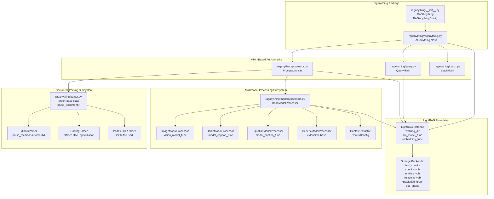
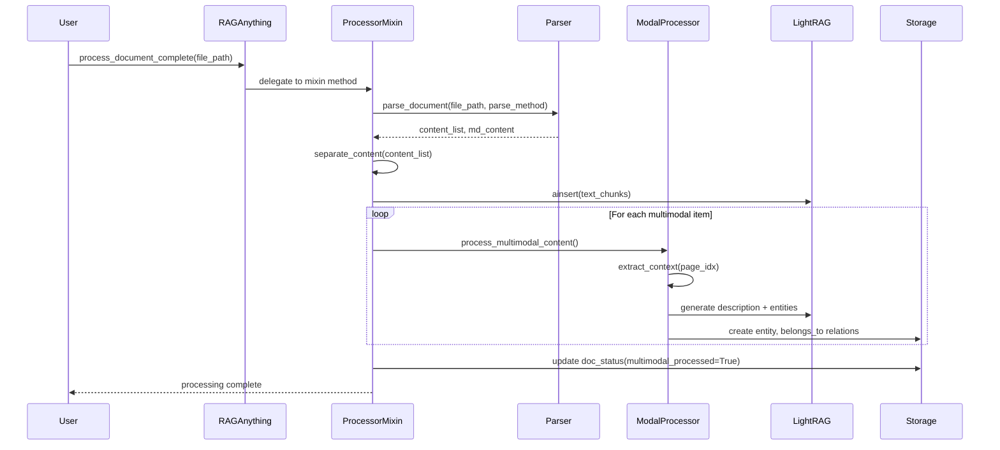
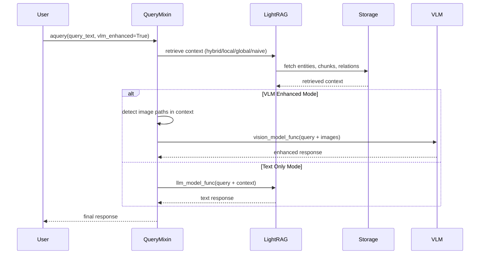
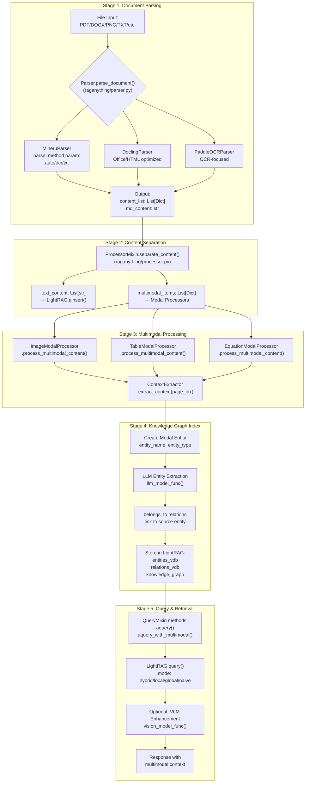
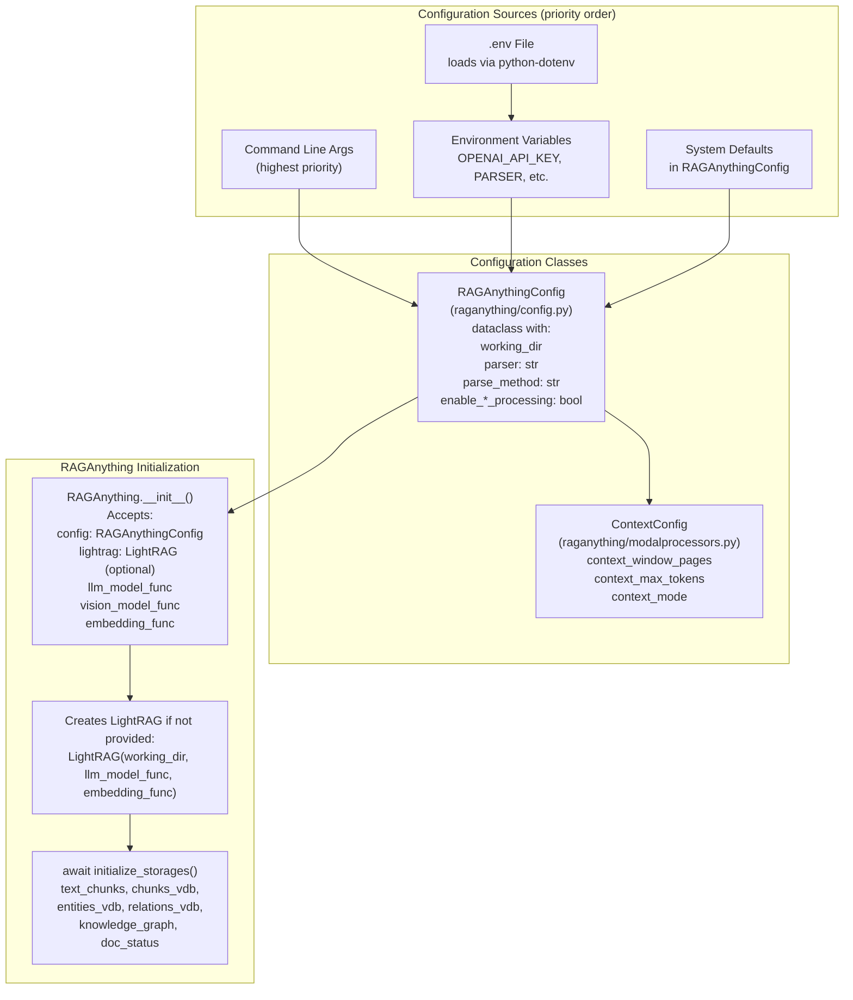

<!-- source: DeepWiki mcp.deepwiki.com · repo HKUDS/RAG-Anything · page 1 Overview · fetched 2026-11-09 -->

# Overview

Relevant source files

The following files were used as context for generating this wiki page:

- [README.md](README.md)
- [README_zh.md](README_zh.md)
- [raganything/__init__.py](raganything/__init__.py)

## Purpose and Scope

This document provides a high-level introduction to RAG-Anything, an all-in-one multimodal Retrieval-Augmented Generation (RAG) framework. It explains the system's core value proposition, architecture, and main components.

For detailed installation instructions, see [Installation](#2.1). For configuration details, see [Configuration](#8). For implementation details of specific subsystems, see [System Architecture](#3), [Document Processing](#4), [Multimodal Content Processing](#5), and [Query System](#7).

Sources: [README.md:1-98]()

## What is RAG-Anything

RAG-Anything is a comprehensive multimodal document processing and retrieval system built on top of [LightRAG](https://github.com/HKUDS/LightRAG). It extends traditional text-only RAG systems to handle heterogeneous content types including text, images, tables, mathematical equations, and structured data within a unified framework.

The system addresses the limitation that modern documents contain diverse multimodal content that text-focused RAG systems cannot effectively process. Unlike conventional approaches requiring multiple specialized tools, RAG-Anything provides seamless processing and querying across all content modalities through a single integrated interface.

**Key Distinguishing Features:**

| Feature | Description |
|---------|-------------|
| **Unified Processing** | Single framework handles PDFs, Office documents, images, and text files |
| **Multimodal Analysis** | Specialized processors for images, tables, equations with context awareness |
| **Knowledge Graph Integration** | Cross-modal entity extraction and relationship mapping |
| **Flexible Parsing** | Multiple parser backends (MinerU, Docling, PaddleOCR) with format-specific optimization |
| **Multi-Mode Querying** | Text queries, multimodal queries, and VLM-enhanced queries |

Sources: [README.md:83-112](), [raganything/__init__.py:8-14]()

## Core Architecture

### Architectural Overview

RAG-Anything implements a three-layer architecture built on top of LightRAG, utilizing a Mixin-based design to separate concerns.

**Core Classes and Their Roles:**

| Class | File Location | Primary Responsibility |
|-------|--------------|------------------------|
| `RAGAnything` | [raganything/raganything.py:28-29]() | Main orchestrator, inherits from mixins, holds LightRAG instance |
| `RAGAnythingConfig` | [raganything/config.py:12-13]() | Configuration dataclass for all system parameters |
| `ProcessorMixin` | [raganything/processor.py:46-47]() | Document processing methods: `process_document_complete()`, `insert_content_list()` |
| `QueryMixin` | [raganything/query.py:23-24]() | Query methods: `aquery()`, `aquery_with_multimodal()` |
| `BatchMixin` | [raganything/batch.py:84-85]() | Batch processing logic: `process_folder_complete()`, `process_documents_batch()` |
| `Parser` | [raganything/parser.py:53-54]() | Abstract base for document parsers, defines `parse_document()` interface |
| `BaseModalProcessor` | [raganything/modalprocessors.py:102-103]() | Abstract base for multimodal content processors |
| `ContextExtractor` | [raganything/modalprocessors.py:49-50]() | Extracts surrounding text context for multimodal items |

Sources: [raganything/__init__.py:1-68](), [README.md:115-150]()

### Component Interaction Diagram

**System Initialization and Processing Flow:**

**Query Processing Flow:**

Sources: [raganything/processor.py:214-266](), [raganything/query.py:101-155](), [raganything/modalprocessors.py:155-190]()

### Five-Stage Processing Pipeline

**Pipeline Flow with Code Constructs:**

**Stage Implementation Details:**

| Stage | Entry Point | Key Methods | Output Format |
|-------|-------------|-------------|---------------|
| **1. Parsing** | `Parser.parse_document()` | `MineruParser._parse_with_mineru()`, `DoclingParser._parse_with_docling()` | `content_list: List[Dict]` with keys: `type`, `text`, `img_path`, `table_body`, `latex`, `page_idx` |
| **2. Separation** | `ProcessorMixin.separate_content()` | Internal logic splits by `content['type']` | Text strings for LightRAG, dicts for modal processors |
| **3. Modal Analysis** | `BaseModalProcessor.process_multimodal_content()` | `ContextExtractor.extract_context()`, `vision_model_func()`, `modal_caption_func()` | Enhanced description string, entity metadata dict |
| **4. KG Construction** | LightRAG integration | `LightRAG.ainsert()`, entity extraction, relationship mapping | Entities stored in `entities_vdb`, relations in `relations_vdb` and `knowledge_graph` |
| **5. Query** | `QueryMixin.aquery()` | `LightRAG.query()`, optional VLM enhancement via `vision_model_func()` | String response with citations |

**Parse Cache System:**

Documents are cached to avoid redundant parsing. Cache key generation:
`cache_key = f"{file_path}_{mtime}_{parser_name}_{parse_method}_{config_hash}"`
Cache location: `{working_dir}/parse_cache/{cache_key}.json`

Sources: [raganything/parser.py:53-84](), [raganything/processor.py:423-448](), [raganything/modalprocessors.py:155-190](), [raganything/query.py:101-155](), [README.md:151-246]()

## Configuration and Initialization

### Configuration Architecture

**Key Configuration Parameters:**

| Parameter | Type | Default | Description |
|-----------|------|---------|-------------|
| `working_dir` | `str` | `"./rag_storage"` | Directory for LightRAG data persistence |
| `parser` | `str` | `"mineru"` | Parser backend: `"mineru"`, `"docling"`, or `"paddleocr"` |
| `parse_method` | `str` | `"auto"` | Parse mode: `"auto"`, `"ocr"`, or `"txt"` (MinerU-specific) |
| `enable_image_processing` | `bool` | `True` | Enable `ImageModalProcessor` |
| `enable_table_processing` | `bool` | `True` | Enable `TableModalProcessor` |
| `enable_equation_processing` | `bool` | `True` | Enable `EquationModalProcessor` |

Sources: [raganything/config.py:12-70](), [raganything/raganything.py:31-90](), [README.md:326-427]()

## Supported Content Types

### Document Format Support Matrix

| Format | Extensions | MinerU | Docling | PaddleOCR | External Dependency |
|--------|-----------|--------|---------|-----------|---------------------|
| **PDF** | `.pdf` | ✓ (primary) | ✓ | ✓ | None |
| **Office** | `.doc`, `.docx`, `.ppt`, `.pptx`, `.xls`, `.xlsx` | ✓ (via conversion) | ✓ (native) | ✓ (via conversion) | LibreOffice |
| **Images** | `.jpg`, `.png` | ✓ | ✓ | ✓ | None |
| **Extended Images** | `.bmp`, `.tiff`, `.gif`, `.webp` | ✓ | ✓ | ✓ | Pillow (`raganything[image]`) |
| **Text** | `.txt`, `.md` | ✓ (via conversion) | ✗ | ✓ (via conversion) | ReportLab (`raganything[text]`) |
| **HTML** | `.html`, `.htm` | ✗ | ✓ (primary) | ✗ | None |

### Multimodal Content Processing

**Content Type Mapping:**

| Content Type | `content_list` Format | Processor Class | Required Fields |
|--------------|----------------------|-----------------|-----------------|
| **Images** | `{"type": "image", "img_path": str}` | `ImageModalProcessor` | `img_path` (absolute path) |
| **Tables** | `{"type": "table", "table_body": str}` | `TableModalProcessor` | `table_body` (markdown) |
| **Equations** | `{"type": "equation", "latex": str}` | `EquationModalProcessor` | `latex` (LaTeX string) |
| **Text** | `{"type": "text", "text": str}` | Direct to LightRAG | `text` content |

Sources: [raganything/parser.py:53-84](), [raganything/modalprocessors.py:202-386](), [README.md:1136-1168]()

## System Extension Points

| Extension Point | Base Class | Required Methods | Use Case |
|----------------|------------|------------------|----------|
| **Custom Modal Processor** | `GenericModalProcessor` | `process_multimodal_content()` | Process domain-specific content types |
| **Custom Parser** | `Parser` | `parse_document()` | Integrate alternative parsing engines |
| **Direct Injection** | N/A | `insert_content_list()` | Use pre-parsed content from external sources |

Sources: [raganything/modalprocessors.py:386-412](), [raganything/parser.py:53-84](), [raganything/processor.py:268-335]()

## Relationship to LightRAG

RAG-Anything extends LightRAG's capabilities while preserving full compatibility. The system can initialize with an existing `LightRAG` instance, share working directories, and leverage LightRAG's knowledge graph and retrieval modes. `RAGAnything` holds a `LightRAG` instance and extends it with document parsing and multimodal analysis through mixins.

Sources: [raganything/raganything.py:92-125](), [README.md:674-799]()

---

