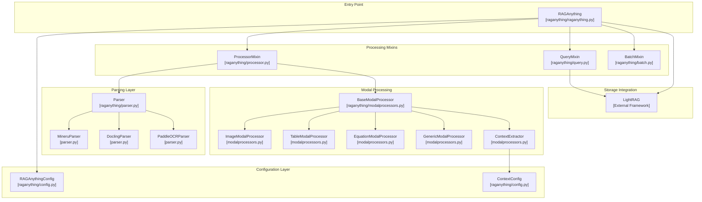
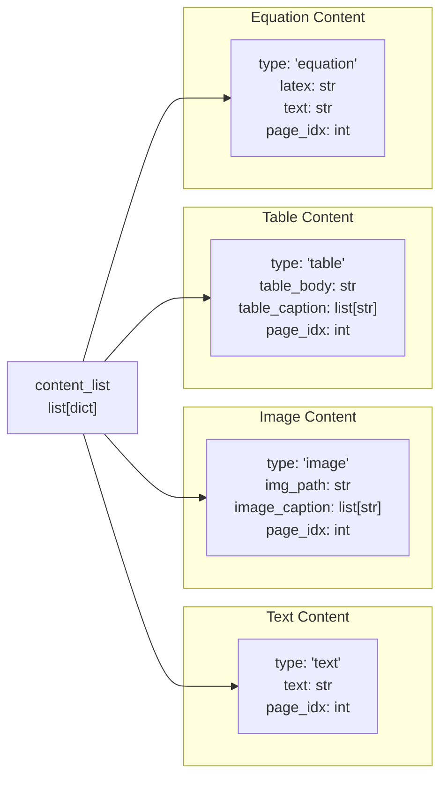
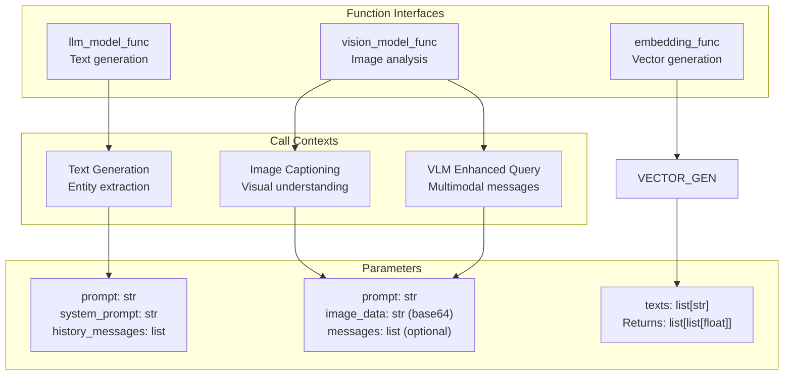

<!-- source: DeepWiki mcp.deepwiki.com · repo HKUDS/RAG-Anything · page 10 API Reference · fetched 2026-11-09 -->

# API Reference

<details>
<summary>Relevant source files</summary>

The following files were used as context for generating this wiki page:

- [raganything/__init__.py](raganything/__init__.py)
- [raganything/raganything.py](raganything/raganything.py)

</details>


This page provides an overview of the RAG-Anything API structure and serves as a navigation guide to detailed API documentation in subsections. The API is organized into major component categories, each documented in detail in the following pages:

- **[RAGAnything Class](#10.1)** - Main orchestrator class and entry point.
- **[Configuration Classes](#10.2)** - API reference for `RAGAnythingConfig` and `ContextConfig`.
- **[Modal Processors API](#10.3)** - API reference for `BaseModalProcessor`, `ImageModalProcessor`, and others.
- **[Parser API](#10.4)** - API reference for `Parser` base class and backend implementations.
- **[Query Methods API](#10.5)** - API reference for `QueryMixin` methods and VLM-enhanced retrieval.
- **[Utilities API](#10.6)** - Helper functions for table formatting, equation extraction, and asset URLs.
- **[ProcessorMixin API](#10.7)** - Core document processing pipeline methods.
- **[BatchMixin API](#10.8)** - Batch and folder processing API.

---

## API Architecture

The RAG-Anything API follows a layered architecture with clear separation of concerns. The diagram below shows the main API components and their relationships, using actual class names and file locations.

**Diagram: API Layer Architecture with Code Entities**



**Sources:** [raganything/raganything.py:50-51](), [raganything/__init__.py:1-60](), [raganything/processor.py:1-50]()

---

## Core API Interfaces

RAG-Anything exposes primary interfaces for different integration scenarios. For details on these methods, see [ProcessorMixin API](#10.7) and [Query Methods API](#10.5).

### Primary Interfaces

| Interface | File Location | Purpose | Entry Methods |
|-----------|---------------|---------|---------------|
| **Document Processing** | `raganything/processor.py` | Ingest and process documents | `process_document_complete()`, `insert_content_list()` |
| **Batch Processing** | `raganything/batch.py` | Folder and batch operations | `process_folder_complete()`, `process_documents_batch()` |
| **Query Interface** | `raganything/query.py` | Search and retrieve information | `aquery()`, `aquery_with_multimodal()` |
| **Modal Processing** | `raganything/modalprocessors.py` | Process specific content types | `ImageModalProcessor`, `TableModalProcessor` |

### Method Naming Conventions

| Pattern | Meaning | Example |
|---------|---------|---------|
| `a*` prefix | Async coroutine | `aquery()` [raganything/query.py:101]() |
| `*_complete` suffix | End-to-end pipeline | `process_document_complete()` [raganything/processor.py:213]() |
| `*_batch` suffix | Batch processing | `process_documents_batch()` [raganything/batch.py:84]() |

---

## Type System and Data Structures

The API uses consistent type definitions across all components. For a complete field-by-field reference, see [Configuration Classes](#10.2).

### Core Data Types

| Type Name | Python Type | Description | Example Value |
|-----------|-------------|-------------|---------------|
| `content_list` | `list[dict]` | Parsed document content | `[{"type": "text", "text": "...", "page_idx": 0}]` |
| `doc_id` | `str` | Content-based SHA256 hash | `"a3f2c8e4b6d9..."` |
| `modal_content` | `dict` | Modality-specific data | `{"img_path": "/path/img.jpg", "image_caption": ["..."]}` |

### Content List Structure

The `content_list` is the fundamental data structure produced by `Parser` implementations. Each element must contain `type` and `page_idx` fields.

**Diagram: Content List Schema with Types**



**Sources:** [raganything/processor.py:260-350](), [raganything/modalprocessors.py:237-250]()

---

## Model Function Contracts

RAG-Anything requires three types of model functions with specific signatures. For implementation examples, see [Model Provider Configuration](#8.4).

### Required Function Signatures

**Diagram: Model Function Interfaces and Call Patterns**



### LLM Model Function
Used by `ProcessorMixin` for entity extraction and `TableModalProcessor` for analysis.
```python
def llm_model_func(prompt: str, system_prompt: str = None, history_messages: list = [], **kwargs) -> str
```
**Sources:** [raganything/raganything.py:59-60](), [raganything/modalprocessors.py:534-540]()

### Vision Model Function
Used by `ImageModalProcessor` for captioning and `QueryMixin` for VLM-enhanced queries.
```python
def vision_model_func(prompt: str, system_prompt: str = None, image_data: str = None, messages: list = None, **kwargs) -> str
```
**Sources:** [raganything/raganything.py:62-63](), [raganything/query.py:246-260]()

---

## Error Handling and Status Tracking

RAG-Anything tracks the state of document processing in `doc_status_storage`. For details on the caching mechanism, see [Parse Caching System](#4.3).

| State | Meaning |
|-------|---------|
| `READY` | Document recognized, processing not started. |
| `HANDLING` | Document currently being parsed or indexed. |
| `PROCESSED` | Document successfully indexed in Knowledge Graph. |
| `FAILED` | Processing terminated due to error. |

**Sources:** [raganything/processor.py:220-240](), [raganything/raganything.py:97-98]()

---

