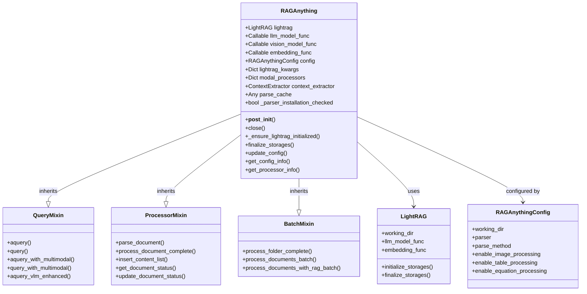
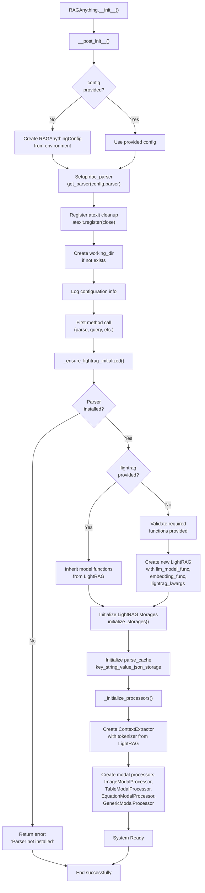
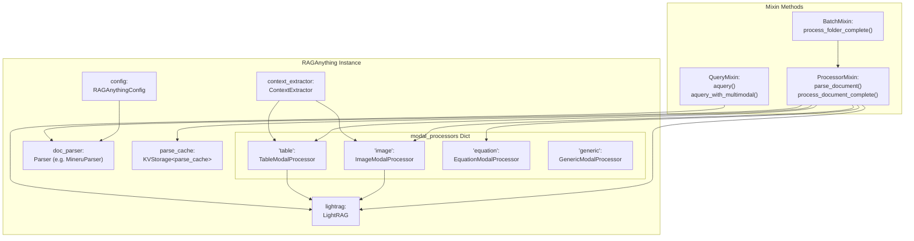

<!-- source: DeepWiki mcp.deepwiki.com · repo HKUDS/RAG-Anything · page 10.1 RAGAnything Class · fetched 2026-11-09 -->

# RAGAnything Class

<details>
<summary>Relevant source files</summary>

The following files were used as context for generating this wiki page:

- [raganything/__init__.py](raganything/__init__.py)
- [raganything/raganything.py](raganything/raganything.py)

</details>


**Purpose**: This page documents the `RAGAnything` class, which serves as the central orchestrator and entry point for the RAG-Anything system. It coordinates document parsing, multimodal content processing, knowledge graph construction, and query execution.

**Scope**: This page covers the class structure, initialization patterns, core components, and lifecycle management. For detailed API documentation of specific methods, see:
- Processing methods: [ProcessorMixin API](#10.7)
- Query methods: [Query Methods API](#10.5)
- Batch processing methods: [BatchMixin API](#10.8)

**Related Pages**: For configuration details, see [RAGAnythingConfig](#8.1). For architectural context, see [Component Overview](#3.1).

---

## Class Structure

The `RAGAnything` class is implemented as a Python dataclass that inherits functionality from three mixins, providing a modular architecture for different operational concerns.

**Class Definition Structure**



**Sources**: [raganything/raganything.py:50-586]()

---

## Core Components and Fields

The `RAGAnything` class manages several key components through its fields:

| Field | Type | Default | Description |
|-------|------|---------|-------------|
| `lightrag` | `Optional[LightRAG]` | `None` | Optional pre-initialized LightRAG instance. If not provided, will be created during initialization. [raganything/raganything.py:56-57]() |
| `llm_model_func` | `Optional[Callable]` | `None` | LLM model function for text analysis. Required if `lightrag` is not provided. [raganything/raganything.py:59-60]() |
| `vision_model_func` | `Optional[Callable]` | `None` | Vision model function for image analysis. Optional, but required for image processing. [raganything/raganything.py:62-63]() |
| `embedding_func` | `Optional[Callable]` | `None` | Embedding function for text vectorization. Required if `lightrag` is not provided. [raganything/raganything.py:65-66]() |
| `config` | `Optional[RAGAnythingConfig]` | `None` | Configuration object. If not provided, created from environment variables. [raganything/raganything.py:68-69]() |
| `lightrag_kwargs` | `Dict[str, Any]` | `{}` | Additional keyword arguments for LightRAG initialization. [raganything/raganything.py:73-84]() |
| `modal_processors` | `Dict[str, Any]` | `{}` (auto-initialized) | Dictionary mapping content types to modal processors. [raganything/raganything.py:88-89]() |
| `context_extractor` | `Optional[ContextExtractor]` | `None` (auto-initialized) | Context extractor for providing surrounding content. [raganything/raganything.py:91-92]() |
| `parse_cache` | `Optional[Any]` | `None` (auto-initialized) | Parse result cache storage using LightRAG KV storage. [raganything/raganything.py:94-95]() |
| `callback_manager` | `CallbackManager` | `CallbackManager()` | Manager for processing hooks and observability. [raganything/raganything.py:100-103]() |

**Additional Attributes Set During Initialization:**
- `working_dir` (str): Set from `config.working_dir` [raganything/raganything.py:115-115]()
- `logger` (Logger): Uses LightRAG's logger instance [raganything/raganything.py:118-118]()
- `doc_parser` (Parser): Initialized via `get_parser(self.config.parser)` [raganything/raganything.py:121-121]()

**Sources**: [raganything/raganything.py:49-106]()

---

## Initialization Patterns

The `RAGAnything` class supports multiple initialization patterns to accommodate different use cases.

**Component Initialization Flow**



**Sources**: [raganything/raganything.py:108-142](), [raganything/raganything.py:177-221](), [raganything/raganything.py:231-369]()

### Pattern 1: Full Initialization (Recommended)

When you have all model functions and want RAGAnything to create the LightRAG instance:

```python
from raganything import RAGAnything, RAGAnythingConfig

config = RAGAnythingConfig(
    working_dir="./rag_storage",
    parser="mineru",
    enable_image_processing=True
)

rag = RAGAnything(
    config=config,
    llm_model_func=your_llm_function,
    vision_model_func=your_vision_function,
    embedding_func=your_embedding_function
)
```

**Sources**: [raganything/raganything.py:50-84]()

### Pattern 2: Pre-Initialized LightRAG

When you have an existing LightRAG instance and want to add multimodal capabilities:

```python
from lightrag import LightRAG
from raganything import RAGAnything

lightrag_instance = LightRAG(working_dir="./existing_rag")
# ... model funcs set on lightrag_instance ...

rag = RAGAnything(
    lightrag=lightrag_instance,
    vision_model_func=your_vision_function
)
```

**Sources**: [raganything/raganything.py:255-263]()

---

## Component Coordination

The `RAGAnything` class orchestrates the interaction between multiple subsystems:

**Component Communication Diagram**



**Sources**: [raganything/raganything.py:177-221](), [raganything/raganything.py:493-519]()

---

## Key Methods

### Initialization and Setup

#### `__post_init__()`
Called automatically after dataclass initialization. Sets up the working directory, logger, document parser, and registers cleanup handlers via `atexit.register(self.close)`. [raganything/raganything.py:108-142]()

#### `_ensure_lightrag_initialized()`
Ensures LightRAG instance and storages are initialized before any processing or query operations. This method handles deferred initialization, creates the `parse_cache` and `multimodal_status_cache`, and triggers `_initialize_processors()`. [raganything/raganything.py:231-369]()

#### `_initialize_processors()`
Creates modal processor instances based on configuration flags (e.g., `ImageModalProcessor` if `config.enable_image_processing` is True). [raganything/raganything.py:177-221]()

### Configuration Management

#### `update_config(**kwargs)`
Updates configuration with new values at runtime by applying `setattr` to the internal `config` object. [raganything/raganything.py:222-229]()

#### `update_context_config(**context_kwargs)`
Updates context extraction configuration (like `context_window` or `max_context_tokens`) and recreates the `context_extractor` for all modal processors. [raganything/raganything.py:521-551]()

#### `set_content_source_for_context(content_source, content_format="auto")`
Sets the source content (full document or list of chunks) for context extraction in all modal processors. [raganything/raganything.py:493-519]()

### Information Retrieval

#### `get_config_info()`
Returns a comprehensive dictionary of current configuration settings, including directory paths, parsing methods, and multimodal flags. [raganything/raganything.py:437-491]()

#### `get_processor_info()`
Returns information about initialized processors and their capabilities, including model function availability and parser installation status. [raganything/raganything.py:553-585]()

### Parser Verification

#### `check_parser_installation()`
Checks if the configured parser is properly installed. [raganything/raganything.py:417-424]()

#### `verify_parser_installation_once()`
Verifies parser installation once and caches the result to avoid redundant checks. Raises `RuntimeError` if the parser is missing. [raganything/raganything.py:426-435]()

---

## Lifecycle Management

### Automatic Cleanup
The `close()` method is registered with `atexit` to ensure cleanup on program exit. [raganything/raganything.py:124-124]()

The `close()` method handles three scenarios:
1. Inside a running async context (e.g., FastAPI shutdown) -> schedules `finalize_storages`. [raganything/raganything.py:160-161]()
2. No event loop in thread -> creates one with `asyncio.run(self.finalize_storages())`. [raganything/raganything.py:172-172]()
3. Event loop exists but is closed -> cleans up and runs a fresh loop. [raganything/raganything.py:166-172]()

### `finalize_storages()`
Finalizes all storage components concurrently, including `parse_cache`, `multimodal_status_cache`, and the underlying `lightrag` storages. [raganything/raganything.py:371-415]()

**Sources**: [raganything/raganything.py:143-176](), [raganything/raganything.py:371-415]()

---

