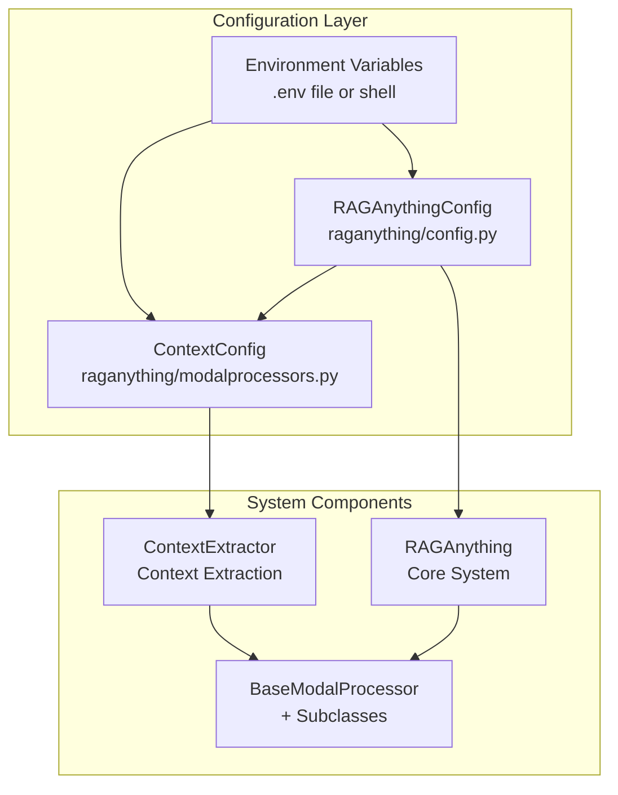
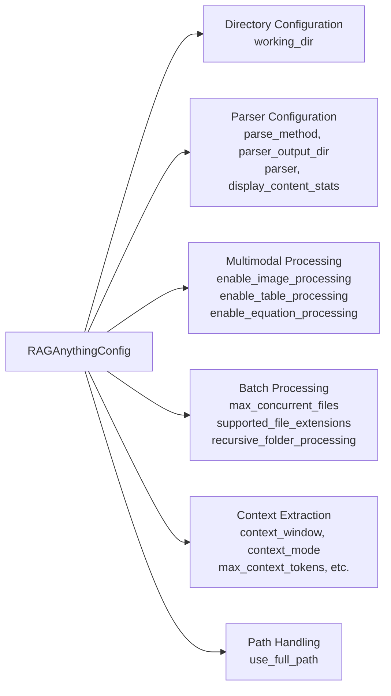
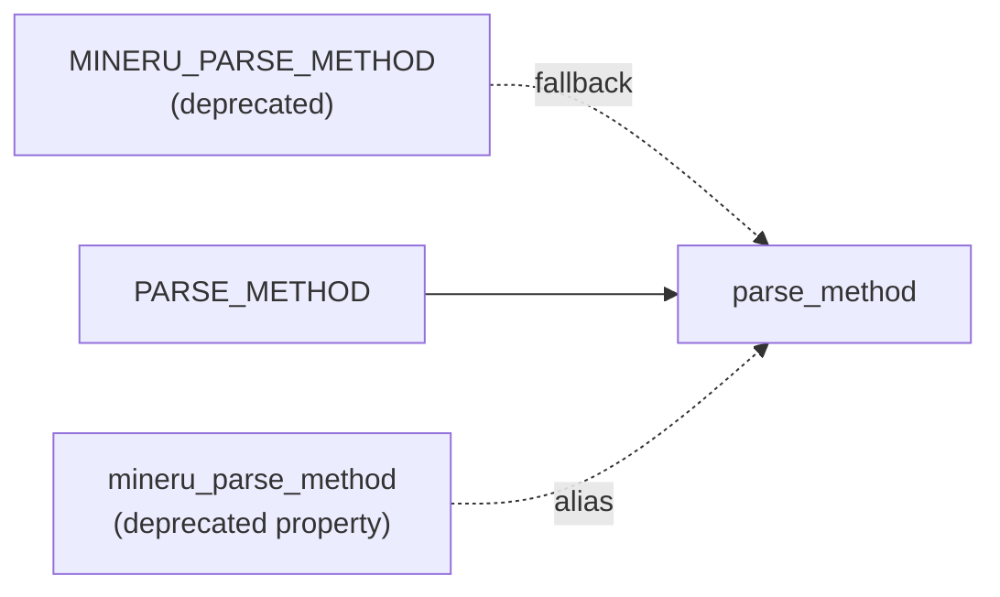
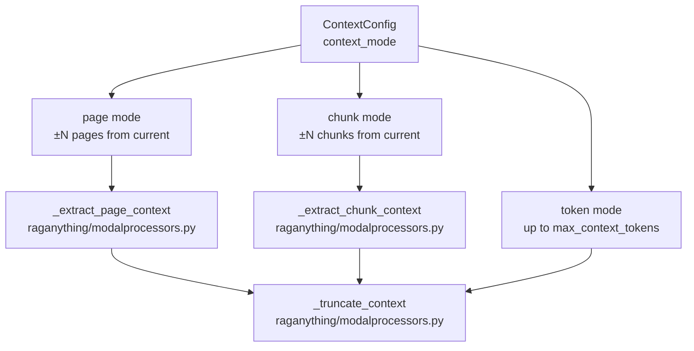
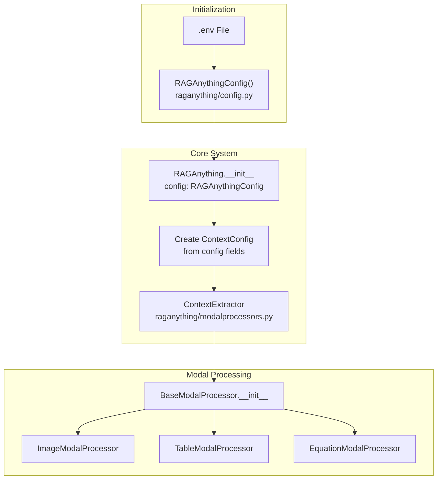
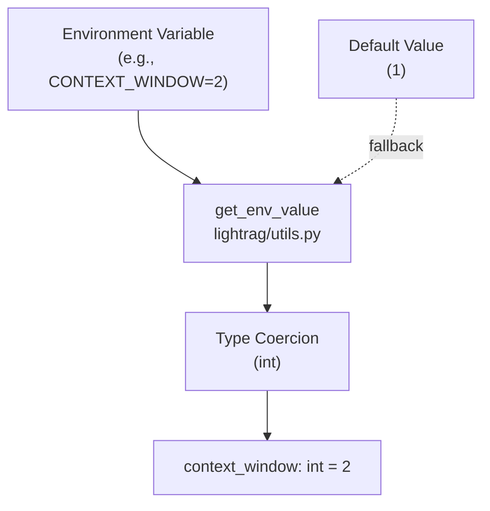

<!-- source: DeepWiki mcp.deepwiki.com · repo HKUDS/RAG-Anything · page 10.2 Configuration Classes · fetched 2026-11-09 -->

# Configuration Classes

<details>
<summary>Relevant source files</summary>

The following files were used as context for generating this wiki page:

- [raganything/config.py](raganything/config.py)
- [raganything/modalprocessors.py](raganything/modalprocessors.py)

</details>


This page provides comprehensive API reference documentation for the configuration classes used in RAG-Anything. These classes define the configurable parameters for document processing, multimodal content handling, and context extraction.

For information about configuring storage backends and model providers, see [Storage Backend Configuration](#8.3) and [Model Provider Configuration](#8.4). For environment variable reference, see [Environment Variables](#8.2).

## Overview

RAG-Anything uses two primary configuration classes:

- **`RAGAnythingConfig`**: Main configuration class that controls global settings for parsing, processing, and batch operations.
- **`ContextConfig`**: Specialized configuration for context extraction behavior in modal processors.

Both classes are implemented as Python dataclasses with built-in support for environment variable overrides, providing flexibility for different deployment scenarios.

---

## Configuration Class Hierarchy



**Sources:** [raganything/config.py:12-153](), [raganything/modalprocessors.py:33-47]()

---

## RAGAnythingConfig

The `RAGAnythingConfig` class is the primary configuration object for RAG-Anything, controlling document parsing, multimodal processing, batch operations, and context extraction.

### Class Definition

```python
@dataclass
class RAGAnythingConfig:
    """Configuration class for RAGAnything with environment variable support"""
```

**Location:** [raganything/config.py:12-14]()

### Configuration Categories

The configuration parameters are organized into seven logical categories:



**Sources:** [raganything/config.py:15-110]()

---

### Directory Configuration

| Field | Type | Default | Environment Variable | Description |
|-------|------|---------|---------------------|-------------|
| `working_dir` | `str` | `"./rag_storage"` | `WORKING_DIR` | Directory where RAG storage and cache files are stored |

**Source:** [raganything/config.py:18-19]()

---

### Parser Configuration

| Field | Type | Default | Environment Variable | Description |
|-------|------|---------|---------------------|-------------|
| `parse_method` | `str` | `"auto"` | `PARSE_METHOD` | Default parsing method: `"auto"`, `"ocr"`, or `"txt"` |
| `parser_output_dir` | `str` | `"./output"` | `OUTPUT_DIR` | Default output directory for parsed content |
| `parser` | `str` | `"mineru"` | `PARSER` | Parser backend: `"mineru"`, `"docling"`, or `"paddleocr"` |
| `display_content_stats` | `bool` | `True` | `DISPLAY_CONTENT_STATS` | Whether to display content statistics during parsing |

**Notes:**
- `parse_method` controls how the selected parser processes documents.
- `parser` selects which backend parser implementation to use.
- Legacy environment variable `MINERU_PARSE_METHOD` is supported but deprecated [raganything/config.py:120-129]().

**Source:** [raganything/config.py:21-35]()

---

### Multimodal Processing Configuration

| Field | Type | Default | Environment Variable | Description |
|-------|------|---------|---------------------|-------------|
| `enable_image_processing` | `bool` | `True` | `ENABLE_IMAGE_PROCESSING` | Enable image content processing |
| `enable_table_processing` | `bool` | `True` | `ENABLE_TABLE_PROCESSING` | Enable table content processing |
| `enable_equation_processing` | `bool` | `True` | `ENABLE_EQUATION_PROCESSING` | Enable equation content processing |

**Notes:**
- These flags control whether modal processors are invoked during document processing.
- Disabling processing for specific modalities improves performance when those content types are not needed.

**Source:** [raganything/config.py:37-52]()

---

### Batch Processing Configuration

| Field | Type | Default | Environment Variable | Description |
|-------|------|---------|---------------------|-------------|
| `max_concurrent_files` | `int` | `1` | `MAX_CONCURRENT_FILES` | Maximum number of files to process concurrently |
| `supported_file_extensions` | `List[str]` | (see below) | `SUPPORTED_FILE_EXTENSIONS` | List of supported file extensions |
| `recursive_folder_processing` | `bool` | `True` | `RECURSIVE_FOLDER_PROCESSING` | Whether to recursively process subfolders in batch mode |

**Default Supported Extensions:**
`.pdf, .jpg, .jpeg, .png, .bmp, .tiff, .tif, .gif, .webp, .doc, .docx, .ppt, .pptx, .xls, .xlsx, .txt, .md` [raganything/config.py:65-69]()

**Source:** [raganything/config.py:54-73]()

---

### Context Extraction Configuration

These parameters control how surrounding content is extracted and included during multimodal content processing.

| Field | Type | Default | Environment Variable | Description |
|-------|------|---------|---------------------|-------------|
| `context_window` | `int` | `1` | `CONTEXT_WINDOW` | Number of pages/chunks to include before and after current item |
| `context_mode` | `str` | `"page"` | `CONTEXT_MODE` | Context extraction mode: `"page"` or `"chunk"` |
| `max_context_tokens` | `int` | `2000` | `MAX_CONTEXT_TOKENS` | Maximum number of tokens in extracted context |
| `include_headers` | `bool` | `True` | `INCLUDE_HEADERS` | Whether to include document headers and titles |
| `include_captions` | `bool` | `True` | `INCLUDE_CAPTIONS` | Whether to include image/table captions |
| `context_filter_content_types` | `List[str]` | `["text"]` | `CONTEXT_FILTER_CONTENT_TYPES` | Content types to include (comma-separated) |
| `content_format` | `str` | `"minerU"` | `CONTENT_FORMAT` | Default content format for context extraction |

**Source:** [raganything/config.py:75-110]()

---

### Path Handling Configuration

| Field | Type | Default | Environment Variable | Description |
|-------|------|---------|---------------------|-------------|
| `use_full_path` | `bool` | `False` | `USE_FULL_PATH` | Whether to use full file path (`True`) or just basename (`False`) |

**Source:** [raganything/config.py:113-115]()

---

### Backward Compatibility

The class includes support for legacy environment variables via `__post_init__` and deprecated property accessors.



**Source:** [raganything/config.py:117-159]()

---

## ContextConfig

The `ContextConfig` class provides fine-grained control over context extraction behavior for modal processors. It is used by the `ContextExtractor` class.

### Class Definition

```python
@dataclass
class ContextConfig:
    """Configuration for context extraction"""
```

**Location:** [raganything/modalprocessors.py:39-41]()

### Configuration Fields

| Field | Type | Default | Description |
|-------|------|---------|-------------|
| `context_window` | `int` | `1` | Window size for context extraction |
| `context_mode` | `str` | `"page"` | Extraction mode: `"page"`, `"chunk"`, or `"token"` |
| `max_context_tokens` | `int` | `2000` | Maximum tokens to include in extracted context |
| `include_headers` | `bool` | `True` | Whether to include headers/titles |
| `include_captions` | `bool` | `True` | Whether to include image/table captions |
| `filter_content_types` | `List[str]` | `["text"]` | Content types to include in context |

**Source:** [raganything/modalprocessors.py:43-52]()

---

### Context Extraction Modes



**Sources:** [raganything/modalprocessors.py:132-204]()

---

## Usage in System Components

### Configuration Flow Through System



**Sources:** [raganything/config.py:12-153](), [raganything/modalprocessors.py:58-66]()

---

### Environment Variable Loading

The configuration system uses `lightrag.utils.get_env_value` for environment variable support with type coercion.



**Sources:** [raganything/config.py:9-107]()

---

## Related Pages

- **[Environment Variables](#8.2)**: Complete environment variable reference.
- **[Context Extraction](#5.6)**: Detailed explanation of the context extraction system.
- **[RAGAnything Class](#10.1)**: Main class that uses these configuration objects.

**Sources:** [raganything/config.py:1-159](), [raganything/modalprocessors.py:33-52]()

---

