<!-- source: DeepWiki mcp.deepwiki.com · repo HKUDS/RAG-Anything · page 10.3 Modal Processors API · fetched 2026-11-09 -->

# Modal Processors API

<details>
<summary>Relevant source files</summary>

The following files were used as context for generating this wiki page:

- [raganything/modalprocessors.py](raganything/modalprocessors.py)

</details>


## Purpose and Scope

This page provides comprehensive API documentation for the modal processor classes in RAG-Anything. Modal processors are responsible for analyzing and processing multimodal content types (images, tables, equations, and custom content) and integrating them into the knowledge graph.

For architectural overview and design patterns of modal processors, see [Modal Processor Architecture](#5.1). For implementation details of specific processors, see [Image Processing](#5.2), [Table Processing](#5.3), [Equation Processing](#5.4), and [Custom Modal Processors](#5.5). For context extraction concepts, see [Context Extraction](#5.6).

This page documents:
- Class constructors and initialization parameters
- Public methods with signatures, parameters, and return types
- Configuration classes and data structures
- Internal utility methods
- Usage patterns and integration points

---

## Class Hierarchy

```mermaid
classDiagram
    class BaseModalProcessor {
        +LightRAG lightrag
        +modal_caption_func
        +ContextExtractor context_extractor
        +content_source
        +content_format
        +set_content_source(content_source, content_format)
        +generate_description_only(modal_content, content_type, item_info, entity_name)*
        +process_multimodal_content(modal_content, content_type, file_path, entity_name, item_info, batch_mode, doc_id, chunk_order_index)*
        -_get_context_for_item(item_info)
        -_create_entity_and_chunk(modal_chunk, entity_info, file_path, batch_mode, doc_id, chunk_order_index)
        -_process_chunk_for_extraction(chunk_id, modal_entity_name, batch_mode)
        -_robust_json_parse(response)
    }
    
    class ImageModalProcessor {
        -_encode_image_to_base64(image_path)
        +generate_description_only(modal_content, content_type, item_info, entity_name)
        +process_multimodal_content(modal_content, content_type, file_path, entity_name, item_info, batch_mode, doc_id, chunk_order_index)
        -_parse_response(response, entity_name)
    }
    
    class TableModalProcessor {
        +generate_description_only(modal_content, content_type, item_info, entity_name)
        +process_multimodal_content(modal_content, content_type, file_path, entity_name, item_info, batch_mode, doc_id, chunk_order_index)
        -_parse_table_response(response, entity_name)
    }
    
    class EquationModalProcessor {
        +generate_description_only(modal_content, content_type, item_info, entity_name)
        +process_multimodal_content(modal_content, content_type, file_path, entity_name, item_info, batch_mode, doc_id, chunk_order_index)
        -_parse_equation_response(response, entity_name)
    }
    
    class GenericModalProcessor {
        +generate_description_only(modal_content, content_type, item_info, entity_name)
        +process_multimodal_content(modal_content, content_type, file_path, entity_name, item_info, batch_mode, doc_id, chunk_order_index)
        -_parse_generic_response(response, entity_name, content_type)
    }
    
    class ContextExtractor {
        +ContextConfig config
        +tokenizer
        +extract_context(content_source, current_item_info, content_format)
        -_extract_from_content_list(content_list, current_item_info)
        -_extract_page_context(content_list, current_item_info)
        -_extract_chunk_context(content_list, current_item_info)
        -_truncate_context(context)
    }
    
    class ContextConfig {
        +int context_window
        +str context_mode
        +int max_context_tokens
        +bool include_headers
        +bool include_captions
        +List filter_content_types
    }
    
    BaseModalProcessor <|-- ImageModalProcessor
    BaseModalProcessor <|-- TableModalProcessor
    BaseModalProcessor <|-- EquationModalProcessor
    BaseModalProcessor <|-- GenericModalProcessor
    BaseModalProcessor o-- ContextExtractor
    ContextExtractor o-- ContextConfig
```



**Sources:** [raganything/modalprocessors.py:39-1570]()

---

## Configuration Classes

### ContextConfig

`ContextConfig` is a dataclass that controls context extraction behavior for multimodal content processing.

**Class Definition:** [raganything/modalprocessors.py:39-53]()

#### Fields

| Field | Type | Default | Description |
|-------|------|---------|-------------|
| `context_window` | `int` | `1` | Number of pages/chunks before and after current item to include |
| `context_mode` | `str` | `"page"` | Context extraction mode: `"page"`, `"chunk"`, or `"token"` |
| `max_context_tokens` | `int` | `2000` | Maximum number of tokens in extracted context |
| `include_headers` | `bool` | `True` | Whether to include document headers/titles in context |
| `include_captions` | `bool` | `True` | Whether to include image/table captions in context |
| `filter_content_types` | `List[str]` | `["text"]` | Content types to include (e.g., `["text"]`, `["text", "image"]`) |

#### Example Usage

```python
from raganything.modalprocessors import ContextConfig

# Default configuration
config = ContextConfig()

# Custom configuration for wider context
config = ContextConfig(
    context_window=2,
    context_mode="page",
    max_context_tokens=4000,
    include_headers=True,
    include_captions=True,
    filter_content_types=["text", "image"]
)
```

**Sources:** [raganything/modalprocessors.py:39-53]()

---

## ContextExtractor Class

The `ContextExtractor` class extracts surrounding context for multimodal content to enable context-aware processing.

**Class Definition:** [raganything/modalprocessors.py:55-358]()

### Constructor

```python
def __init__(self, config: ContextConfig = None, tokenizer=None)
```

**Parameters:**
- `config` (`ContextConfig`, optional): Configuration for context extraction. If `None`, uses default `ContextConfig()`.
- `tokenizer` (optional): Tokenizer instance for accurate token counting. If `None`, falls back to character-based truncation.

**Sources:** [raganything/modalprocessors.py:58-66]()

### Methods

#### extract_context()

```python
def extract_context(
    self,
    content_source: Any,
    current_item_info: Dict[str, Any],
    content_format: str = "auto"
) -> str
```

Extract context for the current item from a content source.

**Parameters:**
- `content_source` (`Any`): Source content in various formats (list, dict, or string)
- `current_item_info` (`Dict[str, Any]`): Information about the current item:
  - `page_idx` (`int`): Page index for page-based extraction
  - `index` (`int`): Chunk index for chunk-based extraction
- `content_format` (`str`): Format hint: `"auto"`, `"minerU"`, `"text_chunks"`, or `"text"`

**Returns:**
- `str`: Extracted and truncated context text

**Sources:** [raganything/modalprocessors.py:68-118]()

#### Internal Methods

| Method | Purpose | Line Reference |
|--------|---------|----------------|
| `_extract_from_content_list()` | Extract from MinerU-style content list | [raganything/modalprocessors.py:120-137]() |
| `_extract_page_context()` | Extract context based on page boundaries | [raganything/modalprocessors.py:139-177]() |
| `_extract_chunk_context()` | Extract context based on chunk boundaries | [raganything/modalprocessors.py:179-210]() |
| `_extract_text_from_item()` | Extract text from a content item | [raganything/modalprocessors.py:212-242]() |
| `_extract_from_dict_source()` | Extract from dictionary source | [raganything/modalprocessors.py:244-269]() |
| `_extract_from_text_source()` | Extract from plain text | [raganything/modalprocessors.py:271-283]() |
| `_extract_from_text_chunks()` | Extract from text chunk list | [raganything/modalprocessors.py:285-312]() |
| `_truncate_context()` | Truncate to max token limit | [raganything/modalprocessors.py:314-357]() |

**Sources:** [raganything/modalprocessors.py:120-357]()

---

## BaseModalProcessor Class

`BaseModalProcessor` is the abstract base class for all modal processors, providing common infrastructure for multimodal content processing.

**Class Definition:** [raganything/modalprocessors.py:360-794]()

### Constructor

```python
def __init__(
    self,
    lightrag: LightRAG,
    modal_caption_func,
    context_extractor: ContextExtractor = None
)
```

**Parameters:**
- `lightrag` (`LightRAG`): LightRAG instance providing storage and model functions
- `modal_caption_func` (callable): Async function for generating descriptions. Signature:
  ```python
  async def modal_caption_func(
      prompt: str,
      image_data: str = None,
      system_prompt: str = None
  ) -> str
  ```
- `context_extractor` (`ContextExtractor`, optional): Context extractor instance. If `None`, creates default instance.

**Initialized Attributes:**
- `self.lightrag`: LightRAG instance reference
- `self.modal_caption_func`: Caption generation function
- `self.text_chunks_db`: Text chunks storage from LightRAG
- `self.chunks_vdb`: Chunk vector database from LightRAG
- `self.entities_vdb`: Entity vector database from LightRAG
- `self.relationships_vdb`: Relationship vector database from LightRAG
- `self.knowledge_graph_inst`: Knowledge graph storage from LightRAG
- `self.embedding_func`: Embedding function from LightRAG
- `self.llm_model_func`: LLM function from LightRAG
- `self.global_config`: LightRAG configuration dictionary
- `self.hashing_kv`: LLM response cache from LightRAG
- `self.tokenizer`: Tokenizer from LightRAG
- `self.context_extractor`: Context extractor instance
- `self.content_source`: Content source for context extraction (initially `None`)
- `self.content_format`: Content format hint (initially `"auto"`)

**Sources:** [raganything/modalprocessors.py:363-404]()

### Public Methods

#### set_content_source()

```python
def set_content_source(self, content_source: Any, content_format: str = "auto")
```

Set the content source for context extraction in batch processing.

**Parameters:**
- `content_source` (`Any`): Full document content for context extraction
- `content_format` (`str`): Format hint: `"auto"`, `"minerU"`, `"text_chunks"`, or `"text"`

**Usage:**
```python
processor.set_content_source(parsed_content, content_format="minerU")
```

**Sources:** [raganything/modalprocessors.py:406-415]()

#### generate_description_only()

```python
async def generate_description_only(
    self,
    modal_content,
    content_type: str,
    item_info: Dict[str, Any] = None,
    entity_name: str = None
) -> Tuple[str, Dict[str, Any]]
```

Generate text description and entity info without entity/relation extraction. Used in batch processing stage 1.

**Parameters:**
- `modal_content`: Modal content to process (format varies by processor type)
- `content_type` (`str`): Type of content: `"image"`, `"table"`, `"equation"`, or custom type
- `item_info` (`Dict[str, Any]`, optional): Item information for context extraction:
  - `page_idx` (`int`): Page index
  - `index` (`int`): Chunk index
- `entity_name` (`str`, optional): Predefined entity name. If `None`, generated from content.

**Returns:**
- `Tuple[str, Dict[str, Any]]`:
  - `description` (`str`): Generated detailed description
  - `entity_info` (`dict`): Entity information with keys:
    - `entity_name` (`str`): Entity identifier
    - `entity_type` (`str`): Entity type
    - `summary` (`str`): Concise summary (max 100 words)

**Note:** This is an abstract method that must be implemented by subclasses.

**Sources:** [raganything/modalprocessors.py:442-463]()

#### process_multimodal_content()

```python
async def process_multimodal_content(
    self,
    modal_content,
    content_type: str,
    file_path: str = "manual_creation",
    entity_name: str = None,
    item_info: Dict[str, Any] = None,
    batch_mode: bool = False,
    doc_id: str = None,
    chunk_order_index: int = 0
) -> Tuple[str, Dict[str, Any], List]
```

Complete processing of multimodal content including description generation, entity creation, and knowledge graph insertion.

**Parameters:**
- `modal_content`: Modal content to process (format varies by processor type)
- `content_type` (`str`): Type of content
- `file_path` (`str`): Source file path for tracking
- `entity_name` (`str`, optional): Predefined entity name
- `item_info` (`Dict[str, Any]`, optional): Item information for context extraction
- `batch_mode` (`bool`): If `True`, skips immediate merge operation for batch processing
- `doc_id` (`str`, optional): Document ID for chunk tracking
- `chunk_order_index` (`int`): Chunk position in document

**Returns:**
- `Tuple[str, Dict[str, Any], List]`:
  - `description` (`str`): Generated description
  - `entity_info` (`dict`): Entity information
  - `chunk_results` (`list`): Extraction results as list of `(nodes, edges)` tuples

**Note:** This is an abstract method that must be implemented by subclasses.

**Sources:** Implementation varies by subclass (see specialized processors below)

### Protected Methods

#### _get_context_for_item()

```python
def _get_context_for_item(self, item_info: Dict[str, Any]) -> str
```

Get context for the current processing item using the configured context extractor.

**Parameters:**
- `item_info` (`Dict[str, Any]`): Item information with `page_idx` or `index`

**Returns:**
- `str`: Extracted context text

**Sources:** [raganything/modalprocessors.py:417-440]()

#### _create_entity_and_chunk()

```python
async def _create_entity_and_chunk(
    self,
    modal_chunk: str,
    entity_info: Dict[str, Any],
    file_path: str,
    batch_mode: bool = False,
    doc_id: str = None,
    chunk_order_index: int = 0
) -> Tuple[str, Dict[str, Any], List]
```

Create text chunk, entity node, and extract relationships.

**Parameters:**
- `modal_chunk` (`str`): Complete formatted content for the chunk
- `entity_info` (`Dict[str, Any]`): Entity information dictionary
- `file_path` (`str`): Source file path
- `batch_mode` (`bool`): Batch processing flag
- `doc_id` (`str`): Document ID
- `chunk_order_index` (`int`): Chunk position

**Returns:**
- `Tuple[str, Dict[str, Any], List]`: Description, entity info, and chunk results

**Operations Performed:**
1. Generates chunk ID using `compute_mdhash_id()` [raganything/modalprocessors.py:476]()
2. Creates chunk data with tokens, content, and metadata [raganything/modalprocessors.py:478-498]()
3. Inserts chunk into `text_chunks_db` and `chunks_vdb` [raganything/modalprocessors.py:500-505]()
4. Creates entity node in knowledge graph [raganything/modalprocessors.py:507-521]()
5. Inserts entity into `entities_vdb` [raganything/modalprocessors.py:523-532]()
6. Calls `_process_chunk_for_extraction()` for entity/relationship extraction [raganything/modalprocessors.py:534]()
7. If not batch mode, calls `merge_nodes_and_edges()` [raganything/modalprocessors.py:538-542]()

**Sources:** [raganything/modalprocessors.py:465-545]()

#### _process_chunk_for_extraction()

```python
async def _process_chunk_for_extraction(
    self,
    chunk_id: str,
    modal_entity_name: str,
    batch_mode: bool = False
) -> List[Tuple[Dict, Dict]]
```

Extract entities and relationships from chunk content.

**Parameters:**
- `chunk_id` (`str`): Chunk identifier
- `modal_entity_name` (`str`): Main modal entity name
- `batch_mode` (`bool`): Batch processing flag

**Returns:**
- `List[Tuple[Dict, Dict]]`: List of `(nodes, edges)` extraction results

**Operations Performed:**
1. Retrieves chunk data from `text_chunks_db` [raganything/modalprocessors.py:708-713]()
2. Creates chunk vector database entry [raganything/modalprocessors.py:715-726]()
3. Calls `extract_entities()` for NER and relation extraction [raganything/modalprocessors.py:728-734]()
4. Creates "belongs_to" relationships between extracted entities and modal entity [raganything/modalprocessors.py:745-774]()
5. Inserts relationships into `relationships_vdb` [raganything/modalprocessors.py:759-766]()
6. If not batch mode, calls `merge_nodes_and_edges()` and `_insert_done()` [raganything/modalprocessors.py:776-791]()

**Sources:** [raganything/modalprocessors.py:699-793]()

#### _robust_json_parse()

```python
def _robust_json_parse(self, response: str) -> dict
```

Parse JSON from LLM response with multiple fallback strategies.

**Parameters:**
- `response` (`str`): Raw LLM response text

**Returns:**
- `dict`: Parsed JSON object

**Strategies Applied (in order):**
1. Direct JSON parsing from all candidates [raganything/modalprocessors.py:603-611]()
2. Basic cleanup (smart quotes, trailing commas) [raganything/modalprocessors.py:613-623]()
3. Progressive quote fixing for LaTeX and escape sequences [raganything/modalprocessors.py:625-635]()
4. Regex field extraction as last resort [raganything/modalprocessors.py:637-697]()

**Handles:**
- JSON in code blocks (` ```json ... ``` `)
- Thinking/reasoning tags (`` tags)
- `<thinking>...</thinking>` tags

This ensures clean JSON extraction even from models that output reasoning chains.

**Sources:** [raganything/modalprocessors.py:579-697]()

### Entity Fallback Creation

All processors implement fallback entity creation when processing fails:

```python
fallback_entity = {
    "entity_name": entity_name or f"{content_type}_{compute_mdhash_id(str(modal_content))}",
    "entity_type": content_type,
    "summary": f"{content_type} content: {str(modal_content)[:100]}"
}
```

This ensures processing continues even with LLM failures.

**Sources:** [raganything/modalprocessors.py:984-990](), [raganything/modalprocessors.py:1177-1183](), [raganything/modalprocessors.py:1361-1367](), [raganything/modalprocessors.py:1523-1529]()

---

## Return Value Specifications

### Entity Information Dictionary

All `generate_description_only()` methods return entity information in this format:

```python
{
    "entity_name": str,      # Unique identifier with type suffix, e.g., "Figure 1 (image)"
    "entity_type": str,      # Content type: "image", "table", "equation", or custom
    "summary": str          # Concise summary, max 100 words
}
```

### Chunk Results Format

The `process_multimodal_content()` method returns chunk results as:

```python
List[Tuple[Dict[str, Dict], Dict[Tuple[str, str], List[Dict]]]]
```

Where each tuple contains:
- `nodes` (`Dict[str, Dict]`): Extracted entity nodes, keyed by entity name
- `edges` (`Dict[Tuple[str, str], List[Dict]]`): Extracted relationships, keyed by `(source, target)` tuple

**Sources:** [raganything/modalprocessors.py:699-793]()

---

## Integration with LightRAG Functions

Modal processors use these LightRAG utility functions:

| Function | Module | Purpose | Line Reference |
|----------|--------|---------|----------------|
| `compute_mdhash_id()` | `lightrag.utils` | Generate hash-based IDs | [raganything/modalprocessors.py:476]() |
| `extract_entities()` | `lightrag.operate` | NER and relation extraction | [raganything/modalprocessors.py:728-734]() |
| `merge_nodes_and_edges()` | `lightrag.operate` | Merge entities into KG | [raganything/modalprocessors.py:776-788]() |
| `get_namespace_data()` | `lightrag.kg.shared_storage` | Get pipeline status | [raganything/modalprocessors.py:721]() |
| `get_pipeline_status_lock()` | `lightrag.kg.shared_storage` | Get status lock | [raganything/modalprocessors.py:722]() |

**Sources:** [raganything/modalprocessors.py:20-27]()

---

