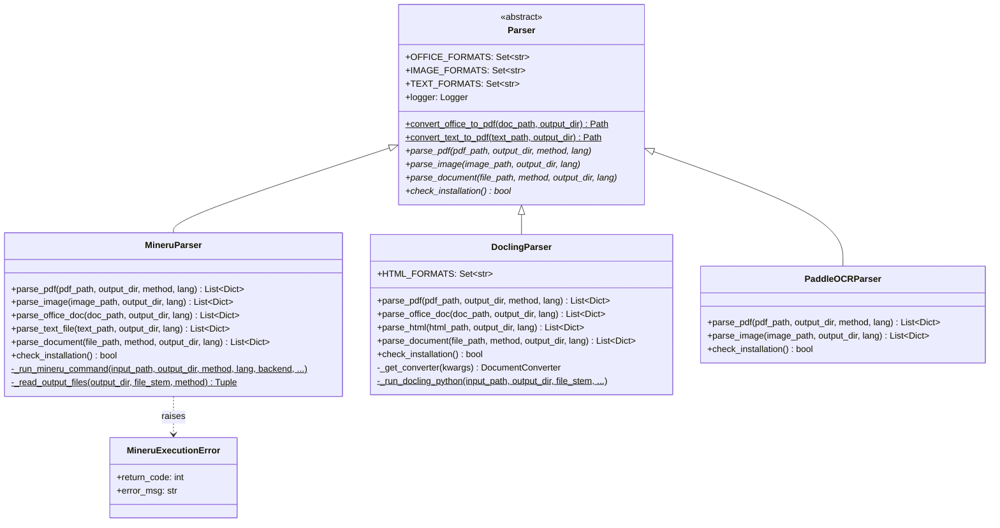
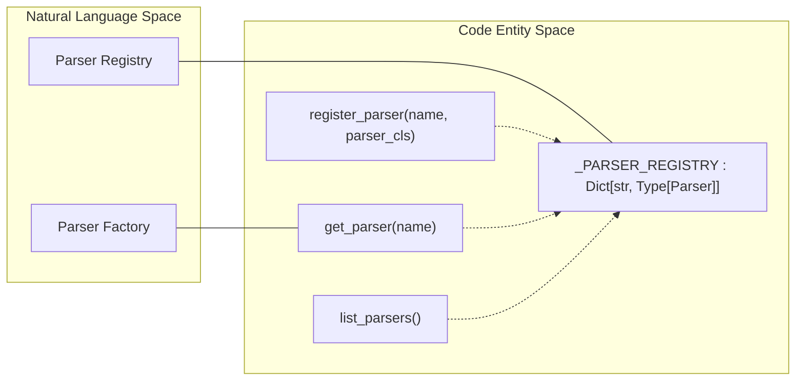
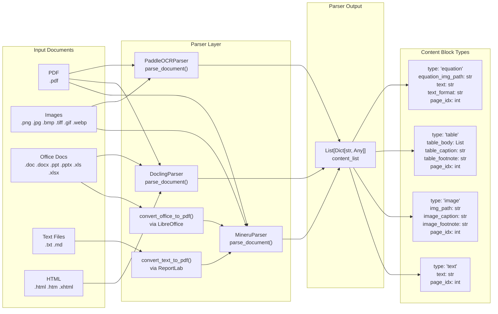
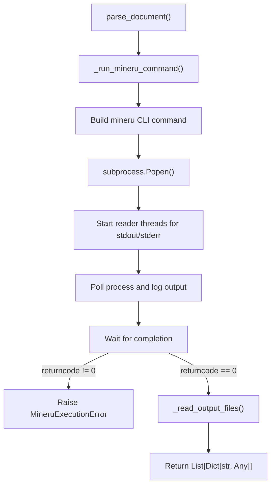

<!-- source: DeepWiki mcp.deepwiki.com · repo HKUDS/RAG-Anything · page 10.4 Parser API · fetched 2026-11-09 -->

# Parser API

<details>
<summary>Relevant source files</summary>

The following files were used as context for generating this wiki page:

- [raganything/__init__.py](raganything/__init__.py)
- [raganything/parser.py](raganything/parser.py)
- [tests/testparser_kwargs.py](tests/testparser_kwargs.py)

</details>


This page provides API reference documentation for the document parsing subsystem in RAG-Anything. The parser layer is responsible for converting documents from various formats (PDF, images, Office documents, HTML, text files) into structured content lists that can be processed by the multimodal analysis pipeline.

For the high-level processing pipeline that uses these parsers, see [Document Parsers](#4.1). For configuration of parser selection, see [RAGAnythingConfig](#8.1).

---

## Parser Class Hierarchy

The following diagram shows the inheritance structure and key methods of the parser subsystem, including the factory registry system.



**Sources:** [raganything/parser.py:68-170](), [raganything/parser.py:612-1327](), [raganything/parser.py:1329-1784](), [raganything/parser.py:1786-1934](), [raganything/parser.py:57-66]()

---

## Registry and Factory Functions

RAG-Anything uses a global registry to manage parser implementations. This allows for easy extension and dynamic selection of parsing backends.

### Code-to-Entity Mapping: Parser Registry



**Sources:** [raganything/parser.py:2020-2070]()

### Function Reference

| Function | Description |
|----------|-------------|
| `register_parser(name, parser_cls)` | Registers a new parser class under a string name. [raganything/parser.py:2020-2035]() |
| `unregister_parser(name)` | Removes a parser from the registry. [raganything/parser.py:2037-2046]() |
| `get_parser(name)` | Factory function that returns an instance of the requested parser. Defaults to `MineruParser` if name is unknown. [raganything/parser.py:2058-2070]() |
| `list_parsers()` | Returns a list of all registered parser names. [raganything/parser.py:2048-2051]() |

---

## Parse Output Format

The following diagram shows the data flow from documents through parsers to structured content lists:



**Sources:** [raganything/parser.py:1239-1294](), [raganything/parser.py:1410-1451](), [raganything/parser.py:1865-1906]()

---

## Parser Base Class

The `Parser` class provides an abstract interface for document parsing utilities.

**Location:** [raganything/parser.py:68-610]()

### Class Attributes

| Attribute | Type | Description |
|-----------|------|-------------|
| `OFFICE_FORMATS` | `Set[str]` | Supported Office file extensions: `.doc`, `.docx`, `.ppt`, `.pptx`, `.xls`, `.xlsx` |
| `IMAGE_FORMATS` | `Set[str]` | Supported image extensions: `.png`, `.jpeg`, `.jpg`, `.bmp`, `.tiff`, `.tif`, `.gif`, `.webp` |
| `TEXT_FORMATS` | `Set[str]` | Supported text extensions: `.txt`, `.md` |
| `logger` | `logging.Logger` | Class-level logger instance |

**Sources:** [raganything/parser.py:76-81]()

### Constructor

```python
def __init__(self) -> None
```

Initializes the base parser. Called by subclass constructors.

**Sources:** [raganything/parser.py:167-169]()

### Static Conversion Methods

#### convert_office_to_pdf

```python
@classmethod
def convert_office_to_pdf(
    cls, 
    doc_path: Union[str, Path], 
    output_dir: Optional[str] = None
) -> Path
```

Converts Office documents to PDF format using LibreOffice command-line tools.

**Sources:** [raganything/parser.py:193-331]()

#### convert_text_to_pdf

```python
@classmethod
def convert_text_to_pdf(
    cls, 
    text_path: Union[str, Path], 
    output_dir: Optional[str] = None
) -> Path
```

Converts text files to PDF format using ReportLab with markdown support.

**Sources:** [raganything/parser.py:333-568]()

---

## MineruParser Class

The `MineruParser` class implements document parsing using the MinerU 2.0 command-line tool.

**Location:** [raganything/parser.py:612-1327]()

### MinerU Command Execution Flow



**Sources:** [raganything/parser.py:631-831](), [raganything/parser.py:833-922]()

### Public Methods

#### parse_pdf

```python
def parse_pdf(
    self,
    pdf_path: Union[str, Path],
    output_dir: Optional[str] = None,
    method: str = "auto",
    lang: Optional[str] = None,
    **kwargs,
) -> List[Dict[str, Any]]
```
**Sources:** [raganything/parser.py:924-1022]()

---

## DoclingParser Class

The `DoclingParser` class implements document parsing using the Docling Python API.

**Location:** [raganything/parser.py:1329-1784]()

### Implementation Details
DoclingParser now uses the `DocumentConverter` Python API rather than a subprocess CLI call. It maintains a converter cache to improve performance.

- `_get_converter(**kwargs)`: Retrieves or initializes a `DocumentConverter` with specified options. [raganything/parser.py:1453-1502]()
- `_run_docling_python(...)`: Performs the actual conversion and exports to JSON/Markdown. [raganything/parser.py:1504-1563]()

---

## PaddleOCRParser Class

The `PaddleOCRParser` provides a lightweight OCR-based parsing alternative using the PaddleOCR library.

**Location:** [raganything/parser.py:1786-1934]()

### Capabilities
- **OCR for Images/PDFs**: Uses `PaddleOCR` to detect and recognize text. [raganything/parser.py:1820-1863]()
- **Text-only Output**: Currently returns a list of text blocks; does not extract images or tables separately. [raganything/parser.py:1865-1906]()

---

## Content Block Formats

### Text Block
```python
{
    "type": "text",
    "text": str,
    "page_idx": int,
}
```
**Sources:** [raganything/parser.py:1658-1672]()

### Image Block
```python
{
    "type": "image",
    "img_path": str,
    "image_caption": str,
    "image_footnote": str,
    "page_idx": int,
}
```
**Sources:** [raganything/parser.py:1673-1696]()

### Table Block
```python
{
    "type": "table",
    "img_path": str,
    "table_caption": str,
    "table_footnote": str,
    "table_body": List[List[str]],
    "page_idx": int,
}
```
**Sources:** [raganything/parser.py:1697-1713]()

---

## Parser Selection Guidelines

| Use Case | Recommended Parser | Reason |
|----------|-------------------|---------|
| PDF (complex layout) | `mineru` | Superior structure and formula extraction. |
| Office / HTML | `docling` | Native Python API support for structured docs. |
| Quick OCR / Light | `paddleocr` | Lower resource usage for simple text extraction. |

**Sources:** [raganything/parser.py:2053-2070]()

---

