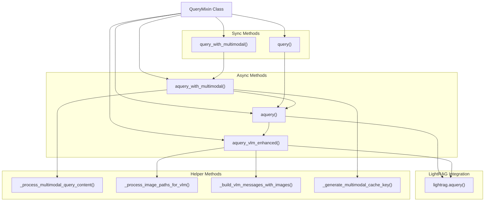
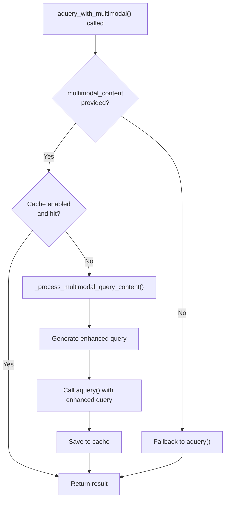
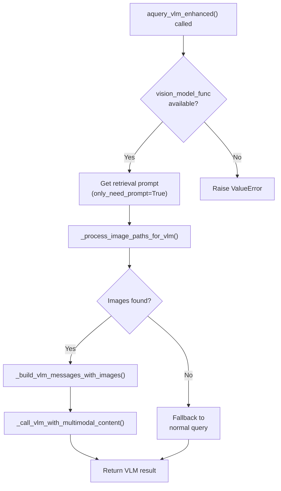

<!-- source: DeepWiki mcp.deepwiki.com · repo HKUDS/RAG-Anything · page 10.5 Query Methods API · fetched 2026-11-09 -->

# Query Methods API

<details>
<summary>Relevant source files</summary>

The following files were used as context for generating this wiki page:

- [raganything/batch.py](raganything/batch.py)
- [raganything/query.py](raganything/query.py)

</details>


This page documents the public API methods of the `QueryMixin` class, which provides text and multimodal query capabilities for RAG-Anything. These methods enable querying the knowledge graph constructed from processed documents using various retrieval strategies.

For information about query architecture and retrieval strategies, see [Query Architecture](#7.1). For practical query examples, see [Query Examples](#9.4).

**Sources:** [raganything/query.py:1-770]()

---

## QueryMixin Class Overview

The `QueryMixin` class provides all query functionality as a mixin to the main `RAGAnything` class. It offers three distinct query interfaces, each available in both synchronous and asynchronous versions:

1. **Pure Text Query** - Standard text-based retrieval via `aquery()` / `query()`
2. **Multimodal Query** - Query with accompanying multimodal content via `aquery_with_multimodal()` / `query_with_multimodal()`
3. **VLM Enhanced Query** - Automatic image detection and VLM processing via `aquery_vlm_enhanced()`

All query methods integrate with LightRAG's retrieval engine and support multiple query modes.

**Sources:** [raganything/query.py:22-23]()

---

## Query Method Hierarchy



**Sources:** [raganything/query.py:102-770]()

---

## Public Query Methods

### aquery() - Asynchronous Text Query

Pure text query method that directly interfaces with LightRAG's query functionality. Automatically enables VLM enhancement when `vision_model_func` is available.

**Signature:**
```python
async def aquery(
    self,
    query: str,
    mode: str = "mix",
    system_prompt: str | None = None,
    **kwargs
) -> str
```

**Parameters:**

| Parameter | Type | Default | Description |
|-----------|------|---------|-------------|
| `query` | `str` | Required | Query text to search for |
| `mode` | `str` | `"mix"` | Retrieval mode (see Query Modes section) |
| `system_prompt` | `str \| None` | `None` | Optional system prompt to include |
| `vlm_enhanced` | `bool` | Auto-detected | Enable VLM enhancement for image processing |
| `**kwargs` | | | Additional parameters passed to `QueryParam` |

**Returns:** `str` - Query result generated by the LLM

**Behavior:**

1. Validates that LightRAG instance exists [raganything/query.py:120-124]().
2. Auto-detects VLM enhancement capability based on `vision_model_func` availability [raganything/query.py:129-133]().
3. If VLM enhancement is enabled, delegates to `aquery_vlm_enhanced()` [raganything/query.py:136-143]().
4. Otherwise, creates a `QueryParam` and calls `lightrag.aquery()` [raganything/query.py:162-171]().

**Example:**
```python
# Basic text query
result = await rag.aquery("What is machine learning?")

# Query with specific mode
result = await rag.aquery("Explain the algorithm", mode="local")

# Disable VLM enhancement explicitly
result = await rag.aquery("Describe the results", vlm_enhanced=False)
```

**Sources:** [raganything/query.py:102-193]()

---

### query() - Synchronous Text Query

Synchronous wrapper around `aquery()`. Uses `always_get_an_event_loop()` to handle async execution.

**Signature:**
```python
def query(
    self,
    query: str,
    mode: str = "mix",
    **kwargs
) -> str
```

**Parameters:** Same as `aquery()` except `system_prompt` is passed via `**kwargs`.

**Returns:** `str` - Query result

**Example:**
```python
# Synchronous query
result = rag.query("What is deep learning?", mode="hybrid")
```

**Sources:** [raganything/query.py:727-743]()

---

### aquery_with_multimodal() - Asynchronous Multimodal Query

Query method that accepts multimodal content (images, tables, equations) alongside the text query. Processes multimodal content to generate enhanced context before querying.

**Signature:**
```python
async def aquery_with_multimodal(
    self,
    query: str,
    multimodal_content: List[Dict[str, Any]] = None,
    mode: str = "mix",
    system_prompt: str | None = None,
    **kwargs,
) -> str
```

**Parameters:**

| Parameter | Type | Default | Description |
|-----------|------|---------|-------------|
| `query` | `str` | Required | Base query text |
| `multimodal_content` | `List[Dict[str, Any]]` | `None` | List of multimodal content items |
| `mode` | `str` | `"mix"` | Retrieval mode |
| `system_prompt` | `str \| None` | `None` | Optional system prompt |
| `**kwargs` | | | Additional query parameters |

**Multimodal Content Format:**

Each item in `multimodal_content` is a dictionary with content type and type-specific fields:

**Image Content:**
```python
{
    "type": "image",
    "img_path": "./path/to/image.jpg",  # Required
    "image_caption": ["Caption text"],   # Optional
    "img_footnote": ["Footnote"]        # Optional
}
```

**Table Content:**
```python
{
    "type": "table",
    "table_data": "Name,Age\nAlice,25",  # Required (CSV or markdown)
    "table_caption": "User data table"   # Optional
}
```

**Equation Content:**
```python
{
    "type": "equation",
    "latex": "E = mc^2",              # Required
    "equation_caption": "Mass-energy"  # Optional
}
```

**Returns:** `str` - Query result incorporating multimodal analysis

**Processing Flow:**



**Caching Strategy:**

The method implements intelligent caching for multimodal queries [raganything/query.py:214-230]():
- Cache key generated via `_generate_multimodal_cache_key()` [raganything/query.py:26-100]().
- Image paths normalized to basenames for portability [raganything/query.py:54-60]().
- Large content (>200 chars) hashed instead of stored directly [raganything/query.py:62-69]().
- Cache checked before processing, saved after successful query [raganything/query.py:284-288]().

**Example:**
```python
# Query with image
result = await rag.aquery_with_multimodal(
    "What does this diagram show?",
    multimodal_content=[{
        "type": "image",
        "img_path": "./diagram.png"
    }]
)
```

**Sources:** [raganything/query.py:195-301]()

---

### query_with_multimodal() - Synchronous Multimodal Query

Synchronous wrapper around `aquery_with_multimodal()`.

**Signature:**
```python
def query_with_multimodal(
    self,
    query: str,
    multimodal_content: List[Dict[str, Any]] = None,
    mode: str = "mix",
    **kwargs
) -> str
```

**Parameters:** Same as `aquery_with_multimodal()`.

**Returns:** `str` - Query result

**Sources:** [raganything/query.py:745-769]()

---

### aquery_vlm_enhanced() - VLM Enhanced Query

Specialized query method that automatically detects image paths in retrieved context and replaces them with base64-encoded images for VLM (Vision-Language Model) processing. This enables the LLM to "see" images referenced in the retrieved knowledge.

**Signature:**
```python
async def aquery_vlm_enhanced(
    self,
    query: str,
    mode: str = "mix",
    system_prompt: str | None = None,
    **kwargs
) -> str
```

**Parameters:**

| Parameter | Type | Default | Description |
|-----------|------|---------|-------------|
| `query` | `str` | Required | User query text |
| `mode` | `str` | `"mix"` | Underlying LightRAG retrieval mode |
| `system_prompt` | `str \| None` | `None` | Optional system prompt |
| `**kwargs` | | | Additional query parameters |

**Requirements:**
- `vision_model_func` must be provided during RAGAnything initialization [raganything/query.py:319-323]().
- Image files must exist at referenced paths and pass validation [raganything/query.py:573-581]().

**Returns:** `str` - VLM-generated query result

**Processing Pipeline:**



**Image Path Detection:**

The method uses regex pattern matching to find image paths in the retrieved context [raganything/query.py:539-541]():
```
Image Path:\s*([^\r\n]*?\.(?:jpg|jpeg|png|gif|bmp|webp|tiff|tif))
```

Images are validated using `validate_image_file()` and encoded to base64 using `encode_image_to_base64()` [raganything/query.py:573-586]().

**VLM Message Format:**

Messages are constructed in OpenAI-compatible multimodal format with interleaved text and images [raganything/query.py:609-691]().

**Sources:** [raganything/query.py:303-364]()

---

## Query Modes

All query methods support the following retrieval modes via the `mode` parameter:

| Mode | Description | Use Case |
|------|-------------|----------|
| `"local"` | Context-based search using vector similarity | Finding specific facts or details |
| `"global"` | Knowledge-based search using graph traversal | Understanding overall themes and concepts |
| `"hybrid"` | Combines vector similarity and graph traversal | Balanced retrieval for complex queries |
| `"naive"` | Simple vector similarity search | Fast retrieval without graph enhancement |
| `"mix"` | **Default.** Automatically selects best mode | General purpose queries |
| `"bypass"` | Direct LLM call without retrieval | Testing or LLM-only responses |

These modes are passed to LightRAG's `QueryParam` [raganything/query.py:162]().

**Sources:** [raganything/query.py:110,199,311]()

---

## Internal Helper Methods

### Multimodal Content Processing

**`_process_multimodal_query_content()`** [raganything/query.py:366-417]()
Processes multimodal content items to generate enhanced query text by routing each item to the appropriate processor.

**`_generate_query_content_description()`** [raganything/query.py:419-447]()
Dispatches content to type-specific description generators based on the `type` field.

**Type-Specific Describers:**
- `_describe_image_for_query()` [raganything/query.py:449-478]()
- `_describe_table_for_query()` [raganything/query.py:480-495]()
- `_describe_equation_for_query()` [raganything/query.py:497-512]()
- `_describe_generic_for_query()` [raganything/query.py:514-531]()

### VLM Image Processing

**`_process_image_paths_for_vlm()`** [raganything/query.py:533-607]()
Extracts image paths from prompt text, validates files, and encodes them to base64.

**`_build_vlm_messages_with_images()`** [raganything/query.py:609-691]()
Constructs the final multimodal message list for the VLM provider.

**`_call_vlm_with_multimodal_content()`** [raganything/query.py:693-724]()
Invokes `vision_model_func` with the constructed multimodal messages.

### Caching

**`_generate_multimodal_cache_key()`** [raganything/query.py:26-100]()
Generates a unique MD5 hash for a multimodal query based on the text, mode, and normalized content descriptions.

**Sources:** [raganything/query.py:26-724]()

---

