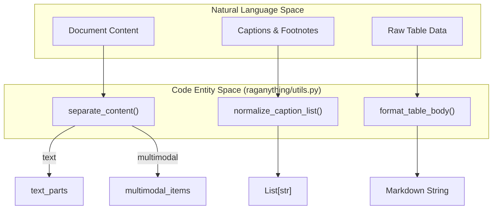
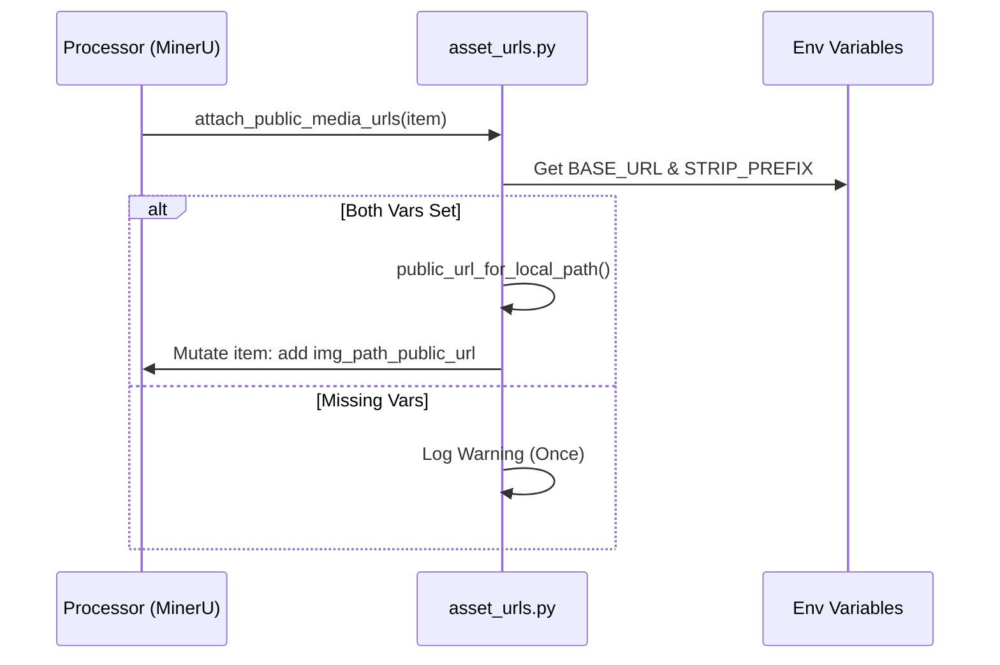
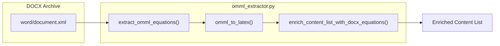

<!-- source: DeepWiki mcp.deepwiki.com · repo HKUDS/RAG-Anything · page 10.6 Utilities API · fetched 2026-11-09 -->

# Utilities API

Relevant source files

The following files were used as context for generating this wiki page:

- [docs/multimodal_rag_failure_modes.md](docs/multimodal_rag_failure_modes.md)
- [raganything/asset_urls.py](raganything/asset_urls.py)
- [raganything/omml_extractor.py](raganything/omml_extractor.py)
- [raganything/utils.py](raganything/utils.py)
- [tests/test_asset_urls.py](tests/test_asset_urls.py)
- [tests/test_doc_status_creation.py](tests/test_doc_status_creation.py)
- [tests/test_omml_extractor.py](tests/test_omml_extractor.py)

## Purpose and Scope

This page documents the utility functions and helper modules within RAG-Anything. These utilities provide core functionality for content normalization, table formatting, OMML equation extraction, and public asset URL mapping.

For information about the main RAGAnything class that uses these utilities, see [RAGAnything Class](10.1). For details on document processing workflows that orchestrate these utilities, see [ProcessorMixin API](10.7).

---

## Utility Module Overview

The codebase contains three primary utility modules:

| Module | Purpose | Key Functions |
|--------|---------|---------------|
| `raganything.utils` | General content processing and normalization. | `normalize_caption_list`, `format_table_body`, `separate_content` |
| `raganything.asset_urls` | Mapping local paths to public URLs (S3/CDN). | `attach_public_media_urls`, `public_url_for_local_path` |
| `raganything.omml_extractor` | Extracting and converting Word (OMML) equations. | `extract_omml_equations`, `omml_to_latex` |

**Sources:** [raganything/utils.py:1-5](), [raganything/asset_urls.py:1-12](), [raganything/omml_extractor.py:1-38]()

---

## Content Normalization and Formatting (`utils.py`)

### `normalize_caption_list`
Ensures that captions and footnotes (which may arrive as `None`, `str`, or `list`) are converted into a consistent `List[str]`.
[raganything/utils.py:16-24]()

### `format_table_body`
Serializes table content for LLM consumption. It converts "list-of-lists" (common in non-MinerU parsers) into a Markdown table format with headers and separators.
[raganything/utils.py:36-60]()

### `get_equation_text_and_format`
Resolves equation content by checking multiple alias fields (`text`, `latex`, `equation`) to ensure compatibility across different parser backends (MinerU, Docling, PaddleOCR).
[raganything/utils.py:63-88]()

### `separate_content`
Separates text content from multimodal content (images, tables, equations) in a parsed document's content list. It also enriches multimodal items with `_section_path` and `_neighbor_text` for context.
[raganything/utils.py:172-214]()

**Sources:** [raganything/utils.py:16-214]()

---

## Public Asset URL Mapping (`asset_urls.py`)

This module implements the environment-variable contract for systems where ingestion occurs on a server but the UI/retrieval runs elsewhere. It allows local filesystem paths to be mapped to public HTTPS/S3 URLs.

### Environment Variables
- `RAGANYTHING_PUBLIC_ASSET_BASE_URL`: The prefix for the public URL (e.g., `https://cdn.example.com/assets`).
- `RAGANYTHING_PUBLIC_ASSET_STRIP_PREFIX`: The local absolute path to strip from the beginning of the file path.

### `attach_public_media_urls`
Mutates a content item dictionary by adding `*_public_url` fields for any detected media paths (`img_path`, `table_img_path`, `equation_img_path`).
[raganything/asset_urls.py:65-118]()

**Sources:** [raganything/asset_urls.py:42-118]()

---

## OMML Equation Extraction (`omml_extractor.py`)

This module provides a zero-dependency, pure-stdlib utility to extract mathematical formulas from `.docx` files. It parses the `word/document.xml` archive directly.

### `extract_omml_equations`
Opens a DOCX as a ZIP archive and locates every `<m:oMath>` or `<m:oMathPara>` element in document order.
[raganything/omml_extractor.py:111-147]()

### `omml_to_latex`
A recursive transformer that converts OMML XML constructs into searchable LaTeX strings.
- **Handled Constructs**: Fractions (`m:f`), Sub/Superscripts (`m:sSub`, `m:sSup`), Radicals (`m:rad`), N-ary operators (Summation, Integral), Matrices (`m:m`), and Delimiters (`m:d`).
- **Fallback**: If a construct is unhandled, it falls back to concatenated text content to ensure RAG recall.
[raganything/omml_extractor.py:203-345]()

### `enrich_content_list_with_docx_equations`
Merges extracted equations into an existing `content_list` produced by standard parsers. It uses a fuzzy matching strategy (ignoring whitespace/case) to insert LaTeX formulas where placeholders were left by the PDF conversion process.
[raganything/omml_extractor.py:348-422]()

**Sources:** [raganything/omml_extractor.py:111-422]()

---

## Implementation Details

### Table Serialization Logic
The `format_table_body` function implements a robust fallback mechanism:
1. **String**: Returned as-is.
2. **List of Lists**: Rendered as a Markdown table.
3. **List of Objects**: Rendered as newline-joined strings.
4. **Empty List**: Returns empty string.
[raganything/utils.py:44-60]()

### Section Path Reconstruction
The `extract_section_path_from_content_list` utility walks backward through the `content_list` to reconstruct a hierarchical path (e.g., `Introduction > Method > Results`) based on `text_level` markers. This provides spatial context to multimodal elements.
[raganything/utils.py:91-134]()

### OMML N-ary Operators
The extractor maps Unicode math symbols to LaTeX commands for common operators:
- `\u2211` → `\sum`
- `\u222b` → `\int`
- `\u220f` → `\prod`
[raganything/omml_extractor.py:65-79]()

**Sources:** [raganything/utils.py:44-134](), [raganything/omml_extractor.py:65-79]()

---

