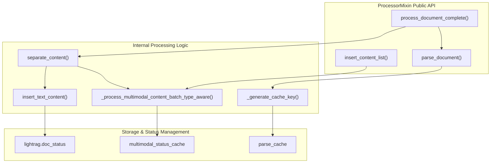

<!-- source: DeepWiki mcp.deepwiki.com · repo HKUDS/RAG-Anything · page 10.7 ProcessorMixin API · fetched 2026-11-09 -->

# ProcessorMixin API

<details>
<summary>Relevant source files</summary>

The following files were used as context for generating this wiki page:

- [raganything/processor.py](raganything/processor.py)
- [tests/test_insert_content_list.py](tests/test_insert_content_list.py)

</details>


## Purpose and Scope

This document provides comprehensive API documentation for the `ProcessorMixin` class, which contains all document processing functionality in RAG-Anything. The ProcessorMixin implements the core document ingestion pipeline including parsing, caching, text content insertion, multimodal content processing, and document status tracking.

For information about:
- Parser implementations and supported formats, see [Parser API](#10.4)
- Multimodal content processors, see [Modal Processors API](#10.3)
- Batch processing methods, see [BatchMixin API](#10.8)
- Query functionality, see [Query Methods API](#10.5)

Sources: [raganything/processor.py:1-30]()

---

## ProcessorMixin Class Overview

The `ProcessorMixin` class is defined in [raganything/processor.py:32-33]() and provides document processing capabilities as a mixin that is composed into the main `RAGAnything` class. It orchestrates a multi-stage processing pipeline that handles both text and multimodal content.

### System Architecture and Data Flow

The following diagram bridges the Natural Language processing requirements to the Code Entity Space, showing how `ProcessorMixin` methods interact with storage and internal utilities.



Sources: [raganything/processor.py:32-202](), [raganything/processor.py:1441-1861]()

---

## Core Processing Methods

### process_document_complete()

Complete document processing workflow that parses a file and integrates both text and multimodal content into the knowledge graph.

**Signature:**
[raganything/processor.py:1441-1453]()
```python
async def process_document_complete(
    self,
    file_path: str,
    output_dir: str = None,
    parse_method: str = None,
    display_stats: bool = None,
    split_by_character: str | None = None,
    split_by_character_only: bool = False,
    doc_id: str | None = None,
    file_name: str | None = None,
    **kwargs,
)
```

**Parameters:**

| Parameter | Type | Description |
|-----------|------|-------------|
| `file_path` | `str` | Path to the file to process (required) |
| `output_dir` | `str` | Parser output directory (defaults to `config.parser_output_dir`) |
| `parse_method` | `str` | Parse method: `"auto"`, `"ocr"`, or `"txt"` (defaults to `config.parse_method`) |
| `display_stats` | `bool` | Display content statistics (defaults to `config.display_content_stats`) |
| `split_by_character` | `str \| None` | Character to split text by (e.g., `"\n\n"`) |
| `split_by_character_only` | `bool` | If True, split only by specified character |
| `doc_id` | `str \| None` | Document ID (auto-generated from content if not provided) |
| `file_name` | `str \| None` | File name for citation (defaults to basename or full path based on `config.use_full_path`) |
| `**kwargs` | | Additional parser parameters: `lang`, `device`, `start_page`, `end_page`, `formula`, `table`, `backend`, `source` |

**Behavior:**
1. Calls `parse_document` to get `content_list` and `doc_id` [raganything/processor.py:1477-1483]().
2. Separates content into text and multimodal items using `separate_content` [raganything/processor.py:1492]().
3. Inserts text content using `insert_text_content` (or `insert_text_content_with_multimodal_content` if enabled) [raganything/processor.py:1502-1510]().
4. Processes multimodal items via `_process_multimodal_content` [raganything/processor.py:1512-1517]().
5. Updates document status to `PROCESSED` and sets the `multimodal_processed` flag [raganything/processor.py:1523-1528]().

Sources: [raganything/processor.py:1441-1529]()

---

### process_document_complete_lightrag_api()

A specialized version of the complete processing workflow designed to be compatible with LightRAG API expectations. It ensures the `doc_status` is updated correctly within the LightRAG ecosystem.

**Behavior:**
- Wraps `process_document_complete` but focuses on providing the `doc_id` and ensuring `doc_status` records exist [raganything/processor.py:1531-1582]().
- Uses `_ensure_doc_status_record` to prevent missing status entries in the LightRAG backend [raganything/processor.py:1561-1563]().

Sources: [raganything/processor.py:1531-1582]()

---

### insert_content_list()

Insert pre-parsed content list directly without document parsing. This method bypasses the parsing stage and allows integration with external parsers or pre-processed content.

**Signature:**
[raganything/processor.py:1756-1765]()
```python
async def insert_content_list(
    self,
    content_list: List[Dict[str, Any]],
    file_path: str = "unknown_document",
    split_by_character: str | None = None,
    split_by_character_only: bool = False,
    doc_id: str | None = None,
    display_stats: bool = None,
)
```

**Content List Schema:**
Items must be dictionaries with a `type` field. Supported types:
- `text`: Requires `text` field [raganything/processor.py:1796]().
- `image`: Requires `img_path` [raganything/processor.py:1806]().
- `table`: Requires `table_body` [raganything/processor.py:1810]().
- `equation`: Requires `latex` or `text` [raganything/processor.py:1814]().

**Status Management:**
If text is present, it uses `ainsert` which marks the document as `PROCESSED` [tests/test_insert_content_list.py:141-148](). If only multimodal content is present, it manually transitions status from `READY` to `HANDLING` [tests/test_insert_content_list.py:196-217]().

Sources: [raganything/processor.py:1756-1861](), [tests/test_insert_content_list.py:131-217]()

---

### parse_document()

Parse document with automatic caching support. This method handles parser selection via the `get_parser` factory and manages the `parse_cache`.

**Logic Flow:**
1. Generates a cache key using `_generate_cache_key` [raganything/processor.py:293]().
2. Checks `parse_cache` for existing results [raganything/processor.py:295-305]().
3. If not cached, selects a parser (e.g., `MineruParser`) and executes parsing [raganything/processor.py:343-417]().
4. Generates a `doc_id` using `_generate_content_based_doc_id` [raganything/processor.py:431]().
5. Stores the result in `parse_cache` [raganything/processor.py:434-445]().

Sources: [raganything/processor.py:280-453]()

---

### _process_multimodal_content_batch_type_aware()

The core internal engine for handling multimodal elements (images, tables, equations) in a batch-aware manner.

**Implementation Details:**
- **Concurrency Control:** Uses `asyncio.Semaphore` limited by `config.max_parallel_insert` to bound LLM/VLM calls [raganything/processor.py:716-721]().
- **Type Routing:** For each item, it calls `get_processor_for_type` to retrieve the specialized processor (e.g., `ImageModalProcessor`) [raganything/processor.py:723-724]().
- **Two-Stage Processing:**
    1. **Description Generation:** Generates text descriptions for all items concurrently [raganything/processor.py:726-751]().
    2. **LightRAG Integration:** Converts descriptions to LightRAG chunks, extracts entities, and merges them into the knowledge graph [raganything/processor.py:756-879]().


Sources: [raganything/processor.py:703-879]()

---

## Internal Helper Methods

### _generate_cache_key()
Generates a unique MD5 hash based on:
- Absolute file path [raganything/processor.py:70]().
- File modification time (`st_mtime`) [raganything/processor.py:66-71]().
- Parser and `parse_method` [raganything/processor.py:72-73]().
- Specific parser parameters like `lang`, `device`, `pages` [raganything/processor.py:77-92]().

### _upsert_doc_status()
Safely updates the `lightrag.doc_status` record. It first ensures a record exists via `_ensure_doc_status_record` and then merges updates while updating the `updated_at` timestamp [raganything/processor.py:138-159]().

### _set_multimodal_status_record()
Persists the completion state of multimodal processing in the `multimodal_status_cache` namespace. This is crucial for tracking documents that have finished text indexing but are still undergoing VLM analysis [raganything/processor.py:171-188]().

Sources: [raganything/processor.py:50-188]()

---

