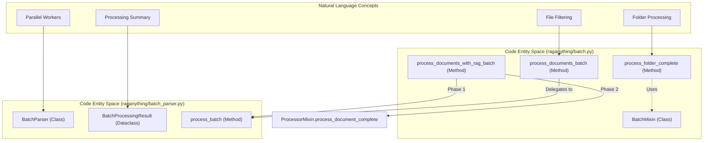
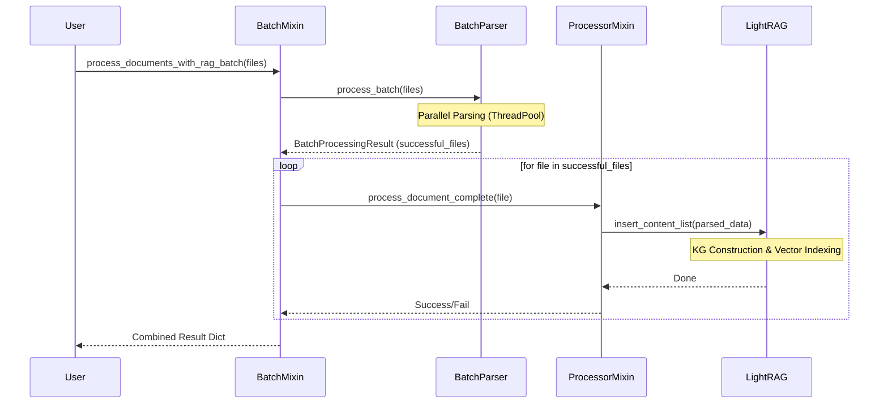

<!-- source: DeepWiki mcp.deepwiki.com · repo HKUDS/RAG-Anything · page 10.8 BatchMixin API · fetched 2026-11-09 -->

# BatchMixin API

<details>
<summary>Relevant source files</summary>

The following files were used as context for generating this wiki page:

- [raganything/batch.py](raganything/batch.py)
- [raganything/batch_parser.py](raganything/batch_parser.py)
- [raganything/query.py](raganything/query.py)
- [tests/test_custom_parser.py](tests/test_custom_parser.py)

</details>


This document provides the complete API reference for the `BatchMixin` class and the supporting `BatchParser` class. These components provide batch and concurrent document processing capabilities to RAGAnything, enabling processing of multiple files, entire folders, and integrated batch parsing with RAG insertion.

For usage examples of batch processing, see [Batch Processing](#9.2). For the single-document processing API, see [ProcessorMixin API](#10.7).

---

## Overview

The `BatchMixin` class is composed into the `RAGAnything` class to provide batch processing functionality. It supports:

- **Concurrent file processing** with configurable worker pools and semaphore-based concurrency control.
- **Folder traversal** with optional recursive processing.
- **Format filtering** based on supported file extensions.
- **Progress tracking** and statistics reporting via `tqdm`.
- **Two processing modes**: parse-only batch processing and integrated RAG batch processing.
- **Synchronous and asynchronous APIs** for both workflows.

Sources: [raganything/batch.py:1-25](), [raganything/batch_parser.py:1-16]()

---

## Batch Processing Architecture

The system uses a delegation pattern where high-level batch requests are routed through `BatchMixin` to the `BatchParser` for the parsing phase, and back to `ProcessorMixin` for the RAG integration phase.

### Natural Language Space to Code Entity Space Mapping


Sources: [raganything/batch.py:19-34](), [raganything/batch.py:177-185](), [raganything/batch_parser.py:22-59]()

---

## BatchParser and BatchProcessingResult

The `BatchParser` is a standalone utility class that handles the low-level concurrency of document parsing.

### BatchProcessingResult (Dataclass)

This class stores the outcome of a batch operation.

| Attribute | Type | Description |
|-----------|------|-------------|
| `successful_files` | `List[str]` | List of paths for successfully parsed files. |
| `failed_files` | `List[str]` | List of paths for files that encountered errors. |
| `total_files` | `int` | Count of all files attempted. |
| `processing_time` | `float` | Total duration of the batch in seconds. |
| `errors` | `Dict[str, str]` | Map of `file_path -> error_message`. |
| `output_dir` | `str` | Root directory where results were stored. |
| `dry_run` | `bool` | Whether the operation was a dry run. |

Sources: [raganything/batch_parser.py:22-31]()

### BatchParser Class

```python
class BatchParser:
    def __init__(
        self,
        parser_type: str = "mineru",
        max_workers: int = 4,
        show_progress: bool = True,
        timeout_per_file: int = 300,
        skip_installation_check: bool = False,
    )
```

**Key Methods:**
- `filter_supported_files(file_paths, recursive)`: Filters a list of paths to only include those matching the parser's supported extensions [raganything/batch_parser.py:110-156]().
- `process_batch(file_paths, output_dir, ...)`: Executes parallel parsing using a `ThreadPoolExecutor` [raganything/batch_parser.py:203-230]().

---

## BatchMixin Method Reference

### process_folder_complete

```python
async def process_folder_complete(
    self,
    folder_path: str,
    output_dir: str = None,
    parse_method: str = None,
    display_stats: bool = None,
    file_extensions: Optional[List[str]] = None,
    recursive: bool = None,
    max_workers: int = None,
    **kwargs
)
```

The original RAG-integrated batch method. It crawls a directory and calls `process_document_complete` for every matching file concurrently using an `asyncio.Semaphore`.

**Implementation Logic:**
1. **File Discovery**: Uses `Path.glob` or `Path.rglob` based on the `recursive` flag [raganything/batch.py:85-91]().
2. **Concurrency**: Creates an `asyncio.Semaphore(max_workers)` to limit active tasks [raganything/batch.py:106-110]().
3. **Execution**: Wraps each file in a `process_single_file` task and gathers them via `asyncio.gather` [raganything/batch.py:143-148]().

Sources: [raganything/batch.py:34-172]()

### process_documents_batch

```python
def process_documents_batch(
    self,
    file_paths: List[str],
    output_dir: Optional[str] = None,
    parse_method: Optional[str] = None,
    max_workers: Optional[int] = None,
    recursive: Optional[bool] = None,
    show_progress: bool = True,
    **kwargs,
) -> BatchProcessingResult
```

A synchronous wrapper that delegates parsing to `BatchParser`. It does **not** insert data into the Knowledge Graph; it only produces parsed files (Markdown/JSON) in the `output_dir`.

Sources: [raganything/batch.py:177-224]()

### process_documents_with_rag_batch

```python
async def process_documents_with_rag_batch(
    self,
    file_paths: List[str],
    output_dir: Optional[str] = None,
    parse_method: Optional[str] = None,
    max_workers: Optional[int] = None,
    recursive: Optional[bool] = None,
    show_progress: bool = True,
    **kwargs,
) -> Dict[str, Any]
```

The modern integrated workflow. It executes in two distinct phases:
1. **Phase 1 (Parsing)**: Calls `process_documents_batch_async` to generate all parsed content [raganything/batch.py:357-365]().
2. **Phase 2 (Indexing)**: Iterates through the `successful_files` from Phase 1 and calls `process_document_complete` to insert them into LightRAG [raganything/batch.py:378-385]().

Sources: [raganything/batch.py:302-405]()

---

## Concurrency and Data Flow

The following diagram illustrates how `BatchMixin` manages the flow of data from raw files to the RAG index.


Sources: [raganything/batch.py:357-405](), [raganything/batch_parser.py:203-230]()

---

## Utility Methods

### filter_supported_files
Filters a list of input paths (files or directories) and returns only those supported by the current parser backend (e.g., MinerU or Docling).
Sources: [raganything/batch.py:283-300](), [raganything/batch_parser.py:110-156]()

### get_supported_file_extensions
Queries the active parser to determine which file suffixes it can handle.
Sources: [raganything/batch.py:278-281](), [raganything/batch_parser.py:101-108]()

---

