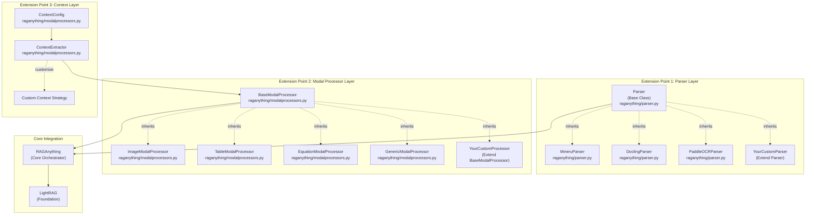
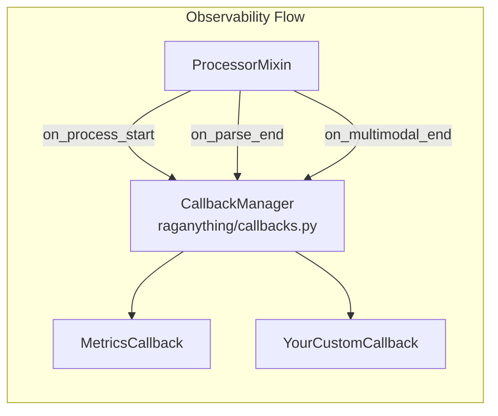
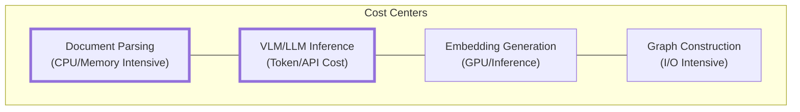

<!-- source: DeepWiki mcp.deepwiki.com · repo HKUDS/RAG-Anything · page 11 Advanced Topics · fetched 2026-11-09 -->

# Advanced Topics

Relevant source files

The following files were used as context for generating this wiki page:

- [.github/workflows/linting.yaml](.github/workflows/linting.yaml)
- [docs/offline_setup.md](docs/offline_setup.md)
- [raganything/__init__.py](raganything/__init__.py)
- [scripts/create_tiktoken_cache.py](scripts/create_tiktoken_cache.py)

This section covers advanced usage patterns, customization techniques, and deployment strategies for RAG-Anything. These topics are intended for users who need to extend the system's capabilities, optimize performance, or deploy in specialized environments.

**Scope**: This page provides an architectural overview of extension points and advanced patterns. For detailed implementation guides, see:
- [Offline Deployment](#11.1) — Guide for deploying RAG-Anything with local models and no internet connectivity.
- [Performance Optimization](#11.2) — Tips for optimizing processing speed, memory usage, and query performance.
- [Custom Modal Processor Development](#11.3) — In-depth guide for developing custom modal processors for new content types.
- [Parser Extension](#11.4) — Guide for creating custom parser implementations using the parser registry.
- [Resilience and Error Handling](#11.5) — Documentation on retries, circuit breakers, and fault tolerance.
- [Callbacks and Observability](#11.6) — Monitoring the document processing lifecycle with hooks and metrics.
- [Prompt Management and Localization](#11.7) — Managing multilingual prompt templates and localization.

---

## Extension Point Architecture

RAG-Anything provides three primary extension points for customization: **parsers**, **modal processors**, and **context extractors**. Understanding these extension points is essential for advanced customization.

### System Extension Map

**Sources**: [raganything/parser.py:49-1720](), [raganything/modalprocessors.py:33-1570]()

---

## Resilience and Observability

To ensure reliability in production environments, RAG-Anything includes optional modules for resilience (retries, circuit breakers) and observability (callbacks).

### Resilience Utilities
The system provides `retry`, `async_retry`, and `CircuitBreaker` patterns to handle transient failures in LLM APIs or network-bound operations. These are feature-gated and available if the resilience module is present.

### Callback System
The `ProcessingCallback` and `CallbackManager` allow developers to hook into the document processing lifecycle. This is useful for progress tracking, logging, or custom metrics collection.

**Sources**: [raganything/__init__.py:21-44](), [raganything/__init__.py:81-98]()

---

## Offline and Performance Strategies

### Offline Deployment
RAG-Anything can run in air-gapped environments. A critical step is handling the `tiktoken` network dependency by pre-caching models using `scripts/create_tiktoken_cache.py` and setting the `TIKTOKEN_CACHE_DIR` environment variable. For details, see [Offline Deployment](#11.1).

### Performance Tuning
Optimization targets include concurrency control (e.g., `MAX_ASYNC`), batch processing in `BatchMixin`, and caching mechanisms for both parsing and multimodal analysis. For details, see [Performance Optimization](#11.2).

### Resource Consumption Hierarchy

**Sources**: [docs/offline_setup.md:1-79](), [scripts/create_tiktoken_cache.py:1-18]()

---

## Prompt Management and Localization

The `prompt_manager` provides a centralized way to handle multilingual prompts and template overrides. Users can switch between languages (e.g., English and Chinese) or register entirely new prompt sets without modifying core logic.

| Function | Purpose |
|----------|---------|
| `set_prompt_language` | Sets the global prompt language for the session. |
| `register_prompt_language` | Adds a new language mapping to the system. |
| `reset_prompts` | Reverts prompts to their default state. |

**Sources**: [raganything/__init__.py:48-58](), [raganything/__init__.py:100-109]()

---

## Next Steps

For detailed implementation guides on specific advanced topics:

- **Deploying without internet**: [Offline Deployment](#11.1)
- **Speeding up processing and queries**: [Performance Optimization](#11.2)
- **Creating custom content processors**: [Custom Modal Processor Development](#11.3)
- **Adding support for new file formats**: [Parser Extension](#11.4)
- **Implementing retries and error handling**: [Resilience and Error Handling](#11.5)
- **Monitoring with callbacks**: [Callbacks and Observability](#11.6)
- **Customizing prompt templates**: [Prompt Management and Localization](#11.7)

---

