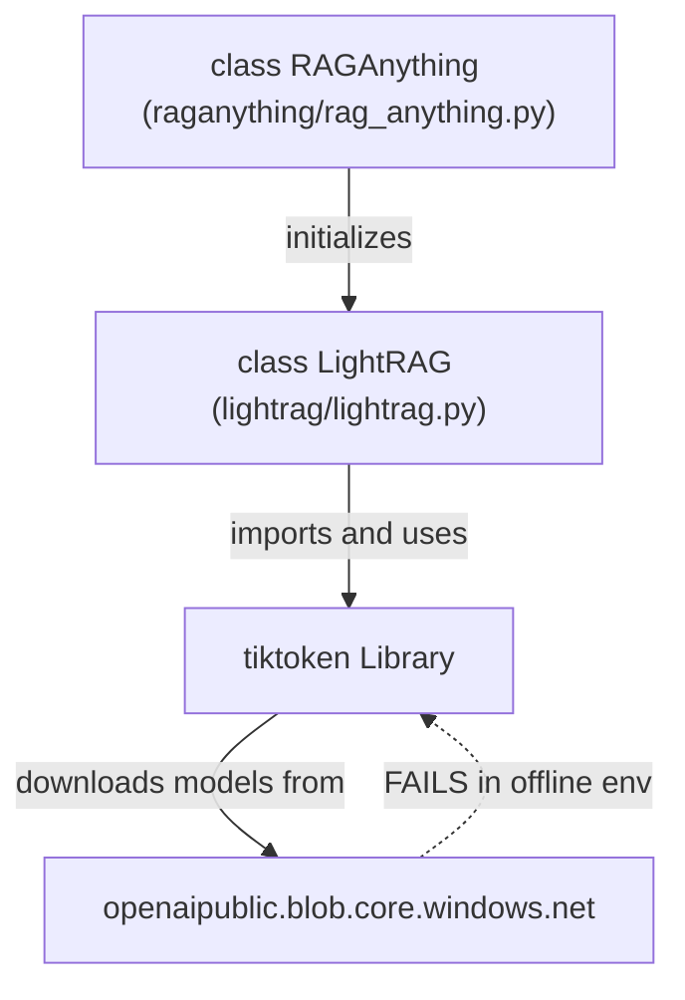
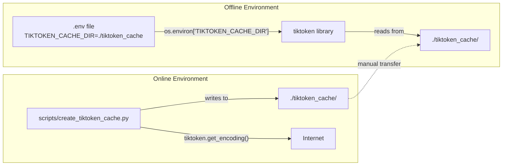
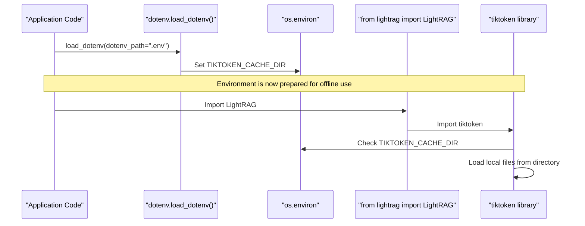

<!-- source: DeepWiki mcp.deepwiki.com · repo HKUDS/RAG-Anything · page 11.1 Offline Deployment · fetched 2026-11-09 -->

# Offline Deployment

<details>
<summary>Relevant source files</summary>

The following files were used as context for generating this wiki page:

- [.github/workflows/linting.yaml](.github/workflows/linting.yaml)
- [.gitignore](.gitignore)
- [docs/offline_setup.md](docs/offline_setup.md)
- [env.example](env.example)
- [examples/lmstudio_integration_example.py](examples/lmstudio_integration_example.py)
- [scripts/create_tiktoken_cache.py](scripts/create_tiktoken_cache.py)

</details>


This document explains how to deploy and run RAG-Anything in air-gapped or network-restricted environments where internet access is unavailable. The primary challenge involves the `tiktoken` library's default behavior of downloading tokenizer models from OpenAI's servers on first use. This page covers the necessary steps to pre-cache these models and configure the system for fully offline operation.

For general configuration of RAG-Anything, see [RAGAnythingConfig](). For model provider setup, see [Model Provider Configuration]().

## Network Dependency Problem

RAG-Anything relies on the LightRAG framework, which uses OpenAI's `tiktoken` library for text tokenization. By default, `tiktoken` attempts to download tokenizer model files from `openaipublic.blob.core.windows.net` on its first use [docs/offline_setup.md:5-9](). In offline environments, this network call fails, preventing the LightRAG instance from initializing [docs/offline_setup.md:9-15]().

### Dependency Chain

The following diagram illustrates the relationship between code entities and the external network dependency.

**Tokenizer Dependency Graph**


**Sources:** [docs/offline_setup.md:5-18](), [env.example:13-17]()

### Error Manifestation

When the network download fails, you will encounter an error similar to:

```
Failed to initialize LightRAG instance: HTTPSConnectionPool(host='openaipublic.blob.core.windows.net', port=443): 
Max retries exceeded with url: /encodings/o200k_base
```

This failure occurs during initialization, even though RAG-Anything itself does not directly import or call `tiktoken`. The dependency is indirect through the underlying library [docs/offline_setup.md:11-17]().

## Solution Overview

The solution involves creating a local cache of `tiktoken` models in an environment with internet access, then configuring the offline environment to use this cache instead of attempting network downloads. This is achieved through the `TIKTOKEN_CACHE_DIR` environment variable [docs/offline_setup.md:19-24]().

**Offline Workflow Architecture**


**Sources:** [docs/offline_setup.md:19-24](), [scripts/create_tiktoken_cache.py:1-18]()

## Setting Up Offline Deployment

### Step 1: Create the Tiktoken Cache

In an environment **with internet access**, run the provided cache creation script:

```bash
uv run scripts/create_tiktoken_cache.py
```

This script performs the following operations:

| Operation | Description | Code Reference |
|-----------|-------------|----------------|
| Set cache directory | Defines `./tiktoken_cache` as the cache location | [scripts/create_tiktoken_cache.py:5-7]() |
| Create directory | Creates the cache directory if it doesn't exist | [scripts/create_tiktoken_cache.py:10-11]() |
| Download models | Downloads `cl100k_base` encoding (used by GPT-3.5/4) | [scripts/create_tiktoken_cache.py:14]() |
| Store locally | Saves model files to the cache directory | [scripts/create_tiktoken_cache.py:5-11]() |

**Sources:** [docs/offline_setup.md:26-34](), [scripts/create_tiktoken_cache.py:1-18]()

### Step 2: Transfer Cache to Offline Environment

Copy the entire `tiktoken_cache` directory from the online environment to your offline deployment environment. The directory structure should be preserved [docs/offline_setup.md:27-34]():

```
project_root/
├── tiktoken_cache/
│   └── [model files downloaded by script]
├── .env
└── [other project files]
```

**Sources:** [docs/offline_setup.md:27-34](), [.gitignore:69]()

### Step 3: Configure Environment Variable

Add the following line to your `.env` file in the offline environment:

```bash
TIKTOKEN_CACHE_DIR=./tiktoken_cache
```

This environment variable instructs `tiktoken` to read model files from the specified local directory instead of attempting network downloads [env.example:17]().

**Sources:** [docs/offline_setup.md:36-40](), [env.example:13-17]()

### Step 4: Ensure Proper Load Order

**Critical:** The `.env` file must be loaded **before** the code imports `tiktoken` (which happens inside LightRAG). This ensures the `TIKTOKEN_CACHE_DIR` environment variable is active when the library initializes [docs/offline_setup.md:42-43]().

**Initialization Sequence**


**Sources:** [docs/offline_setup.md:42-65]()

The initialization code should follow this pattern:

```python
import os
from pathlib import Path
from dotenv import load_dotenv

# Load environment variables FIRST - before any imports that use tiktoken
load_dotenv(dotenv_path=".env", override=False)

# Now import LightRAG (which will import tiktoken with the correct env var set)
from lightrag import LightRAG
```

**Sources:** [docs/offline_setup.md:44-64]()

## Testing Offline Setup

Follow these steps to verify your offline deployment is configured correctly [docs/offline_setup.md:67-78]():

1.  **Create a `tiktoken_cache` directory:** Run `scripts/create_tiktoken_cache.py` to populate the directory.
2.  **Set the variable:** Add `TIKTOKEN_CACHE_DIR=./tiktoken_cache` to your `.env` file.
3.  **Disconnect from the internet:** Disable network interfaces or use airplane mode.
4.  **Run the application:** Execute an example, such as `uv run examples/raganything_example.py requirements.txt`.

If the application initializes without an `HTTPSConnectionPool` error, the offline setup is successful.

**Sources:** [docs/offline_setup.md:67-78]()

## Tiktoken Models Cached

The `create_tiktoken_cache.py` script specifically targets the following:

| Encoding Name | Used By | Code Reference |
|---------------|---------|----------------|
| `cl100k_base` | GPT-3.5-Turbo, GPT-4, text-embedding-3-* | [scripts/create_tiktoken_cache.py:14]() |

Additional encodings like `p50k_base` (GPT-3, Codex) are commented out in the script but can be enabled if required by your specific local models [scripts/create_tiktoken_cache.py:15]().

**Sources:** [scripts/create_tiktoken_cache.py:14-15]()

## Local Model Integration

For a truly offline deployment, you must also use local LLM and Embedding providers. RAG-Anything supports several local backends:

*   **Ollama:** Configure via `EMBEDDING_BINDING=ollama` and `LLM_BINDING=ollama` [env.example:136-141]().
*   **LM Studio:** Use the OpenAI-compatible API provided by LM Studio [examples/lmstudio_integration_example.py:14-21]().
*   **vLLM:** Recommended for high-throughput production inference [env.example:127-132]().

Example `.env` for local LM Studio integration:
```bash
LLM_BINDING=lmstudio
LLM_MODEL=openai/gpt-oss-20b
LLM_BINDING_HOST=http://localhost:1234/v1
EMBEDDING_BINDING=lmstudio
EMBEDDING_MODEL=text-embedding-nomic-embed-text-v1.5
EMBEDDING_BINDING_HOST=http://localhost:1234/v1
TIKTOKEN_CACHE_DIR=./tiktoken_cache
```

**Sources:** [examples/lmstudio_integration_example.py:12-22](), [env.example:127-141]()

---

