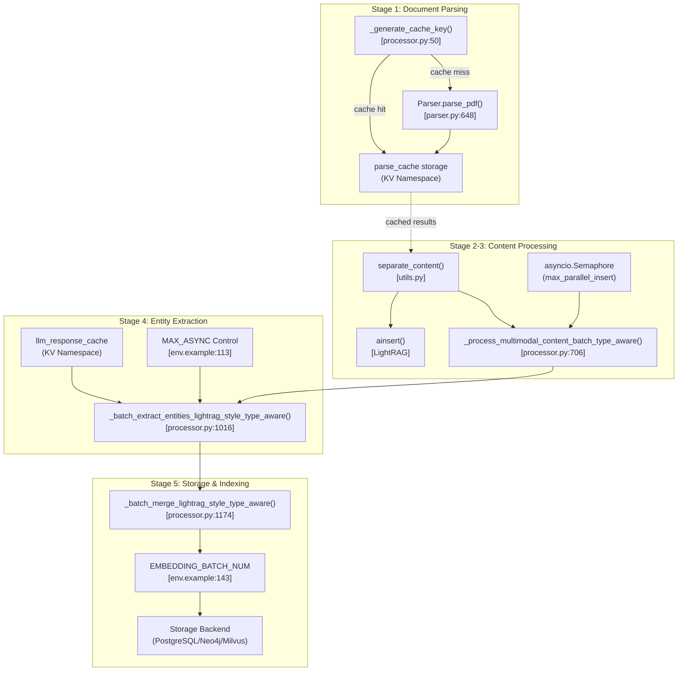
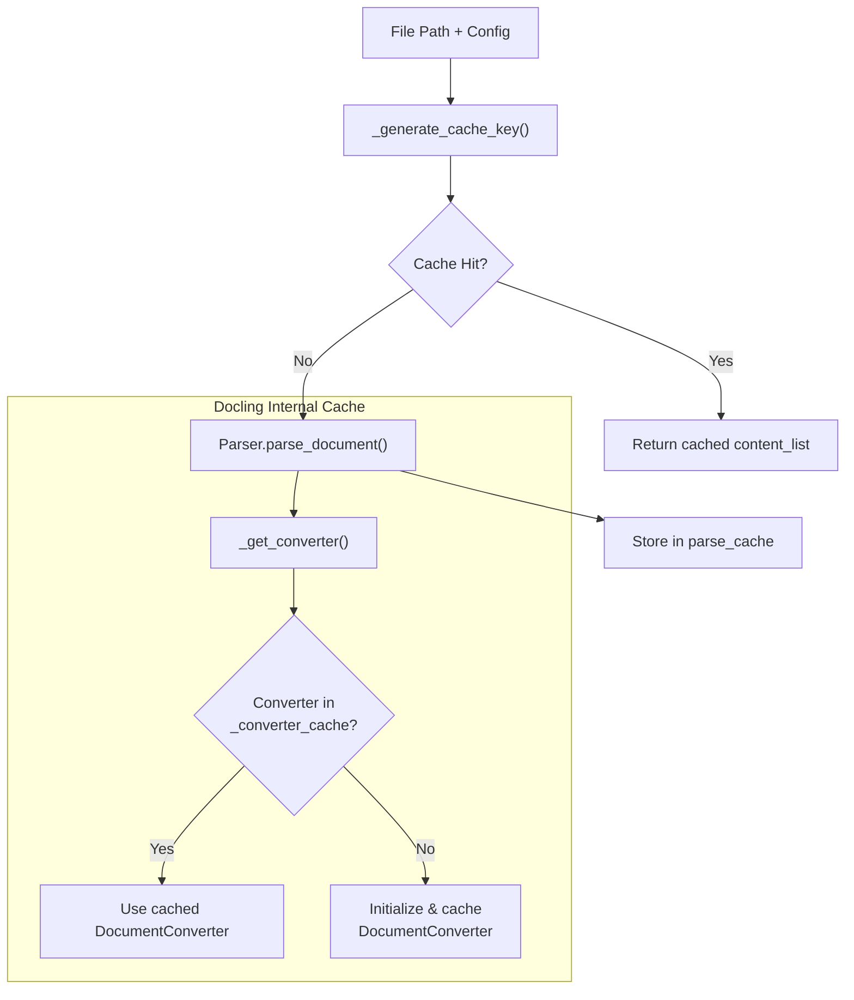
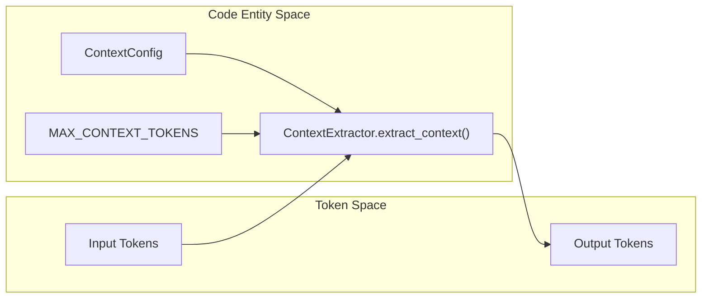

<!-- source: DeepWiki mcp.deepwiki.com · repo HKUDS/RAG-Anything · page 11.2 Performance Optimization · fetched 2026-11-09 -->

# Performance Optimization

Relevant source files

The following files were used as context for generating this wiki page:

- [.gitignore](.gitignore)
- [env.example](env.example)
- [examples/lmstudio_integration_example.py](examples/lmstudio_integration_example.py)
- [raganything/parser.py](raganything/parser.py)
- [raganything/processor.py](raganything/processor.py)
- [tests/test_insert_content_list.py](tests/test_insert_content_list.py)
- [tests/testparser_kwargs.py](tests/testparser_kwargs.py)

This document covers performance optimization techniques and configuration options for RAG-Anything. It explains caching strategies, batch processing, concurrency controls, and memory management that can significantly improve processing speed and resource utilization.

For configuration details, see **8. Configuration**. For storage backend optimization, see **8.3. Storage Backend Configuration**. For offline deployment optimization, see **11.1. Offline Deployment**.

---

## Overview of Performance Optimization Areas

RAG-Anything provides multiple optimization mechanisms across its five-stage processing pipeline. The main performance-critical areas are:

1.  **Parse Caching**: Avoid redundant document parsing through intelligent caching.
2.  **Batch Processing**: Process multimodal content in parallel batches instead of sequentially.
3.  **Concurrency Controls**: Configure parallelism for LLM calls, embeddings, and document processing.
4.  **LLM Call Optimization**: Cache responses and control API request concurrency.
5.  **Context Extraction**: Optimize context window size and token limits.
6.  **Memory Management**: Efficient handling of large documents and multimodal content.

### Performance Pipeline Architecture

The following diagram maps high-level optimization concepts to the specific code entities and variables that implement them.

**Sources:** [raganything/processor.py:50-50](), [raganything/processor.py:706-706](), [raganything/processor.py:1016-1016](), [raganything/processor.py:1174-1174](), [raganything/parser.py:648-648](), [env.example:113-143]()

---

## Parse Caching System

The parse caching system prevents redundant parsing of documents by storing and reusing results in the `parse_cache` storage.

### Cache Key Generation

The `_generate_cache_key` method in `ProcessorMixin` creates a unique MD5 hash based on the file's state and the parser's configuration [raganything/processor.py:50-98]().

| Component | Purpose | Implementation |
| :--- | :--- | :--- |
| `file_path` | Unique file identifier | Absolute path string [raganything/processor.py:70-70]() |
| `mtime` | Detect file changes | `file_path.stat().st_mtime` [raganything/processor.py:66-66]() |
| `parser` | Parser backend | `self.config.parser` (mineru, docling, etc.) [raganything/processor.py:72-72]() |
| `parse_method` | Processing mode | `config.parse_method` (auto, ocr, txt) [raganything/processor.py:73-73]() |
| `relevant_kwargs` | Parser parameters | `lang`, `device`, `pages`, `formula`, `table` [raganything/processor.py:77-92]() |

### Docling Converter Cache
For the `DoclingParser`, RAG-Anything optimizes performance by caching the `DocumentConverter` instance. This avoids the heavy overhead of re-initializing the Docling model pipeline for every document [raganything/parser.py:1015-1044]().

**Sources:** [raganything/processor.py:50-98](), [raganything/parser.py:1015-1044]()

---

## Batch Processing Optimization

RAG-Anything implements `_process_multimodal_content_batch_type_aware` to maximize parallelism and minimize LLM API call overhead [raganything/processor.py:706-881]().

### Concurrency Control via Semaphores
The system uses an `asyncio.Semaphore` to limit concurrent multimodal processing tasks. The limit is derived from `max_parallel_insert` (defaulting to 2) [raganything/processor.py:732-732]().

### Optimization Comparison: Individual vs. Batch

| Metric | Individual Processing | Batch Processing |
| :--- | :--- | :--- |
| **LLM Description Calls** | Sequential or Uncontrolled | Controlled via `Semaphore` [raganything/processor.py:743-746]() |
| **Entity Extraction** | 1 Call per Item | 1 Batch Call for all items [raganything/processor.py:844-846]() |
| **Storage Ops** | Multiple per Item | Single Batch Upsert [raganything/processor.py:829-834]() |
| **KG Merging** | Separate operations | `_batch_merge_lightrag_style_type_aware` [raganything/processor.py:863-865]() |

**Sources:** [raganything/processor.py:706-881](), [raganything/processor.py:732-732](), [raganything/processor.py:743-746](), [raganything/processor.py:844-846](), [raganything/processor.py:863-865]()

---

## Concurrency Controls

Multiple environment variables and config fields control the system's parallel execution capabilities.

### Key Performance Variables

| Variable | Default | Purpose | File Pointer |
| :--- | :--- | :--- | :--- |
| `MAX_ASYNC` | 4 | Max concurrent LLM requests. | [env.example:113]() |
| `MAX_PARALLEL_INSERT` | 2 | Concurrent document processing tasks. | [env.example:100]() |
| `EMBEDDING_FUNC_MAX_ASYNC` | 16 | Concurrent embedding API calls. | [env.example:145]() |
| `EMBEDDING_BATCH_NUM` | 32 | Chunks per embedding request. | [env.example:143]() |
| `MAX_CONCURRENT_FILES` | 1 | Parallel files in `process_folder_complete`. | [env.example:54]() |

### Optimization Guidelines

1.  **For High-Throughput APIs (OpenAI/Azure)**: Increase `MAX_ASYNC` to 10-20 and `EMBEDDING_FUNC_MAX_ASYNC` to 32.
2.  **For Local Models (Ollama/LM Studio)**: Keep `MAX_ASYNC` low (1-4) to avoid GPU OOM or context contention. Set `EMBEDDING_BATCH_NUM` to 32+ to benefit from batch processing [examples/lmstudio_integration_example.py:167-173]().
3.  **Memory Constraints**: If processing large PDFs with many images, keep `MAX_PARALLEL_INSERT` at 1 or 2 to limit memory spikes during VLM description generation.

**Sources:** [env.example:54-145](), [examples/lmstudio_integration_example.py:167-173]()

---

## Context Extraction Optimization

The `ContextExtractor` determines how much surrounding text is sent to the VLM for describing images, tables, or equations.

### Token and Window Tuning
The `ContextConfig` class allows tuning the context window to balance description accuracy with token cost [raganything/config.py:76-105]().

*   **`context_mode`**: `page` (default) extracts surrounding pages; `chunk` extracts surrounding text chunks [raganything/config.py:81-81]().
*   **`context_window`**: Number of units (pages/chunks) to include before/after the item [raganything/config.py:79-79]().
*   **`max_context_tokens`**: Hard limit (default 2000) to prevent oversized LLM payloads [raganything/config.py:83-83]().

**Sources:** [raganything/config.py:76-105](), [env.example:58-63]()

---

## Storage and Query Performance

### Vector DB Batching
When inserting text chunks, the system batches them according to `EMBEDDING_BATCH_NUM`. This is critical for remote embedding services where network latency per request is high [env.example:143]().

### Query Retrieval Tuning
Query performance is primarily affected by retrieval depth:
*   **`TOP_K`**: Number of text chunks retrieved (default 60) [env.example:86]().
*   **`MAX_GRAPH_NODES`**: Maximum nodes returned from graph retrieval (default 1000) [env.example:73]().
*   **`COSINE_THRESHOLD`**: Similarity filter; higher values (e.g., 0.3) speed up processing by ignoring low-relevance chunks [env.example:85]().

### LLM Response Caching
`ENABLE_LLM_CACHE` (default true) ensures that identical entity extraction prompts or summary requests do not hit the LLM twice, drastically speeding up the indexing of similar documents [env.example:106-107]().

**Sources:** [env.example:73-143]()

---

