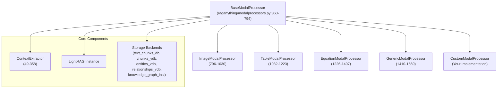
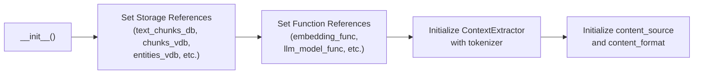
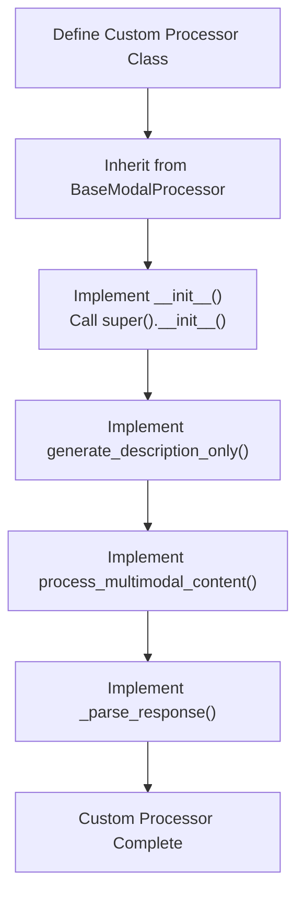
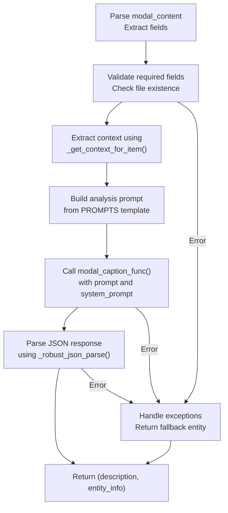
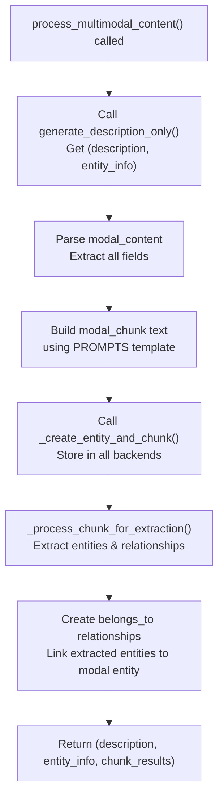
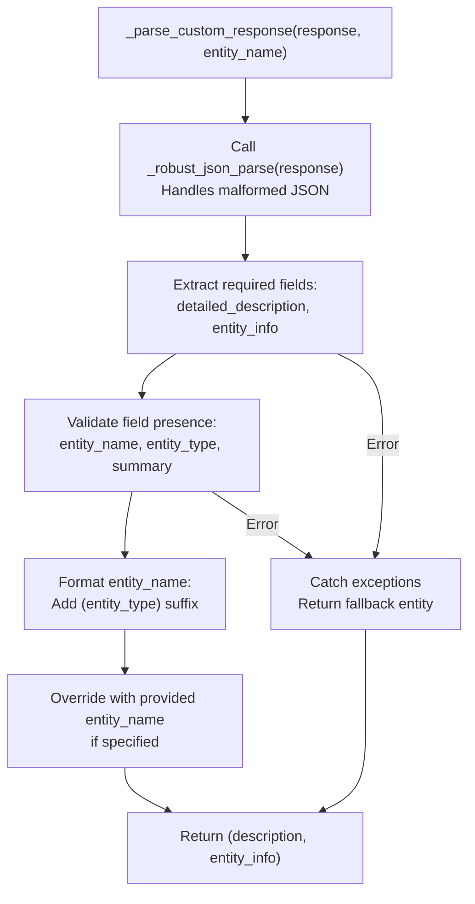
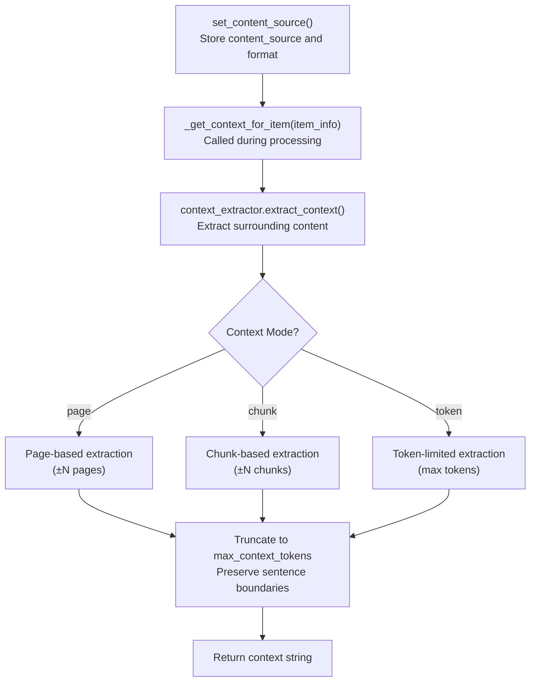
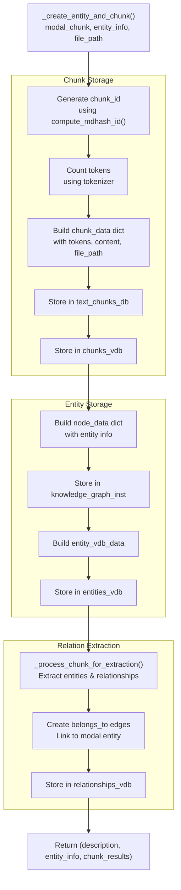
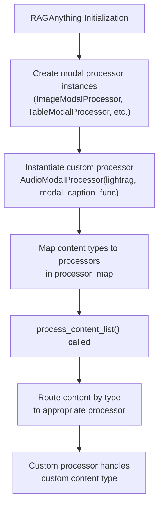

<!-- source: DeepWiki mcp.deepwiki.com · repo HKUDS/RAG-Anything · page 11.3 Custom Modal Processor Development · fetched 2026-11-09 -->

# Custom Modal Processor Development

<details>
<summary>Relevant source files</summary>

The following files were used as context for generating this wiki page:

- [docs/context_aware_processing.md](docs/context_aware_processing.md)
- [examples/insert_content_list_example.py](examples/insert_content_list_example.py)
- [examples/modalprocessors_example.py](examples/modalprocessors_example.py)
- [raganything/modalprocessors.py](raganything/modalprocessors.py)
- [tests/test_embedding_examples.py](tests/test_embedding_examples.py)

</details>


This page provides an in-depth guide for developing custom modal processors to handle new content types in RAG-Anything. Custom modal processors enable the system to process, analyze, and index specialized content formats beyond the built-in image, table, and equation processors.

For an overview of the modal processor architecture and built-in processors, see [Modal Processor Architecture](#5.1). For specific implementations of existing processors, see [Image Processing](#5.2), [Table Processing](#5.3), and [Equation Processing](#5.4). For API reference, see [Modal Processors API](#10.3).

---

## Architecture Overview

The modal processor system follows a class-based inheritance pattern where all processors extend `BaseModalProcessor` and implement specific content handling logic.

### Class Hierarchy



**Sources:** [raganything/modalprocessors.py:360-794](), [raganything/modalprocessors.py:49-358]()

---

## BaseModalProcessor Components

### Required Dependencies

Every `BaseModalProcessor` instance receives and manages several core components:

| Component | Type | Purpose |
|-----------|------|---------|
| `lightrag` | `LightRAG` | Core RAG system instance |
| `modal_caption_func` | Callable | LLM/VLM function for content analysis |
| `context_extractor` | `ContextExtractor` | Extracts surrounding document context |
| `text_chunks_db` | Storage | Text chunk storage backend |
| `chunks_vdb` | VectorStorage | Vector database for chunks |
| `entities_vdb` | VectorStorage | Vector database for entities |
| `relationships_vdb` | VectorStorage | Vector database for relationships |
| `knowledge_graph_inst` | GraphStorage | Knowledge graph storage |
| `embedding_func` | Callable | Embedding generation function |
| `llm_model_func` | Callable | LLM function for extraction |
| `tokenizer` | Tokenizer | Token counting and encoding |

**Sources:** [raganything/modalprocessors.py:363-401]()

### Initialization Pattern



**Sources:** [raganything/modalprocessors.py:363-404]()

---

## Required Methods

Custom modal processors must implement two primary methods:

### 1. generate_description_only()

Generates text descriptions and entity information without performing entity extraction. Used in batch processing Stage 1.

**Signature:**
```python
async def generate_description_only(
    self,
    modal_content: Any,
    content_type: str,
    item_info: Dict[str, Any] = None,
    entity_name: str = None,
) -> Tuple[str, Dict[str, Any]]:
```

**Returns:**
- `Tuple[str, Dict[str, Any]]`: (enhanced_description, entity_info)

**entity_info Structure:**
```python
{
    "entity_name": str,  # Unique identifier for the entity
    "entity_type": str,  # Content type classification
    "summary": str       # Concise summary (max 100 words)
}
```

**Sources:** [raganything/modalprocessors.py:442-463]()

### 2. process_multimodal_content()

Complete processing pipeline including description generation, entity creation, chunk storage, and knowledge graph integration.

**Signature:**
```python
async def process_multimodal_content(
    self,
    modal_content: Any,
    content_type: str,
    file_path: str = "manual_creation",
    entity_name: str = None,
    item_info: Dict[str, Any] = None,
    batch_mode: bool = False,
    doc_id: str = None,
    chunk_order_index: int = 0,
) -> Tuple[str, Dict[str, Any]]:
```

**Returns:**
- `Tuple[str, Dict[str, Any], List]`: (description, entity_info, chunk_results)

**Sources:** [raganything/modalprocessors.py:930-991]() (ImageModalProcessor example)

---

## Development Workflow

### Step 1: Define Content Structure

Identify the structure of your custom content type and define how it will be represented.

**Example Content Structure:**
```python
# Audio content example
audio_content = {
    "audio_path": "/path/to/audio.mp3",
    "duration": 120.5,
    "transcript": "...",
    "speakers": ["Speaker A", "Speaker B"],
    "audio_caption": ["Interview recording"],
}
```

### Step 2: Create Processor Class



**Sources:** [raganything/modalprocessors.py:360-401](), [raganything/modalprocessors.py:796-812]()

### Step 3: Implement generate_description_only()

This method handles content analysis and description generation.

**Implementation Pattern:**



**Key Components:**

1. **Content Parsing:**
```python
# Handle both string and dict formats
if isinstance(modal_content, str):
    try:
        content_data = json.loads(modal_content)
    except json.JSONDecodeError:
        content_data = {"field": modal_content}
else:
    content_data = modal_content
```

2. **Context Extraction:**
```python
# Extract context for current item
context = ""
if item_info:
    context = self._get_context_for_item(item_info)
```

3. **Prompt Construction:**
```python
# Build analysis prompt with or without context
if context:
    prompt = PROMPTS.get(
        "custom_prompt_with_context", PROMPTS["custom_prompt"]
    ).format(
        context=context,
        entity_name=entity_name or "descriptive name",
        **content_fields
    )
else:
    prompt = PROMPTS["custom_prompt"].format(
        entity_name=entity_name or "descriptive name",
        **content_fields
    )
```

4. **LLM Invocation:**
```python
# Call analysis function
response = await self.modal_caption_func(
    prompt,
    system_prompt=PROMPTS["CUSTOM_ANALYSIS_SYSTEM"],
)
```

5. **Response Parsing:**
```python
# Parse response using robust parser
enhanced_description, entity_info = self._parse_custom_response(
    response, entity_name
)
```

**Sources:** [raganything/modalprocessors.py:824-928]() (ImageModalProcessor example), [raganything/modalprocessors.py:1035-1123]() (TableModalProcessor example)

### Step 4: Implement process_multimodal_content()

This method orchestrates the complete processing pipeline.

**Processing Pipeline:**



**Implementation Template:**
```python
async def process_multimodal_content(
    self,
    modal_content,
    content_type: str,
    file_path: str = "manual_creation",
    entity_name: str = None,
    item_info: Dict[str, Any] = None,
    batch_mode: bool = False,
    doc_id: str = None,
    chunk_order_index: int = 0,
) -> Tuple[str, Dict[str, Any]]:
    try:
        # Step 1: Generate description and entity info
        enhanced_description, entity_info = await self.generate_description_only(
            modal_content, content_type, item_info, entity_name
        )
        
        # Step 2: Parse content for building complete chunk
        if isinstance(modal_content, str):
            try:
                content_data = json.loads(modal_content)
            except json.JSONDecodeError:
                content_data = {"content": modal_content}
        else:
            content_data = modal_content
        
        # Extract fields from content_data
        field1 = content_data.get("field1", "")
        field2 = content_data.get("field2", "")
        
        # Step 3: Build complete content chunk
        modal_chunk = PROMPTS["custom_chunk"].format(
            field1=field1,
            field2=field2,
            enhanced_description=enhanced_description,
        )
        
        # Step 4: Create entity and chunk (handles storage)
        return await self._create_entity_and_chunk(
            modal_chunk,
            entity_info,
            file_path,
            batch_mode,
            doc_id,
            chunk_order_index,
        )
        
    except Exception as e:
        logger.error(f"Error processing {content_type} content: {e}")
        # Return fallback entity
        fallback_entity = {
            "entity_name": entity_name or f"{content_type}_{compute_mdhash_id(str(modal_content))}",
            "entity_type": content_type,
            "summary": f"{content_type} content: {str(modal_content)[:100]}",
        }
        return str(modal_content), fallback_entity
```

**Sources:** [raganything/modalprocessors.py:930-991]() (ImageModalProcessor), [raganything/modalprocessors.py:1125-1185]() (TableModalProcessor)

### Step 5: Implement Response Parsing

Create a method to parse LLM responses with robust error handling.

**Parsing Method Pattern:**



**Implementation:**
```python
def _parse_custom_response(
    self, response: str, entity_name: str = None
) -> Tuple[str, Dict[str, Any]]:
    """Parse custom content analysis response"""
    try:
        # Use inherited robust JSON parser
        response_data = self._robust_json_parse(response)
        
        # Extract required fields
        description = response_data.get("detailed_description", "")
        entity_data = response_data.get("entity_info", {})
        
        # Validate presence
        if not description or not entity_data:
            raise ValueError("Missing required fields in response")
        
        if not all(
            key in entity_data for key in ["entity_name", "entity_type", "summary"]
        ):
            raise ValueError("Missing required fields in entity_info")
        
        # Format entity name with type
        entity_data["entity_name"] = (
            entity_data["entity_name"] + f" ({entity_data['entity_type']})"
        )
        
        # Override with provided name if specified
        if entity_name:
            entity_data["entity_name"] = entity_name
        
        return description, entity_data
        
    except (json.JSONDecodeError, AttributeError, ValueError) as e:
        logger.error(f"Error parsing custom content response: {e}")
        logger.debug(f"Raw response: {response}")
        
        # Return fallback entity
        fallback_entity = {
            "entity_name": entity_name or f"custom_{compute_mdhash_id(response)}",
            "entity_type": "custom",
            "summary": response[:100] + "..." if len(response) > 100 else response,
        }
        return response, fallback_entity
```

**Sources:** [raganything/modalprocessors.py:993-1029]() (ImageModalProcessor), [raganything/modalprocessors.py:547-698]() (BaseModalProcessor robust parsing)

---

## Prompt Templates

Custom processors require prompt templates defined in `PROMPTS` dictionary.

### Required Prompt Types

| Prompt Key | Purpose | Context Support |
|------------|---------|-----------------|
| `custom_prompt` | Basic analysis prompt | No |
| `custom_prompt_with_context` | Context-aware analysis prompt | Yes |
| `CUSTOM_ANALYSIS_SYSTEM` | System prompt for LLM | N/A |
| `custom_chunk` | Chunk formatting template | N/A |

### Prompt Structure

**Basic Prompt Template:**
```python
PROMPTS["custom_prompt"] = """Please analyze this {content_type} content and provide a JSON response with the following structure:

{{
    "detailed_description": "A comprehensive analysis of the content including:
    - Content structure and organization
    - Key information and elements
    - Relationships between components
    - Context and significance
    - Relevant details for knowledge retrieval",
    "entity_info": {{
        "entity_name": "{entity_name}",
        "entity_type": "{content_type}",
        "summary": "concise summary (max 100 words)"
    }}
}}

Content Information:
{content_fields}

Focus on extracting meaningful information for knowledge retrieval."""
```

**Context-Aware Prompt Template:**
```python
PROMPTS["custom_prompt_with_context"] = """Please analyze this {content_type} content considering the surrounding context, and provide a JSON response:

{{
    "detailed_description": "Comprehensive analysis including:
    - Content structure and key elements
    - Relationships to surrounding context
    - How this content supports the broader discussion
    - Relevant details for knowledge retrieval",
    "entity_info": {{
        "entity_name": "{entity_name}",
        "entity_type": "{content_type}",
        "summary": "concise summary including context relationship (max 100 words)"
    }}
}}

Context from surrounding content:
{context}

Content Information:
{content_fields}"""
```

**System Prompt:**
```python
PROMPTS["CUSTOM_ANALYSIS_SYSTEM"] = (
    "You are an expert {content_type} analyst. Provide detailed, accurate analysis."
)
```

**Chunk Template:**
```python
PROMPTS["custom_chunk"] = """{content_type} Content Analysis:
Field1: {field1}
Field2: {field2}

Analysis: {enhanced_description}"""
```

**Sources:** [raganything/prompt.py:1-354]()

---

## Context Integration

Custom processors inherit context extraction capabilities from `BaseModalProcessor`.

### Context Extraction Flow



### Using Context in Processors

**Setting Content Source:**
```python
# Before processing, set the content source
processor.set_content_source(
    content_source=content_list,  # Full document content
    content_format="minerU"        # Format hint
)
```

**Extracting Context:**
```python
# Inside generate_description_only()
context = ""
if item_info:
    context = self._get_context_for_item(item_info)
```

**item_info Structure:**
```python
item_info = {
    "page_idx": 5,        # Current page index
    "index": 10,          # Current item index
    # Additional fields as needed
}
```

**Sources:** [raganything/modalprocessors.py:406-440](), [raganything/modalprocessors.py:49-358]()

---

## Storage Integration

The `_create_entity_and_chunk()` method handles all storage operations.

### Storage Pipeline



**Storage Targets:**

| Storage | Purpose | Data Format |
|---------|---------|-------------|
| `text_chunks_db` | Text chunk metadata | `{chunk_id: {tokens, content, chunk_order_index, full_doc_id, file_path}}` |
| `chunks_vdb` | Vector embeddings for chunks | `{chunk_id: {content, full_doc_id, tokens, chunk_order_index, file_path}}` |
| `knowledge_graph_inst` | Graph nodes | `{entity_id, entity_type, description, source_id, file_path, created_at}` |
| `entities_vdb` | Vector embeddings for entities | `{entity_id: {entity_name, entity_type, content, source_id, file_path}}` |
| `relationships_vdb` | Vector embeddings for relationships | `{relation_id: {src_id, tgt_id, keywords, content, source_id, file_path}}` |

**Sources:** [raganything/modalprocessors.py:465-545](), [raganything/modalprocessors.py:699-793]()

---

## Complete Example: AudioModalProcessor

Here is a complete example implementing a custom processor for audio content.

### Class Definition

```python
class AudioModalProcessor(BaseModalProcessor):
    """Processor specialized for audio content"""
    
    async def generate_description_only(
        self,
        modal_content,
        content_type: str,
        item_info: Dict[str, Any] = None,
        entity_name: str = None,
    ) -> Tuple[str, Dict[str, Any]]:
        """Generate audio description and entity info"""
        try:
            # Parse audio content
            if isinstance(modal_content, str):
                try:
                    content_data = json.loads(modal_content)
                except json.JSONDecodeError:
                    content_data = {"transcript": modal_content}
            else:
                content_data = modal_content
            
            # Extract audio fields
            audio_path = content_data.get("audio_path", "")
            duration = content_data.get("duration", 0)
            transcript = content_data.get("transcript", "")
            speakers = content_data.get("speakers", [])
            audio_caption = content_data.get("audio_caption", [])
            
            # Validate required fields
            if not transcript:
                raise ValueError(
                    f"No transcript provided in modal_content: {modal_content}"
                )
            
            # Extract context
            context = ""
            if item_info:
                context = self._get_context_for_item(item_info)
            
            # Build analysis prompt
            if context:
                audio_prompt = PROMPTS.get(
                    "audio_prompt_with_context", PROMPTS["audio_prompt"]
                ).format(
                    context=context,
                    entity_name=entity_name or "descriptive name for this audio",
                    audio_path=audio_path,
                    duration=duration,
                    transcript=transcript,
                    speakers=", ".join(speakers) if speakers else "Unknown",
                    audio_caption=", ".join(audio_caption) if audio_caption else "None",
                )
            else:
                audio_prompt = PROMPTS["audio_prompt"].format(
                    entity_name=entity_name or "descriptive name for this audio",
                    audio_path=audio_path,
                    duration=duration,
                    transcript=transcript,
                    speakers=", ".join(speakers) if speakers else "Unknown",
                    audio_caption=", ".join(audio_caption) if audio_caption else "None",
                )
            
            # Call LLM for audio analysis
            response = await self.modal_caption_func(
                audio_prompt,
                system_prompt=PROMPTS["AUDIO_ANALYSIS_SYSTEM"],
            )
            
            # Parse response
            enhanced_description, entity_info = self._parse_audio_response(
                response, entity_name
            )
            
            return enhanced_description, entity_info
            
        except Exception as e:
            logger.error(f"Error generating audio description: {e}")
            # Fallback entity
            fallback_entity = {
                "entity_name": entity_name or f"audio_{compute_mdhash_id(str(modal_content))}",
                "entity_type": "audio",
                "summary": f"Audio content: {str(modal_content)[:100]}",
            }
            return str(modal_content), fallback_entity
    
    async def process_multimodal_content(
        self,
        modal_content,
        content_type: str,
        file_path: str = "manual_creation",
        entity_name: str = None,
        item_info: Dict[str, Any] = None,
        batch_mode: bool = False,
        doc_id: str = None,
        chunk_order_index: int = 0,
    ) -> Tuple[str, Dict[str, Any]]:
        """Process audio content with context support"""
        try:
            # Generate description and entity info
            enhanced_description, entity_info = await self.generate_description_only(
                modal_content, content_type, item_info, entity_name
            )
            
            # Parse content for building complete chunk
            if isinstance(modal_content, str):
                try:
                    content_data = json.loads(modal_content)
                except json.JSONDecodeError:
                    content_data = {"transcript": modal_content}
            else:
                content_data = modal_content
            
            audio_path = content_data.get("audio_path", "")
            duration = content_data.get("duration", 0)
            transcript = content_data.get("transcript", "")
            speakers = content_data.get("speakers", [])
            audio_caption = content_data.get("audio_caption", [])
            
            # Build complete audio content
            modal_chunk = PROMPTS["audio_chunk"].format(
                audio_path=audio_path,
                duration=duration,
                transcript=transcript,
                speakers=", ".join(speakers) if speakers else "Unknown",
                audio_caption=", ".join(audio_caption) if audio_caption else "None",
                enhanced_description=enhanced_description,
            )
            
            return await self._create_entity_and_chunk(
                modal_chunk,
                entity_info,
                file_path,
                batch_mode,
                doc_id,
                chunk_order_index,
            )
            
        except Exception as e:
            logger.error(f"Error processing audio content: {e}")
            # Fallback entity
            fallback_entity = {
                "entity_name": entity_name or f"audio_{compute_mdhash_id(str(modal_content))}",
                "entity_type": "audio",
                "summary": f"Audio content: {str(modal_content)[:100]}",
            }
            return str(modal_content), fallback_entity
    
    def _parse_audio_response(
        self, response: str, entity_name: str = None
    ) -> Tuple[str, Dict[str, Any]]:
        """Parse audio analysis response"""
        try:
            response_data = self._robust_json_parse(response)
            
            description = response_data.get("detailed_description", "")
            entity_data = response_data.get("entity_info", {})
            
            if not description or not entity_data:
                raise ValueError("Missing required fields in response")
            
            if not all(
                key in entity_data for key in ["entity_name", "entity_type", "summary"]
            ):
                raise ValueError("Missing required fields in entity_info")
            
            entity_data["entity_name"] = (
                entity_data["entity_name"] + f" ({entity_data['entity_type']})"
            )
            if entity_name:
                entity_data["entity_name"] = entity_name
            
            return description, entity_data
            
        except (json.JSONDecodeError, AttributeError, ValueError) as e:
            logger.error(f"Error parsing audio analysis response: {e}")
            logger.debug(f"Raw response: {response}")
            fallback_entity = {
                "entity_name": entity_name or f"audio_{compute_mdhash_id(response)}",
                "entity_type": "audio",
                "summary": response[:100] + "..." if len(response) > 100 else response,
            }
            return response, fallback_entity
```

### Prompt Templates

```python
# Add to raganything/prompt.py

PROMPTS["AUDIO_ANALYSIS_SYSTEM"] = (
    "You are an expert audio content analyst. Provide detailed, accurate transcription analysis."
)

PROMPTS["audio_prompt"] = """Please analyze this audio content and provide a JSON response:

{{
    "detailed_description": "A comprehensive analysis of the audio including:
    - Main topics and themes discussed
    - Key points and conclusions
    - Speaker contributions and perspectives
    - Tone and communication style
    - Context and significance of the discussion
    - Important quotes or statements",
    "entity_info": {{
        "entity_name": "{entity_name}",
        "entity_type": "audio",
        "summary": "concise summary of audio content (max 100 words)"
    }}
}}

Audio Information:
Path: {audio_path}
Duration: {duration} seconds
Speakers: {speakers}
Caption: {audio_caption}

Transcript:
{transcript}"""

PROMPTS["audio_prompt_with_context"] = """Please analyze this audio content considering the surrounding context:

{{
    "detailed_description": "Comprehensive analysis including:
    - Main topics and themes discussed
    - Key points and their relationship to surrounding content
    - Speaker contributions and perspectives
    - How this audio relates to the broader discussion
    - Important quotes or statements
    - Context connections",
    "entity_info": {{
        "entity_name": "{entity_name}",
        "entity_type": "audio",
        "summary": "concise summary including context relationship (max 100 words)"
    }}
}}

Context from surrounding content:
{context}

Audio Information:
Path: {audio_path}
Duration: {duration} seconds
Speakers: {speakers}
Caption: {audio_caption}

Transcript:
{transcript}"""

PROMPTS["audio_chunk"] = """Audio Content Analysis:
Path: {audio_path}
Duration: {duration} seconds
Speakers: {speakers}
Caption: {audio_caption}

Transcript:
{transcript}

Analysis: {enhanced_description}"""
```

**Sources:** Based on patterns from [raganything/modalprocessors.py:796-1030](), [raganything/modalprocessors.py:1032-1223](), [raganything/prompt.py:1-354]()

---

## Integration with RAGAnything

### Registration Pattern

Custom processors are typically instantiated and used within `ProcessorMixin` methods.



**Example Integration:**
```python
# In RAGAnything or ProcessorMixin initialization
self.audio_processor = AudioModalProcessor(
    lightrag=self.lightrag,
    modal_caption_func=self.llm_model_func,  # or vision_model_func
    context_extractor=self.context_extractor,
)

# Map content type to processor
self.processor_map = {
    "image": self.image_processor,
    "table": self.table_processor,
    "equation": self.equation_processor,
    "audio": self.audio_processor,  # Custom processor
    # ... other processors
}

# During processing
content_type = item.get("type")
processor = self.processor_map.get(content_type)
if processor:
    result = await processor.process_multimodal_content(
        modal_content=item,
        content_type=content_type,
        file_path=file_path,
        item_info={"page_idx": item.get("page_idx"), "index": idx},
    )
```

**Sources:** Based on patterns from [raganything/modalprocessors.py:360-401]()

---

## Best Practices

### Error Handling

1. **Wrap all operations in try-except blocks**
2. **Always provide fallback entities** for graceful degradation
3. **Log errors with detailed context** for debugging
4. **Validate input data** before processing

```python
try:
    # Processing logic
    result = await self.process_content(...)
except FileNotFoundError as e:
    logger.error(f"File not found: {e}")
    return self._create_fallback_entity()
except json.JSONDecodeError as e:
    logger.error(f"JSON parsing failed: {e}")
    return self._create_fallback_entity()
except Exception as e:
    logger.error(f"Unexpected error: {e}", exc_info=True)
    return self._create_fallback_entity()
```

### Prompt Design

1. **Request structured JSON output** with clear field definitions
2. **Provide specific instructions** for analysis
3. **Include context when available** for better understanding
4. **Use consistent field names** across all prompts
5. **Specify entity_name format** requirements

### Performance Optimization

1. **Use batch_mode flag** to defer expensive operations
2. **Cache LLM responses** using built-in `hashing_kv`
3. **Minimize redundant context extraction**
4. **Validate required fields early** before calling LLM

### Content Validation

1. **Check for required fields** before processing
2. **Validate file paths** if handling external resources
3. **Handle both string and dict inputs** consistently
4. **Provide meaningful error messages**

**Sources:** [raganything/modalprocessors.py:547-698]() (robust parsing strategies), [raganything/modalprocessors.py:824-928]() (error handling patterns)

---

## Testing Custom Processors

### Unit Test Structure

```python
import pytest
from raganything.modalprocessors import BaseModalProcessor
from your_module import AudioModalProcessor

@pytest.fixture
async def audio_processor(lightrag_instance, mock_llm_func):
    """Create audio processor instance for testing"""
    processor = AudioModalProcessor(
        lightrag=lightrag_instance,
        modal_caption_func=mock_llm_func,
    )
    return processor

@pytest.mark.asyncio
async def test_generate_description_only(audio_processor):
    """Test description generation"""
    modal_content = {
        "audio_path": "/path/to/test.mp3",
        "duration": 60.0,
        "transcript": "Test transcript content",
        "speakers": ["Speaker A"],
    }
    
    description, entity_info = await audio_processor.generate_description_only(
        modal_content=modal_content,
        content_type="audio",
    )
    
    assert description is not None
    assert entity_info["entity_type"] == "audio"
    assert "entity_name" in entity_info
    assert "summary" in entity_info

@pytest.mark.asyncio
async def test_process_multimodal_content(audio_processor):
    """Test complete processing pipeline"""
    modal_content = {
        "audio_path": "/path/to/test.mp3",
        "transcript": "Test transcript",
    }
    
    result = await audio_processor.process_multimodal_content(
        modal_content=modal_content,
        content_type="audio",
        file_path="test.pdf",
    )
    
    description, entity_info, chunk_results = result
    assert description is not None
    assert entity_info is not None
    assert chunk_results is not None

@pytest.mark.asyncio
async def test_error_handling(audio_processor):
    """Test error handling with invalid input"""
    modal_content = {}  # Missing required fields
    
    description, entity_info = await audio_processor.generate_description_only(
        modal_content=modal_content,
        content_type="audio",
    )
    
    # Should return fallback entity
    assert "audio_" in entity_info["entity_name"]
    assert entity_info["entity_type"] == "audio"
```

### Integration Test

```python
@pytest.mark.asyncio
async def test_end_to_end_processing(rag_instance):
    """Test custom processor in complete RAG pipeline"""
    # Add audio content to document
    content_list = [
        {
            "type": "text",
            "text": "Introduction to the interview",
            "page_idx": 0,
        },
        {
            "type": "audio",
            "audio_path": "/path/to/interview.mp3",
            "transcript": "Full interview transcript...",
            "duration": 1800.0,
            "speakers": ["Interviewer", "Expert"],
            "page_idx": 0,
        },
    ]
    
    # Process document
    await rag_instance.insert_content_list(
        content_list=content_list,
        file_path="interview_document.pdf",
    )
    
    # Query should retrieve audio content
    result = await rag_instance.aquery(
        "What did the expert say about the topic?"
    )
    
    assert result is not None
    assert "audio" in result.lower() or "interview" in result.lower()
```

**Sources:** Based on testing patterns for modal processors

---

## Troubleshooting

### Common Issues

| Issue | Cause | Solution |
|-------|-------|----------|
| JSON parsing fails | Malformed LLM response | Use `_robust_json_parse()` inherited method |
| Context not extracted | `content_source` not set | Call `set_content_source()` before processing |
| Entity not stored | Missing required fields | Validate `entity_info` has all required keys |
| Relationships not created | `batch_mode=True` | Ensure merge is called after batch processing |
| Token count incorrect | Wrong tokenizer | Use `self.tokenizer` from BaseModalProcessor |

### Debugging Tips

1. **Enable debug logging:**
```python
import logging
logging.getLogger("raganything").setLevel(logging.DEBUG)
```

2. **Inspect LLM responses:**
```python
logger.debug(f"Raw LLM response: {response}")
```

3. **Verify storage operations:**
```python
# Check if entity was stored
entity_data = await self.knowledge_graph_inst.get_node(entity_name)
logger.debug(f"Stored entity: {entity_data}")
```

4. **Test prompt templates:**
```python
# Print formatted prompt before calling LLM
logger.debug(f"Prompt: {prompt}")
```

**Sources:** [raganything/modalprocessors.py:547-698]() (robust parsing strategies)

---

## Summary

Custom modal processor development follows a structured pattern:

1. **Inherit from `BaseModalProcessor`** to access storage, LLM functions, and context extraction
2. **Implement `generate_description_only()`** for content analysis and entity creation
3. **Implement `process_multimodal_content()`** for complete processing pipeline
4. **Create parsing methods** using `_robust_json_parse()` for error handling
5. **Define prompt templates** with and without context support
6. **Integrate context extraction** using `_get_context_for_item()`
7. **Leverage `_create_entity_and_chunk()`** for automatic storage handling
8. **Test thoroughly** with unit and integration tests

The architecture provides flexibility for handling any content type while maintaining consistency with the RAG-Anything processing pipeline.

**Sources:** [raganything/modalprocessors.py:360-1569](), [raganything/prompt.py:1-354]()

---

