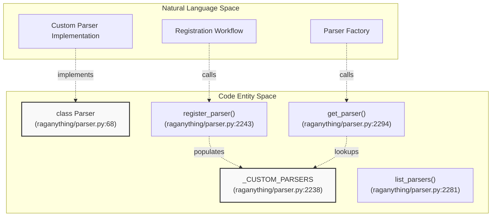
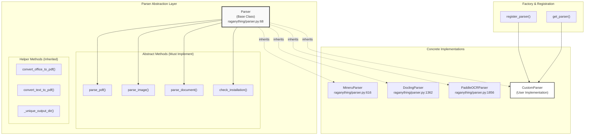

<!-- source: DeepWiki mcp.deepwiki.com · repo HKUDS/RAG-Anything · page 11.4 Parser Extension · fetched 2026-11-09 -->

# Parser Extension

<details>
<summary>Relevant source files</summary>

The following files were used as context for generating this wiki page:

- [raganything/batch_parser.py](raganything/batch_parser.py)
- [raganything/parser.py](raganything/parser.py)
- [tests/test_custom_parser.py](tests/test_custom_parser.py)
- [tests/testparser_kwargs.py](tests/testparser_kwargs.py)

</details>


This guide provides comprehensive documentation for creating custom parser implementations in RAG-Anything. It covers the `Parser` base class interface, the standardized output format specifications, and the plugin registry system for integrating new backends.

For information about using the existing parsers, see [Document Parsers](#4.1). For the broader document processing pipeline, see [Processing Pipeline Internals](#4.2).

---

## Purpose and Scope

RAG-Anything's parser subsystem is designed to be extensible. While the system ships with three parser implementations (`MineruParser`, `DoclingParser`, `PaddleOCRParser`), you can create custom parsers to integrate new document processing backends, specialized OCR engines, or proprietary parsing solutions.

The system utilizes a central registry (`_CUSTOM_PARSERS`) to manage third-party implementations, allowing them to be used via the standard `get_parser` factory without modifying core library code [raganything/parser.py:2238-2240]().

---

## Parser Architecture Overview

The following diagram bridges the **Natural Language Space** (Concepts) to the **Code Entity Space** (Classes and Functions).

### System Component Association

**Sources:** [raganything/parser.py:68-2310](), [raganything/parser.py:2238-2294]()

### Parser Inheritance and Data Flow

**Sources:** [raganything/parser.py:68-1856](), [raganything/parser.py:2243-2294]()

---

## Base Parser Class Interface

The `Parser` base class defines the contract for all implementations. It provides common functionality and requires subclasses to implement four primary methods.

### Required Abstract Methods

| Method | Purpose | Return Type |
|--------|---------|-------------|
| `parse_pdf()` | Parse PDF documents | `List[Dict[str, Any]]` |
| `parse_image()` | Parse image files | `List[Dict[str, Any]]` |
| `parse_document()` | Main routing method for any supported file | `List[Dict[str, Any]]` |
| `check_installation()` | Verify parser dependencies are available | `bool` |

### Class Attributes
The `Parser` class defines file format constants used for routing:
- `OFFICE_FORMATS`: `{".doc", ".docx", ".ppt", ".pptx", ".xls", ".xlsx"}` [raganything/parser.py:76]()
- `IMAGE_FORMATS`: `{".png", ".jpeg", ".jpg", ".bmp", ".tiff", ".tif", ".gif", ".webp"}` [raganything/parser.py:77]()
- `TEXT_FORMATS`: `{".txt", ".md"}` [raganything/parser.py:78]()

**Sources:** [raganything/parser.py:68-82]()

---

## Standardized Output Format

All parsers must return a `List[Dict[str, Any]]`. The system recognizes four content types:

### 1. Text Block
```python
{
    "type": "text",
    "text": "Extracted text content...",
    "page_idx": 0
}
```
**Sources:** [raganything/parser.py:1647-1661]()

### 2. Image Block
```python
{
    "type": "image",
    "img_path": "/abs/path/to/image.png", # Must be absolute
    "image_caption": ["Caption text"], 
    "image_footnote": ["Footnote text"],
    "page_idx": 0
}
```
*Note: For backward compatibility, include `img_caption` and `img_footnote` as aliases.* [raganything/parser.py:935-948]()

### 3. Table Block
```python
{
    "type": "table",
    "table_body": "| Col1 | Col2 |\n|---|---|", # Markdown or List
    "table_caption": ["Table Title"],
    "page_idx": 0
}
```
**Sources:** [raganything/parser.py:1686-1702]()

### 4. Equation Block
```python
{
    "type": "equation",
    "latex": "E=mc^2",
    "text": "Energy equals mass times c squared",
    "text_format": "latex", # "latex", "mathml", or "unknown"
    "page_idx": 0
}
```
**Sources:** [raganything/parser.py:1647-1655]()

---

## The Parser Registry System

RAG-Anything uses an **in-process registry** for custom parsers. This is primarily intended for Python usage where the application imports a parser and registers it before calling RAG-Anything APIs [raganything/parser.py:9-13]().

### Key Functions

| Function | Description |
|----------|-------------|
| `register_parser(name, parser_cls)` | Registers a new parser class under a unique name. Rejects built-in names like `mineru`. [raganything/parser.py:2243]() |
| `unregister_parser(name)` | Removes a custom parser from the registry. [raganything/parser.py:2268]() |
| `list_parsers()` | Returns a dictionary of all available (built-in + custom) parsers. [raganything/parser.py:2281]() |
| `get_parser(parser_type)` | Factory function that retrieves an instance of the requested parser. [raganything/parser.py:2294]() |

### Implementation Example

```python
from raganything.parser import Parser, register_parser

class MySpecialParser(Parser):
    def check_installation(self) -> bool:
        return True
    
    def parse_document(self, file_path, output_dir="./output", **kwargs):
        return [{"type": "text", "text": "Parsed by MySpecialParser", "page_idx": 0}]
    
    def parse_pdf(self, pdf_path, **kwargs):
        return self.parse_document(pdf_path, **kwargs)

# Registering the parser
register_parser("special", MySpecialParser)

# Usage via factory
from raganything.parser import get_parser
parser = get_parser("special")
```
**Sources:** [tests/test_custom_parser.py:17-30](), [raganything/parser.py:2243-2266]()

---

## Helper Utilities

The `Parser` base class provides inherited methods to simplify implementation:

- **`_unique_output_dir(base_dir, file_path)`**: Generates a collision-resistant directory by hashing the absolute file path. [raganything/parser.py:172-191]()
- **`convert_office_to_pdf(doc_path, output_dir)`**: Uses LibreOffice to convert `.docx`, `.pptx`, etc., to PDF. [raganything/parser.py:194-332]()
- **`convert_text_to_pdf(text_path, output_dir)`**: Converts `.txt` or `.md` to PDF using ReportLab with full markdown support. [raganything/parser.py:334-569]()
- **`_is_url(path)`**: Utility to check if a string is a valid URL. [raganything/parser.py:83-90]()
- **`_download_file(url)`**: Downloads a remote file to a temporary local path for processing. [raganything/parser.py:92-166]()

**Sources:** [raganything/parser.py:172-569]()

---

## Best Practices

1.  **Case Insensitivity**: The registry handles names case-insensitively and strips whitespace [raganything/parser.py:2253-2254]().
2.  **Subclass Validation**: `register_parser` strictly enforces that the provided class is a subclass of `Parser` [raganything/parser.py:2256-2257]().
3.  **Absolute Paths**: Always ensure `img_path` in returned content blocks is an absolute path to prevent processing failures in downstream modal processors [raganything/parser.py:935-948]().
4.  **CLI Discovery**: The standalone CLI (`python -m raganything.parser`) does **not** perform automatic plugin discovery. Custom parsers must be registered in the current process (e.g., via `sitecustomize` or a wrapper script) [raganything/parser.py:14-17]().

**Sources:** [raganything/parser.py:9-17](), [raganything/parser.py:2253-2260]()

---

