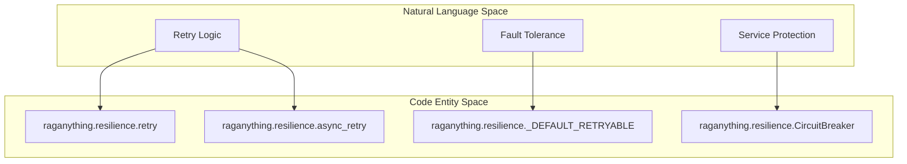
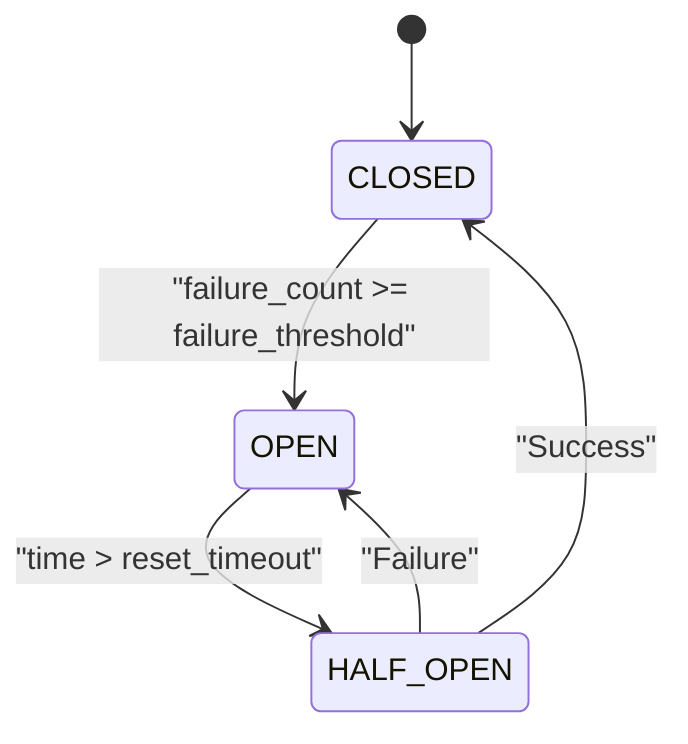
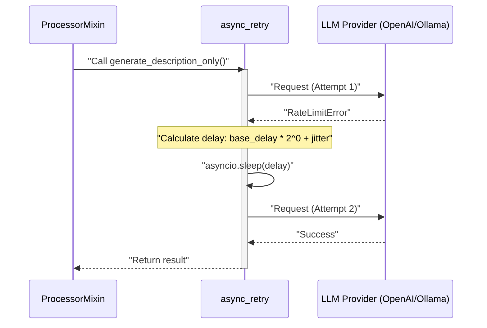

<!-- source: DeepWiki mcp.deepwiki.com · repo HKUDS/RAG-Anything · page 11.5 Resilience and Error Handling · fetched 2026-11-09 -->

# Resilience and Error Handling

<details>
<summary>Relevant source files</summary>

The following files were used as context for generating this wiki page:

- [raganything/__init__.py](raganything/__init__.py)
- [raganything/resilience.py](raganything/resilience.py)
- [tests/test_resilience.py](tests/test_resilience.py)

</details>


The RAG-Anything framework incorporates a dedicated resilience layer to handle the inherent instability of distributed systems, specifically focusing on LLM API calls, embedding requests, and network-dependent document parsing [raganything/resilience.py:1-9](). This subsystem prevents the processing pipeline from stalling due to transient failures like rate limits or intermittent network drops [raganything/resilience.py:7-9]().

## Resilience Mechanisms

The system implements three primary patterns for fault tolerance:
1.  **Retry Decorators**: Automatic re-execution of failed operations with backoff logic.
2.  **Circuit Breaker**: Preventing system overload by "tripping" when a service is consistently failing.
3.  **Exponential Backoff with Jitter**: Spreading out retry attempts to avoid "thundering herd" problems [raganything/resilience.py:70-71]().

### Resilience Component Mapping
The following diagram maps the logical resilience concepts to their implementation entities in the codebase.

**Resilience Logic to Code Entity Mapping**

Sources: [raganything/resilience.py:59-67](), [raganything/resilience.py:146-154](), [raganything/resilience.py:29-32](), [raganything/resilience.py:216-220]()

## Retry Logic and Backoff

RAG-Anything provides two primary decorators: `retry` for synchronous functions and `async_retry` for asynchronous operations [raganything/resilience.py:59-177](). Both use a configurable exponential backoff strategy.

### Configuration Parameters
The decorators accept several parameters to tune behavior:
*   `max_attempts`: Total attempts including the initial call (default: 3) [raganything/resilience.py:60]().
*   `base_delay`: Initial sleep time in seconds (default: 1.0) [raganything/resilience.py:61]().
*   `max_delay`: Upper bound for delay (default: 60.0) [raganything/resilience.py:62]().
*   `exponential_base`: Multiplier for the delay after each failure (default: 2.0) [raganything/resilience.py:63]().
*   `jitter`: Adds 0-50% random noise to the delay to prevent synchronized retries [raganything/resilience.py:124-127]().

### Retryable Exception Types
The system defines a default set of exceptions (`_DEFAULT_RETRYABLE`) that are considered transient and safe to retry [raganything/resilience.py:29-56]():

| Category | Exception Types |
| :--- | :--- |
| **Standard Python** | `ConnectionError`, `TimeoutError` |
| **HTTPX** | `ConnectError`, `ReadTimeout`, `WriteTimeout`, `PoolTimeout` |
| **OpenAI API** | `APIConnectionError`, `APITimeoutError`, `RateLimitError`, `InternalServerError` |

Local programming errors (e.g., `TypeError`, `ValueError`) and filesystem errors (e.g., `FileNotFoundError`) are explicitly excluded from default retries to prevent infinite loops on non-recoverable errors [raganything/resilience.py:26-28]().

Sources: [raganything/resilience.py:29-56](), [raganything/resilience.py:59-92](), [tests/test_resilience.py:198-213]()

## Circuit Breaker Pattern

The `CircuitBreaker` class protects downstream services (like a local LLM server or a vector database) from being overwhelmed when they are struggling [raganything/resilience.py:216-220]().

### State Machine Flow
The circuit breaker operates in three states:
1.  **CLOSED**: Normal operation. Requests pass through. Failures are tracked [tests/test_resilience.py:217-225]().
2.  **OPEN**: Threshold reached. All calls fail immediately with `CircuitBreakerOpen` without attempting the underlying function [tests/test_resilience.py:227-241]().
3.  **HALF-OPEN**: After a `reset_timeout`, the system allows a single "proportional" call to test if the service has recovered [tests/test_resilience.py:243-255]().

**Circuit Breaker Lifecycle**

Sources: [raganything/resilience.py:216-260](), [tests/test_resilience.py:216-255]()

## Implementation Example: Wrapping LLM Calls

The following diagram illustrates how the resilience layer wraps an LLM call to provide fault tolerance during document processing.

**LLM Call Fault Tolerance Flow**


### Usage in Code
Developers can apply these protections by decorating sensitive functions:

```python
# Example of wrapping a sync call
@retry(max_attempts=5, retryable_exceptions=[ConnectionError])
def fetch_data():
    ...

# Example of wrapping an async LLM call
@async_retry(max_attempts=3, on_retry=my_callback)
async def call_vision_model(image_data):
    ...
```

Sources: [raganything/resilience.py:89-91](), [raganything/resilience.py:173-176](), [tests/test_resilience.py:100-106]()

---

