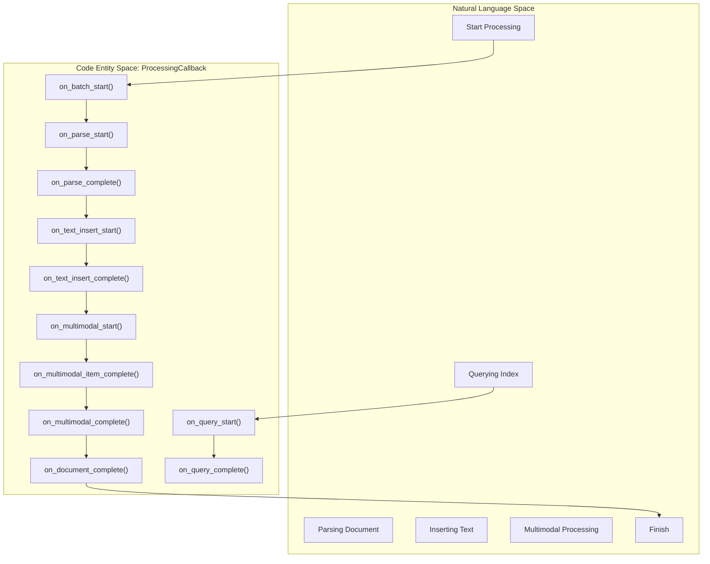
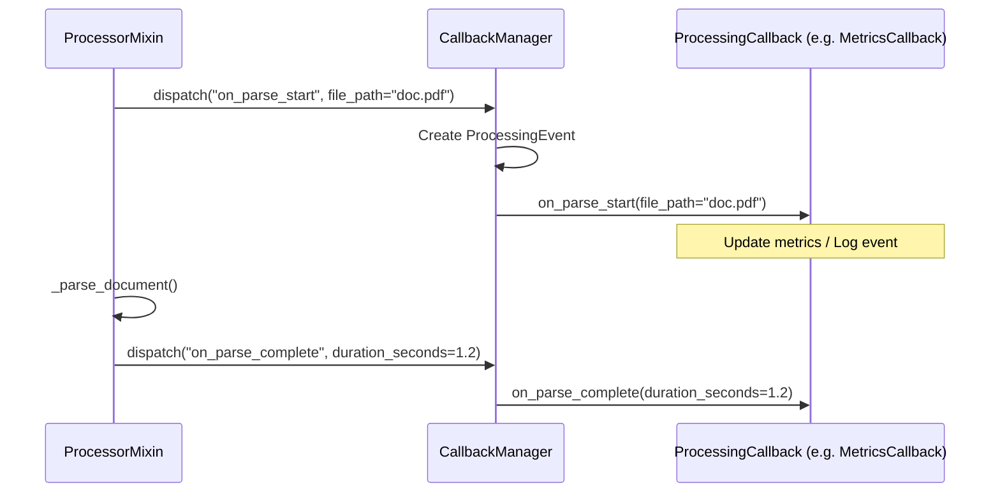

<!-- source: DeepWiki mcp.deepwiki.com · repo HKUDS/RAG-Anything · page 11.6 Callbacks and Observability · fetched 2026-11-09 -->

# Callbacks and Observability

Relevant source files

The following files were used as context for generating this wiki page:

- [raganything/__init__.py](raganything/__init__.py)
- [raganything/callbacks.py](raganything/callbacks.py)
- [tests/test_callbacks.py](tests/test_callbacks.py)

The RAG-Anything system includes a comprehensive callback and event system designed for monitoring, logging, and metrics collection across the document processing lifecycle. This system provides a lightweight publish-subscribe mechanism that hooks into every major stage, from initial parsing to final query execution.

### Overview of the Callback System

The observability framework is built around three primary components:
1.  **`ProcessingEvent`**: An immutable data structure representing a specific occurrence in the pipeline.
2.  **`ProcessingCallback`**: An abstract base class that defines hook methods for various lifecycle events.
3.  **`CallbackManager`**: A registry and dispatcher that manages multiple callbacks and ensures event delivery.

Sources: [raganything/callbacks.py:4-21](), [raganything/callbacks.py:35-46]()

---

### Data Structures and Core Classes

#### ProcessingEvent
The `ProcessingEvent` captures the state of the system at a specific point in time. It includes fields for the event type, timestamp, document identifiers, and performance metrics like `duration_seconds`.

| Field | Type | Description |
| :--- | :--- | :--- |
| `event_type` | `str` | The name of the hook (e.g., `on_parse_start`). |
| `timestamp` | `float` | Epoch time when the event was created. |
| `file_path` | `Optional[str]` | Path to the document being processed. |
| `stage` | `Optional[str]` | The pipeline stage (parsing, insertion, etc.). |
| `duration_seconds` | `Optional[float]` | Time taken for the stage to complete. |
| `error` | `Optional[str]` | Error message if the stage failed. |

Sources: [raganything/callbacks.py:35-58]()

#### CallbackManager
The `CallbackManager` acts as the central hub for observability. It maintains a list of registered callbacks and dispatches events to them. It includes a thread-safe mechanism for event logging that can be enabled for debugging.

*   **`register(callback)`**: Adds a `ProcessingCallback` instance to the manager [raganything/callbacks.py:257-263]().
*   **`dispatch(event_type, **kwargs)`**: Triggers the corresponding method on all registered callbacks. It automatically handles errors within callbacks to prevent them from crashing the main processing pipeline [raganything/callbacks.py:276-312]().
*   **`enable_event_log(enabled)`**: When enabled, the manager stores a history of `ProcessingEvent` objects in an internal list [raganything/callbacks.py:314-316]().

Sources: [raganything/callbacks.py:238-316]()

---

### The Processing Lifecycle Hooks

The `ProcessingCallback` class provides a set of `on_*` methods that can be overridden. By default, these methods are empty and silently ignored if not implemented.

#### Lifecycle Diagram: Code Entity Flow
This diagram maps the natural language processing stages to the specific hook methods defined in `raganything/callbacks.py`.

Title: Document Processing Callback Lifecycle

Sources: [raganything/callbacks.py:61-181](), [tests/test_callbacks.py:12-61]()

---

### Built-in Metrics Collection

RAG-Anything provides a `MetricsCallback` that aggregates data across multiple documents and queries. This is useful for generating performance reports or monitoring system health.

#### Tracked Metrics
The `MetricsCallback` maintains a `metrics` dictionary containing:
*   **Document Stats**: `documents_processed`, `documents_failed` [raganything/callbacks.py:198-199]().
*   **Content Stats**: `total_content_blocks`, `total_multimodal_items` [raganything/callbacks.py:200-201]().
*   **Latency Stats**: `total_parse_time`, `total_insert_time`, `total_multimodal_time`, `total_query_time` [raganything/callbacks.py:202-206]().
*   **Error Tracking**: A list of error descriptions and stages [raganything/callbacks.py:207]().

#### Summary Generation
The `summary()` method provides a human-readable string of the collected metrics, including averages (e.g., average parse time per document) [raganything/callbacks.py:231-235]().

Sources: [raganything/callbacks.py:183-235](), [tests/test_callbacks.py:148-181]()

---

### Integration with RAGAnything

The `CallbackManager` is initialized within the `RAGAnything` class. Users can register their own callbacks via the `callback_manager` attribute.

#### Implementation Diagram: Dispatcher Logic
This diagram shows how the `CallbackManager` mediates between the `ProcessorMixin` (which triggers events) and the `ProcessingCallback` implementations.

Title: Callback Dispatcher Interaction

Sources: [raganything/callbacks.py:276-312](), [raganything/__init__.py:34-40](), [tests/test_callbacks.py:184-195]()

### Error Handling in Callbacks
To ensure that observability does not impact system reliability, the `CallbackManager` wraps every call to a callback method in a `try-except` block. If a callback raises an exception, it is caught, logged, and processing continues uninterrupted [raganything/callbacks.py:302-307]().

Sources: [raganything/callbacks.py:302-312](), [tests/test_callbacks.py:95-103]()

---

