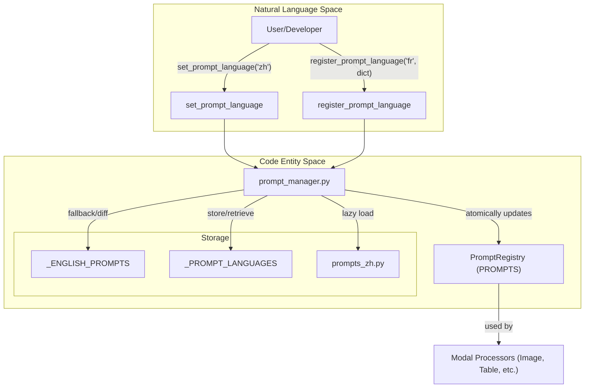
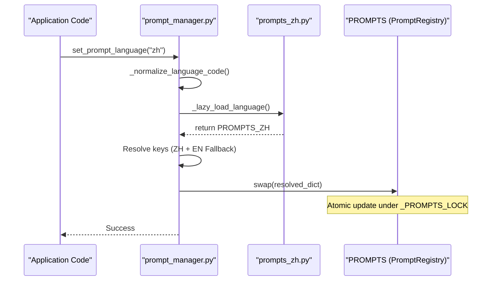

<!-- source: DeepWiki mcp.deepwiki.com · repo HKUDS/RAG-Anything · page 11.7 Prompt Management and Localization · fetched 2026-11-09 -->

# Prompt Management and Localization

<details>
<summary>Relevant source files</summary>

The following files were used as context for generating this wiki page:

- [raganything/__init__.py](raganything/__init__.py)
- [raganything/prompt.py](raganything/prompt.py)
- [raganything/prompt_manager.py](raganything/prompt_manager.py)
- [raganything/prompts_zh.py](raganything/prompts_zh.py)
- [tests/test_prompt_language.py](tests/test_prompt_language.py)

</details>


RAG-Anything provides a robust localization framework for managing LLM and VLM prompt templates. This system allows the engine to adapt its multimodal analysis—covering images, tables, and equations—to different target languages at runtime. The architecture supports built-in Chinese templates, atomic language switching, and a registry for custom language extensions.

### Overview of Prompt Management

The prompt management system is centered around the `prompt_manager` module, which controls the global state of prompt templates used across all modal processors [raganything/prompt_manager.py:1-16](). It ensures that even when the language is switched, the system remains thread-safe and provides fallback mechanisms to English for any missing translations [raganything/prompt_manager.py:84-90]().

The following diagram illustrates the relationship between the localization functions and the underlying data structures.

**Prompt Management Architecture**

Sources: [raganything/prompt_manager.py:24-40](), [raganything/prompt.py:65-82](), [raganything/prompts_zh.py:1-14]()

---

### Key Components and Classes

#### PromptRegistry
The `PromptRegistry` class serves as a stable container for prompt templates. It implements a "snapshot swapping" pattern where readers (modal processors) maintain a reference to the registry object, but the underlying data can be replaced in a single atomic step using the `swap` method [raganything/prompt.py:13-25]().

| Method | Description |
| :--- | :--- |
| `swap(prompts)` | Atomically replaces the active prompt dictionary with a new set [raganything/prompt.py:23-25](). |
| `snapshot()` | Returns a copy of the currently active prompt set [raganything/prompt.py:27-29](). |
| `__getitem__(key)` | Standard dictionary-like access to specific templates [raganything/prompt.py:31-32](). |

Sources: [raganything/prompt.py:13-62]()

#### Prompt Manager Functions
The `prompt_manager` module provides the public API for controlling localization.

*   **`set_prompt_language(language: str)`**: Switches the active templates. It performs a "lazy load" for built-in languages like Chinese (`zh`) if they haven't been initialized yet [raganything/prompt_manager.py:84-114]().
*   **`register_prompt_language(language_code: str, prompts: dict)`**: Allows developers to add support for new languages by providing a dictionary of templates [raganything/prompt_manager.py:64-82]().
*   **`reset_prompts()`**: Reverts all templates back to the original English defaults [raganything/prompt_manager.py:139-146]().
*   **`get_prompt_language()`**: Returns the ISO 639-1 code of the current language [raganything/prompt_manager.py:134-136]().

Sources: [raganything/prompt_manager.py:64-156]()

---

### Data Flow for Language Switching

When `set_prompt_language` is called, the system follows a specific resolution logic to ensure stability and completeness:

1.  **Normalization**: The language code is stripped and lower-cased [raganything/prompt_manager.py:100]().
2.  **Loading**: If the language is `zh`, it imports `PROMPTS_ZH` from `raganything.prompts_zh` [raganything/prompt_manager.py:57-60]().
3.  **Resolution**: A new dictionary is constructed. For every key in the default English set, the system checks if a translation exists in the target language. If not, it falls back to the English version [raganything/prompt_manager.py:120-125]().
4.  **Atomic Swap**: The `_PROMPTS_LOCK` (a `threading.RLock`) is acquired, and `PROMPTS.swap()` is called to update the global registry without interrupting concurrent readers [raganything/prompt_manager.py:127-129]().

**Language Switch Sequence**

Sources: [raganything/prompt_manager.py:43-61](), [raganything/prompt_manager.py:115-131](), [raganything/prompt.py:23-25]()

---

### Chinese Prompt Templates (`prompts_zh.py`)

The system includes a full suite of Chinese templates to support native-language multimodal RAG. These templates cover:

*   **System Prompts**: Specialized personas for image, table, and equation analysis (e.g., `IMAGE_ANALYSIS_SYSTEM` defined as "你是一位专业的图像分析专家") [raganything/prompts_zh.py:17-27]().
*   **Analysis Prompts**: Detailed instructions for VLMs to extract structured JSON from visual elements, including `vision_prompt`, `table_prompt`, and `equation_prompt` [raganything/prompts_zh.py:30-218]().
*   **Chunk Templates**: Formatting templates used to create text chunks for the vector database (e.g., `image_chunk`, `table_chunk`) [raganything/prompts_zh.py:271-298]().
*   **Query Prompts**: Instructions for the query system to describe images or tables provided in a multimodal query [raganything/prompts_zh.py:301-318]().

Sources: [raganything/prompts_zh.py:1-318]()

---

### Implementation Details and Usage

#### Adding a New Language
To add a custom language (e.g., French), use the `register_prompt_language` function. You only need to provide the keys you wish to override; others will remain in English.

```python
from raganything.prompt_manager import register_prompt_language, set_prompt_language

french_prompts = {
    "IMAGE_ANALYSIS_SYSTEM": "Vous êtes un expert en analyse d'images."
}
register_prompt_language("fr", french_prompts)
set_prompt_language("fr")
```
Sources: [raganything/prompt_manager.py:64-82](), [tests/test_prompt_language.py:70-74]()

#### Verification and Thread Safety
The system uses a `threading.RLock` to ensure that even if multiple threads attempt to switch languages or read prompts simultaneously, the `PROMPTS` registry never enters an inconsistent state [raganything/prompt_manager.py:40](), [raganything/prompt_manager.py:127-129]().

Testing utilities confirm that:
1.  Switching to a language and back to English restores original values [tests/test_prompt_language.py:32-39]().
2.  Unknown languages raise a `ValueError` [tests/test_prompt_language.py:41-43]().
3.  The Chinese template set is verified to contain all keys present in the English set [tests/test_prompt_language.py:49-56]().

Sources: [raganything/prompt_manager.py:108-113](), [tests/test_prompt_language.py:24-67]()

---

