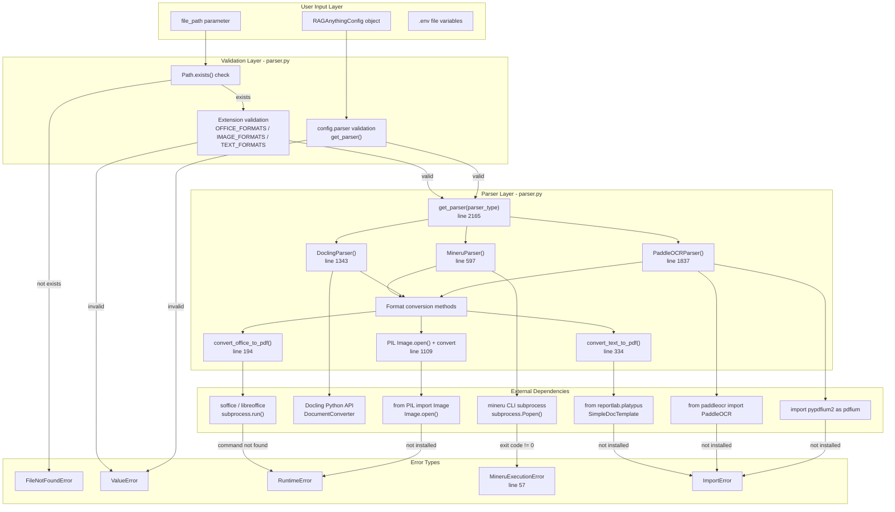
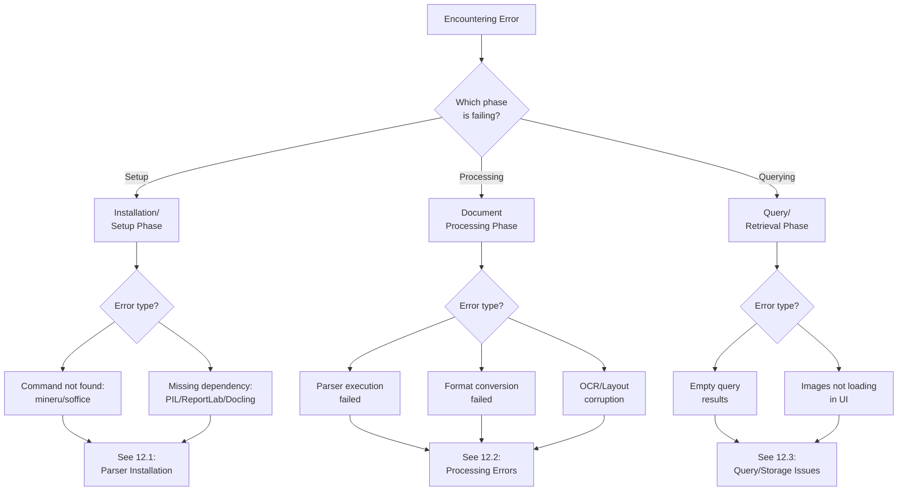
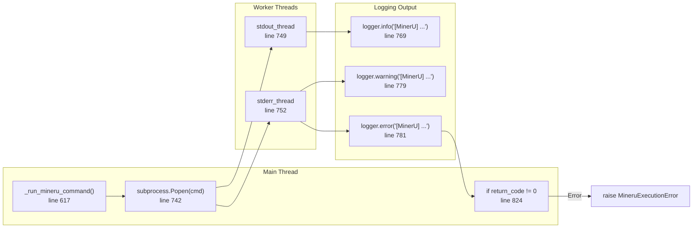

<!-- source: DeepWiki mcp.deepwiki.com · repo HKUDS/RAG-Anything · page 12 Troubleshooting · fetched 2026-11-09 -->

# Troubleshooting

<details>
<summary>Relevant source files</summary>

The following files were used as context for generating this wiki page:

- [docs/multimodal_rag_failure_modes.md](docs/multimodal_rag_failure_modes.md)
- [raganything/asset_urls.py](raganything/asset_urls.py)
- [raganything/parser.py](raganything/parser.py)
- [tests/test_asset_urls.py](tests/test_asset_urls.py)
- [tests/testparser_kwargs.py](tests/testparser_kwargs.py)

</details>


This page provides an overview of common issues encountered when using RAG-Anything and guidance for diagnosing and resolving them. The troubleshooting process is organized into three main categories: parser installation issues, document processing errors, and query/storage problems.

For detailed troubleshooting of specific issues, see:
- **Parser Installation Issues**: See [Parser Installation Issues](#12.1)
- **Processing Errors**: See [Processing Errors](#12.2)
- **Query and Storage Issues**: See [Query and Storage Issues](#12.3)

For initial setup guidance, see [Installation](#2.1) and [Environment Configuration](#2.3).

---

## Error Propagation Architecture

Understanding where errors originate in the system helps diagnose problems efficiently. The following diagram shows the major error sources and their propagation paths through the RAG-Anything pipeline.



**Sources:** [raganything/parser.py:57-66](), [raganything/parser.py:194-228](), [raganything/parser.py:334-568](), [raganything/parser.py:597-615](), [raganything/parser.py:1343-1356](), [raganything/parser.py:1837-1847](), [raganything/parser.py:2165-2176]()

---

## Common Error Categories

The system encounters errors in three primary areas, each with distinct diagnostic approaches.

| Error Category | Typical Symptoms | Primary Source Code | Detailed Guide |
|---------------|------------------|---------------------|----------------|
| **Parser Installation** | `FileNotFoundError` for `mineru`, subprocess failures, Docling API missing | `get_parser()` [raganything/parser.py:2165-2176](), `check_installation()` [raganything/parser.py:1309-1340, 1803-1834]() | [Parser Installation Issues](#12.1) |
| **Format Dependencies** | `ImportError` for PIL/Pillow/ReportLab/PaddleOCR, LibreOffice conversion failures | `convert_office_to_pdf()` [raganything/parser.py:194-331](), `convert_text_to_pdf()` [raganything/parser.py:334-568]() | [Parser Installation Issues](#12.1) |
| **Processing Errors** | `MineruExecutionError` [raganything/parser.py:57-66](), empty `content_list`, invalid JSON output | `_run_mineru_command()` [raganything/parser.py:617-845](), `_read_output_files()` [raganything/parser.py:847-962]() | [Processing Errors](#12.2) |
| **Multimodal Failure** | OCR corruption, table structure loss, image-caption misalignment | `docs/multimodal_rag_failure_modes.md` [docs/multimodal_rag_failure_modes.md:1-85]() | [Processing Errors](#12.2) |
| **Asset URL Issues** | Images not loading in UI, path mismatch | `attach_public_media_urls()` [raganything/asset_urls.py:65-118]() | [Query and Storage Issues](#12.3) |
| **Storage Errors** | Connection timeouts, database initialization failures | LightRAG storage backends | [Query and Storage Issues](#12.3) |

**Sources:** [raganything/parser.py:57-66](), [raganything/parser.py:617-845](), [raganything/asset_urls.py:65-118](), [docs/multimodal_rag_failure_modes.md:9-72]()

---

## Diagnostic Workflow

Use this decision tree to quickly identify the appropriate troubleshooting section for your issue.



**Sources:** [docs/multimodal_rag_failure_modes.md:1-85](), [raganything/parser.py:617-845]()

---

## Quick Diagnostic Commands

### Check Parser Installation

```python
from raganything.parser import get_parser

# Check MinerU installation
mineru_parser = get_parser("mineru")
if mineru_parser.check_installation():
    print("✅ MinerU installed properly")

# Check Docling installation (Python API check)
docling_parser = get_parser("docling")
if docling_parser.check_installation():
    print("✅ Docling installed properly")
```

The `check_installation()` method verifies parser availability:
- `MineruParser.check_installation()` [raganything/parser.py:1309-1340]() runs `mineru --version`.
- `DoclingParser.check_installation()` [raganything/parser.py:1803-1834]() checks for the `docling` package.

**Sources:** [raganything/parser.py:1309-1340](), [raganything/parser.py:1803-1834]()

### Verify Public Asset Mapping

If images are missing in your UI, verify the environment variables for asset URL mapping:

```python
import os
base = os.environ.get("RAGANYTHING_PUBLIC_ASSET_BASE_URL")
strip = os.environ.get("RAGANYTHING_PUBLIC_ASSET_STRIP_PREFIX")
print(f"Base URL: {base}, Strip Prefix: {strip}")
```

If only one is set, the system logs a warning and skips attachment [raganything/asset_urls.py:83-100]().

**Sources:** [raganything/asset_urls.py:77-100]()

---

## Subprocess Execution Monitoring (MinerU)

MinerU runs as a subprocess with real-time logging. Errors are captured via `stdout_queue` and `stderr_queue` [raganything/parser.py:745-746]().



**Sources:** [raganything/parser.py:731-826]()

---

## Next Steps

1. **[Parser Installation Issues](#12.1)** - Solutions for LibreOffice, MinerU, and dependency conflicts.
2. **[Processing Errors](#12.2)** - Debugging OCR corruption, table loss, and `MineruExecutionError`.
3. **[Query and Storage Issues](#12.3)** - Fixing VLM path validation, retrieval bias, and public URL mapping.

**Sources:** [docs/multimodal_rag_failure_modes.md:1-85](), [raganything/asset_urls.py:1-118]()

---

