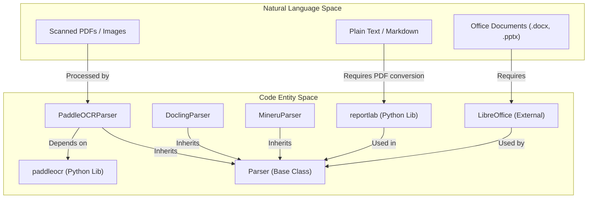
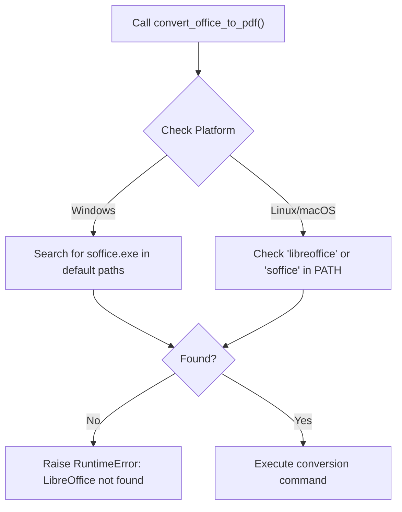

<!-- source: DeepWiki mcp.deepwiki.com · repo HKUDS/RAG-Anything · page 12.1 Parser Installation Issues · fetched 2026-11-09 -->

# Parser Installation Issues

<details>
<summary>Relevant source files</summary>

The following files were used as context for generating this wiki page:

- [.github/workflows/pypi-publish.yml](.github/workflows/pypi-publish.yml)
- [raganything/parser.py](raganything/parser.py)
- [setup.py](setup.py)
- [tests/testparser_kwargs.py](tests/testparser_kwargs.py)

</details>


## Purpose and Scope

This page documents common installation problems with the document parsing subsystem and their solutions. RAG-Anything supports multiple parser backends—**MinerU**, **Docling**, and **PaddleOCR**—each with distinct dependencies. This page covers installation verification, dependency resolution, and troubleshooting for all supported parsers.

For general parser functionality and usage, see [Document Parsers](#4.1). For processing errors that occur after successful installation, see [Processing Errors](#12.2).

---

## Parser Dependencies Overview

RAG-Anything's parsing subsystem requires different dependencies depending on which parser and file formats you need to support. The `setup.py` file defines specific `extras_require` groups to simplify this process.

### Dependency Categories

| Category | Components | Required By | Installation Method |
|----------|-----------|-------------|-------------------|
| **Core Parser** | `mineru[core]` | `MineruParser` | `pip install mineru[core]` |
| **Core Parser** | `docling` | `DoclingParser` | `pip install docling` |
| **OCR Parser** | `paddleocr`, `pypdfium2` | `PaddleOCRParser` | `pip install raganything[paddleocr]` |
| **Office Conversion**| LibreOffice | All parsers for Office files | System package manager |
| **Image Conversion** | `Pillow` | `MineruParser` for exotic images | `pip install raganything[image]` |
| **Text Conversion**  | `reportlab` | All parsers for TXT/MD | `pip install raganything[text]` |
| **Markdown Support** | `weasyprint`, `markdown` | Enhanced MD conversion | `pip install raganything[markdown]` |

**Sources:** [raganything/parser.py:68-82](), [setup.py:61-84]()

---

## Dependency Installation Flow

The following diagram maps the relationship between system requirements and the Python classes that utilize them.



**Sources:** [raganything/parser.py:68-82](), [raganything/parser.py:193-207](), [raganything/parser.py:1262-1270](), [raganything/parser.py:1743-1750]()

---

## MinerU Installation Issues

### Error: `mineru command not found`

**Symptom:** When attempting to parse a document, you receive:
`RuntimeError: mineru command not found. Please ensure MinerU 2.0 is properly installed.`

**Location:** Raised by `MineruParser._run_mineru_command` [raganything/parser.py:784-788]().

**Cause:** The `mineru` CLI tool is not available in the system PATH. Note that MinerU 2.0 no longer includes LibreOffice document conversion; Office files must be converted to PDF first [raganything/parser.py:19-22]().

**Solutions:**
1. **Install MinerU:** `pip install -U 'mineru[core]'`
2. **Verify installation:** 
   ```python
   from raganything.parser import MineruParser
   assert MineruParser().check_installation()
   ```

### MinerU Execution Errors

**Error Class:** `MineruExecutionError` [raganything/parser.py:57-65]()

This exception is raised when the subprocess call to the `mineru` CLI returns a non-zero exit code.
- **return_code:** The exit code from the process.
- **error_msg:** The captured stderr output.

**Sources:** [raganything/parser.py:57-65](), [raganything/parser.py:771-793]()

---

## Docling Installation Issues

### API-Based Integration

Unlike previous versions, `DoclingParser` now utilizes the Docling Python API (`DocumentConverter`) rather than the CLI [tests/testparser_kwargs.py:8-14]().

**Error:** `ImportError: Docling is not installed.`
**Location:** Raised during `_get_converter` [raganything/parser.py:1455-1465]().

**Solution:**
```bash
pip install docling
```

**Kwarg Handling:**
The `DoclingParser` accepts an `env` dictionary for backward compatibility but ignores it in the Python-API path [tests/testparser_kwargs.py:86-91](). However, it performs strict type checking: `env` must be a dictionary with string keys and values [tests/testparser_kwargs.py:131-158]().

**Sources:** [raganything/parser.py:1455-1465](), [tests/testparser_kwargs.py:86-106]()

---

## PaddleOCR Installation Issues

**Symptom:** `PaddleOCRParser` fails to initialize or process files.

**Required Extras:**
```bash
pip install "raganything[paddleocr]"
```
This installs `paddleocr` and `pypdfium2` [setup.py:66-69]().

**Common Issues:**
- **CUDA/GPU Conflicts:** PaddleOCR often requires specific versions of `paddlepaddle-gpu`. If OCR is slow, ensure the correct Paddle backend is installed for your hardware.
- **Memory Errors:** Scanned PDF processing via `PaddleOCRParser` is memory-intensive as it renders pages to images before OCR.

**Sources:** [setup.py:66-69](), [raganything/parser.py:1743-1750]()

---

## LibreOffice Requirement

LibreOffice is mandatory for processing Office formats (`.doc`, `.docx`, `.ppt`, `.pptx`, `.xls`, `.xlsx`) [raganything/parser.py:76]().

### Detection Logic

The `Parser.convert_office_to_pdf` method attempts to locate `libreoffice` or `soffice` in the system path [raganything/parser.py:193-240]().



**Sources:** [raganything/parser.py:193-240](), [raganything/parser.py:108-160]()

---

## Skip Installation Check

In some environments (e.g., restricted containers), the standard `check_installation()` might fail even if the parser is functional. 

While the codebase performs these checks during initialization of `MineruParser` [raganything/parser.py:1228-1259]() and `DoclingParser` [raganything/parser.py:1709-1740](), users can bypass or handle these by catching the `RuntimeError` if they are certain the environment is configured correctly.

---

## Summary of Optional Dependencies (`setup.py`)

| Extra Name | Packages | Purpose |
|------------|----------|---------|
| `image` | `Pillow` | Conversion for BMP, TIFF, GIF, WebP [setup.py:63]() |
| `text` | `reportlab` | TXT/MD to PDF conversion [setup.py:64]() |
| `paddleocr` | `paddleocr`, `pypdfium2` | Scanned PDF parsing [setup.py:66-69]() |
| `markdown` | `markdown`, `weasyprint`, `pygments` | Enhanced MD to PDF [setup.py:79-83]() |
| `all` | All above | Full multimodal support [setup.py:70-78]() |

**Sources:** [setup.py:61-84]()

---

