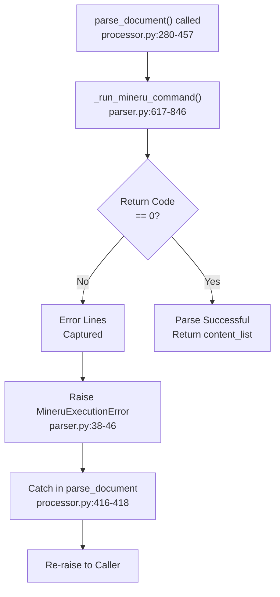
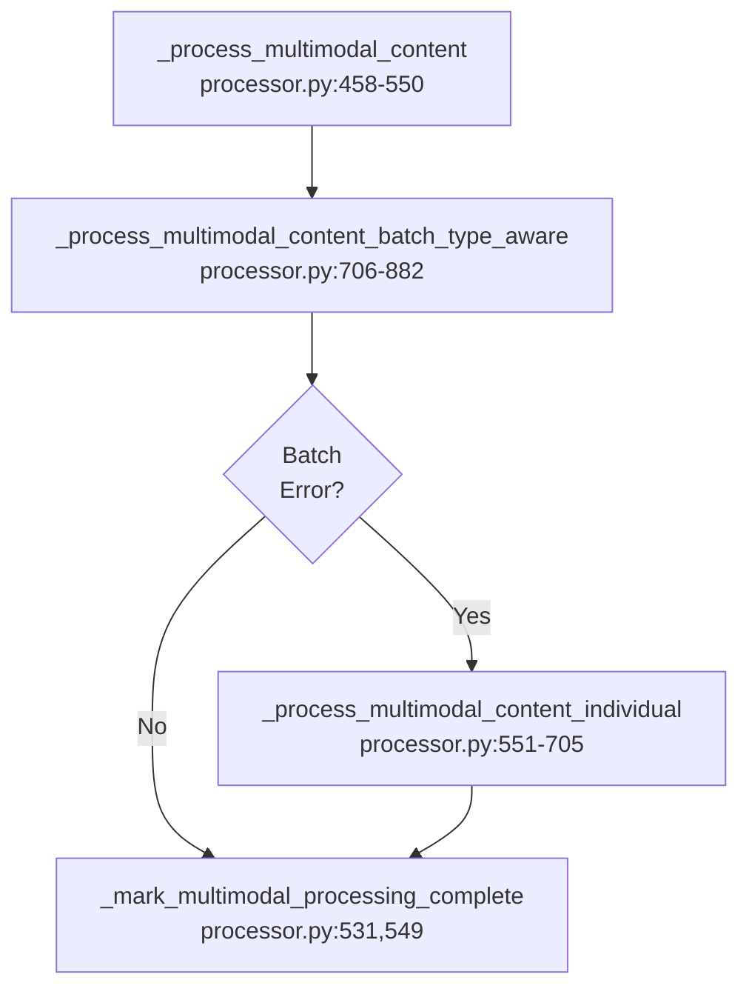
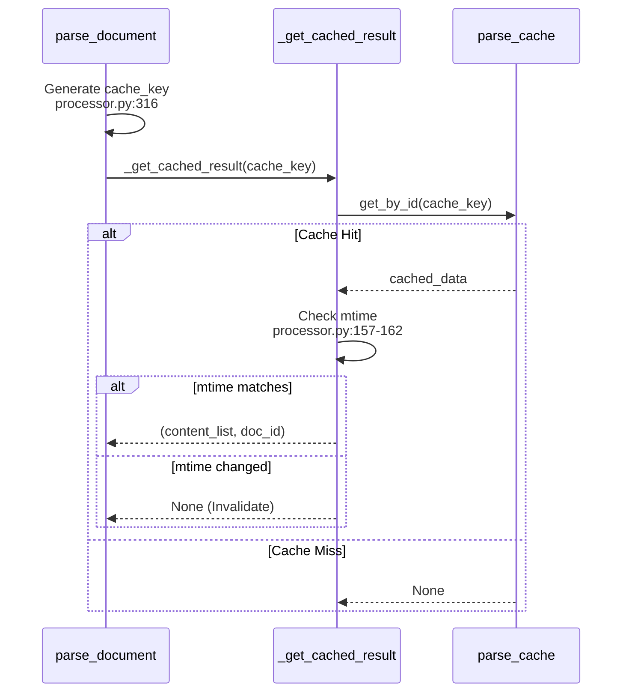

<!-- source: DeepWiki mcp.deepwiki.com · repo HKUDS/RAG-Anything · page 12.2 Processing Errors · fetched 2026-11-09 -->

# Processing Errors

Relevant source files

The following files were used as context for generating this wiki page:

- [docs/multimodal_rag_failure_modes.md](docs/multimodal_rag_failure_modes.md)
- [raganything/asset_urls.py](raganything/asset_urls.py)
- [raganything/processor.py](raganything/processor.py)
- [tests/test_asset_urls.py](tests/test_asset_urls.py)
- [tests/test_insert_content_list.py](tests/test_insert_content_list.py)

## Purpose and Scope

This page covers errors that occur during document processing, multimodal content analysis, and content extraction in RAG-Anything. It focuses on debugging parsing failures, multimodal processor errors, and recovery strategies. This includes handling OCR corruption, table structure loss, and image-caption misalignment.

The processing pipeline involves three main stages where errors can occur:
1. **Document Parsing** - Converting files to structured content lists.
2. **Content Extraction** - Separating and routing multimodal items.
3. **Multimodal Processing** - Generating descriptions and extracting entities via Vision Language Models (VLMs).

---

## Error Classification System

```mermaid
graph TD
    subgraph "Error Sources"
        PARSE_ERR["Parser Errors<br/>(parser.py)"]
        PROC_ERR["Processing Errors<br/>(processor.py)"]
        MODAL_ERR["Modal Processor Errors<br/>(modalprocessors.py)"]
    end
    
    subgraph "Parser Error Types"
        MINERU_ERR["MineruExecutionError<br/>parser.py:38-46"]
        CONV_ERR["Format Conversion Errors<br/>parser.py:187-196"]
        FILE_ERR["File Access Errors<br/>parser.py:108,989,1063"]
        VAL_ERR["Validation Errors<br/>parser.py:211-216"]
    end
    
    subgraph "Processing Error Types"
        EMPTY_ERR["Empty Content Error<br/>processor.py:428-430"]
        CACHE_ERR["Cache Validation Error<br/>processor.py:160-162"]
        PARSE_FAIL["Parsing Method Failure<br/>processor.py:416-423"]
        MM_PROC_ERR["Multimodal Processing Error<br/>processor.py:540-546"]
    end
    
    subgraph "Modal Processor Error Types"
        JSON_ERR["JSON Parsing Error<br/>modalprocessors.py"]
        IMG_ERR["Image Processing Error<br/>modalprocessors.py"]
        VLM_ERR["VLM Call Failure<br/>modalprocessors.py"]
        FALLBACK["Fallback Entity Creation<br/>modalprocessors.py"]
    end
    
    PARSE_ERR --> MINERU_ERR
    PARSE_ERR --> CONV_ERR
    PARSE_ERR --> FILE_ERR
    PARSE_ERR --> VAL_ERR
    
    PROC_ERR --> EMPTY_ERR
    PROC_ERR --> CACHE_ERR
    PROC_ERR --> PARSE_FAIL
    PROC_ERR --> MM_PROC_ERR
    
    MODAL_ERR --> JSON_ERR
    MODAL_ERR --> IMG_ERR
    MODAL_ERR --> VLM_ERR
    MODAL_ERR --> FALLBACK
```

**Error Classification Hierarchy**

Sources: [raganything/parser.py:38-46](), [raganything/processor.py:416-430]()

---

## Common Multimodal Failure Modes

Real-world documents are often noisy. Below are specific symptoms and their corresponding code-level checks.

### 1. OCR Corruption and Layout Loss
**Symptoms:** Answers quote nonsense, wrong numbers, or mixed columns. OCR confuses ligatures or watermarks.
- **Check:** Inspect the `content_list` produced by `parse_document` [raganything/processor.py:311-457](). Eyeball the `text` blocks in the `*_content_list.json` in the parser output directory.
- **Solution:** Try a different `parse_method` (e.g., forcing `ocr` vs `auto`) or switch the `parser` backend (e.g., `docling` vs `mineru`) [raganything/processor.py:69-74]().

### 2. Table Structure Loss
**Symptoms:** Merged cells, tables rendered as plain text lines, or incorrect row order.
- **Check:** Look for `type: table` blocks in the content list [raganything/utils.py:19-27](). Check if `table_body` or structure fields contain plausible Markdown/HTML.
- **Solution:** Use `TableModalProcessor` to regenerate descriptions from the table image if the structured text is corrupted [raganything/modalprocessors.py:1026-1133]().

### 3. Image-Caption Misalignment
**Symptoms:** Captions match the wrong figure, or images appear in the wrong order.
- **Check:** Validate `img_path` and `caption_list` consistency in `_process_multimodal_content_batch_type_aware` [raganything/processor.py:706-882]().
- **Note:** For DOCX files, equations can be dropped during PDF conversion. Use the OMML helper to recover equations directly from the source [raganything/processor.py:24-27]().

### 4. Public Asset URL Issues
**Symptoms:** Indexed images or tables fail to load in the UI because they reference local filesystem paths.
- **Check:** Verify `RAGANYTHING_PUBLIC_ASSET_BASE_URL` and `RAGANYTHING_PUBLIC_ASSET_STRIP_PREFIX` are set [raganything/asset_urls.py:77-80]().
- **Implementation:** The `attach_public_media_urls` function maps local paths to public URLs for `img_path`, `table_img_path`, and `equation_img_path` [raganything/asset_urls.py:23-27]().

---

## Parser-Level Errors

### MinerU Execution Errors
The `MineruExecutionError` captures failures from the MinerU command-line interface.

**MinerU Execution Error Flow**

| Field | Description |
|-------|-------------|
| `return_code` | Subprocess exit code (e.g., 127 if command not found) [raganything/parser.py:38-46](). |
| `error_msg` | Captured stderr lines (e.g., "CUDA error") [raganything/parser.py:762-792](). |

Sources: [raganything/parser.py:38-46](), [raganything/processor.py:416-423]()

---

## Multimodal Processing Failures

The system uses a two-tier recovery strategy for multimodal content analysis.

**Multimodal Recovery Logic**

### Batch vs. Individual Processing
- **Batch Processing:** Uses `_process_multimodal_content_batch_type_aware` to handle multiple items (images, tables) concurrently to reduce LLM overhead [raganything/processor.py:706-882]().
- **Fallback:** If the batch fails (due to rate limits or context window issues), the system catches the exception and triggers `_process_multimodal_content_individual` to process items one by one [raganything/processor.py:538-546]().

### JSON Parsing Robustness
VLMs often return malformed JSON or wrap it in Markdown tags. `BaseModalProcessor` implements `_robust_json_parse` which:
1. Strips `<thinking>` tags (e.g., from DeepSeek-R1) [raganything/modalprocessors.py:580-589]().
2. Fixes common JSON syntax errors like trailing commas [raganything/modalprocessors.py:628-640]().
3. Uses regex field extraction as a final resort [raganything/modalprocessors.py:657-688]().

Sources: [raganything/processor.py:522-546](), [raganything/modalprocessors.py:547-688]()

---

## Cache Validation Errors

The `ParseCache` prevents redundant parsing but can cause issues if the file or configuration changes.

**Cache Invalidation Triggers:**
- **File Modification:** `current_mtime` from `file_path.stat().st_mtime` must match the cached value [raganything/processor.py:157-162]().
- **Config Change:** Changes in `parser`, `parse_method`, or language settings generate a different `cache_key` [raganything/processor.py:69-98]().

Sources: [raganything/processor.py:133-211](), [raganything/processor.py:65-98]()

---

## Debugging and Manual Recovery

### Manual Recovery Actions
1. **Clear Parse Cache:** If parsing results are corrupted, manually delete the `parse_cache` directory in the `working_dir` to force a re-parse.
2. **Reprocess Failed Docs:** Check `doc_status` for entries where `status == DocStatus.FAILED` [raganything/base.py:16](). Re-run `process_document_complete` for these files [raganything/processor.py:280-457]().
3. **Verify Asset URLs:** If images don't load, use `public_url_for_local_path` to test your environment variable mapping manually [raganything/asset_urls.py:42-62]().

### Logging Points
- **Parser Logs:** Subprocess output is logged with the `[MinerU]` prefix in real-time [raganything/parser.py:709-747]().
- **Multimodal Progress:** Logged at 10% intervals during batch processing [raganything/processor.py:781-790]().

Sources: [raganything/parser.py:709-815](), [raganything/processor.py:781-790](), [raganything/asset_urls.py:42-62]()

---

