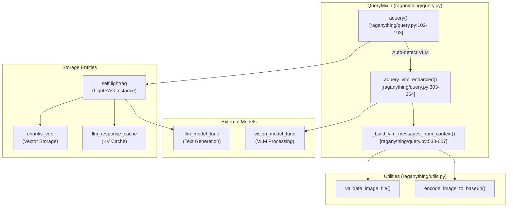
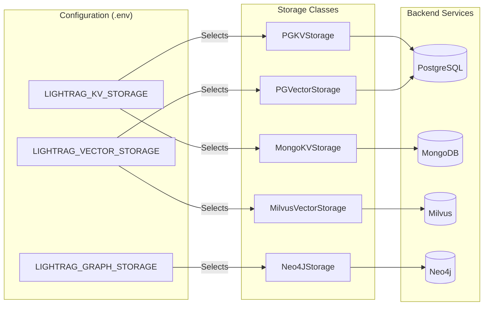

<!-- source: DeepWiki mcp.deepwiki.com · repo HKUDS/RAG-Anything · page 12.3 Query and Storage Issues · fetched 2026-11-09 -->

# Query and Storage Issues

Relevant source files

The following files were used as context for generating this wiki page:

- [.github/workflows/linting.yaml](.github/workflows/linting.yaml)
- [docs/multimodal_rag_failure_modes.md](docs/multimodal_rag_failure_modes.md)
- [docs/offline_setup.md](docs/offline_setup.md)
- [raganything/asset_urls.py](raganything/asset_urls.py)
- [raganything/batch.py](raganything/batch.py)
- [raganything/query.py](raganything/query.py)
- [scripts/create_tiktoken_cache.py](scripts/create_tiktoken_cache.py)
- [tests/test_asset_urls.py](tests/test_asset_urls.py)

This page provides technical troubleshooting guidance for query failures and storage backend problems in RAG-Anything. It covers solutions for retrieval bias, VLM path validation, tiktoken network dependencies in offline environments, and database connection issues.

---

## 1. Query System Architecture and Error Points

The query system is implemented via the `QueryMixin` class, which bridges the gap between multimodal content and the underlying `LightRAG` retrieval engine.

### Diagram: Query Execution Flow and System Names
This diagram associates system names with the code entities responsible for query execution and image handling.

**Sources:**
- [raganything/query.py:102-193]()
- [raganything/query.py:303-364]()
- [raganything/query.py:533-607]()

---

## 2. Retrieval and Query Issues

### 2.1 Retrieval Bias Toward Text
**Symptoms:** The system answers using surrounding text but ignores figures or tables that contain the actual answer.

**Technical Cause:** 
- Multimodal stages may not have run, leaving the knowledge graph without enriched descriptions.
- The `ENABLE_IMAGE_PROCESSING` or `ENABLE_TABLE_PROCESSING` flags were false during ingestion [docs/multimodal_rag_failure_modes.md:42-51]().

**Resolution:**
- Verify multimodal flags in `.env` [docs/multimodal_rag_failure_modes.md:49]().
- Use a "probe question" that can *only* be answered by visual data to verify if descriptions are indexed [docs/multimodal_rag_failure_modes.md:48]().

### 2.2 VLM Path Validation and Image Errors
**Symptoms:** VLM-enhanced queries fail to load images or show "No valid images found".

**Implementation Detail:**
The `aquery_vlm_enhanced` method extracts paths from retrieved context using a specific regex: `Image Path:\s*([^\r\n]*?\.(?:jpg|jpeg|png|gif|bmp|webp|tiff|tif))` [raganything/query.py:551-552]().

**Common Failures:**
- **Regex Mismatch:** If the parser changed the "Image Path:" prefix, the extractor fails [raganything/query.py:556-557]().
- **Validation Failure:** `validate_image_file` is called for every path. If the file is missing or permissions are restricted, the image is skipped [raganything/query.py:571-577]().
- **Encoding Failure:** Large or corrupt images may fail during `encode_image_to_base64` [raganything/query.py:582]().

**Sources:**
- [raganything/query.py:551-582]()
- [docs/multimodal_rag_failure_modes.md:42-51]()

---

## 3. Storage and Network Issues

### 3.1 Tiktoken Network Failures (Offline Mode)
**Symptoms:** `LightRAG` fails to initialize with a `ConnectionError` to `openaipublic.blob.core.windows.net` [docs/offline_setup.md:14-15]().

**Cause:** 
The `tiktoken` library, used by `LightRAG`, attempts to download tokenizer models (like `o200k_base`) on the first run [docs/offline_setup.md:7-9]().

**Solution:**
1. Run the cache creation script in an online environment: `uv run scripts/create_tiktoken_cache.py` [scripts/create_tiktoken_cache.py:1-18]().
2. Set the `TIKTOKEN_CACHE_DIR` environment variable to point to this directory *before* `LightRAG` is imported [docs/offline_setup.md:21-23]().
3. Ensure `.env` is loaded before any imports that trigger `tiktoken` [docs/offline_setup.md:57-61]().

### 3.2 Public Asset URL Mapping
**Symptoms:** UI/Frontend cannot display images because they are stored as local absolute paths (e.g., `/home/user/rag/data/...`) [docs/multimodal_rag_failure_modes.md:66-67]().

**Implementation:**
The `attach_public_media_urls` utility maps local paths to public URLs using `RAGANYTHING_PUBLIC_ASSET_BASE_URL` and `RAGANYTHING_PUBLIC_ASSET_STRIP_PREFIX` [raganything/asset_urls.py:77-78]().

**Code Logic:**
- It iterates over `MEDIA_PATH_FIELDS` (`img_path`, `table_img_path`, etc.) [raganything/asset_urls.py:23-27]().
- It strips the prefix and appends the remainder to the base URL [raganything/asset_urls.py:42-62]().
- Currently, this is only wired into the **MinerU** parser path [raganything/asset_urls.py:8-12]().

**Sources:**
- [docs/offline_setup.md:1-79]()
- [scripts/create_tiktoken_cache.py:1-18]()
- [raganything/asset_urls.py:1-118]()

---

## 4. Database Connection Issues

### Diagram: Storage Backend Code Entities
This diagram maps the environment configuration to the internal storage classes and backend services.

### Common Backend Errors

| Backend | Common Error | Resolution |
| :--- | :--- | :--- |
| **PostgreSQL** | `Connection refused` | Check `POSTGRES_HOST` and `POSTGRES_PORT`. Ensure the service is running. |
| **Neo4j** | `AuthError` | Verify `NEO4J_USERNAME` and `NEO4J_PASSWORD`. Ensure URI uses `neo4j://` or `bolt://`. |
| **Milvus** | `Collection not found` | Ensure `MILVUS_URI` is correct. Collections are usually created automatically on first insert. |
| **MongoDB** | `ServerSelectionTimeout` | Verify `MONGO_URI`. Check if the database requires specific auth mechanisms in the connection string. |

**Sources:**
- [raganything/batch.py:73-77]() (Initialization checks)
- [docs/multimodal_rag_failure_modes.md:53-61]() (Resource/Hangs)

---

