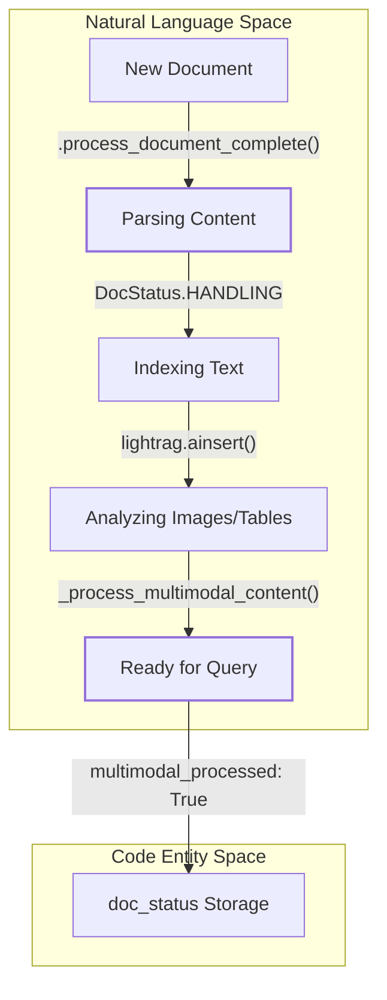
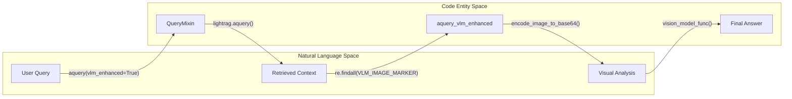

<!-- source: DeepWiki mcp.deepwiki.com · repo HKUDS/RAG-Anything · page 13 Glossary · fetched 2026-11-09 -->

# Glossary

Relevant source files

The following files were used as context for generating this wiki page:

- [README.md](README.md)
- [raganything/base.py](raganything/base.py)
- [raganything/batch.py](raganything/batch.py)
- [raganything/config.py](raganything/config.py)
- [raganything/modalprocessors.py](raganything/modalprocessors.py)
- [raganything/parser.py](raganything/parser.py)
- [raganything/processor.py](raganything/processor.py)
- [raganything/query.py](raganything/query.py)
- [tests/test_insert_content_list.py](tests/test_insert_content_list.py)
- [tests/testparser_kwargs.py](tests/testparser_kwargs.py)

This page provides technical definitions for codebase-specific terms, domain concepts, and architectural components within the RAG-Anything framework. It serves as a reference for engineers to understand how natural language concepts map to specific code entities and implementation logic.

## 1. Core RAG Concepts

### Hybrid Retrieval
A retrieval strategy that combines multiple search modalities. In RAG-Anything, this typically refers to the `mix` mode in `QueryMixin.aquery`, which leverages both vector-based similarity and Knowledge Graph-based relationship traversal [raganything/query.py:102-119]().

### Knowledge Graph (KG)
The structural representation of entities and relationships extracted from documents. RAG-Anything extends standard text-based KGs by inserting multimodal entities (images, tables, equations) as nodes and creating `belongs_to` relationships between these elements and their parent documents or surrounding text chunks [raganything/processor.py:202-212]().

### Retrieval Modes
RAG-Anything supports several query modes inherited and extended from LightRAG [raganything/query.py:110-110]():
*   **Naive**: Basic vector retrieval.
*   **Local**: Context-focused retrieval around specific entities.
*   **Global**: High-level summary retrieval across the entire corpus.
*   **Hybrid/Mix**: Combines multiple strategies for balanced results.
*   **Bypass**: Direct LLM call without retrieval.

**Sources:** [raganything/query.py:102-119](), [raganything/processor.py:202-212]()

---

## 2. Document Processing & Storage

### DocStatus
An enumeration defining the lifecycle of a document within the system [raganything/base.py:4-12]().
*   `READY`: Initial state.
*   `HANDLING`: Currently being parsed or processed.
*   `PROCESSED`: Successfully indexed into both text and multimodal storages.
*   `FAILED`: Error encountered during processing.

### Parse Cache
A mechanism to avoid redundant parsing of the same file. The cache key is generated using a hash of the absolute file path, modification time (`mtime`), and the specific parser configuration used [raganything/processor.py:50-98]().

### Working Directory (`working_dir`)
The root directory for all persistent storage, including the Knowledge Graph, vector databases, and the `doc_status` KV store [raganything/config.py:18-19]().

### Logic-to-Code Mapping: Document Lifecycle
The following diagram bridges the conceptual "Document State" to the internal classes and status flags used in the code.

**Title: Document Processing State Flow**

**Sources:** [raganything/processor.py:105-160](), [raganything/base.py:4-12](), [raganything/processor.py:202-212]()

---

## 3. Multimodal Terms

### Modal Processor
Specialized classes inheriting from `BaseModalProcessor` (or using `GenericModalProcessor`) that handle specific content types. They typically follow a two-stage lifecycle: generating a textual description for indexing and creating graph entities for retrieval [raganything/modalprocessors.py:5-10]().

### Context Window
The range of surrounding content (measured in pages or chunks) provided to a VLM or LLM when processing a multimodal element to ensure the model understands the surrounding narrative [raganything/modalprocessors.py:40-48]().

### VLM-Enhanced Query
A query mode where the system automatically detects image markers in retrieved text context, retrieves the original images from disk, encodes them as base64, and passes them to a Vision Language Model (VLM) for multimodal reasoning [raganything/query.py:125-143]().

### Logic-to-Code Mapping: Multimodal Retrieval
This diagram shows how a user's query is enriched with visual data before hitting the LLM.

**Title: VLM-Enhanced Retrieval Pipeline**

**Sources:** [raganything/query.py:125-150](), [raganything/utils.py:18-20]()

---

## 4. Parser Terminology

### Parser Registry
A factory system that maps parser names (e.g., "mineru", "docling") to their respective implementation classes. This allows for runtime selection of parsing backends [raganything/parser.py:5-17]().

### OCR (Optical Character Recognition)
Used when `parse_method` is set to `ocr`. This forces the parser to treat the document as an image and extract text via visual recognition, rather than extracting embedded text metadata [raganything/config.py:23-24]().

### OMML Extractor
A specialized utility for extracting Office Math Markup Language (OMML) from `.docx` files and converting it to LaTeX format for indexing and querying [raganything/processor.py:24-25]().

---

## 5. Configuration Abbreviations

| Abbreviation | Full Name / Meaning | Code Pointer |
| :--- | :--- | :--- |
| `VDB` | Vector Database (entities, relationships, or chunks) | [raganything/config.py:18-19]() |
| `mtime` | Modification Time (used for cache invalidation) | [raganything/processor.py:66-66]() |
| `VLM` | Vision Language Model | [raganything/query.py:113-115]() |
| `KV` | Key-Value Storage (used for status tracking) | [raganything/processor.py:161-170]() |
| `OMML` | Office Math Markup Language | [raganything/processor.py:24-25]() |

**Sources:** [raganything/config.py:13-116](), [raganything/processor.py:50-98](), [raganything/query.py:125-150]()