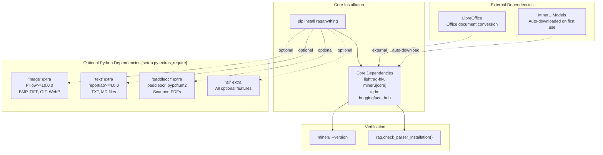
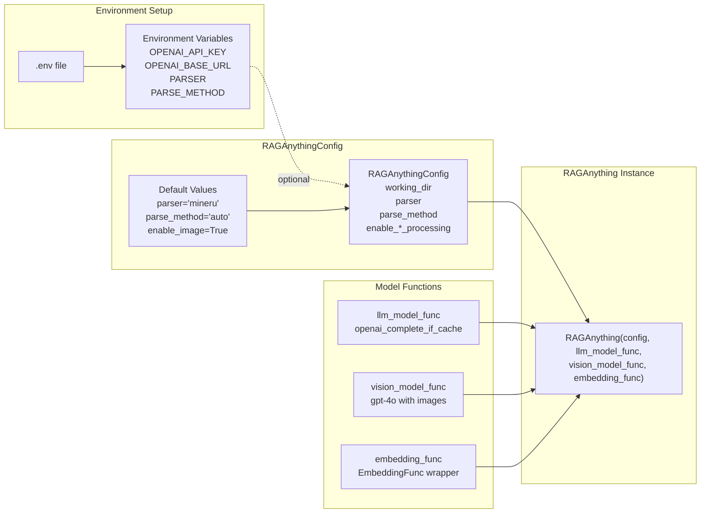
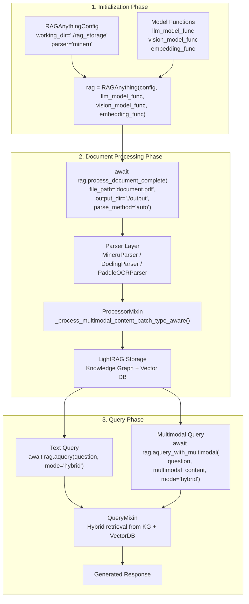

<!-- source: DeepWiki mcp.deepwiki.com · repo HKUDS/RAG-Anything · page 2 Getting Started · fetched 2026-11-09 -->

# Getting Started

<details>
<summary>Relevant source files</summary>

The following files were used as context for generating this wiki page:

- [.github/workflows/pypi-publish.yml](.github/workflows/pypi-publish.yml)
- [README.md](README.md)
- [raganything/enhanced_markdown.py](raganything/enhanced_markdown.py)
- [requirements.txt](requirements.txt)
- [setup.py](setup.py)

</details>


This guide covers the essential steps to install, configure, and run your first RAG-Anything pipeline. You will learn how to set up the environment, initialize the `RAGAnything` class, process your first document, and execute basic queries.

For detailed installation options and troubleshooting, see [Installation](#2.1). For comprehensive configuration reference, see [Environment Configuration](#2.3). For complete end-to-end examples, see [Quick Start Example](#2.2).

---

## Overview

RAG-Anything requires three primary setup phases:

1.  **Installation**: Installing Python packages and external dependencies.
2.  **Configuration**: Setting up API keys and model providers.
3.  **Initialization**: Creating a `RAGAnything` instance with model functions.

Once configured, the typical workflow involves:
*   Processing documents with `process_document_complete()`.
*   Querying the knowledge base with `aquery()` or `aquery_with_multimodal()`.

---

## Prerequisites

Before installing RAG-Anything, ensure you have:

| Requirement | Version | Purpose |
| :--- | :--- | :--- |
| Python | 3.10+ | Core runtime environment [setup.py:105-105]() |
| pip or uv | Latest | Package management [README.md:26-26]() |
| API Key | - | LLM/embedding service access (OpenAI, Ollama, etc.) |

**Optional External Tools:**

| Tool | Required For | Installation Method |
| :--- | :--- | :--- |
| LibreOffice | Office documents (.docx, .xlsx, .pptx) | [Official website](https://www.libreoffice.org) or system package manager [setup.py:65-65]() |
| CUDA Toolkit | GPU acceleration for MinerU | [NVIDIA website](https://developer.nvidia.com/cuda-downloads) |

Sources: [README.md:301-308](), [setup.py:105-105](), [setup.py:65-65]()

---

## Installation Quick Reference

### Installation Architecture



Sources: [README.md:257-320](), [requirements.txt:1-15](), [setup.py:62-84]()

### Basic Installation Commands

**From PyPI (Recommended):**
```bash
# Minimal installation
pip install raganything

# With optional dependencies for images and scanned PDFs
pip install 'raganything[image,paddleocr]'

# Install everything
pip install 'raganything[all]'
```

**From Source:**
```bash
git clone https://github.com/HKUDS/RAG-Anything.git
cd RAG-Anything
# Using uv for fast dependency resolution
uv sync
```

For detailed installation instructions including troubleshooting, see [Installation](#2.1).

Sources: [README.md:257-320](), [requirements.txt:15-16]()

---

## Configuration Essentials

### Configuration Flow



Sources: [README.md:1037-1052](), [README.md:326-427]()

### Minimal Configuration Example

Initialize `RAGAnything` with minimal configuration using OpenAI-compatible functions:

```python
from raganything import RAGAnything, RAGAnythingConfig
from lightrag.llm.openai import openai_complete_if_cache, openai_embed
from lightrag.utils import EmbeddingFunc

# Create configuration
config = RAGAnythingConfig(
    working_dir="./rag_storage",
    parser="mineru",
    enable_image_processing=True,
    enable_table_processing=True,
    enable_equation_processing=True
)

# Define model functions
def llm_model_func(prompt, system_prompt=None, history_messages=[], **kwargs):
    return openai_complete_if_cache(
        "gpt-4o-mini",
        prompt,
        system_prompt=system_prompt,
        history_messages=history_messages,
        api_key="your-api-key",
        **kwargs
    )

embedding_func = EmbeddingFunc(
    embedding_dim=3072,
    max_token_size=8192,
    func=lambda texts: openai_embed(
        texts,
        model="text-embedding-3-large",
        api_key="your-api-key"
    )
)

# Initialize RAGAnything orchestrator
rag = RAGAnything(
    config=config,
    llm_model_func=llm_model_func,
    embedding_func=embedding_func
)
```

For complete configuration options and environment variables, see [Environment Configuration](#2.3).

Sources: [README.md:326-427]()

---

## Your First RAG Pipeline

### End-to-End Workflow



Sources: [README.md:323-457]()

### Complete Minimal Example

```python
import asyncio
from raganything import RAGAnything, RAGAnythingConfig

async def main():
    # Step 1: Initialize with basic config
    # Note: Model functions would be defined here as shown in previous section
    rag = RAGAnything(config=RAGAnythingConfig(working_dir="./rag_storage"))
    
    # Step 2: Process a document
    # This calls ProcessorMixin.process_document_complete
    await rag.process_document_complete(
        file_path="path/to/document.pdf",
        output_dir="./output"
    )
    
    # Step 3: Query the knowledge base
    # This uses QueryMixin.aquery
    result = await rag.aquery(
        "What are the main findings in the document?",
        mode="hybrid"
    )
    print(result)

if __name__ == "__main__":
    asyncio.run(main())
```

Sources: [README.md:323-457]()

### Key Method Reference

| Method | Purpose | Source |
| :--- | :--- | :--- |
| `process_document_complete()` | Parse and process a document into the knowledge base | [README.md:428-457]() |
| `aquery()` | Execute a text-based query | [README.md:604-616]() |
| `aquery_with_multimodal()` | Execute a query with images/tables/equations | [README.md:648-672]() |
| `process_folder_complete()` | Batch process multiple documents in a directory | [README.md:577-603]() |

For detailed API documentation, see [RAGAnything Class](#10.1) and [Query Methods API](#10.5).

---

## Query Modes Explained

RAG-Anything supports four query modes inherited from LightRAG:

1.  **`hybrid`**: Default mode. Combines vector similarity with graph relationships for comprehensive retrieval. Recommended for most use cases.
2.  **`local`**: Focuses on specific entities and their immediate neighbors. Best when you know the exact entity you're querying about.
3.  **`global`**: Traverses the entire knowledge graph for high-level understanding. Best for broad, summarization-style questions.
4.  **`naive`**: Simple vector-based search without graph traversal. Fastest but may miss contextual relationships.

Sources: [README.md:604-616]()

---

## Next Steps

Now that you have RAG-Anything running, explore these topics:

### Core Functionality
*   **[Installation](#2.1)**: Detailed installation instructions and troubleshooting.
*   **[Environment Configuration](#2.3)**: Complete environment variable reference and configuration options.
*   **[Quick Start Example](#2.2)**: Comprehensive end-to-end examples.

### Advanced Features
*   **[Multimodal Content Processing](#5)**: Process images, tables, and equations with specialized processors.
*   **[Query System](#7)**: Advanced query modes including VLM-enhanced queries.
*   **[Batch Processing](#4.5)**: Concurrent processing of multiple documents using `BatchMixin`.

### Configuration & Deployment
*   **[Storage Backend Configuration](#8.3)**: Configure PostgreSQL, Neo4j, Milvus, and other backends.
*   **[Model Provider Configuration](#8.4)**: Set up OpenAI, Ollama, Azure, or local models.
*   **[Offline Deployment](#11.1)**: Configure for fully offline operation with local models.

Sources: [README.md:257-672]()

---

