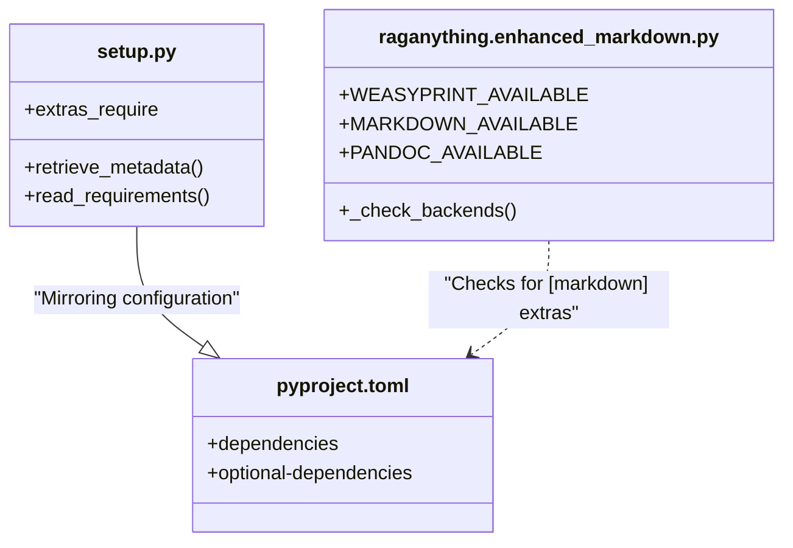
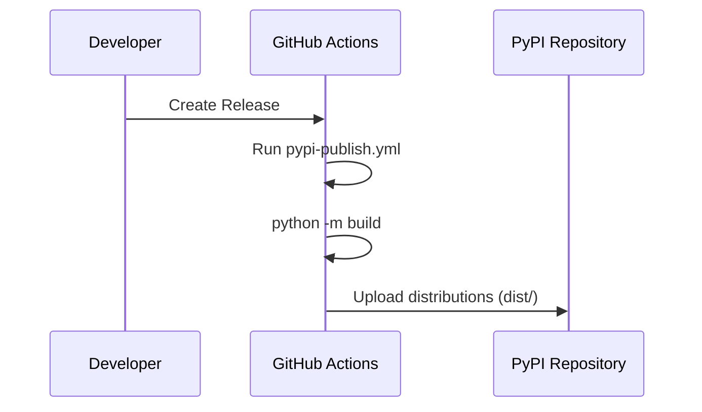

<!-- source: DeepWiki mcp.deepwiki.com · repo HKUDS/RAG-Anything · page 2.1 Installation · fetched 2026-11-09 -->

# Installation

<details>
<summary>Relevant source files</summary>

The following files were used as context for generating this wiki page:

- [.github/workflows/pypi-publish.yml](.github/workflows/pypi-publish.yml)
- [pyproject.toml](pyproject.toml)
- [raganything/enhanced_markdown.py](raganything/enhanced_markdown.py)
- [requirements.txt](requirements.txt)
- [setup.py](setup.py)

</details>


This page covers the standard installation process for RAG-Anything, including core dependencies, optional feature packages, and external requirements like LibreOffice.

## Installation Overview

RAG-Anything is a modular system that leverages several high-performance backends for document parsing and retrieval. It is built on top of the LightRAG framework and uses MinerU as its primary parsing engine.

```mermaid
flowchart TD
    subgraph "Installation Methods"
        [pip_install] -- "Standard" --> PIP["pip install raganything"]
        [pip_extras] -- "Feature-specific" --> PIP_EXTRAS["pip install raganything[extras]"]
    end
    
    subgraph "Core Dependencies (pyproject.toml)"
        [lightrag-hku]
        [mineru_core]
        [huggingface_hub]
        [tqdm]
    end
    
    subgraph "Optional Dependencies (extras_require)"
        [image_extra] -- "Pillow" --> PILLOW["Image Conversion"]
        [text_extra] -- "reportlab" --> REPORTLAB["TXT/MD to PDF"]
        [paddle_extra] -- "paddleocr" --> PADDLE["Scanned PDF OCR"]
        [md_extra] -- "weasyprint" --> WEASY["Enhanced MD Styling"]
        [office_ext] -- "System" --> LIBRE["LibreOffice (External)"]
    end
    
    PIP --> [lightrag-hku]
    PIP --> [mineru_core]
    PIP_EXTRAS --> [image_extra]
    PIP_EXTRAS --> [paddle_extra]
    PIP_EXTRAS --> [md_extra]
```
**Installation Dependency Mapping**  
Sources: [pyproject.toml:23-51](), [setup.py:62-84](), [requirements.txt:1-7]()

## System Requirements

| Requirement | Version | Source |
|-------------|---------|---------|
| Python | >=3.10 | [pyproject.toml:14]() |
| Operating System | Cross-platform | [pyproject.toml:19]() |
| Build System | setuptools >= 64 | [pyproject.toml:2]() |

**Note**: While [setup.py:105]() mentions `python_requires=">=3.9"`, the `pyproject.toml` specification of `3.10` is the recommended minimum for modern dependency compatibility.

## Basic Installation

### Standard Installation
Install the core package which includes `lightrag-hku` for graph-based RAG and `mineru[core]` for multimodal document parsing.

```bash
pip install raganything
```
Sources: [pyproject.toml:23-28](), [requirements.txt:1-7]()

### Installation with Optional Features
RAG-Anything uses `extras_require` to manage specialized dependencies.

```bash
# For scanned PDF OCR support
pip install raganything[paddleocr]

# For image format conversion (BMP, TIFF, etc.)
pip install raganything[image]

# For enhanced Markdown to PDF styling
pip install raganything[markdown]

# Install everything
pip install raganything[all]
```
Sources: [setup.py:62-84](), [pyproject.toml:30-51]()

## Detailed Dependency Breakdown

### Core Dependencies
These are installed by default and form the backbone of the system:
*   **`lightrag-hku`**: The retrieval engine and knowledge graph framework [pyproject.toml:25]().
*   **`mineru[core]`**: Handles the "Five-Stage Processing Pipeline" for PDF and document parsing [pyproject.toml:26]().
*   **`huggingface_hub`**: Used for downloading model weights and assets [pyproject.toml:24]().

### Optional Packages (Extras)
| Extra | Packages | Purpose |
|-------|----------|---------|
| `image` | `Pillow>=10.0.0` | Format conversion for BMP, TIFF, GIF, and WebP [setup.py:63](). |
| `text` | `reportlab>=4.0.0` | Basic conversion of TXT and MD files to PDF for the parser [setup.py:64](). |
| `paddleocr` | `paddleocr`, `pypdfium2` | Better OCR accuracy for scanned PDFs [setup.py:66-69](). |
| `markdown` | `markdown`, `weasyprint`, `pygments` | High-fidelity Markdown conversion with CSS and syntax highlighting [setup.py:79-83](). |

### External Dependencies
*   **LibreOffice**: Required for processing Microsoft Office formats (DOCX, PPTX, XLSX). RAG-Anything invokes LibreOffice as an external process to convert these files to PDF before parsing [setup.py:65](), [requirements.txt:12]().

## Code Entity to Natural Language Mapping

The following diagram maps installation-related code entities to their functional roles in the setup process.


**Code Entity Space: Installation & Backend Detection**  
Sources: [setup.py:14-84](), [pyproject.toml:23-51](), [raganything/enhanced_markdown.py:21-43]()

## Verification and Backend Detection

RAG-Anything performs runtime checks to determine which features are available based on the installed packages. For example, the `EnhancedMarkdownConverter` class detects backends during initialization.

```python
# raganything/enhanced_markdown.py:92-94
self.available_backends = self._check_backends()
self.logger.info(f"Available backends: {list(self.available_backends.keys())}")
```

You can verify your installation by checking the availability of these backends:

```python
from raganything.enhanced_markdown import EnhancedMarkdownConverter

converter = EnhancedMarkdownConverter()
print(converter.available_backends)
# Output: {'weasyprint': True, 'pandoc': False, 'markdown': True, 'pandoc_system': False}
```
Sources: [raganything/enhanced_markdown.py:96-111]()

## Automated Build Pipeline

The project includes a GitHub Action for automated distribution to PyPI, ensuring that the `install_requires` and `extras_require` are correctly packaged.


**Deployment Workflow**  
Sources: [.github/workflows/pypi-publish.yml:21-53]()

---

