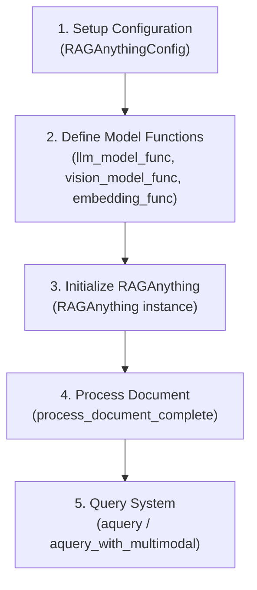
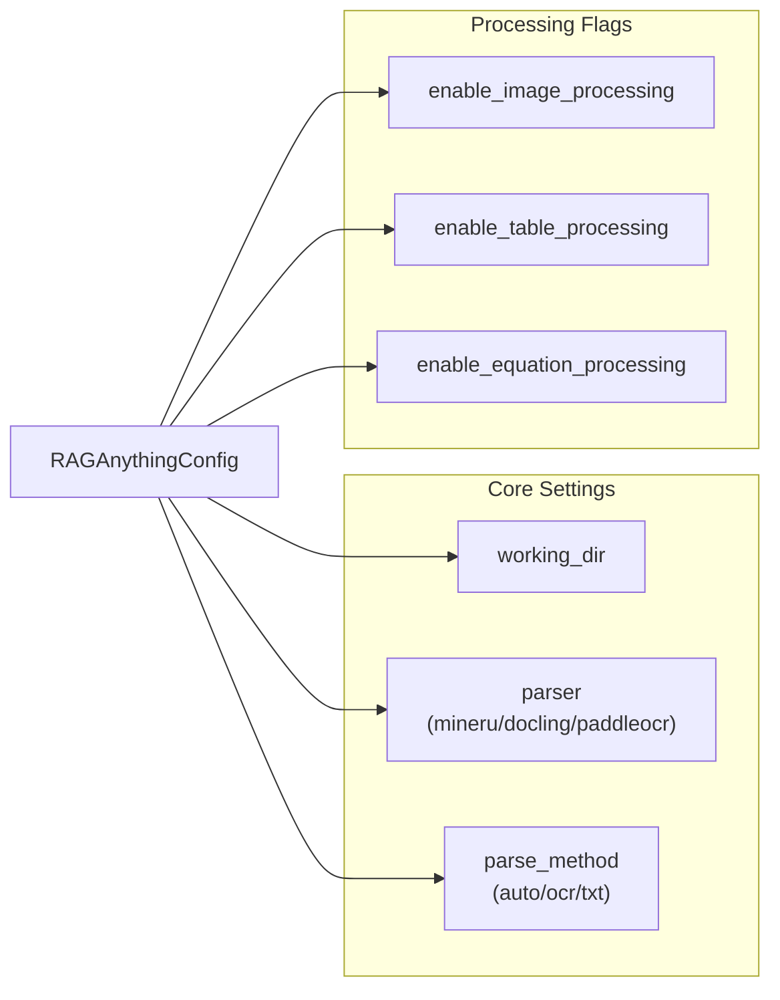
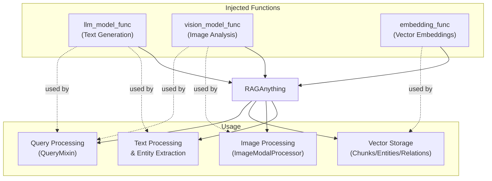
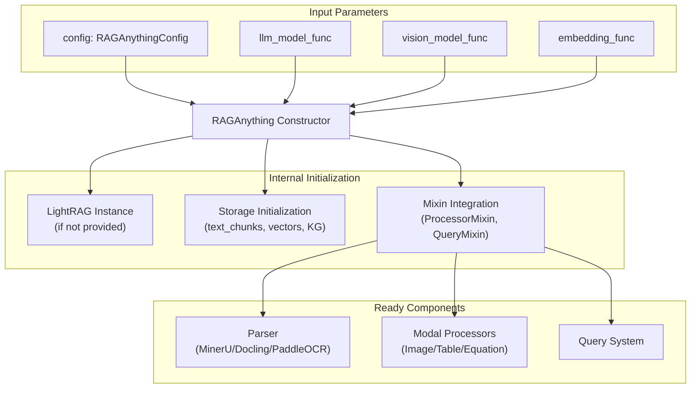
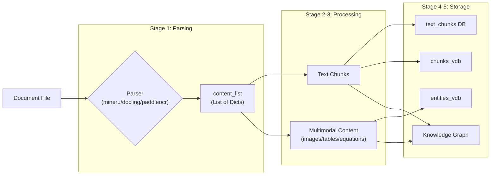
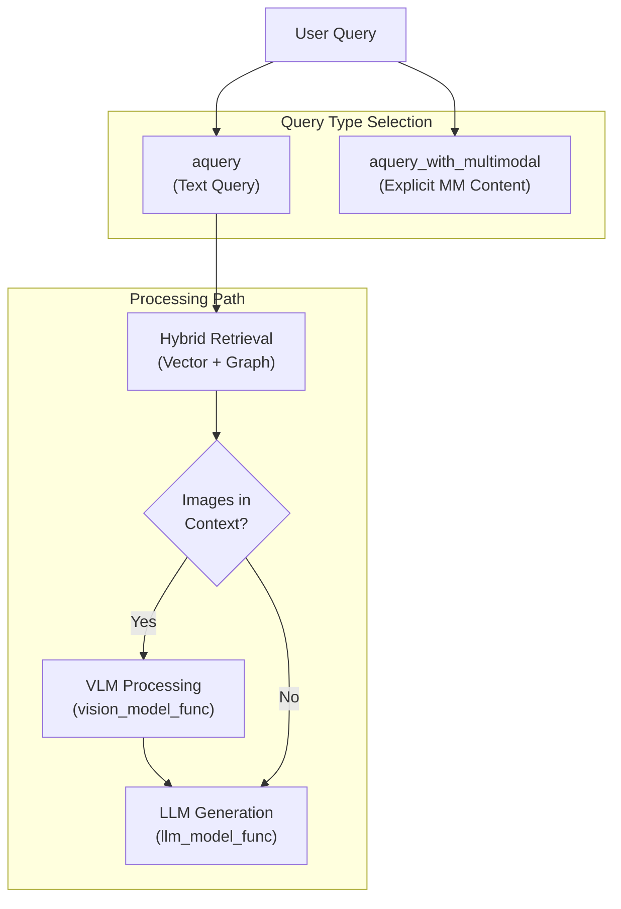

<!-- source: DeepWiki mcp.deepwiki.com · repo HKUDS/RAG-Anything · page 2.2 Quick Start Example · fetched 2026-11-09 -->

# Quick Start Example

<details>
<summary>Relevant source files</summary>

The following files were used as context for generating this wiki page:

- [README.md](README.md)
- [examples/raganything_example.py](examples/raganything_example.py)

</details>


This page provides a minimal working example demonstrating end-to-end document processing and querying with RAG-Anything. It covers the essential steps to process a document, insert it into the knowledge base, and perform different types of queries.

**Scope**: This guide assumes you have already completed installation (see [Installation](#2.1)). For detailed configuration options, see [Environment Configuration](#2.3). For comprehensive usage examples, see [Usage Examples](#9).

---

## Overview of the Basic Workflow

The following diagram illustrates the essential steps in a basic RAG-Anything workflow:



Sources: [README.md:321-456](), [examples/raganything_example.py:89-267]()

---

## Step 1: Create Configuration

Begin by creating a `RAGAnythingConfig` instance to define the system's behavior. This class centralizes all processing parameters.

```python
from raganything import RAGAnything, RAGAnythingConfig

config = RAGAnythingConfig(
    working_dir="./rag_storage",           # Storage directory
    parser="mineru",                        # Parser: mineru, docling, or paddleocr
    parse_method="auto",                    # Parse method: auto, ocr, or txt
    enable_image_processing=True,           # Enable image analysis
    enable_table_processing=True,           # Enable table processing
    enable_equation_processing=True,        # Enable equation processing
)
```

**Configuration Architecture**:



Sources: [README.md:336-344](), [examples/raganything_example.py:109-116]()

---

## Step 2: Define Model Functions

RAG-Anything requires three function types: LLM for text generation, vision model for image analysis, and embedding for vector representations.

### LLM Model Function
The `llm_model_func` handles standard text generation tasks and entity extraction [examples/raganything_example.py:123-132]().

```python
from lightrag.llm.openai import openai_complete_if_cache

def llm_model_func(prompt, system_prompt=None, history_messages=[], **kwargs):
    return openai_complete_if_cache(
        "gpt-4o-mini",
        prompt,
        system_prompt=system_prompt,
        history_messages=history_messages,
        api_key="your-api-key",
        base_url="your-base-url",  # Optional
        **kwargs,
    )
```

### Vision Model Function
The `vision_model_func` is critical for multimodal features. It handles both single-image analysis during document processing and multi-image context analysis during VLM-enhanced queries [examples/raganything_example.py:135-187]().

```python
def vision_model_func(
    prompt, 
    system_prompt=None, 
    history_messages=[], 
    image_data=None, 
    messages=None, 
    **kwargs
):
    # Multimodal VLM format (for VLM-enhanced queries)
    if messages:
        return openai_complete_if_cache(
            "gpt-4o",
            "",
            system_prompt=None,
            history_messages=[],
            messages=messages,
            api_key="your-api-key",
            base_url="your-base-url",
            **kwargs,
        )
    # Single image format (for image processing)
    elif image_data:
        return openai_complete_if_cache(
            "gpt-4o",
            "",
            system_prompt=None,
            history_messages=[],
            messages=[
                {"role": "system", "content": system_prompt} if system_prompt else None,
                {
                    "role": "user",
                    "content": [
                        {"type": "text", "text": prompt},
                        {
                            "type": "image_url",
                            "image_url": {"url": f"data:image/jpeg;base64,{image_data}"}
                        },
                    ],
                }
            ],
            api_key="your-api-key",
            base_url="your-base-url",
            **kwargs,
        )
    # Pure text fallback
    else:
        return llm_model_func(prompt, system_prompt, history_messages, **kwargs)
```

### Embedding Function
Uses `EmbeddingFunc` to wrap vector generation [examples/raganything_example.py:193-206]().

```python
from lightrag.llm.openai import openai_embed
from lightrag.utils import EmbeddingFunc

embedding_func = EmbeddingFunc(
    embedding_dim=3072,
    max_token_size=8192,
    func=lambda texts: openai_embed(
        texts,
        model="text-embedding-3-large",
        api_key="your-api-key",
        base_url="your-base-url",
    ),
)
```

**Function Injection Architecture**:



Sources: [README.md:346-418](), [examples/raganything_example.py:119-198]()

---

## Step 3: Initialize RAGAnything

Create the `RAGAnything` instance. This class inherits from `ProcessorMixin`, `QueryMixin`, and `BatchMixin` to provide a unified interface [README.md:93-97]().

```python
import asyncio

rag = RAGAnything(
    config=config,
    llm_model_func=llm_model_func,
    vision_model_func=vision_model_func,
    embedding_func=embedding_func,
)
```

**Initialization Flow**:



Sources: [README.md:420-426](), [examples/raganything_example.py:200-206]()

---

## Step 4: Process a Document

Use `process_document_complete` to run the five-stage pipeline (parsing, routing, analysis, graph construction, indexing) [README.md:107-111]().

```python
await rag.process_document_complete(
    file_path="path/to/your/document.pdf",
    output_dir="./output",
    parse_method="auto"
)
```

**Document Processing Pipeline**:



Sources: [README.md:428-433](), [examples/raganything_example.py:208-211]()

---

## Step 5: Query the System

### Pure Text Queries
Standard text queries using `aquery()` [examples/raganything_example.py:214-222]().

```python
result = await rag.aquery(
    "What are the main findings in the document?",
    mode="hybrid"  # Options: hybrid, local, global, naive
)
print(result)
```

### Multimodal Queries
Use `aquery_with_multimodal()` for queries containing explicit new multimodal elements [examples/raganything_example.py:224-261]().

```python
# Query with table data
table_result = await rag.aquery_with_multimodal(
    "Compare these metrics with document content",
    multimodal_content=[{
        "type": "table",
        "table_data": "Method,Accuracy\nRAGAnything,95.2%",
        "table_caption": "Performance comparison"
    }],
    mode="hybrid"
)
```

### VLM-Enhanced Queries
If `vision_model_func` is configured, RAG-Anything automatically detects images in the retrieved context and sends them to the VLM for analysis [README.md:80]().



Sources: [README.md:435-453](), [README.md:607-672](), [examples/raganything_example.py:213-261]()

---

## Complete Working Example

A complete, runnable implementation combining the steps above:

```python
import asyncio
from raganything import RAGAnything, RAGAnythingConfig
from lightrag.llm.openai import openai_complete_if_cache, openai_embed
from lightrag.utils import EmbeddingFunc

async def main():
    config = RAGAnythingConfig(
        working_dir="./rag_storage",
        parser="mineru",
        enable_image_processing=True
    )
    
    api_key = "your-api-key"
    
    def llm_model_func(prompt, **kwargs):
        return openai_complete_if_cache("gpt-4o-mini", prompt, api_key=api_key, **kwargs)
    
    def vision_model_func(prompt, image_data=None, messages=None, **kwargs):
        # Implementation logic for single image or VLM messages...
        return openai_complete_if_cache("gpt-4o", prompt, api_key=api_key, messages=messages, **kwargs)
    
    embedding_func = EmbeddingFunc(
        embedding_dim=3072, max_token_size=8192,
        func=lambda texts: openai_embed(texts, model="text-embedding-3-large", api_key=api_key)
    )
    
    rag = RAGAnything(
        config=config,
        llm_model_func=llm_model_func,
        vision_model_func=vision_model_func,
        embedding_func=embedding_func
    )
    
    await rag.process_document_complete(file_path="sample.pdf", output_dir="./out")
    
    print(await rag.aquery("Summarize the charts", mode="hybrid"))

if __name__ == "__main__":
    asyncio.run(main())
```

Sources: [README.md:321-456](), [examples/raganything_example.py:1-331]()

---

