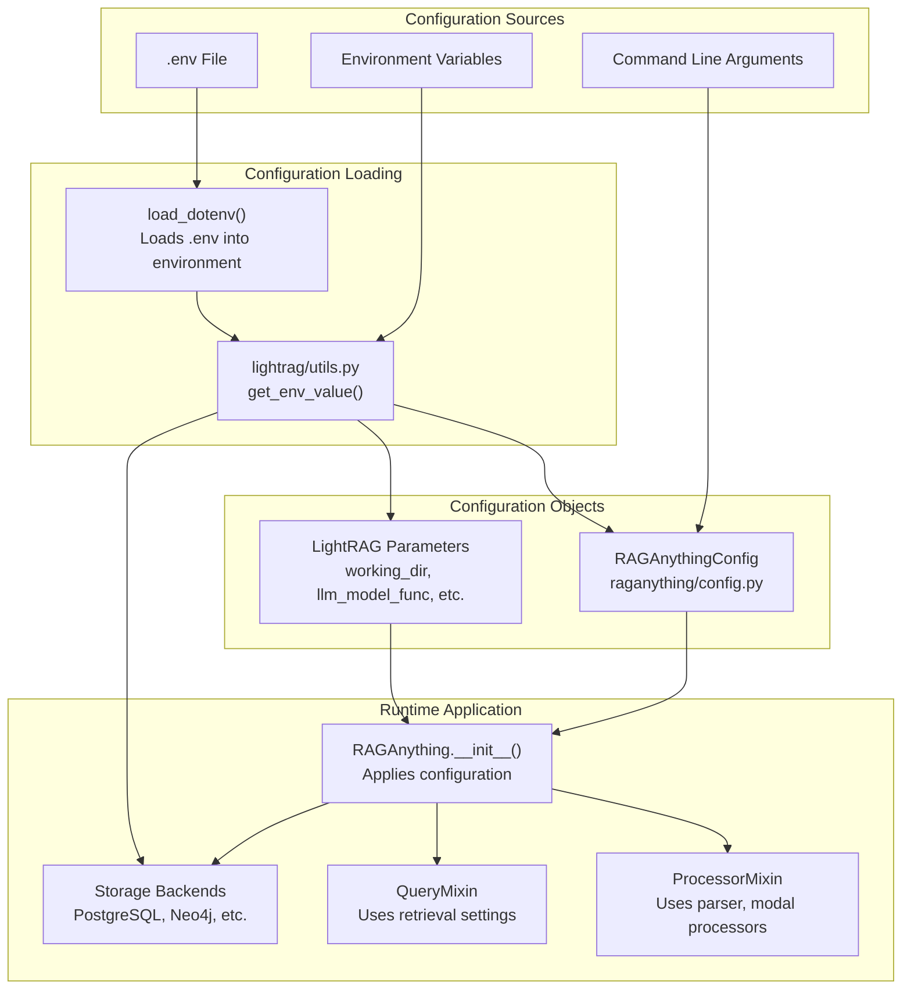
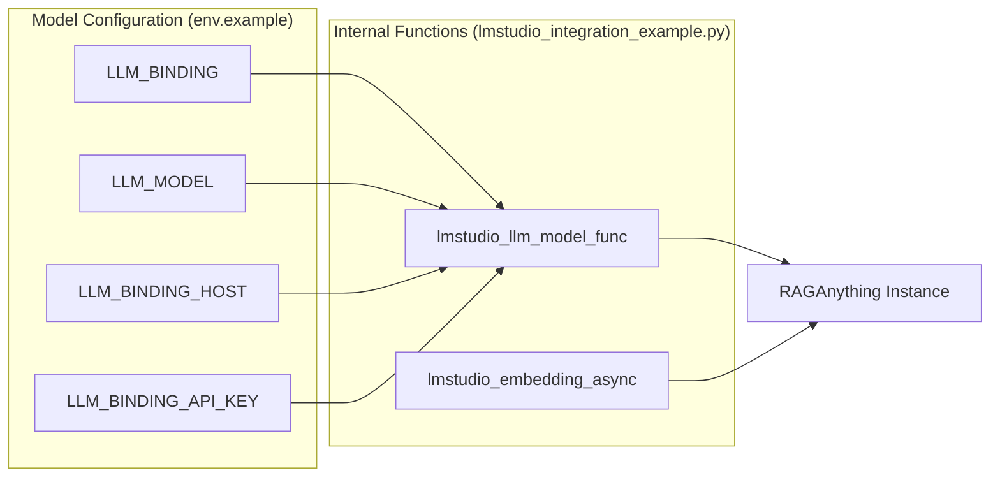
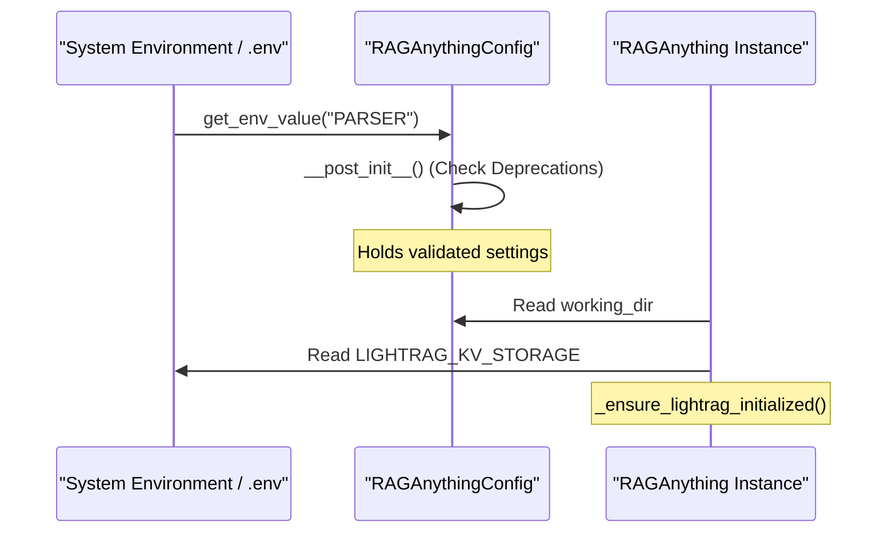

<!-- source: DeepWiki mcp.deepwiki.com · repo HKUDS/RAG-Anything · page 2.3 Environment Configuration · fetched 2026-11-09 -->

# Environment Configuration

<details>
<summary>Relevant source files</summary>

The following files were used as context for generating this wiki page:

- [.gitignore](.gitignore)
- [env.example](env.example)
- [examples/lmstudio_integration_example.py](examples/lmstudio_integration_example.py)
- [raganything/config.py](raganything/config.py)

</details>


## Purpose and Scope

This page explains the basic environment configuration required to get RAG-Anything operational. It covers essential API keys, directory paths, and fundamental settings needed for initial system setup, primarily focusing on the interaction between the `.env` file and the `RAGAnythingConfig` class.

For comprehensive configuration options including all environment variables, see [Environment Variables](#8.2). For storage backend configuration details, see [Storage Backend Configuration](#8.3). For model provider configuration, see [Model Provider Configuration](#8.4). For complete `RAGAnythingConfig` parameter reference, see [RAGAnythingConfig](#8.1).

## Configuration Architecture

RAG-Anything uses a three-tier configuration system that combines environment variables, configuration objects, and runtime parameters. The `RAGAnythingConfig` class acts as the central hub for document processing settings, utilizing the `get_env_value` utility to bridge system environment variables to code entities.

### Configuration Data Flow

The following diagram illustrates how configuration flows from raw environment variables into the `RAGAnything` system components.



**Sources:** [env.example:1-212](), [raganything/config.py:1-116]()

## Configuration Sources

### Environment Variables via `.env` File

The primary configuration method uses a `.env` file in the project root. The `env.example` file provides a comprehensive template including server settings, multimodal processing flags, and storage connection strings.

```bash
cp env.example .env
# Edit .env with your settings
```

**Sources:** [env.example:1-212]()

### Programmatic Configuration

Configuration is encapsulated in the `RAGAnythingConfig` dataclass. This class supports environment variable detection for all fields via `get_env_value`.

```python
from raganything.config import RAGAnythingConfig

config = RAGAnythingConfig(
    working_dir="./rag_storage",
    parser="mineru",
    parse_method="auto",
    enable_image_processing=True,
    enable_table_processing=True,
    enable_equation_processing=True
)
```

**Sources:** [raganything/config.py:13-116]()

### Configuration Priority

When the same setting is specified in multiple places, the priority order is:

1. **Runtime Parameters**: Passed directly to methods like `process_document_complete`.
2. **RAGAnythingConfig Object**: The instance passed to the `RAGAnything` constructor.
3. **Environment Variables**: Values retrieved from `.env` or the system shell.
4. **Default Values**: Hardcoded defaults in `RAGAnythingConfig` (e.g., `parser="mineru"`).

**Sources:** [raganything/config.py:18-115]()

## Essential Configuration

### API Keys and Authentication

API keys are required for AI model services and are typically defined in the `.env` file.

| Environment Variable | Purpose | Code Reference |
|---------------------|---------|--------------|
| `LLM_BINDING_API_KEY` | Authentication for LLM | [env.example:122]() |
| `EMBEDDING_BINDING_API_KEY` | Authentication for Embeddings | [env.example:139]() |
| `LIGHTRAG_API_KEY` | Security for the LightRAG Server API | [env.example:27]() |
| `TOKEN_SECRET` | Secret for JWT generation | [env.example:21]() |

### Directory Configuration

These settings define where the system reads inputs and persists data.

| Environment Variable | `RAGAnythingConfig` Field | Default |
|---------------------|---------------------------|---------|
| `WORKING_DIR` | `working_dir` | `./rag_storage` |
| `OUTPUT_DIR` | `parser_output_dir` | `./output` |
| `INPUT_DIR` | N/A (Server level) | `./inputs` |
| `TIKTOKEN_CACHE_DIR` | N/A (Offline mode) | N/A |

**Sources:** [raganything/config.py:18-27](), [env.example:17-38]()

### LLM and Embedding Configuration

The system uses a binding system to interface with various providers.



**Example local configuration (LM Studio):**
```bash
LLM_BINDING=lmstudio
LLM_MODEL=openai/gpt-oss-20b
LLM_BINDING_HOST=http://localhost:1234/v1
LLM_BINDING_API_KEY=lm-studio
```

**Sources:** [env.example:117-122](), [examples/lmstudio_integration_example.py:39-43]()

## Parser and Processing Configuration

### Parser Selection and Strategy

The `RAGAnythingConfig` manages which parser backend is used for document extraction.

| Variable | Values | Code Entity |
|----------|--------|-------------|
| `PARSER` | `mineru`, `docling`, `paddleocr` | `RAGAnythingConfig.parser` |
| `PARSE_METHOD` | `auto`, `ocr`, `txt` | `RAGAnythingConfig.parse_method` |

**Backward Compatibility:** The class includes a `__post_init__` hook that maps the legacy `MINERU_PARSE_METHOD` to the new `parse_method` field, issuing a `DeprecationWarning` if the old variable is detected.

**Sources:** [raganything/config.py:23-30](), [raganything/config.py:117-130]()

### Multimodal Processing Flags

Processing of specific document elements can be toggled via boolean flags in `RAGAnythingConfig`:
* `enable_image_processing`: Default `True` ([raganything/config.py:39]())
* `enable_table_processing`: Default `True` ([raganything/config.py:44]())
* `enable_equation_processing`: Default `True` ([raganything/config.py:49]())

### Context Extraction Settings

These settings define how much surrounding text is provided to multimodal processors (like vision models for images).

* `CONTEXT_WINDOW`: Number of adjacent pages/chunks ([raganything/config.py:80]())
* `CONTEXT_MODE`: `'page'` or `'chunk'` ([raganything/config.py:83]())
* `MAX_CONTEXT_TOKENS`: Hard limit on context length ([raganything/config.py:86]())

## Storage Backend Configuration

Storage is configured by selecting specific class names for the LightRAG storage interface.

| Category | Env Variable | Options |
|----------|--------------|---------|
| Key-Value | `LIGHTRAG_KV_STORAGE` | `PGKVStorage`, `MongoKVStorage` |
| Vector | `LIGHTRAG_VECTOR_STORAGE` | `PGVectorStorage`, `MilvusVectorStorage` |
| Status | `LIGHTRAG_DOC_STATUS_STORAGE` | `PGDocStatusStorage` |
| Graph | `LIGHTRAG_GRAPH_STORAGE` | `Neo4JStorage`, `NetworkXStorage` |

**Sources:** [env.example:152-156](), [env.example:167-212]()

## Performance and Concurrency Settings

Concurrency is managed through multiple variables to balance throughput and API rate limits.

* `MAX_ASYNC`: Max concurrent LLM requests (Default: 4) ([env.example:113]())
* `MAX_PARALLEL_INSERT`: Max parallel document insertions (Default: 2) ([env.example:100]())
* `MAX_CONCURRENT_FILES`: Max files processed in batch (Default: 1) ([raganything/config.py:56]())
* `EMBEDDING_FUNC_MAX_ASYNC`: Max concurrent embedding requests (Default: 16) ([env.example:145]())

## Configuration Loading Process

The configuration loading process follows this sequence:



**Sources:** [raganything/config.py:117-130](), [env.example:152-156]()

---

