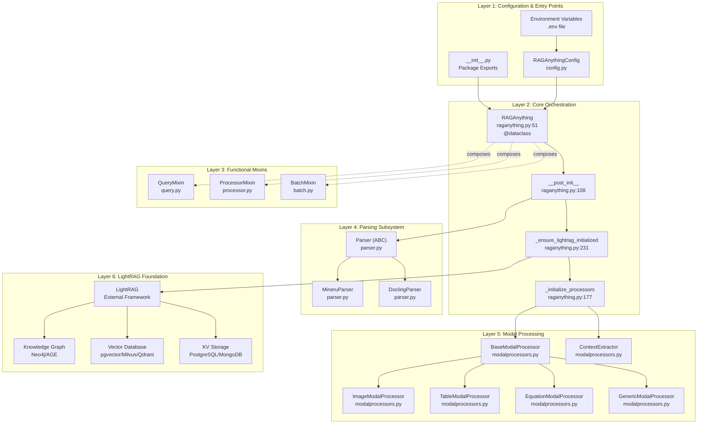
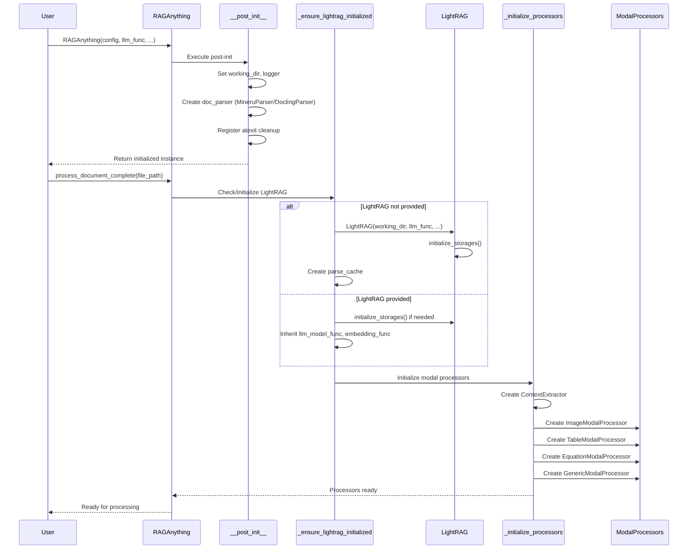
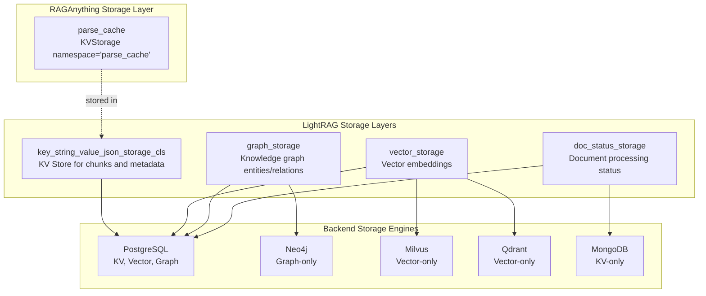

<!-- source: DeepWiki mcp.deepwiki.com · repo HKUDS/RAG-Anything · page 3 System Architecture · fetched 2026-11-09 -->

# System Architecture

Relevant source files

The following files were used as context for generating this wiki page:

- [README.md](README.md)
- [raganything/raganything.py](raganything/raganything.py)

## Purpose and Scope

This document describes the overall system architecture of RAG-Anything, including its component organization, class structure, design patterns, and data flow. It explains how the various modules work together to provide an all-in-one multimodal RAG framework built on top of LightRAG.

For detailed information about specific subsystems, see:
- Component-level details: [Component Overview](#3.1)
- Processing pipeline stages: [Five-Stage Processing Pipeline](#3.2)
- LightRAG integration specifics: [LightRAG Integration](#3.3)
- Document processing internals: [Document Processing](#4)
- Multimodal processing details: [Multimodal Content Processing](#5)
- Query system implementation: [Query System](#7)

---

## Architectural Overview

RAG-Anything is architected as a **modular, mixin-based system** that extends LightRAG with multimodal document processing capabilities. The architecture follows a layered design pattern where high-level orchestration is separated from specialized processing logic through composition.

### Core Design Philosophy

The system is designed around these key architectural principles:

1. **Dependency Injection**: Model functions (LLM, VLM, embedding) are injected as callables, allowing flexible backend configuration [raganything/raganything.py:59-66]().
2. **Mixin-Based Composition**: Major functionality areas (query, processing, batch) are separated into mixins [raganything/raganything.py:51]().
3. **Storage Abstraction**: Leverages LightRAG's storage layer for persistence, with added parse caching [raganything/raganything.py:94-98]().
4. **Extensibility**: Modal processors follow a base class pattern for easy extension [raganything/modalprocessors.py:112-114]().
5. **Lazy Initialization**: LightRAG and processors are initialized on first use to support both pre-configured and on-demand setup [raganything/raganything.py:231-233]().

Sources: [README.md:93-113](), [raganything/raganything.py:1-586]()

---

## Core Class Architecture

### RAGAnything Main Class

The `RAGAnything` class serves as the central orchestrator and is defined as a dataclass that composes three mixin classes:

```mermaid
graph TB
    subgraph "RAGAnything Class Structure"
        RA["RAGAnything<br/>raganything.py:51"]
        
        QM["QueryMixin<br/>query.py"]
        PM["ProcessorMixin<br/>processor.py"]
        BM["BatchMixin<br/>batch.py"]
        
        RA -.inherits.-> QM
        RA -.inherits.-> PM
        RA -.inherits.-> BM
    end
    
    subgraph "Core Components"
        LR["lightrag: LightRAG<br/>Field"]
        LLM["llm_model_func: Callable<br/>Field"]
        VLM["vision_model_func: Callable<br/>Field"]
        EMB["embedding_func: Callable<br/>Field"]
        CFG["config: RAGAnythingConfig<br/>Field"]
    end
    
    subgraph "Internal State"
        MP["modal_processors: Dict<br/>Field init=False"]
        CE["context_extractor: ContextExtractor<br/>Field init=False"]
        PC["parse_cache: KVStorage<br/>Field init=False"]
        DP["doc_parser: Parser<br/>Initialized in __post_init__"]
    end
    
    RA --> LR
    RA --> LLM
    RA --> VLM
    RA --> EMB
    RA --> CFG
    RA --> MP
    RA --> CE
    RA --> PC
    RA --> DP
```

**Diagram: RAGAnything Class Composition and Fields**

The `RAGAnything` class uses Python dataclass fields to manage its components:

- **Core Components** (Lines 56-73): Optional fields that can be provided at initialization [raganything/raganything.py:56-73]().
- **Internal State** (Lines 88-103): Fields initialized during `__post_init__` or lazy initialization [raganything/raganything.py:88-103]().
- **Mixins**: Provide method collections for specific functional areas [raganything/raganything.py:51]().

Sources: [raganything/raganything.py:49-106]()

---

### Mixin-Based Method Distribution

Each mixin contributes a specific set of methods to the `RAGAnything` class:

| Mixin Class | File | Primary Responsibilities | Key Methods |
|------------|------|-------------------------|-------------|
| `QueryMixin` | `raganything/query.py` | Query processing and retrieval | `aquery()`, `aquery_with_multimodal()`, `aquery_vlm_enhanced()` |
| `ProcessorMixin` | `raganything/processor.py` | Document parsing and content insertion | `parse_document()`, `process_document_complete()`, `insert_content_list()` |
| `BatchMixin` | `raganything/batch.py` | Concurrent multi-document processing | `process_folder_complete()`, `process_documents_batch()` |

This separation allows each functional area to be developed and tested independently while still being accessible through the unified `RAGAnything` interface.

Sources: [raganything/raganything.py:32-34]()

---

## Component Layer Architecture

The system is organized into distinct layers, each with specific responsibilities:

**Diagram: Layered Component Architecture with Initialization Flow**

### Layer Descriptions

**Layer 1: Configuration & Entry Points**
- `__init__.py` exports `RAGAnything` and `RAGAnythingConfig` classes.
- `RAGAnythingConfig` reads environment variables and provides default values.

**Layer 2: Core Orchestration**
- `RAGAnything` class orchestrates all components through its lifecycle methods.
- `__post_init__` (line 108): Sets up working directory, logger, and parser [raganything/raganything.py:108-142]().
- `_ensure_lightrag_initialized` (line 231): Lazy initialization of LightRAG instance [raganything/raganything.py:231-369]().
- `_initialize_processors` (line 177): Creates modal processors with appropriate model functions [raganything/raganything.py:177-221]().

**Layer 3: Functional Mixins**
- Each mixin provides a focused set of methods for retrieval, processing, and batching.

**Layer 4: Parsing Subsystem**
- Abstract `Parser` base class defines the parsing interface [raganything/parser.py:61]().
- `MineruParser` and `DoclingParser` implement format-specific parsing logic.

**Layer 5: Modal Processing**
- `BaseModalProcessor` defines the processing interface and entity creation logic [raganything/modalprocessors.py:112]().
- Specialized processors (Image, Table, Equation) inherit from `GenericModalProcessor` [raganything/modalprocessors.py:356-430]().

**Layer 6: LightRAG Foundation**
- LightRAG handles knowledge graph construction, vector storage, and retrieval [raganything/raganything.py:27]().

Sources: [raganything/raganything.py:99-221](), [raganything/config.py](), [raganything/modalprocessors.py]()

---

## Initialization and Data Flow

### Initialization Sequence

The system follows a specific initialization sequence to ensure all components are properly configured:

**Diagram: Component Initialization Sequence**

### Key Initialization Steps

1. **`__post_init__` (raganything.py:108-142)**
   - Creates working directory if it doesn't exist [raganything/raganything.py:127-129]().
   - Selects parser based on `config.parser` [raganything/raganything.py:121]().
   - Registers cleanup handler via `atexit` [raganything/raganything.py:124]().

2. **`_ensure_lightrag_initialized` (raganything.py:231-369)**
   - Called lazily on first processing operation.
   - Checks parser installation before proceeding [raganything/raganything.py:234-239]().
   - Initializes parse cache using LightRAG's KV storage [raganything/raganything.py:285-291]().

3. **`_initialize_processors` (raganything.py:177-221)**
   - Creates `ContextExtractor` with tokenizer from LightRAG [raganything/raganything.py:180-184]().
   - Instantiates modal processors based on configuration flags (Image, Table, Equation) [raganything/raganything.py:186-221]().

Sources: [raganything/raganything.py:99-221](), [raganything/raganything.py:231-369]()

---

## Storage Architecture

### Multi-Layer Storage System

RAG-Anything uses a multi-layer storage approach built on top of LightRAG's storage abstractions:

**Diagram: Storage Layer Architecture**

### Parse Cache Implementation

The parse cache is implemented using LightRAG's KV storage system:

- **Namespace**: `"parse_cache"` [raganything/raganything.py:285]().
- **Purpose**: Stores parsed document results to avoid redundant parsing.
- **Initialization**: Created in `_ensure_lightrag_initialized` after LightRAG setup [raganything/raganything.py:285-291]().

Sources: [raganything/raganything.py:285-291](), [raganything/raganything.py:345-351]()

---

## Resource Cleanup

The system implements proper resource cleanup through `atexit` registration and explicit finalization:

- **`atexit` Registration**: The `close` method is registered in `__post_init__` [raganything/raganything.py:124]().
- **`finalize_storages`**: Asynchronously closes all storage backends (LightRAG, parse cache, and status cache) [raganything/raganything.py:371-415]().
- **Async Safety**: The `close` method detects if an event loop is running to safely schedule cleanup [raganything/raganything.py:143-175]().

Sources: [raganything/raganything.py:124](), [raganything/raganything.py:143-175](), [raganything/raganything.py:371-415]()

---

