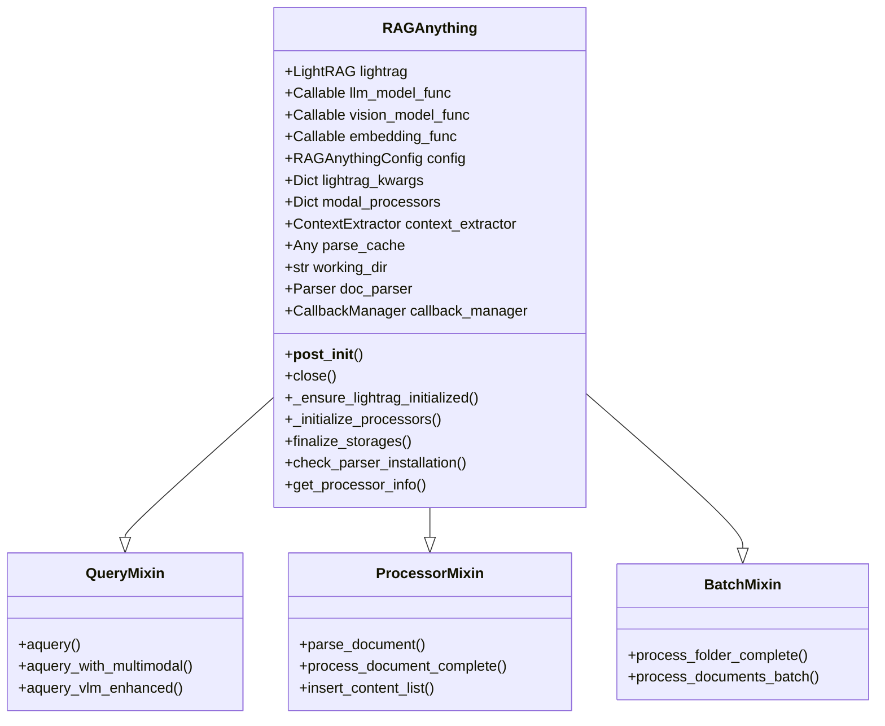

<!-- source: DeepWiki mcp.deepwiki.com · repo HKUDS/RAG-Anything · page 3.1 Component Overview · fetched 2026-11-09 -->

# Component Overview

Relevant source files

The following files were used as context for generating this wiki page:

- [raganything/__init__.py](raganything/__init__.py)
- [raganything/base.py](raganything/base.py)
- [raganything/raganything.py](raganything/raganything.py)

This document describes the main architectural components of RAG-Anything and their responsibilities. It provides a technical overview of the system's modular design, focusing on the `RAGAnything` class, mixin architecture, processors, parsers, and storage integration.

---

## Purpose and Scope

This page covers the structural components that make up the RAG-Anything system:

- **Core orchestrator**: The `RAGAnything` class and its initialization pattern.
- **Mixin architecture**: Modular functionality through `QueryMixin`, `ProcessorMixin`, and `BatchMixin`.
- **Configuration system**: `RAGAnythingConfig` and environment-based setup.
- **Parser abstraction**: Document parsing through `MineruParser`, `DoclingParser`, and `PaddleOCRParser`.
- **Modal processors**: Specialized content handlers for images, tables, equations.
- **Storage integration**: LightRAG-based knowledge graph and vector storage.
- **Dependency injection**: Model function binding pattern for LLM, VLM, and Embeddings.

---

## Component Architecture Overview

The following diagram shows the primary components and their relationships using actual class names from the codebase:

**Figure 1: System Component Map**

```mermaid
graph TB
    subgraph "Core_Orchestration_Layer"
        RAGAnything["RAGAnything<br/>(raganything/raganything.py)"]
        RAGAnythingConfig["RAGAnythingConfig<br/>(raganything/config.py)"]
    end
    
    subgraph "Mixin_Functionality"
        QueryMixin["QueryMixin<br/>(raganything/query.py)"]
        ProcessorMixin["ProcessorMixin<br/>(raganything/processor.py)"]
        BatchMixin["BatchMixin<br/>(raganything/batch.py)"]
    end
    
    subgraph "Document_Parsing"
        Parser["Parser (Base Class)"]
        MineruParser["MineruParser"]
        DoclingParser["DoclingParser"]
        PaddleOCRParser["PaddleOCRParser"]
    end
    
    subgraph "Multimodal_Processing"
        BaseModalProcessor["BaseModalProcessor"]
        ImageModalProcessor["ImageModalProcessor"]
        TableModalProcessor["TableModalProcessor"]
        EquationModalProcessor["EquationModalProcessor"]
        GenericModalProcessor["GenericModalProcessor"]
        ContextExtractor["ContextExtractor"]
    end
    
    subgraph "Storage_&_Knowledge_Graph"
        LightRAG["LightRAG Instance"]
        ParseCache["parse_cache<br/>(KV Storage)"]
        DocStatus["doc_status_storage<br/>(KV Storage)"]
    end
    
    subgraph "External_Dependencies"
        llm_model_func["llm_model_func<br/>(User-provided)"]
        vision_model_func["vision_model_func<br/>(User-provided)"]
        embedding_func["embedding_func<br/>(User-provided)"]
    end
    
    RAGAnything -->|inherits| QueryMixin
    RAGAnything -->|inherits| ProcessorMixin
    RAGAnything -->|inherits| BatchMixin
    RAGAnything -->|configured_by| RAGAnythingConfig
    RAGAnything -->|initializes| LightRAG
    RAGAnything -->|creates| ParseCache
    
    RAGAnything -->|selects_via_get_parser| Parser
    Parser -->|implemented_by| MineruParser
    Parser -->|implemented_by| DoclingParser
    Parser -->|implemented_by| PaddleOCRParser
    
    RAGAnything -->|creates| ImageModalProcessor
    RAGAnything -->|creates| TableModalProcessor
    RAGAnything -->|creates| EquationModalProcessor
    RAGAnything -->|creates| GenericModalProcessor
    RAGAnything -->|creates| ContextExtractor
    
    ImageModalProcessor -->|inherits| BaseModalProcessor
    TableModalProcessor -->|inherits| BaseModalProcessor
    EquationModalProcessor -->|inherits| BaseModalProcessor
    GenericModalProcessor -->|inherits| BaseModalProcessor
    
    BaseModalProcessor -->|writes_to| LightRAG
    ProcessorMixin -->|uses| LightRAG
    QueryMixin -->|queries| LightRAG
    
    ImageModalProcessor -->|uses| ContextExtractor
    TableModalProcessor -->|uses| ContextExtractor
    EquationModalProcessor -->|uses| ContextExtractor
    
    RAGAnything -->|injects| llm_model_func
    RAGAnything -->|injects| vision_model_func
    RAGAnything -->|injects| embedding_func
    
    ImageModalProcessor -->|calls| vision_model_func
    TableModalProcessor -->|calls| llm_model_func
    EquationModalProcessor -->|calls| llm_model_func
    
    LightRAG -->|manages| DocStatus
```

**Sources:** [raganything/raganything.py:49-107](), [raganything/__init__.py:1-68](), [raganything/base.py:4-13]()

---

## RAGAnything: Central Orchestrator

The `RAGAnything` class serves as the system's main entry point and orchestrator. It is implemented as a dataclass that inherits functionality from three mixins.

### Class Structure

**Figure 2: RAGAnything Class Inheritance and Members**

### Key Responsibilities

| Responsibility | Implementation Location | Description |
|---|---|---|
| Configuration management | [raganything/raganything.py:110-112]() | Loads and validates `RAGAnythingConfig` |
| LightRAG lifecycle | [raganything/raganything.py:231-369]() | Initializes or reuses LightRAG instance |
| Parser selection | [raganything/raganything.py:121-121]() | Chooses between `MineruParser`, `DoclingParser`, or `PaddleOCRParser` via `get_parser()` |
| Processor initialization | [raganything/raganything.py:177-221]() | Creates modal processors based on config |
| Resource cleanup | [raganything/raganything.py:124-124](), [raganything/raganything.py:143-172]() | Manages storage finalization via `atexit` and `finalize_storages()` |
| Context extraction setup | [raganything/raganything.py:154-175]() | Configures `ContextExtractor` for processors |

### Initialization Pattern

The initialization follows a lazy pattern where LightRAG and processors are created on first use (e.g., during document processing or querying):

1. **Instantiation**: `__init__` sets up basic configuration and identifies the parser.
2. **Post-Init**: `__post_init__` prepares the working directory and logs the configuration [raganything/raganything.py:108-141]().
3. **Lazy Setup**: Methods like `process_document_complete` call `_ensure_lightrag_initialized()` [raganything/raganything.py:231-245](), which sets up storage backends and modal processors.

**Sources:** [raganything/raganything.py:49-152](), [raganything/raganything.py:231-369]()

---

## Mixin Architecture

RAG-Anything uses a mixin pattern to modularize functionality into three distinct concerns:

### Component Breakdown

| Mixin | File | Primary Methods | Responsibility |
|---|---|---|---|
| `QueryMixin` | `raganything/query.py` | `aquery()`, `aquery_with_multimodal()`, `aquery_vlm_enhanced()` | Query interface to LightRAG with multimodal support and VLM-enhanced retrieval. |
| `ProcessorMixin` | `raganything/processor.py` | `process_document_complete()`, `insert_content_list()`, `parse_document()` | Core document parsing, text insertion, and multimodal content routing. |
| `BatchMixin` | `raganything/batch.py` | `process_folder_complete()`, `process_documents_batch()` | Concurrent processing of multiple documents and folder traversal. |

This design allows:
- **Separation of concerns**: Each mixin handles a distinct aspect of functionality.
- **Shared state access**: All mixins operate on the same `lightrag`, `modal_processors`, and `parse_cache` instances defined in the `RAGAnything` dataclass [raganything/raganything.py:49-107]().
- **Composition**: Functionality is added through multiple inheritance rather than deep hierarchies.

**Sources:** [raganything/raganything.py:49-51](), [raganything/__init__.py:1-68]()

---

## Configuration System

The `RAGAnythingConfig` class provides a centralized configuration interface that can be initialized from environment variables or constructor parameters.

### Key Configuration Fields

| Field | Type | Default | Purpose |
|---|---|---|---|
| `working_dir` | `str` | `"./rag_storage"` | Base directory for all storage [raganything/raganything.py:115-115](). |
| `parser` | `str` | `"mineru"` | Parser selection: `"mineru"`, `"docling"`, or `"paddleocr"` [raganything/raganything.py:134-134](). |
| `parse_method` | `str` | `"auto"` | Parse method: `"auto"`, `"ocr"`, or `"txt"` [raganything/raganything.py:135-135](). |
| `enable_image_processing` | `bool` | `True` | Enable `ImageModalProcessor` [raganything/raganything.py:137-137](). |
| `enable_table_processing` | `bool` | `True` | Enable `TableModalProcessor` [raganything/raganything.py:138-138](). |
| `enable_equation_processing` | `bool` | `True` | Enable `EquationModalProcessor` [raganything/raganything.py:139-139](). |
| `max_concurrent_files` | `int` | `4` | Maximum parallel document processing [raganything/raganything.py:141-141](). |

**Sources:** [raganything/raganything.py:110-141](), [raganything/config.py]()

---

## Document Parsers

RAG-Anything supports multiple document parsers through a unified `Parser` interface.

### Parser Selection Logic

The parser is selected at initialization using the `get_parser()` function based on configuration [raganything/raganything.py:121-121]().

| Parser | Description |
|---|---|
| `MineruParser` | High-fidelity extraction using MinerU, supporting PDF, Office, and images. |
| `DoclingParser` | Structure-aware parsing using Docling, optimized for Office and PDF. |
| `PaddleOCRParser` | OCR-focused parsing using PaddleOCR for images and scanned PDFs. |

### Format Conversion
Both `MineruParser` and `PaddleOCRParser` include automatic format conversion (e.g., Office to PDF via LibreOffice, Text to PDF via ReportLab) to normalize inputs before parsing.

**Sources:** [raganything/raganything.py:121-121](), [raganything/parser.py]()

---

## Modal Processors

Modal processors are specialized components that analyze and create knowledge graph entities from specific content types.

### Processor Initialization

Modal processors are created by `RAGAnything._initialize_processors()` based on configuration flags [raganything/raganything.py:177-221]().

| Processor | Content Types | Model Function | Output |
|---|---|---|---|
| `ImageModalProcessor` | Images (JPG, PNG, etc.) | `vision_model_func` | Visual descriptions and entity nodes. |
| `TableModalProcessor` | Tables (Markdown) | `llm_model_func` | Semantic interpretations and statistics. |
| `EquationModalProcessor` | LaTeX equations | `llm_model_func` | Mathematical concepts and domain mappings. |
| `GenericModalProcessor` | Fallback | `llm_model_func` | Generic entity creation for unknown types. |

### ContextExtractor Integration

All processors use `ContextExtractor` to obtain surrounding content, providing semantic context to the LLM/VLM during multimodal analysis [raganything/raganything.py:154-175]().

**Sources:** [raganything/raganything.py:177-221](), [raganything/raganything.py:38-46]()

---

## Storage and LightRAG Integration

RAG-Anything builds on LightRAG's storage layer and extends it with additional caching.

### Storage Components

1. **LightRAG Instance**: Manages the core knowledge graph, vector databases, and text chunks [raganything/raganything.py:56-57]().
2. **Parse Cache**: A specialized KV storage (namespace: `"parse_cache"`) that caches document parsing results to avoid redundant parsing [raganything/raganything.py:94-95](), [raganything/raganything.py:345-351]().
3. **Doc Status**: Tracks the processing state of documents (e.g., `READY`, `HANDLING`, `PROCESSED`) [raganything/base.py:4-13]().

### Finalization
All storage backends must be properly finalized to persist data and release resources. This is handled by `finalize_storages()` [raganything/raganything.py:371-415](), which is registered via `atexit` [raganything/raganything.py:124-124]().

**Sources:** [raganything/raganything.py:231-415](), [raganything/base.py:4-13]()

---

