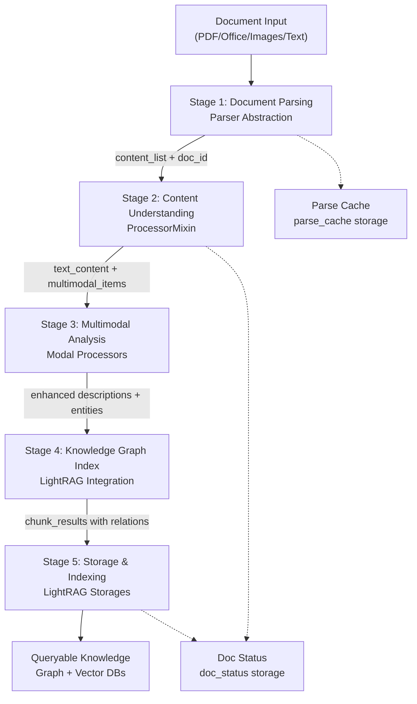
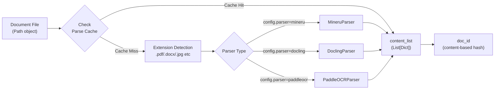
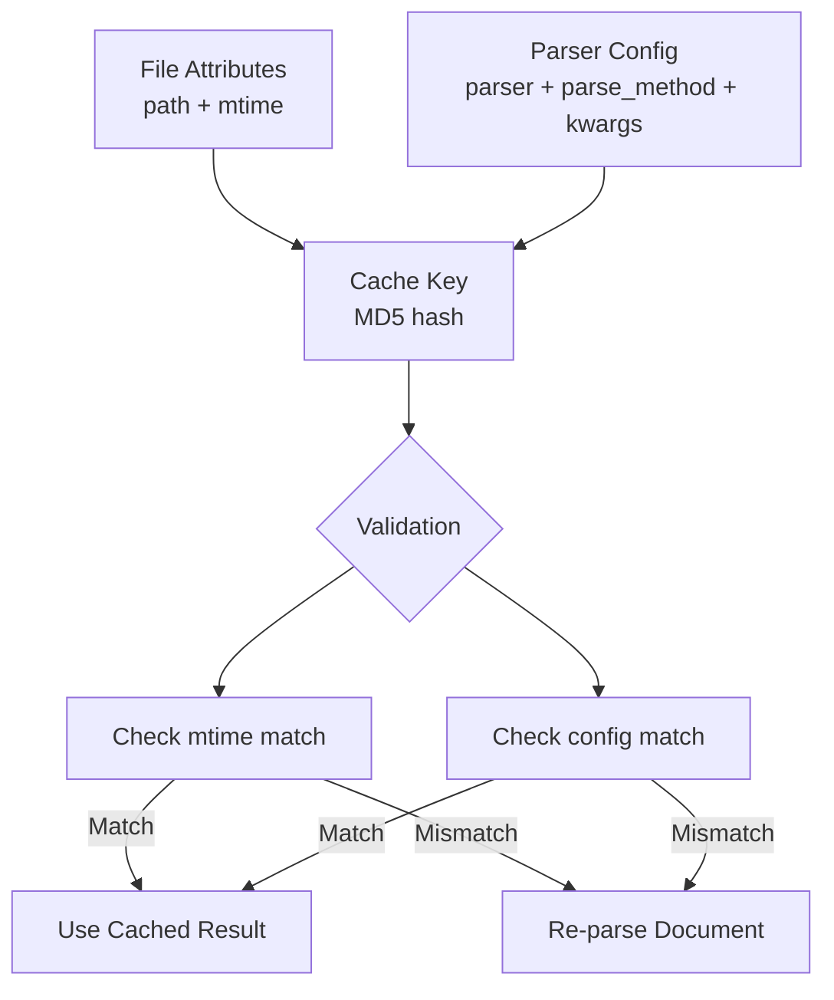
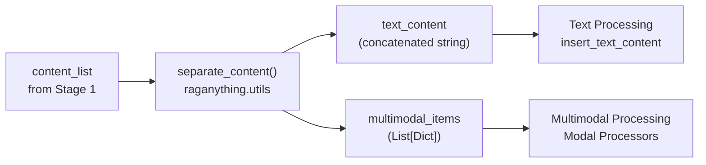
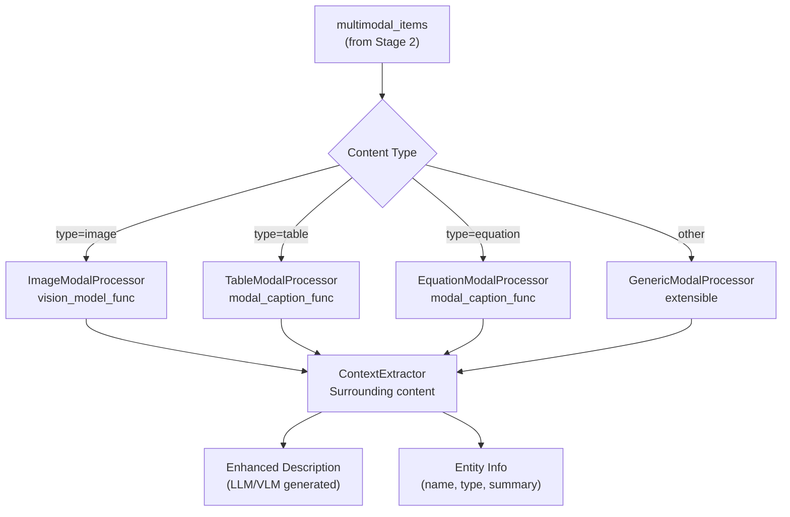
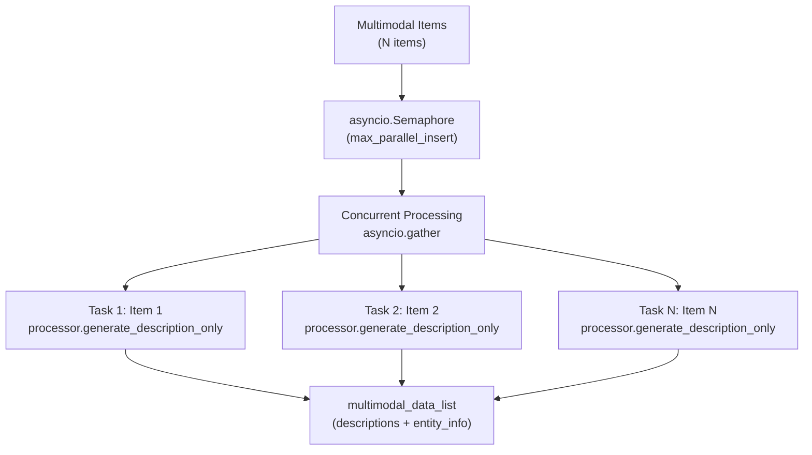
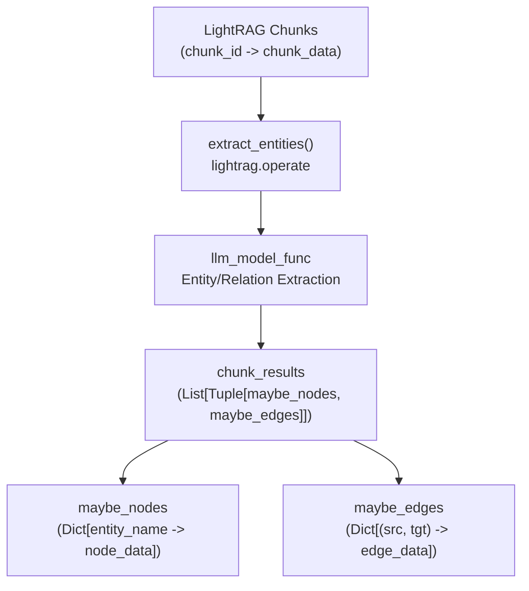
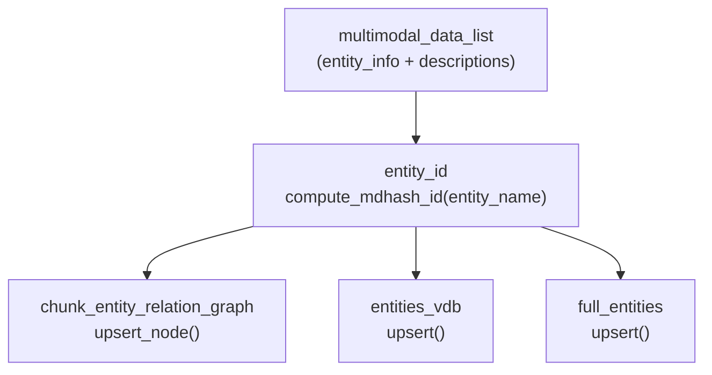
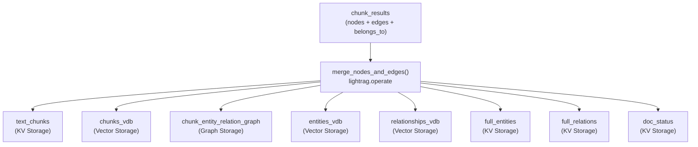
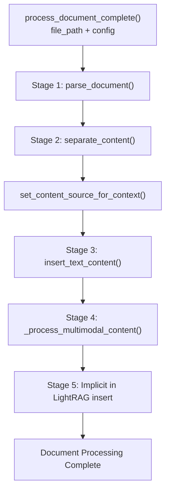

<!-- source: DeepWiki mcp.deepwiki.com · repo HKUDS/RAG-Anything · page 3.2 Five-Stage Processing Pipeline · fetched 2026-11-09 -->

# Five-Stage Processing Pipeline

<details>
<summary>Relevant source files</summary>

The following files were used as context for generating this wiki page:

- [README.md](README.md)
- [README_zh.md](README_zh.md)
- [raganything/processor.py](raganything/processor.py)
- [tests/test_insert_content_list.py](tests/test_insert_content_list.py)

</details>


## Purpose and Scope

This document provides a technical explanation of RAG-Anything's five-stage document processing pipeline. The pipeline transforms raw documents into retrieval-ready knowledge graph structures through sequential stages: document parsing, content understanding, multimodal analysis, knowledge graph indexing, and storage.

For overall architecture context, see [Component Overview](#3.1). For detailed parsing implementation, see [Document Parsers](#4.1). For multimodal processing specifics, see [Modal Processor Architecture](#5.1). For storage configuration, see [Storage Architecture](#6.2).

---

## Pipeline Overview

The five-stage pipeline implements a transformation from unstructured documents to structured, queryable knowledge graphs. Each stage has specific input/output contracts and distinct responsibilities.



**Sources:** [raganything/processor.py:280-456](), [README.md:151-245]()

---

## Stage 1: Document Parsing

Stage 1 converts raw document files into a standardized `content_list` format through parser abstraction. The system supports multiple parser backends (MinerU, Docling, PaddleOCR) with automatic format detection and conversion.

### Parser Selection and Execution

The `parse_document` method in `ProcessorMixin` orchestrates parser selection:



**Key Implementation Details:**

| Component | Location | Responsibility |
|-----------|----------|----------------|
| `parse_document` | [raganything/processor.py:280-456]() | Main parsing orchestration |
| `_generate_cache_key` | [raganything/processor.py:50-98]() | Cache key generation from file + config |
| `_get_cached_result` | [raganything/processor.py:133-210]() | Cache retrieval with validation |
| `_store_cached_result` | [raganything/processor.py:212-278]() | Cache storage with metadata |
| `get_parser` | [raganything/parser.py:17-17]() | Parser factory method |

### Parse Caching Mechanism

Parse results are cached to avoid redundant processing. The cache key incorporates file path, modification time, parser type, and parse method:



The cache stores both `content_list` and `doc_id`, with version tracking for future compatibility.

**Sources:** [raganything/processor.py:50-278]()

### Content List Format

All parsers produce a standardized `content_list` structure:

| Type | Required Fields | Optional Fields |
|------|----------------|-----------------|
| `text` | `type`, `text`, `page_idx` | - |
| `image` | `type`, `img_path`, `page_idx` | `image_caption`, `image_footnote` |
| `table` | `type`, `table_body`, `page_idx` | `table_caption`, `table_footnote`, `img_path` |
| `equation` | `type`, `text`, `page_idx` | `latex`, `text_format` |
| `generic` | `type`, `content`, `page_idx` | Custom fields |

**Sources:** [README.md:969-977](), [raganything/processor.py:280-456]()

---

## Stage 2: Content Understanding

Stage 2 separates text content from multimodal elements and manages document status tracking. The `ProcessorMixin` class implements the core logic.

### Content Separation



The `separate_content` utility function filters `content_list` items:
- Text items: Extracted and concatenated with page markers
- Multimodal items: Collected for specialized processing

### Document ID Generation

The `_generate_content_based_doc_id` method creates stable identifiers using `compute_mdhash_id`:

```python
# Implementation reference
def _generate_content_based_doc_id(self, content_list: List[Dict[str, Any]]) -> str:
    from lightrag.utils import compute_mdhash_id
    content_str = json.dumps(content_list, sort_keys=True)
    return compute_mdhash_id(content_str, prefix="doc-")
```

This generates deterministic IDs based on document content, enabling deduplication.

**Sources:** [raganything/processor.py:202-214](), [raganything/processor.py:29-29]()

### Document Status Tracking

Stage 2 initializes document status records in the `lightrag.doc_status` storage:

| Field | Type | Purpose |
|-------|------|---------|
| `status` | `DocStatus` enum | Processing state (READY/HANDLING/PROCESSED/FAILED) |
| `chunks_list` | `List[str]` | List of chunk IDs |
| `chunks_count` | `int` | Total chunk count |
| `multimodal_processed` | `bool` | Multimodal completion flag |
| `file_path` | `str` | Source file reference |
| `updated_at` | `str` | Last update timestamp |

**Sources:** [raganything/processor.py:105-160]()

---

## Stage 3: Multimodal Analysis

Stage 3 processes non-textual content through specialized modal processors, generating enhanced descriptions and extracting contextual information.

### Modal Processor Dispatch



The `get_processor_for_type` utility function selects the appropriate processor.

### Batch Processing with Concurrency Control

The `_process_multimodal_content_batch_type_aware` method implements parallel description generation:



Concurrency is controlled by `lightrag.max_parallel_insert` to avoid overwhelming API rate limits.

**Key Methods:**

| Method | Location | Purpose |
|--------|----------|---------|
| `_process_multimodal_content` | [raganything/processor.py:458-549]() | Entry point for multimodal processing |
| `_process_multimodal_content_batch_type_aware` | [raganything/processor.py:706-881]() | Batch processing orchestration |
| `generate_description_only` | Modal processor classes | LLM/VLM description generation |
| `process_multimodal_content` | Modal processor classes | Full processing pipeline |

**Sources:** [raganything/processor.py:458-881]()

---

## Stage 4: Knowledge Graph Index

Stage 4 constructs the knowledge graph by extracting entities and relationships from both text and multimodal content. This stage integrates tightly with LightRAG's `extract_entities` and `merge_nodes_and_edges` operations.

### Entity Extraction Flow



**Sources:** [raganything/processor.py:1176-1203]()

### Multimodal Main Entity Storage

Before entity extraction, multimodal main entities (e.g., "Figure 1: System Architecture (image)") are pre-stored in three locations:



**Sources:** [raganything/processor.py:1023-1174]()

### Belongs-To Relationship Creation

Stage 4 adds hierarchical `belongs_to` relationships linking extracted entities to their parent multimodal entities via `_batch_add_belongs_to_relations_type_aware`.

**Sources:** [raganything/processor.py:1205-1267]()

---

## Stage 5: Storage & Indexing

Stage 5 distributes processed data across multiple storage backends, creating a multi-layered retrieval infrastructure.

### Storage Distribution



**Sources:** [raganything/processor.py:1269-1302]()

### Document Status Finalization

After all data is stored, the document status is updated with final metadata. The `multimodal_processed` flag is set to `True` using `_set_multimodal_status_record` or direct `doc_status` update.

**Sources:** [raganything/processor.py:171-201](), [raganything/processor.py:1304-1366]()

---

## Pipeline Execution Methods

### process_document_complete

The standard entry point for document processing.



**Location:** [raganything/processor.py:1444-1532]()

### insert_content_list

Alternative entry point for pre-parsed content. It skips Stage 1 and starts from content separation.

**Location:** [raganything/processor.py:1759-1864]()

---

## Error Handling and Recovery

The pipeline implements recovery mechanisms:
- **Parsing Failures:** `MineruExecutionError` is caught and `doc_status` updated to `FAILED` [raganything/processor.py:1645-1678]().
- **Multimodal Fallback:** If batch processing fails, the system falls back to individual processing [raganything/processor.py:540-549]().

**Sources:** [raganything/processor.py:1-1864](), [README.md:1-245]()

---

