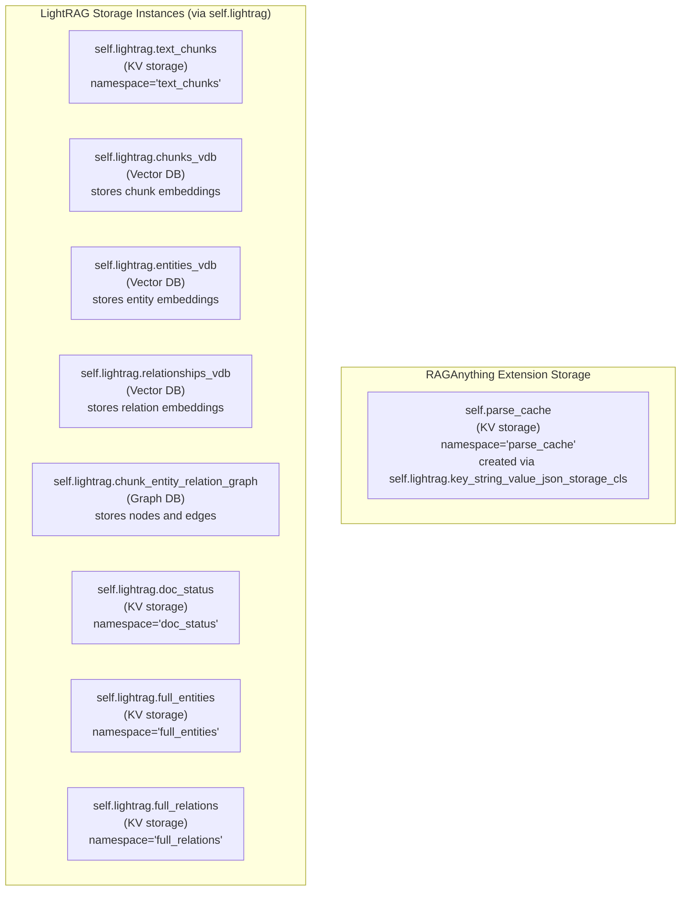
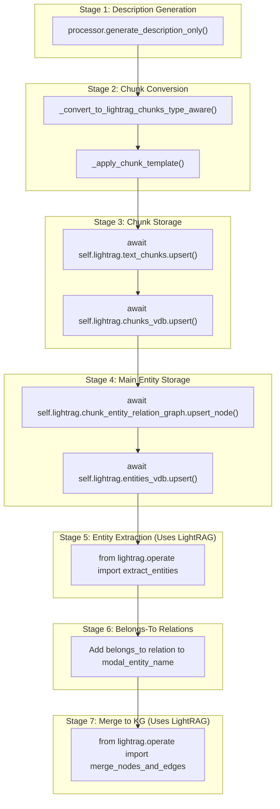
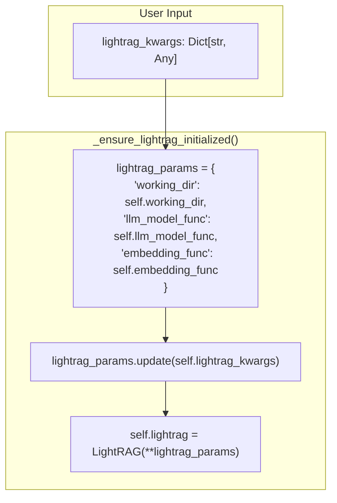

<!-- source: DeepWiki mcp.deepwiki.com · repo HKUDS/RAG-Anything · page 3.3 LightRAG Integration · fetched 2026-11-09 -->

# LightRAG Integration

<details>
<summary>Relevant source files</summary>

The following files were used as context for generating this wiki page:

- [.gitignore](.gitignore)
- [env.example](env.example)
- [examples/lmstudio_integration_example.py](examples/lmstudio_integration_example.py)
- [raganything/raganything.py](raganything/raganything.py)

</details>


This document explains how RAG-Anything extends and integrates with the [LightRAG framework](https://github.com/HKUDS/LightRAG), which provides the foundational RAG capabilities including knowledge graph construction, vector storage, and text-based retrieval. 

RAG-Anything builds on LightRAG by adding multimodal document processing capabilities while maintaining full compatibility with LightRAG's storage and query systems. For details on the overall system architecture, see [Component Overview](3.1). For multimodal processing specifics, see [Multimodal Content Processing](5).

---

## LightRAG Foundation

LightRAG provides the core RAG infrastructure that RAG-Anything depends on:

| Component | LightRAG Provides | RAG-Anything Uses For |
|-----------|-------------------|----------------------|
| **Knowledge Graph** | Entity and relationship storage | Storing multimodal entities and `belongs_to` relations |
| **Vector Databases** | Chunks, entities, relationships VDBs | Storing text and multimodal chunk embeddings |
| **Key-Value Storage** | Document status, full entities/relations | Parse caching, multimodal processing tracking |
| **Entity Extraction** | LLM-based entity/relation extraction | Extracting entities from multimodal descriptions |
| **Query System** | Hybrid/local/global/naive query modes | Base query functionality for all query types |
| **Text Chunking** | Token-aware text splitting | Processing text content from documents |

Sources: [raganything/raganything.py:27-28](), [env.example:152-156]()

---

## Integration Architecture

RAG-Anything integrates with LightRAG through two primary patterns: **wrapping** (where RAG-Anything wraps an existing LightRAG instance) and **extension** (where RAG-Anything adds new capabilities on top of LightRAG's foundation).

### RAGAnything Class Integration

**Mixin Inheritance Pattern:**

```mermaid
graph TB
    subgraph "RAGAnything Class"
        RAGAnything["@dataclass<br/>RAGAnything<br/>(raganything.py:51)"]
        
        subgraph "Mixins (Multiple Inheritance)"
            QueryMixin["QueryMixin<br/>(query.py)"]
            ProcessorMixin["ProcessorMixin<br/>(processor.py)"]
            BatchMixin["BatchMixin<br/>(batch.py)"]
        end
        
        RAGAnything -.->|"inherits"| QueryMixin
        RAGAnything -.->|"inherits"| ProcessorMixin
        RAGAnything -.->|"inherits"| BatchMixin
    end
    
    subgraph "Core LightRAG Instance (self.lightrag)"
        LightRAG["LightRAG instance<br/>field: lightrag<br/>(raganything.py:56)"]
        
        subgraph "LightRAG Storage Attributes"
            text_chunks["self.lightrag.text_chunks<br/>(KV storage)"]
            chunks_vdb["self.lightrag.chunks_vdb<br/>(Vector DB)"]
            entities_vdb["self.lightrag.entities_vdb<br/>(Vector DB)"]
            relationships_vdb["self.lightrag.relationships_vdb<br/>(Vector DB)"]
            kg["self.lightrag.chunk_entity_relation_graph<br/>(Graph DB)"]
            doc_status["self.lightrag.doc_status<br/>(KV storage)"]
            full_entities["self.lightrag.full_entities<br/>(KV storage)"]
            full_relations["self.lightrag.full_relations<br/>(KV storage)"]
        end
    end
    
    subgraph "RAG-Anything Extensions"
        vision_model_func["vision_model_func<br/>(raganything.py:62)"]
        modal_processors["modal_processors: Dict<br/>(raganything.py:88)"]
        parse_cache["parse_cache<br/>namespace='parse_cache'<br/>(raganything.py:94)"]
        context_extractor["context_extractor<br/>(raganything.py:91)"]
    end
    
    RAGAnything -->|"self.lightrag"| LightRAG
    
    QueryMixin -->|"calls self.lightrag.aquery"| LightRAG
    ProcessorMixin -->|"uses self.lightrag storage"| LightRAG
    BatchMixin -->|"uses ProcessorMixin"| ProcessorMixin
    
    ProcessorMixin -->|"stores to"| text_chunks
    ProcessorMixin -->|"stores to"| chunks_vdb
    ProcessorMixin -->|"stores to"| entities_vdb
    ProcessorMixin -->|"stores to"| kg
    ProcessorMixin -->|"updates"| doc_status
    ProcessorMixin -->|"stores to"| full_entities
    
    modal_processors -->|"use self.lightrag"| LightRAG
```



**Key Integration Points:**

| Field/Attribute | Type | Purpose | Code Reference |
|----------------|------|---------|----------------|
| `self.lightrag` | `Optional[LightRAG]` | Core LightRAG instance (pre-initialized or created) | [raganything/raganything.py:56-57]() |
| `self.llm_model_func` | `Optional[Callable]` | LLM function (inherited from LightRAG if not provided) | [raganything/raganything.py:59-60]() |
| `self.vision_model_func` | `Optional[Callable]` | VLM function for image analysis (RAG-Anything extension) | [raganything/raganything.py:62-63]() |
| `self.embedding_func` | `Optional[Callable]` | Embedding function (inherited from LightRAG if not provided) | [raganything/raganything.py:65-66]() |
| `self.lightrag_kwargs` | `Dict[str, Any]` | Parameters for LightRAG initialization | [raganything/raganything.py:73-84]() |
| `self.modal_processors` | `Dict[str, Any]` | Multimodal content processors | [raganything/raganything.py:88-89]() |
| `self.parse_cache` | Storage instance | Document parse cache (uses LightRAG's KV storage class) | [raganything/raganything.py:94-95]() |

Sources: [raganything/raganything.py:50-106]()

---

## Initialization Patterns

RAG-Anything supports two initialization patterns for LightRAG integration:

### Pattern 1: Automatic LightRAG Creation

RAG-Anything creates and configures a new LightRAG instance:

```mermaid
graph LR
    INIT["RAGAnything.__post_init__<br/>(raganything.py:108)"]
    ENSURE["_ensure_lightrag_initialized<br/>(raganything.py:231)"]
    CREATE["LightRAG(...)<br/>(raganything.py:340)"]
    INIT_STOR["initialize_storages<br/>(raganything.py:341)"]
    PARSE_CACHE["Initialize parse_cache<br/>(raganything.py:345-351)"]
    PROCS["_initialize_processors<br/>(raganything.py:354)"]
    
    INIT -->|"deferred"| ENSURE
    ENSURE -->|"if lightrag is None"| CREATE
    CREATE --> INIT_STOR
    INIT_STOR --> PARSE_CACHE
    PARSE_CACHE --> PROCS
```



**Key Steps:**
1. Check `self.lightrag is None` ([raganything/raganything.py:247]())
2. Validate `llm_model_func` and `embedding_func` provided ([raganything/raganything.py:307-315]())
3. Create LightRAG with `lightrag_params` merged from defaults and `lightrag_kwargs` ([raganything/raganything.py:320-327]())
4. Initialize storages via `await self.lightrag.initialize_storages()` ([raganything/raganything.py:341]())
5. Create parse cache using `self.lightrag.key_string_value_json_storage_cls` ([raganything/raganything.py:345-351]())
6. Initialize modal processors via `_initialize_processors()` ([raganything/raganything.py:354]())

Sources: [raganything/raganything.py:231-364]()

### Pattern 2: Using Pre-initialized LightRAG

RAG-Anything wraps an existing LightRAG instance:

```mermaid
graph LR
    USER["User provides<br/>lightrag=existing_instance"]
    INIT["RAGAnything.__post_init__<br/>(raganything.py:108)"]
    ENSURE["_ensure_lightrag_initialized<br/>(raganything.py:231)"]
    INHERIT["Inherit model funcs<br/>(raganything.py:250-260)"]
    CHECK["Check storage status<br/>(raganything.py:264-276)"]
    PARSE_CACHE["Initialize parse_cache<br/>(raganything.py:279-291)"]
    PROCS["_initialize_processors<br/>(raganything.py:294-295)"]
    
    USER --> INIT
    INIT -->|"deferred"| ENSURE
    ENSURE -->|"if lightrag is not None"| INHERIT
    INHERIT --> CHECK
    CHECK --> PARSE_CACHE
    PARSE_CACHE --> PROCS
```



**Key Steps:**
1. Check `self.lightrag is not None` ([raganything/raganything.py:247]())
2. Inherit `llm_model_func` if not provided ([raganything/raganything.py:250-254]())
3. Inherit `embedding_func` if not provided ([raganything/raganything.py:256-260]())
4. Initialize storages if not already done ([raganything/raganything.py:264-276]())
5. Create parse cache in LightRAG's workspace ([raganything/raganything.py:279-291]())
6. Initialize processors ([raganything/raganything.py:294-295]())

Sources: [raganything/raganything.py:247-304]()

---

## Storage System Integration

RAG-Anything integrates deeply with LightRAG's multi-layer storage architecture, adding parse caching and multimodal-specific tracking.

### Storage Architecture Mapping

**Storage Access Pattern:**



**Storage Namespace Pattern:**

All LightRAG and RAG-Anything storages use namespace-based isolation:

| Storage | Namespace | Accessed Via | Creation |
|---------|-----------|--------------|----------|
| `text_chunks` | `'text_chunks'` | `self.lightrag.text_chunks` | LightRAG initialization |
| `doc_status` | `'doc_status'` | `self.lightrag.doc_status` | LightRAG initialization |
| `full_entities` | `'full_entities'` | `self.lightrag.full_entities` | LightRAG initialization |
| `full_relations` | `'full_relations'` | `self.lightrag.full_relations` | LightRAG initialization |
| `parse_cache` | `'parse_cache'` | `self.parse_cache` | RAG-Anything creates using `self.lightrag.key_string_value_json_storage_cls` |

**Parse Cache Creation:**
[raganything/raganything.py:345-351]()
```python
self.parse_cache = self.lightrag.key_string_value_json_storage_cls(
    namespace="parse_cache",
    workspace=self.lightrag.workspace,
    global_config=self.lightrag.__dict__,
    embedding_func=self.embedding_func,
)
await self.parse_cache.initialize()
```

Sources: [raganything/raganything.py:345-351](), [env.example:152-156]()

---

## Processing Pipeline Integration

RAG-Anything extends LightRAG's text processing pipeline to support multimodal content while maintaining compatibility with LightRAG's entity extraction and knowledge graph construction.

### 7-Stage Multimodal Processing Pipeline



Sources: [raganything/raganything.py:50-106](), [env.example:48-51]()

---

## Configuration Inheritance

RAG-Anything allows full control over LightRAG configuration through the `lightrag_kwargs` parameter, which is merged with required defaults during initialization.

**Configuration Flow:**



**Key Configurable Parameters (via `lightrag_kwargs`):**
- **Storage**: `kv_storage`, `vector_storage`, `graph_storage`, `doc_status_storage` [raganything/raganything.py:76]()
- **Retrieval**: `top_k`, `chunk_top_k`, `cosine_threshold` [raganything/raganything.py:77-78]()
- **Chunking**: `chunk_token_size`, `chunk_overlap_token_size` [raganything/raganything.py:79]()
- **LLM**: `llm_model_name`, `llm_model_max_token_size`, `llm_model_max_async` [raganything/raganything.py:81]()

Sources: [raganything/raganything.py:73-84](), [raganything/raganything.py:318-342]()

---

## Summary

RAG-Anything integrates with LightRAG through:

1. **Wrapping Pattern**: Can wrap existing LightRAG instances or create new ones [raganything/raganything.py:56-57]().
2. **Storage Integration**: Uses all LightRAG storage systems plus a custom `parse_cache` [raganything/raganything.py:94-95]().
3. **Pipeline Extension**: Extends entity extraction and merge operations for multimodal content.
4. **Configuration**: Supports all LightRAG configuration parameters via `lightrag_kwargs` [raganything/raganything.py:73-84]().

This integration allows RAG-Anything to provide multimodal capabilities while maintaining full compatibility with LightRAG's text-based RAG system.

Sources: [raganything/raganything.py:50-106](), [examples/lmstudio_integration_example.py:175-194]()

---

