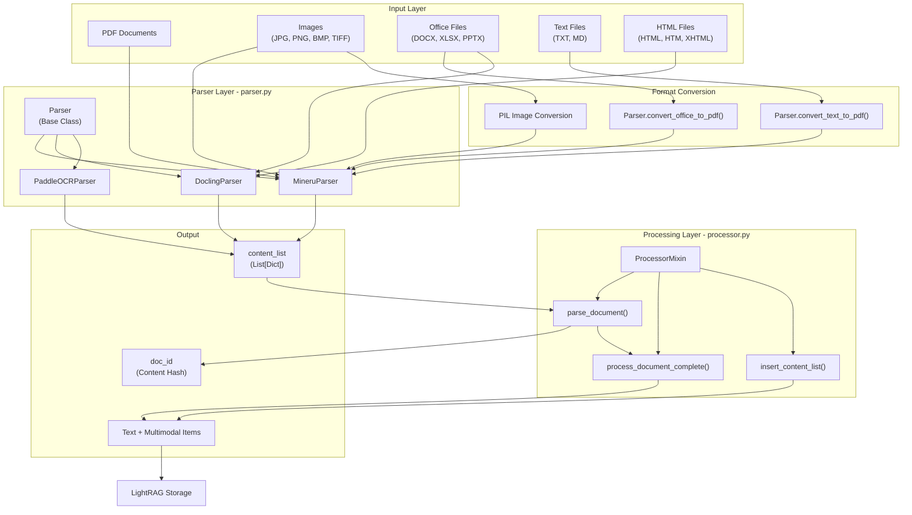

<!-- source: DeepWiki mcp.deepwiki.com · repo HKUDS/RAG-Anything · page 4 Document Processing · fetched 2026-11-09 -->

# Document Processing

Relevant source files

The following files were used as context for generating this wiki page:

- [raganything/parser.py](raganything/parser.py)
- [raganything/processor.py](raganything/processor.py)
- [tests/test_insert_content_list.py](tests/test_insert_content_list.py)
- [tests/testparser_kwargs.py](tests/testparser_kwargs.py)

## Purpose and Scope

This page provides a comprehensive guide to RAG-Anything's document processing system, covering document ingestion, format detection, parsing, and content extraction. The document processing layer is the foundation of the system, with a combined importance score of 81.06 across `parser.py` and `processor.py`, making it the most critical subsystem in the codebase.

**Scope boundaries:**
- For detailed parser implementations and configuration options, see [Document Parsers](#4.1)
- For internal processing pipeline mechanics and LightRAG integration, see [Processing Pipeline Internals](#4.2)
- For the caching mechanism, see [Parse Caching System](#4.3)
- For state management and flags, see [Document Status Tracking](#4.4)
- For batch/concurrent document processing, see [Batch Processing](#4.5)
- For multimodal content analysis (images, tables, equations), see [Multimodal Content Processing](#5)

## Document Processing Architecture

The document processing system follows a two-stage architecture: (1) **Parsing** via `Parser` implementations and (2) **Processing** via `ProcessorMixin` methods. This separation enables flexible parser selection while maintaining a consistent processing interface.

**Sources:** [raganything/parser.py:68-1373](), [raganything/processor.py:32-453](), [raganything/processor.py:1441-1861]()

## Supported Document Formats

RAG-Anything supports a comprehensive range of document formats through its multi-parser strategy. Format support is defined as class-level constants in the `Parser` base class [raganything/parser.py:76-78]().

| Format Category | Extensions | Primary Parser | Conversion Required |
|----------------|------------|----------------|---------------------|
| **PDF** | `.pdf` | MineruParser / DoclingParser | No |
| **Images** | `.png`, `.jpg`, `.jpeg`, `.bmp`, `.tiff`, `.tif`, `.gif`, `.webp` | MineruParser / PaddleOCRParser | Yes (non-PNG/JPG → PNG for MinerU) |
| **Office Documents** | `.doc`, `.docx`, `.ppt`, `.pptx`, `.xls`, `.xlsx` | DoclingParser (direct) MineruParser (via PDF) | MineruParser: Yes (LibreOffice → PDF) |
| **Text Files** | `.txt`, `.md` | MineruParser | Yes (ReportLab → PDF) |
| **HTML** | `.html`, `.htm`, `.xhtml` | DoclingParser | No |

**Format Detection:** Extension-based routing occurs in `MineruParser.parse_document()` [raganything/parser.py:1178-1227]() and `DoclingParser.parse_document()` [raganything/parser.py:1332-1373]().

**Sources:** [raganything/parser.py:76-78](), [raganything/parser.py:1271]()

## Parser Selection Strategy

RAG-Anything employs a pluggable parser architecture optimized for different document types. Parser selection is configured via `RAGAnythingConfig.parser` and defaults to `"mineru"`.

**Available Parsers:**
- **MinerU (Default):** Excels at complex layout detection in academic/technical PDFs. Uses the `magic-pdf` command [raganything/parser.py:572-651]().
- **Docling:** Native support for Office and HTML formats without PDF conversion overhead [raganything/parser.py:1262-1276]().
- **PaddleOCR:** Specialized for high-accuracy OCR on images and scanned documents [raganything/parser.py:1416-1430]().

For details, see [Document Parsers](#4.1).

**Sources:** [raganything/parser.py:572-651](), [raganything/parser.py:1262-1276](), [raganything/processor.py:335-342]()

## Format Conversion Pipelines

RAG-Anything includes robust format conversion utilities in the `Parser` base class to normalize unsupported formats into parser-compatible inputs.

### Office and Text Conversion
- **Office to PDF:** Uses LibreOffice headless mode to convert legacy formats [raganything/parser.py:194-282]().
- **Text to PDF:** Uses ReportLab to generate PDFs from `.txt` or `.md` files, supporting multi-encoding detection (UTF-8, GBK, etc.) and international fonts like WenQuanYi [raganything/parser.py:285-520]().

### Image Normalization
Non-standard image formats (BMP, TIFF, etc.) are converted to PNG using Pillow for MinerU compatibility [raganything/parser.py:1011-1064]().

**Sources:** [raganything/parser.py:194-520](), [raganything/parser.py:1011-1064]()

## Content List Structure

The document parsing output is a standardized `content_list` format - a `List[Dict[str, Any]]` where each dictionary represents a content block.

| Type | Key Fields |
|------|------------|
| `text` | `text`, `page_idx` |
| `image` | `img_path` (absolute), `image_caption`, `page_idx` |
| `table` | `table_body` (markdown), `img_path`, `table_caption` |
| `equation` | `text` (LaTeX), `text_format`, `img_path` |

**Sources:** [raganything/parser.py:798-883](), [raganything/processor.py:1756-1788]()

## Processing Workflow

The `ProcessorMixin` class orchestrates the complete document-to-knowledge workflow.

### Parse Document
`parse_document()` handles the initial ingestion [raganything/processor.py:280-453](). It checks the `parse_cache` using a key generated from the file path, mtime, and configuration [raganything/processor.py:50-98](). If no cache exists, it invokes the selected parser and generates a content-based `doc_id` [raganything/processor.py:202-218]().

For details, see [Processing Pipeline Internals](#4.2) and [Parse Caching System](#4.3).

### Complete Processing
`process_document_complete()` is the high-level entry point [raganything/processor.py:1441-1529](). It:
1. Parses the document.
2. Separates text from multimodal items.
3. Inserts text into LightRAG (triggering chunking/indexing).
4. Routes images, tables, and equations to specialized modal processors.

For details, see [Processing Pipeline Internals](#4.2).

**Sources:** [raganything/processor.py:280-453](), [raganything/processor.py:1441-1529]()

## Document Status and Tracking

Processing states are tracked in `doc_status` storage [raganything/processor.py:105-137]().
- **States:** `READY`, `HANDLING`, `PROCESSED`, `FAILED`.
- **Multimodal Flag:** A `multimodal_processed` flag tracks whether non-textual elements (images/tables) have been integrated into the graph [raganything/processor.py:189-200]().

For details, see [Document Status Tracking](#4.4).

**Sources:** [raganything/processor.py:105-200](), [raganything/base.py:18-24]()

## Batch Processing

The `BatchMixin` provides methods for processing folders and document lists concurrently.
- `process_folder_complete()`: Recursively processes directories.
- `BatchParser`: A utility for high-concurrency parsing with dry-run support.

For details, see [Batch Processing](#4.5).

**Sources:** [raganything/batch.py:26-35](), [raganything/batch.py:263-280]()

---

