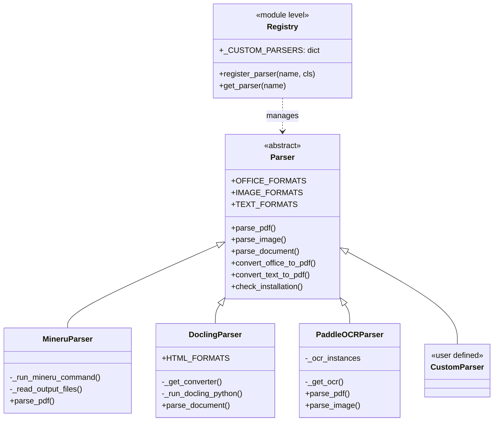
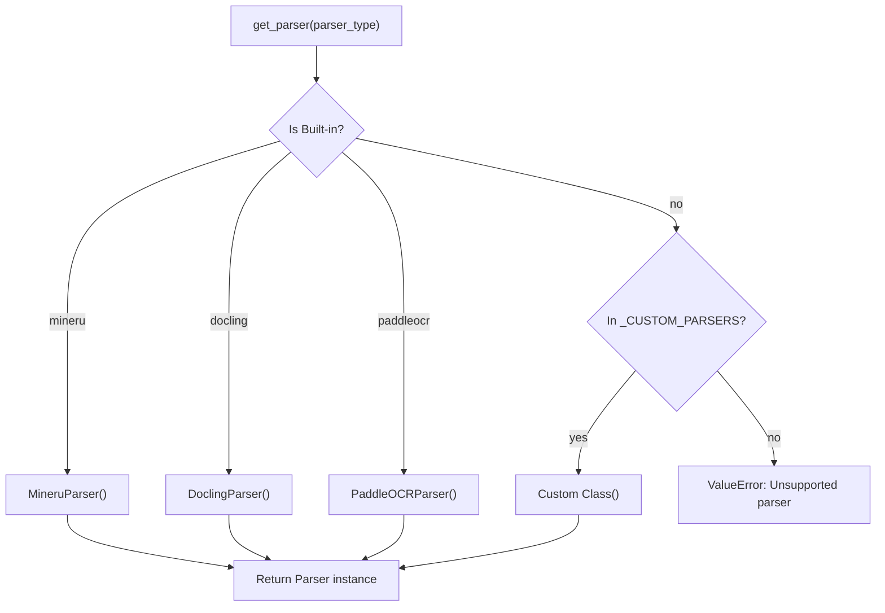

<!-- source: DeepWiki mcp.deepwiki.com · repo HKUDS/RAG-Anything · page 4.1 Document Parsers · fetched 2026-11-09 -->

# Document Parsers

<details>
<summary>Relevant source files</summary>

The following files were used as context for generating this wiki page:

- [.github/workflows/test.yaml](.github/workflows/test.yaml)
- [raganything/batch_parser.py](raganything/batch_parser.py)
- [raganything/omml_extractor.py](raganything/omml_extractor.py)
- [raganything/parser.py](raganything/parser.py)
- [tests/test_content_list_alias_handling.py](tests/test_content_list_alias_handling.py)
- [tests/test_custom_parser.py](tests/test_custom_parser.py)
- [tests/test_doc_status_creation.py](tests/test_doc_status_creation.py)
- [tests/test_omml_extractor.py](tests/test_omml_extractor.py)
- [tests/testpaddleocr_parser.py](tests/testpaddleocr_parser.py)
- [tests/testparser_kwargs.py](tests/testparser_kwargs.py)

</details>


This page documents the document parsing subsystem of RAG-Anything, which converts various file formats into a standardized content representation. The parser layer is the first stage of the five-stage processing pipeline and provides a unified interface for extracting content from PDFs, Office documents, images, and text files.

For information about what happens to parsed content after extraction, see [Processing Pipeline Internals](). For details on parse caching mechanisms, see [Parse Caching System]().

## Purpose and Scope

The document parser subsystem provides:

- **Parser Abstraction**: A unified interface (`Parser` base class) for multiple parsing backends.
- **Format Normalization**: Automatic conversion of Office documents and text files to PDF before parsing.
- **Multi-Backend Support**: Three built-in parser implementations (MinerU, Docling, PaddleOCR) and a registry for custom extensions.
- **Equation Enrichment**: Specialized OMML extraction for structured math in DOCX files.
- **Standardized Output**: All parsers produce a consistent `content_list` format for downstream processing.

Sources: [raganything/parser.py:1-66](), [raganything/omml_extractor.py:1-38]()

## Parser Architecture Overview

The parsing subsystem uses a polymorphic design with a central registry for extensibility.

### Class Hierarchy and Registry



**Parser Selection Flow**



Sources: [raganything/parser.py:49-595](), [raganything/parser.py:2165-2244](), [tests/test_custom_parser.py:17-40]()

## Parser Registry and Custom Parsers

RAG-Anything supports a plugin architecture for document parsers. Developers can register custom parser classes that inherit from the `Parser` base class.

### Key Functions
- `register_parser(name: str, parser_cls: Type[Parser])`: Adds a new parser to the internal `_CUSTOM_PARSERS` dictionary. It enforces that the class is a subclass of `Parser` and prevents overriding built-in names [raganything/parser.py:2180-2212]().
- `unregister_parser(name: str)`: Removes a custom parser from the registry [raganything/parser.py:2215-2231]().
- `list_parsers()`: Returns a dictionary of all available parsers (built-in and custom) [raganything/parser.py:2247-2258]().

### Custom Parser Example
```python
from raganything.parser import Parser, register_parser

class MySpecialParser(Parser):
    def check_installation(self): return True
    def parse_document(self, file_path, **kwargs):
        return [{"type": "text", "text": "Extracted content", "page_idx": 0}]

register_parser("special", MySpecialParser)
```
Sources: [tests/test_custom_parser.py:17-31](), [raganything/parser.py:2180-2212]()

## Supported File Formats

| Format Category | Extensions | MinerU | Docling | PaddleOCR | Notes |
|----------------|------------|--------|---------|-----------|-------|
| **PDF** | `.pdf` | ✅ Native | ✅ Native | ✅ Native | All parsers support PDF |
| **Office** | `.doc`, `.docx`, `.ppt`, `.pptx`, `.xls`, `.xlsx` | ✅ Via LibreOffice | ✅ Native (API) | ✅ Via LibreOffice | MinerU/PaddleOCR convert to PDF first |
| **Images** | `.png`, `.jpeg`, `.jpg` | ✅ Native | ❌ | ✅ Native | Core image formats |
| **Extended Images** | `.bmp`, `.tiff`, `.tif`, `.gif`, `.webp` | ✅ Via Pillow | ❌ | ✅ Native | Requires `raganything[image]` extra |
| **Text** | `.txt`, `.md` | ✅ Via ReportLab | ❌ | ✅ Via ReportLab | Requires `raganything[text]` extra |
| **HTML** | `.html`, `.htm`, `.xhtml` | ❌ | ✅ Native | ❌ | Docling-exclusive |

Sources: [raganything/parser.py:56-59](), [raganything/parser.py:1352](), [raganything/parser.py:76-78]()

## MinerU Parser

`MineruParser` is the default parser, leveraging the MinerU 2.0 CLI. It handles high-fidelity extraction including tables and formulas.

### Windows Path Safety
On Windows, `MineruParser` implements a safety mechanism for paths containing non-ASCII characters. It copies the source file to a temporary ASCII-named file and uses an ASCII output directory to prevent MinerU CLI failures [raganything/parser.py:1010-1065]().

### Backend Support
Supports multiple MinerU backends via the `backend` parameter: `pipeline` (default), `vlm-auto-engine`, `vlm-http-client`, `hybrid-auto-engine`, and `hybrid-http-client` [raganything/parser.py:617-679]().

Sources: [raganything/parser.py:597-1341](), [tests/testparser_kwargs.py:160-192]()

## Docling Parser

`DoclingParser` has been updated to use the **Docling Python API** (`DocumentConverter`) instead of the CLI for better performance and stability.

### Python API Integration
The parser maintains a cached `DocumentConverter` instance via `_get_converter()`. It accepts arbitrary keyword arguments which are forwarded to the converter configuration [raganything/parser.py:1367-1428]().

### Equation Extraction
Docling identifies mathematical formulas and classifies them as `texts` with `label="formula"`. The parser maps these to the standard `equation` block type [raganything/parser.py:1625-1640]().

Sources: [raganything/parser.py:1343-1834](), [tests/testparser_kwargs.py:46-55]()

## PaddleOCR Parser

`PaddleOCRParser` renders PDF pages into images using `pypdfium2` and then performs OCR using the PaddleOCR library.

### Text Line Extraction
The `_extract_text_lines()` method recursively traverses the PaddleOCR result structure (which can be a list of tuples or nested dictionaries) to extract raw text and confidence scores [raganything/parser.py:1884-1968]().

Sources: [raganything/parser.py:1837-2160](), [tests/testpaddleocr_parser.py:95-117]()

## OMML Equation Extractor

For `.docx` files, RAG-Anything includes a specialized `omml_extractor` to recover structured math that might be lost during PDF conversion.

### Implementation Detail
It opens the DOCX as a ZIP archive, reads `word/document.xml`, and recursively converts `<m:oMath>` elements to LaTeX [raganything/omml_extractor.py:111-168]().

### Mapping Logic
The extractor uses a comprehensive mapping for OMML constructs:
- **N-ary Operators**: Maps Unicode codepoints (e.g., `\u2211`) to LaTeX commands (e.g., `\sum`) [raganything/omml_extractor.py:65-79]().
- **Functions**: Recognizes common math functions (sin, cos, log) and wraps others in parentheses [raganything/omml_extractor.py:400-425]().
- **Structures**: Handles fractions (`m:f`), radicals (`m:rad`), and matrices (`m:m`) [raganything/omml_extractor.py:273-350]().

Sources: [raganything/omml_extractor.py:1-450](), [tests/test_omml_extractor.py:63-214]()

## Standardized Output: content_list

All parsers must return a `List[Dict[str, Any]]`.

| Type | Key Fields | Description |
|------|------------|-------------|
| `text` | `text`, `page_idx` | Standard text block. |
| `image` | `img_path`, `image_caption` | Path to extracted image file. |
| `table` | `table_body`, `table_caption` | Markdown or list-of-lists representation. |
| `equation` | `text`, `latex`, `text_format` | Math formula (usually LaTeX). |

### Field Aliases
To maintain backward compatibility with MinerU 1.x and various parser outputs, the system handles aliases like `img_caption` → `image_caption` and `latex` → `text` (when `text_format` is "latex") [raganything/parser.py:603-606](), [tests/test_content_list_alias_handling.py:127-150]().

Sources: [raganything/parser.py:930-957](), [tests/test_content_list_alias_handling.py:87-100]()

---

