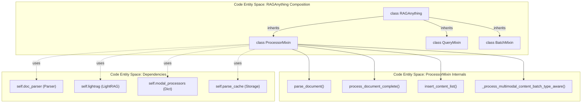
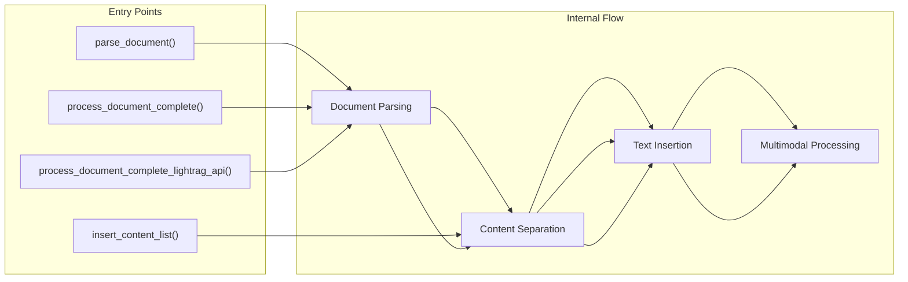
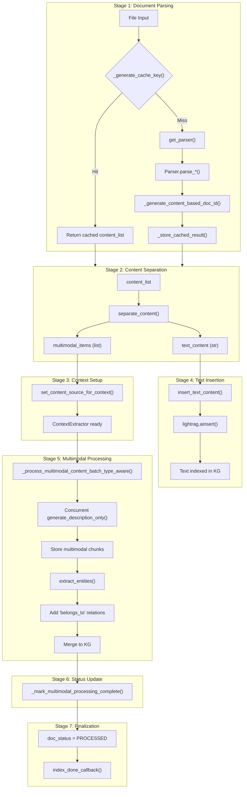

<!-- source: DeepWiki mcp.deepwiki.com · repo HKUDS/RAG-Anything · page 4.2 Processing Pipeline Internals · fetched 2026-11-09 -->

# Processing Pipeline Internals

Relevant source files

The following files were used as context for generating this wiki page:

- [raganything/processor.py](raganything/processor.py)
- [tests/test_insert_content_list.py](tests/test_insert_content_list.py)

This document provides a deep dive into the `ProcessorMixin` class and the document processing workflow in RAG-Anything. It covers the internal mechanisms that transform parsed documents into indexed, queryable knowledge graph entries.

**Scope**: This page focuses on the processing logic after parsing completes and before querying begins. For parser selection and configuration, see [Document Parsers](#4.1). For parse caching mechanisms, see [Parse Caching System](#4.3). For document status tracking details, see [Document Status Tracking](#4.4). For multimodal processor internals, see [Modal Processor Architecture](#5.1).

---

## ProcessorMixin Class Architecture

The `ProcessorMixin` class serves as the central orchestrator for document processing in RAG-Anything. It handles the complete workflow from document parsing through knowledge graph indexing.

### Class Composition and Key Methods

Sources: [raganything/processor.py:32-34](), [raganything/main.py:27-31]()

### Key Attributes

| Attribute | Type | Purpose |
|-----------|------|---------|
| `config` | `RAGAnythingConfig` | Configuration object containing parser settings, paths, and processing options. |
| `lightrag` | `LightRAG` | LightRAG instance for knowledge graph and vector DB operations. |
| `doc_parser` | `Parser` | Parser instance (MinerU/Docling/PaddleOCR) selected by configuration. |
| `modal_processors` | `Dict[str, BaseModalProcessor]` | Registry mapping content types (image, table, equation) to processor instances. |
| `parse_cache` | `Storage` | Cache storage for parsed document results to prevent redundant parsing. |
| `multimodal_status_cache` | `Storage` | Compatibility storage for tracking multimodal processing completion. |

Sources: [raganything/processor.py:32-35](), [raganything/processor.py:163-167](), [raganything/main.py:112-115]()

---

## Core Processing Methods

The `ProcessorMixin` provides three primary entry points for document processing:

### Method Overview

Sources: [raganything/processor.py:280-285](), [raganything/processor.py:1444-1450](), [raganything/processor.py:1534-1540](), [raganything/processor.py:1759-1765]()

### parse_document()

Primary method for parsing documents with caching support. It returns a `(content_list, doc_id)` tuple.

**Workflow**:
1. Generate cache key via `_generate_cache_key()` using MD5 hash of file path, mtime, and configuration [raganything/processor.py:50-98]().
2. Check `parse_cache` for existing results via `_get_cached_result()` [raganything/processor.py:246-261]().
3. On cache miss, identify the parser via `get_parser()` based on the file extension [raganything/processor.py:363-366]().
4. Invoke parser (e.g., `doc_parser.parse_pdf`) [raganything/processor.py:416-419]().
5. Generate content-based `doc_id` via `_generate_content_based_doc_id()` [raganything/processor.py:202-230]().
6. Store result in `parse_cache` via `_store_cached_result()` [raganything/processor.py:263-278]().

### process_document_complete()

End-to-end processing workflow from file to indexed knowledge graph.

**Workflow Stages**:
1. **Parse**: Calls `parse_document()` to get content [raganything/processor.py:1484-1486]().
2. **Separate**: Uses `separate_content()` to split text from multimodal items [raganything/processor.py:1492]().
3. **Insert Text**: Calls `insert_text_content()` which delegates to `lightrag.ainsert` [raganything/processor.py:1504-1515]().
4. **Multimodal**: Calls `_process_multimodal_content()` to handle images, tables, and equations [raganything/processor.py:1517-1522]().

### insert_content_list()

Direct insertion of pre-parsed content without the parsing step. This is the core logic used by `process_document_complete()` after parsing is finished.

**Key Parameters**:
- `content_list`: List of dictionaries containing `type`, `text`/`img_path`, and `page_idx`.
- `file_path`: Source file path for reference.

**Behavior**:
- If text exists, it inserts text first to ensure the base document exists in LightRAG [raganything/processor.py:1807-1818]().
- It then processes multimodal items, linking them to the text entities via `belongs_to` relations [raganything/processor.py:1836-1845]().

Sources: [raganything/processor.py:1759-1864](), [tests/test_insert_content_list.py:131-154]()

---

## Document Processing Workflow

The complete processing workflow consists of seven distinct stages:

Sources: [raganything/processor.py:1444-1532](), [raganything/utils.py:18-54](), [raganything/processor.py:706-881]()

---

## Content Separation Logic

Content separation divides the parsed `content_list` into text and multimodal components using the `separate_content` utility.

### Separation Algorithm

| Input Type | Classification | Logic |
|------------|---------------|-------|
| `{"type": "text", ...}` | Text | Appended to a buffer and joined with `\n\n` [raganything/utils.py:34-36](). |
| `{"type": "image", ...}` | Multimodal | Added to `multimodal_items` list [raganything/utils.py:44-46](). |
| `{"type": "table", ...}` | Multimodal | Added to `multimodal_items` list [raganything/utils.py:44-46](). |
| `{"type": "equation", ...}` | Multimodal | Added to `multimodal_items` list [raganything/utils.py:44-46](). |

**Note**: The logic iterates through the `content_list` once, ensuring all non-text types are treated as multimodal content [raganything/utils.py:29-50]().

---

## Multimodal Content Processing Internals

Multimodal content processing employs a batch processing architecture to optimize throughput via concurrent operations.

### Batch Processing Lifecycle

The method `_process_multimodal_content_batch_type_aware()` handles the heavy lifting:

1.  **Concurrency Control**: Uses an `asyncio.Semaphore` initialized with `lightrag.max_parallel_insert` to limit concurrent LLM/VLM calls [raganything/processor.py:732](), [raganything/processor.py:748]().
2.  **Description Generation**: Iterates through items and calls the specific processor's `generate_description_only()` method concurrently [raganything/processor.py:750-775]().
3.  **Chunk Creation**: For each processed item, it applies a chunk template (e.g., `image_chunk`, `table_chunk`) via `_apply_chunk_template()` [raganything/processor.py:848-870]().
4.  **KG Integration**:
    *   Inserts the multimodal chunk into `text_chunks` storage [raganything/processor.py:1012-1014]().
    *   Extracts entities from the generated description [raganything/processor.py:1176-1203]().
    *   Creates a `belongs_to` relationship between extracted entities and the multimodal item itself (e.g., "Figure 1") [raganything/processor.py:1205-1267]().

Sources: [raganything/processor.py:706-881](), [raganything/processor.py:931-1004](), [raganything/processor.py:1205-1267]()

---

## Document Status Tracking

The `ProcessorMixin` maintains detailed status records in the `doc_status` storage.

### Status Transitions

| State | Trigger | Method |
|-------|---------|--------|
| `READY` | Initial record creation | `_ensure_doc_status_record()` [raganything/processor.py:105-136]() |
| `HANDLING` | Start of text/multimodal processing | `insert_text_content()` [raganything/utils.py:74-83]() |
| `PROCESSED` | All stages finished successfully | `_mark_multimodal_processing_complete()` [raganything/processor.py:1345-1366]() |
| `FAILED` | Exception during processing | `process_document_complete_lightrag_api()` [raganything/processor.py:1651-1666]() |

### Multimodal Completion Flag

Because standard LightRAG status might not track multimodal stages, RAG-Anything uses a `multimodal_processed` flag.
*   Stored within the `doc_status` record if supported [raganything/processor.py:193-194]().
*   Stored in a separate `multimodal_status_cache` for compatibility [raganything/processor.py:171-187]().

Sources: [raganything/processor.py:105-136](), [raganything/processor.py:189-200](), [raganything/base.py:13-17]()

---

## File and ID Management

### File Reference Logic
The method `_get_file_reference()` determines how files are cited in the database.
*   If `config.use_full_path` is `True`, the absolute path is used [raganything/processor.py:45-46]().
*   Otherwise, only the `os.path.basename` is stored [raganything/processor.py:47-48]().

### Content-Based Doc ID
`_generate_content_based_doc_id()` creates a deterministic ID by hashing a "signature" of the document's contents (text blocks, image paths, table bodies). This prevents duplicate indexing of identical content across different file names [raganything/processor.py:202-230]().

Sources: [raganything/processor.py:35-49](), [raganything/processor.py:202-230]()

---

