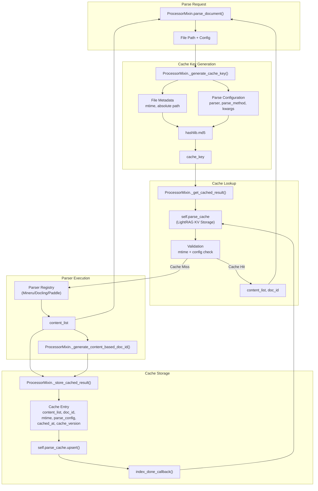
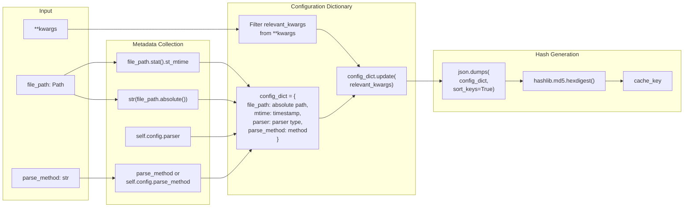
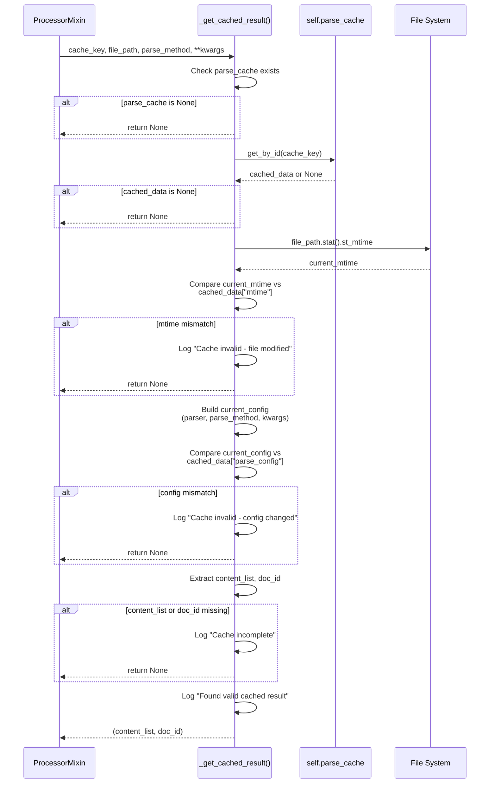
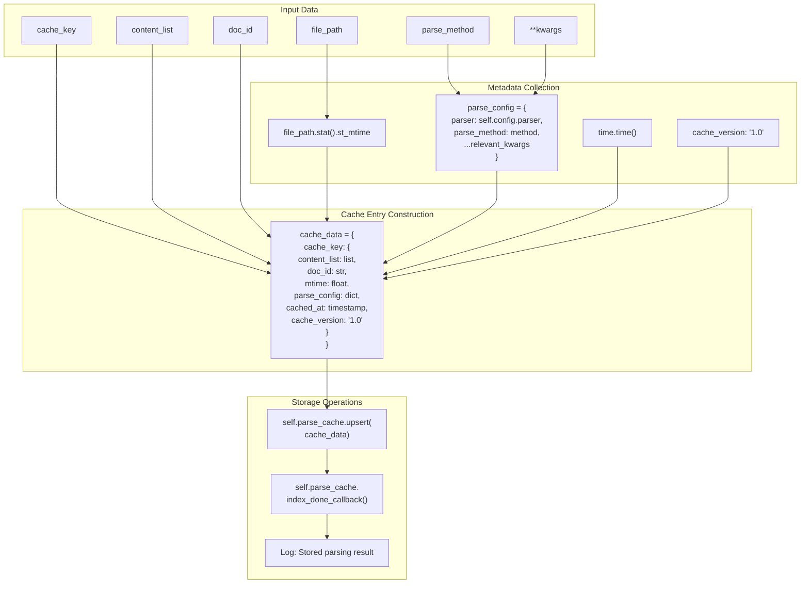
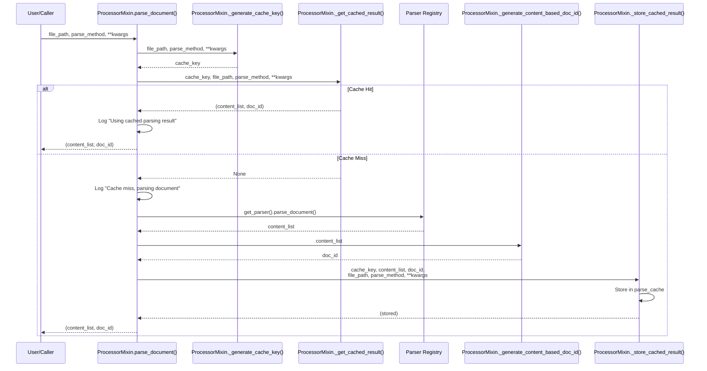

<!-- source: DeepWiki mcp.deepwiki.com · repo HKUDS/RAG-Anything · page 4.3 Parse Caching System · fetched 2026-11-09 -->

# Parse Caching System

<details>
<summary>Relevant source files</summary>

The following files were used as context for generating this wiki page:

- [raganything/processor.py](raganything/processor.py)
- [raganything/raganything.py](raganything/raganything.py)
- [tests/test_insert_content_list.py](tests/test_insert_content_list.py)

</details>


## Purpose and Scope

This document describes RAG-Anything's parse caching system, which optimizes document processing performance by storing and reusing parsing results. The system eliminates redundant document parsing operations by maintaining a cache of previously parsed content lists indexed by file characteristics and parsing configuration.

For information about the document parsing process itself, see [Document Parsers](#4.1). For details on how parsed content is subsequently processed, see [Processing Pipeline Internals](#4.2).

**Sources:** [raganything/processor.py:1-438]()

---

## System Architecture

The parse caching system consists of three core operations managed by the `ProcessorMixin` class: cache key generation, cache retrieval, and cache storage. The cache stores the complete parsed `content_list` and the generated `doc_id` for each successfully parsed document.



**Diagram: Parse Caching System Architecture**

**Sources:** [raganything/processor.py:32-438](), [raganything/raganything.py:94-95]()

---

## Cache Key Generation

The `_generate_cache_key()` method creates a unique cache identifier by combining file metadata with parsing configuration. The cache key is deterministic: identical files with identical parsing settings always produce the same key.

### Key Components

The cache key incorporates the following elements:

| Component | Purpose | Source |
|-----------|---------|--------|
| `file_path` | Absolute path to the file | `Path.absolute()` [raganything/processor.py:70]() |
| `mtime` | File modification timestamp | `Path.stat().st_mtime` [raganything/processor.py:66]() |
| `parser` | Parser type (mineru/docling) | `self.config.parser` [raganything/processor.py:72]() |
| `parse_method` | Parsing method (auto/ocr/txt) | `self.config.parse_method` or parameter [raganything/processor.py:73]() |
| `kwargs` | Relevant parser parameters | Filtered from `**kwargs` [raganything/processor.py:77-92]() |

### Relevant Parser Parameters

Only parsing-relevant keyword arguments are included in the cache key:

```python
relevant_kwargs = ["lang", "device", "start_page", "end_page", 
                   "formula", "table", "backend", "source"]
```

**Sources:** [raganything/processor.py:77-92]()

### Generation Process



**Diagram: Cache Key Generation Flow**

**Sources:** [raganything/processor.py:50-98]()

---

## Cache Retrieval

The `_get_cached_result()` method attempts to retrieve a previously cached parsing result. It performs validation checks to ensure the cached data is still valid.

### Retrieval Flow



**Diagram: Cache Retrieval Sequence**

**Sources:** [raganything/processor.py:118-195]()

### Validation Checks

The cache retrieval performs three critical validation steps:

1. **Existence Check**: Verifies cached entry exists for the cache key [raganything/processor.py:137-140]()
2. **Modification Time Check**: Compares current file `mtime` with cached `mtime` [raganything/processor.py:142-149]()
3. **Configuration Check**: Compares current parsing config with cached `parse_config` [raganything/processor.py:151-176]()

If any validation fails, the method returns `None` and triggers a fresh parse.

**Sources:** [raganything/processor.py:137-176]()

---

## Cache Storage

The `_store_cached_result()` method persists parsing results to the cache after successful document parsing.

### Storage Process



**Diagram: Cache Storage Flow**

**Sources:** [raganything/processor.py:197-263]()

### Cache Entry Structure

Each cache entry contains the following fields:

```python
{
    "cache_key": {
        "content_list": List[Dict[str, Any]],    # Parsed document content
        "doc_id": str,                           # Content-based document ID
        "mtime": float,                          # File modification time
        "parse_config": {                        # Parsing configuration
            "parser": str,                       # "mineru", "docling", "paddle"
            "parse_method": str,                 # "auto", "ocr", or "txt"
            # ...additional relevant kwargs
        },
        "cached_at": float,                      # Cache creation timestamp
        "cache_version": str                     # Cache format version ("1.0")
    }
}
```

**Sources:** [raganything/processor.py:248-257]()

---

## Cache Invalidation Conditions

The cache automatically invalidates under specific conditions to ensure data consistency:

| Condition | Detection Method | Action |
|-----------|------------------|--------|
| **File Modified** | Compare `current_mtime` with `cached_mtime` | Return `None`, trigger fresh parse |
| **Parser Changed** | Compare `self.config.parser` with `cached_config["parser"]` | Return `None`, trigger fresh parse |
| **Parse Method Changed** | Compare current `parse_method` with `cached_config["parse_method"]` | Return `None`, trigger fresh parse |
| **Kwargs Changed** | Compare relevant kwargs with cached kwargs | Return `None`, trigger fresh parse |
| **Missing Cache Entry** | `get_by_id()` returns `None` | Return `None`, trigger fresh parse |
| **Incomplete Cache Data** | Missing `content_list` or `doc_id` | Return `None`, trigger fresh parse |

**Sources:** [raganything/processor.py:142-189]()

---

## Integration with Parse Pipeline

The cache integrates seamlessly into the document parsing workflow in the `parse_document()` method:



**Diagram: Cache Integration in parse_document()**

**Sources:** [raganything/processor.py:265-438]()

### Implementation Details

The `parse_document()` method checks the cache early in its execution:

1. **Generate cache key** using file path and configuration [raganything/processor.py:301]()
2. **Check cache** by calling `_get_cached_result()` [raganything/processor.py:304-306]()
3. **Return cached result** if valid, with logging [raganything/processor.py:307-314]()
4. **Parse document** if cache miss [raganything/processor.py:319-406]()
5. **Generate doc_id** from content [raganything/processor.py:414]()
6. **Store result** in cache for future use [raganything/processor.py:417-419]()

**Sources:** [raganything/processor.py:301-419]()

---

## Cache Storage Backend

The parse cache uses the `self.parse_cache` storage backend, which must implement the following interface:

### Required Methods

| Method | Purpose | Usage in Cache System |
|--------|---------|----------------------|
| `get_by_id(id)` | Retrieve entry by cache key | Cache lookup in `_get_cached_result()` |
| `upsert(data)` | Insert or update cache entries | Store parsed results in `_store_cached_result()` |
| `index_done_callback()` | Persist changes to disk | Ensure cache durability after storage |

The parse cache is typically a key-value store instantiated in the `RAGAnything` class initialization [raganything/raganything.py:94-95](). The cache backend is separate from LightRAG's primary storage systems and is specifically optimized for storing large content lists.

**Sources:** [raganything/processor.py:133-134, 137, 258, 260](), [raganything/raganything.py:94-95]()

---

## Performance Characteristics

### Cache Hit Benefits

When the cache contains a valid entry:

- **Parsing Time**: Eliminated (0 seconds vs. seconds/minutes)
- **API Calls**: None (no external parser process invocation)
- **I/O Operations**: Minimal (single KV store lookup)
- **Memory**: Efficient (cached content_list loaded directly)

### Cache Miss Overhead

When cache lookup fails:

- **Additional Time**: ~1-5ms for cache key generation and lookup
- **Storage Write**: One `upsert()` operation after parsing
- **Negligible Impact**: Cache operations add <1% to total parse time

### Storage Requirements

Cache storage scales with document corpus:

- **Per Document**: Size of serialized `content_list` + metadata (~1-100 MB typical)
- **Cache Key**: 32 characters (MD5 hash)
- **Metadata**: ~200 bytes per entry

**Sources:** [raganything/processor.py:29-438]()

---

## Implementation Notes

### Error Handling

The cache system is designed to fail gracefully:

```python
try:
    cached_data = await self.parse_cache.get_by_id(cache_key)
    # ...validation logic...
except Exception as e:
    self.logger.warning(f"Error accessing parse cache: {e}")
    return None
```

Any cache access error results in a cache miss, triggering a fresh parse. This ensures the system continues functioning even if the cache backend fails.

**Sources:** [raganything/processor.py:192-194, 262-263]()

### Cache Versioning

The cache includes a `cache_version` field (currently `"1.0"`) to support future format changes. This allows for graceful migration if the cache structure needs to evolve.

**Sources:** [raganything/processor.py:255]()

### Async Operations

All cache operations are asynchronous (`async`/`await`) to prevent blocking during cache I/O:

- `_get_cached_result()` is async [raganything/processor.py:118]()
- `_store_cached_result()` is async [raganything/processor.py:197]()
- Cache backend methods (`get_by_id()`, `upsert()`, `index_done_callback()`) are async [raganything/processor.py:137, 258, 260]()

**Sources:** [raganything/processor.py:118, 197, 137, 258, 260]()

---

## Configuration

The parse cache is initialized when `RAGAnything` is instantiated. The cache backend is typically configured through the working directory structure.

### Cache Location

The parse cache storage location is determined by:

```
{working_dir}/parse_cache/
```

This directory contains the key-value store files for cached parsing results.

### Disabling Cache

To disable parse caching, set `self.parse_cache = None` before calling `parse_document()`. The cache methods check for `None` and skip caching operations:

```python
if not hasattr(self, "parse_cache") or self.parse_cache is None:
    return None  # Skip cache operations
```

**Sources:** [raganything/processor.py:133-134, 217-218]()

---

