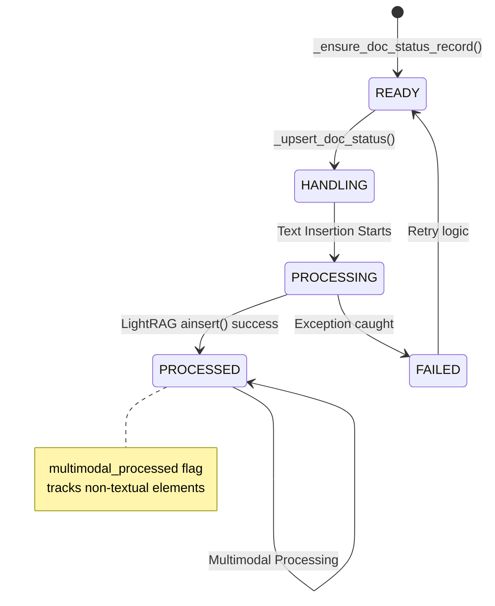
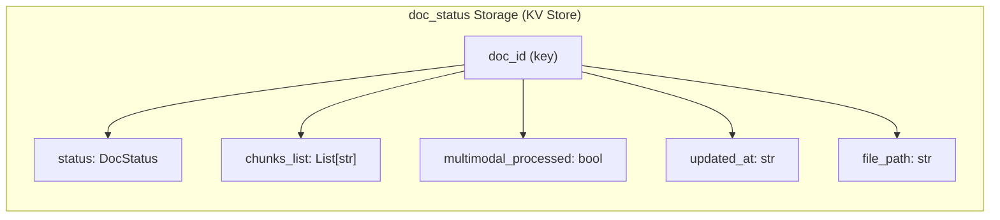
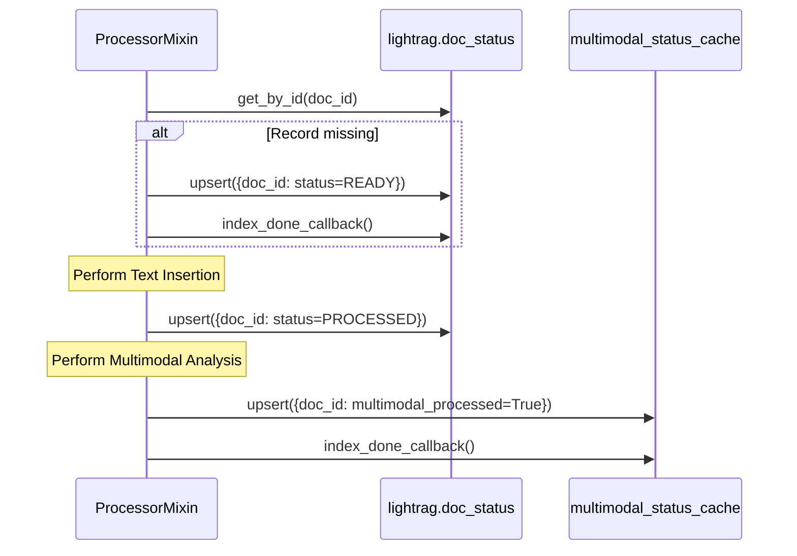
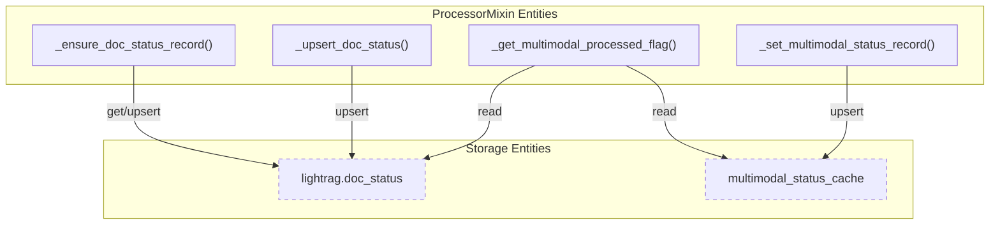

<!-- source: DeepWiki mcp.deepwiki.com · repo HKUDS/RAG-Anything · page 4.4 Document Status Tracking · fetched 2026-11-09 -->

# Document Status Tracking

Relevant source files

The following files were used as context for generating this wiki page:

- [raganything/base.py](raganything/base.py)
- [raganything/processor.py](raganything/processor.py)
- [tests/test_insert_content_list.py](tests/test_insert_content_list.py)

## Purpose and Scope

This document describes RAG-Anything's document status tracking system, which monitors the processing lifecycle of documents from initial parsing through text and multimodal content indexing. The system enables skip logic for already-processed documents, provides visibility into processing failures, and distinguishes between text and multimodal processing completion states using the `doc_status` storage and a specialized `multimodal_processed` flag.

For information about the overall document processing pipeline, see [Document Processing](#4). For details on multimodal content processing specifically, see [Multimodal Content Processing](#5).

**Sources:** [raganything/base.py:1-13](), [raganything/processor.py:1-32]()

---

## DocStatus Enumeration

The `DocStatus` enum defines the lifecycle states a document can occupy during processing. It is implemented as a string-based enumeration in [raganything/base.py:4-12]() to ensure compatibility with JSON serialization for storage backends.

| State | Value | Description |
|-------|-------|-------------|
| `READY` | `"ready"` | Document is queued for processing but not yet started |
| `HANDLING` | `"handling"` | Document is being prepared for processing (initial setup) |
| `PENDING` | `"pending"` | Document is waiting for resources or dependencies |
| `PROCESSING` | `"processing"` | Document is actively being processed |
| `PROCESSED` | `"processed"` | Text processing is complete (multimodal may still be pending) |
| `FAILED` | `"failed"` | Processing encountered an unrecoverable error |

**Sources:** [raganything/base.py:4-12]()

---

## Document Status State Machine

The following diagram illustrates the valid state transitions during document processing within the `ProcessorMixin`.

**Sources:** [raganything/base.py:4-12](), [raganything/processor.py:105-160]()

---

## Document Status Data Structure

Document status is stored in LightRAG's `doc_status` key-value storage. RAG-Anything extends the standard LightRAG schema with multimodal tracking fields.

| Field | Type | Description |
|-------|------|-------------|
| `status` | `str` | Current `DocStatus` enum value [raganything/base.py:4-12]() |
| `chunks_list` | `List[str]` | List of chunk IDs (text + multimodal) [raganything/processor.py:125-126]() |
| `multimodal_processed` | `bool` | Flag indicating non-textual element integration [raganything/processor.py:193-194]() |
| `updated_at` | `str` | UTC timestamp of last update [raganything/processor.py:101-103]() |
| `file_path` | `str` | Path reference (absolute or relative) [raganything/processor.py:129]() |

**Sources:** [raganything/processor.py:113-137](), [raganything/processor.py:138-160](), [raganything/processor.py:189-200]()

---

## Document Processing Lifecycle

The processing pipeline uses `_ensure_doc_status_record` [raganything/processor.py:105-137]() to initialize records and `_upsert_doc_status` [raganything/processor.py:138-160]() to update them.

**Sources:** [raganything/processor.py:105-137](), [raganything/processor.py:138-160](), [raganything/processor.py:171-188]()

---

## Multimodal Status Tracking

RAG-Anything uses a dual-tracking strategy for multimodal content. While text status is tracked in `doc_status`, the `multimodal_processed` flag may be stored in a separate `multimodal_status_cache` for compatibility [raganything/processor.py:161-170]().

### Multimodal Flag Resolution
The method `_get_multimodal_processed_flag` resolves the completion state by checking two locations in order:
1. The `doc_status` dictionary itself [raganything/processor.py:193-194]().
2. The `multimodal_status_cache` (KV namespace) if not found in the primary record [raganything/processor.py:196-198]().

### Implementation Details
*   **Initialization**: `_ensure_doc_status_record` creates a minimal entry with `status=READY` and an empty `chunks_list` [raganything/processor.py:113-132]().
*   **Persistence**: Every update calls `index_done_callback()` to ensure the underlying storage backend flushes changes [raganything/processor.py:135](), [raganything/processor.py:158](), [raganything/processor.py:187]().
*   **Timestamping**: Stable UTC timestamps are generated via `_current_doc_status_timestamp` using `%Y-%m-%dT%H:%M:%S+00:00` format [raganything/processor.py:101-103]().

**Sources:** [raganything/processor.py:101-103](), [raganything/processor.py:161-200]()

---

## Code Entity Reference Map

The following diagram maps internal tracking functions to their storage interactions.

**Sources:** [raganything/processor.py:105-137](), [raganything/processor.py:138-160](), [raganything/processor.py:171-188](), [raganything/processor.py:189-200]()

---

## Status Updates Summary

| Event | Function | Status Result |
|-------|----------|---------------|
| Initial Registration | `_ensure_doc_status_record` | `READY` [raganything/processor.py:111]() |
| Start Processing | `_upsert_doc_status` | `HANDLING` / `PROCESSING` |
| Text Inserted | `lightrag.ainsert` | `PROCESSED` [tests/test_insert_content_list.py:86]() |
| Multimodal Done | `_set_multimodal_status_record` | `multimodal_processed = True` [raganything/processor.py:182]() |
| Failure | Pipeline Exception | `FAILED` [raganything/base.py:12]() |

**Sources:** [raganything/processor.py:111-134](), [raganything/processor.py:179-185](), [tests/test_insert_content_list.py:82-98]()

---

