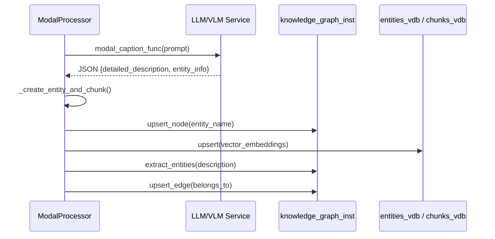

<!-- source: DeepWiki mcp.deepwiki.com · repo HKUDS/RAG-Anything · page 5 Multimodal Content Processing · fetched 2026-11-09 -->

# Multimodal Content Processing

<details>
<summary>Relevant source files</summary>

The following files were used as context for generating this wiki page:

- [README.md](README.md)
- [raganything/modalprocessors.py](raganything/modalprocessors.py)

</details>


## Purpose and Scope

This document describes the multimodal content processing subsystem in RAG-Anything, which analyzes and transforms non-textual content (images, tables, equations) into structured, searchable knowledge. The system deploys specialized processors for each content modality, extracting semantic information and creating entities in the knowledge graph.

For information about the overall document processing pipeline, see [Document Processing](#4). For details on specific processor implementations, see the following child pages:
- [Modal Processor Architecture](#5.1) — Explain the `BaseModalProcessor` design, inheritance hierarchy, and processing flow.
- [Image Processing](#5.2) — Document `ImageModalProcessor`, vision model integration, and spatial relationship extraction.
- [Table Processing](#5.3) — Document `TableModalProcessor`, table structure analysis, and Markdown rendering.
- [Equation Processing](#5.4) — Document `EquationModalProcessor`, LaTeX formula handling, and OMML conversion.
- [Custom Modal Processors](#5.5) — Guide for creating custom modal processors using `GenericModalProcessor`.
- [Context Extraction](#5.6) — Detailed explanation of `ContextExtractor`, `ContextConfig`, and context-aware processing.

## Overview

The multimodal content processing system handles three primary responsibilities:

1. **Content-Specific Analysis**: Each content type (image, table, equation) receives specialized processing through dedicated modal processors that understand its semantic structure. [raganything/modalprocessors.py:1-10]()
2. **Context-Aware Enhancement**: Processors use `ContextExtractor` to retrieve surrounding textual context, improving description accuracy. [raganything/modalprocessors.py:55-66]()
3. **Knowledge Graph Integration**: Processed content is transformed into knowledge graph entities with `belongs_to` relationships connecting them to extracted textual entities. [raganything/modalprocessors.py:736-770]()

The system operates in two modes:
- **Immediate Mode**: Processes individual items and immediately performs entity/relationship extraction.
- **Batch Mode**: Generates descriptions in stage 1, defers entity extraction to stage 2 for concurrent processing. [raganything/modalprocessors.py:773-792]()

Sources: [raganything/modalprocessors.py:1-30](), [README.md:166-211]()

## System Architecture

### Multimodal Pipeline Overview

The following diagram bridges the Natural Language Space (descriptions/captions) to the Code Entity Space (classes and storage backends).

```mermaid
graph TB
    subgraph "Input Content"
        IMG_IN["Image Content<br/>{img_path, captions}"]
        TBL_IN["Table Content<br/>{table_body, captions}"]
        EQ_IN["Equation Content<br/>{text, latex}"]
    end
    
    subgraph "Context Extraction Layer"
        CE["ContextExtractor"]
        CC["ContextConfig"]
        CE --- CC
    end
    
    subgraph "Modal Processor Layer"
        BASE["BaseModalProcessor"]
        IMG_PROC["ImageModalProcessor"]
        TBL_PROC["TableModalProcessor"]
        EQ_PROC["EquationModalProcessor"]
        
        BASE <|-- IMG_PROC
        BASE <|-- TBL_PROC
        BASE <|-- EQ_PROC
    end
    
    subgraph "AI Services"
        VLM["vision_model_func<br/>(e.g., GPT-4o)"]
        LLM["llm_model_func<br/>(e.g., GPT-4o-mini)"]
    end
    
    subgraph "Storage (Code Entity Space)"
        CHUNK_DB["text_chunks_db"]
        CHUNK_VDB["chunks_vdb"]
        KG_INST["knowledge_graph_inst"]
        ENT_VDB["entities_vdb"]
    end
    
    IMG_IN --> IMG_PROC
    TBL_IN --> TBL_PROC
    EQ_IN --> EQ_PROC
    
    CE --> BASE
    
    IMG_PROC --> VLM
    TBL_PROC --> LLM
    EQ_PROC --> LLM
    
    BASE --> CHUNK_DB
    BASE --> CHUNK_VDB
    BASE --> KG_INST
    BASE --> ENT_VDB
```

Sources: [raganything/modalprocessors.py:360-401](), [raganything/modalprocessors.py:465-545](), [raganything/modalprocessors.py:796-1030]()

## Supported Content Types

| Content Type | Processor Class | AI Service | Primary Analysis |
|-------------|----------------|------------|------------------|
| **Image** | `ImageModalProcessor` | Vision Model (VLM) | Visual semantics, object detection, spatial relationships |
| **Table** | `TableModalProcessor` | Language Model (LLM) | Statistical patterns, data relationships |
| **Equation** | `EquationModalProcessor` | Language Model (LLM) | Mathematical concepts, domain mapping |
| **Generic** | `GenericModalProcessor` | Language Model (LLM) | Extensible framework for custom types |

Sources: [README.md:894-977](), [raganything/modalprocessors.py:824-929]()

## Modal Processor Architecture

All specialized processors inherit from `BaseModalProcessor`, which provides the core lifecycle for multimodal data. For a deep dive into the inheritance and storage dependency injection, see [Modal Processor Architecture](#5.1).

### Entity and Chunk Creation Lifecycle

The lifecycle follows a two-stage process:
1. **Description Generation**: Uses LLM/VLM to create a detailed semantic description.
2. **Entity Creation**: Inserts the description as a chunk and creates a corresponding entity node.



Sources: [raganything/modalprocessors.py:465-545](), [raganything/modalprocessors.py:699-793]()

## Context-Aware Processing

The `ContextExtractor` enhances multimodal content analysis by providing surrounding textual context. This prevents processors from analyzing images or tables in isolation.

- **Modes**: Supports `page` (window around a page index) or `chunk` (window around a sequence index). [raganything/modalprocessors.py:43-44]()
- **Truncation**: Uses token-based truncation via `max_context_tokens` to stay within LLM context limits. [raganything/modalprocessors.py:45]()

For details on how context windows are calculated and filtered, see [Context Extraction](#5.6).

Sources: [raganything/modalprocessors.py:49-358](), [raganything/modalprocessors.py:406-440]()

## Robust JSON Parsing

The system implements a multi-strategy JSON parsing approach in `_robust_json_parse` to handle varied LLM response formats, including those from models with reasoning/thinking tags (e.g., DeepSeek, Qwen). [raganything/modalprocessors.py:547-550]()

Strategies include:
1. **Thinking Tag Removal**: Stripping `<thinking>` or `<thought>` blocks. [raganything/modalprocessors.py:579-589]()
2. **Candidate Extraction**: Using regex and brace-matching to find JSON objects within text. [raganything/modalprocessors.py:591-615]()
3. **Regex Fallback**: Extracting specific fields like `detailed_description` via regex if the JSON is malformed. [raganything/modalprocessors.py:657-688]()

Sources: [raganything/modalprocessors.py:547-698]()

## Integration with LightRAG

Modal processors are initialized within the `RAGAnything` class and utilize the underlying `LightRAG` storage components. [raganything/modalprocessors.py:365-375]()

- **Storage Injection**: Processors receive references to `text_chunks_db`, `entities_vdb`, and `knowledge_graph_inst`. [raganything/modalprocessors.py:488-510]()
- **Relationship Mapping**: The system automatically creates `belongs_to` edges to link multimodal elements to the textual entities mentioned in their descriptions. [raganything/modalprocessors.py:736-770]()

Sources: [raganything/modalprocessors.py:360-794](), [README.md:336-356]()

---

