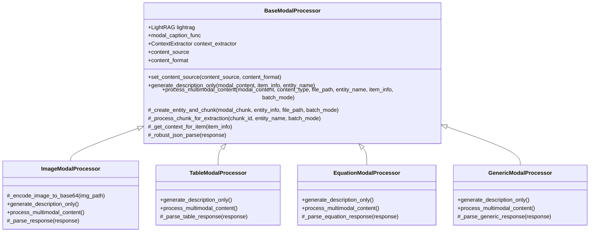
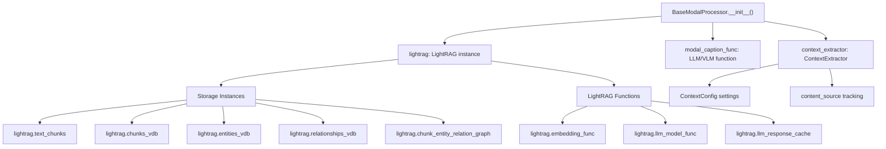
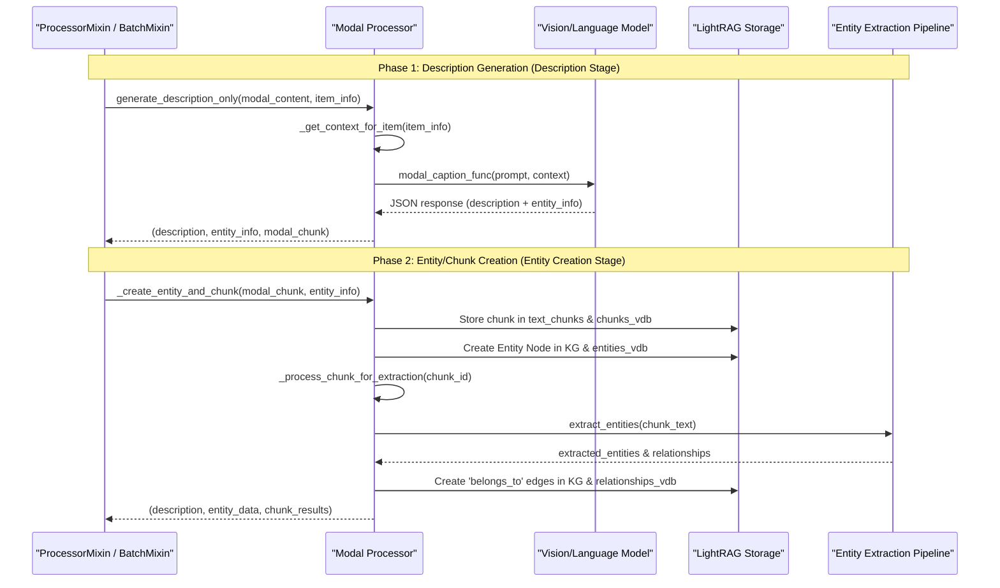
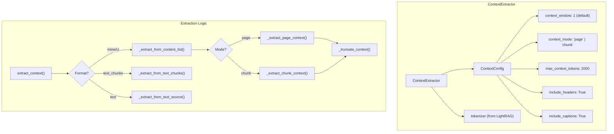

<!-- source: DeepWiki mcp.deepwiki.com · repo HKUDS/RAG-Anything · page 5.1 Modal Processor Architecture · fetched 2026-11-09 -->

# Modal Processor Architecture

Relevant source files

The following files were used as context for generating this wiki page:

- [docs/context_aware_processing.md](docs/context_aware_processing.md)
- [examples/insert_content_list_example.py](examples/insert_content_list_example.py)
- [examples/modalprocessors_example.py](examples/modalprocessors_example.py)
- [raganything/modalprocessors.py](raganything/modalprocessors.py)
- [tests/test_embedding_examples.py](tests/test_embedding_examples.py)

## Purpose and Scope

This document describes the modal processor architecture that handles specialized analysis of multimodal content types (images, tables, equations, and custom content) in RAG-Anything. Modal processors transform raw multimodal content into enhanced textual descriptions, create knowledge graph entities, and establish relationships through the LightRAG framework.

The architecture is built on a two-stage lifecycle: generating descriptive content via Vision-Language Models (VLMs) or Large Language Models (LLMs), and then persisting that content into the LightRAG knowledge graph and vector storage.

**Sources:** [raganything/modalprocessors.py:1-10]()

## Base Processor Architecture

### Class Hierarchy

The modal processor system uses inheritance to provide shared functionality while allowing content-specific customization. The `BaseModalProcessor` provides the core logic for storage interaction and context management.

**Sources:** [raganything/modalprocessors.py:360-405](), [raganything/modalprocessors.py:796-812](), [raganything/modalprocessors.py:1032-1048](), [raganything/modalprocessors.py:1226-1241](), [raganything/modalprocessors.py:1410-1425]()

### BaseModalProcessor Initialization and Storage Injection

The `BaseModalProcessor` class serves as the foundation for all specialized processors. During initialization, it establishes connections to LightRAG storage systems and configures context extraction. It uses dependency injection to receive a `LightRAG` instance, from which it extracts storage backends.

**Sources:** [raganything/modalprocessors.py:363-398]()

### Storage and Configuration Integration

| Component | Code Reference | Purpose |
|-----------|----------------|---------|
| `text_chunks_db` | `self.lightrag.text_chunks` | Store text chunks with metadata |
| `chunks_vdb` | `self.lightrag.chunks_vdb` | Enable chunk retrieval |
| `entities_vdb` | `self.lightrag.entities_vdb` | Enable entity search |
| `relationships_vdb` | `self.lightrag.relationships_vdb` | Enable relationship search |
| `knowledge_graph_inst` | `self.lightrag.chunk_entity_relation_graph` | Store entity-relationship graph |
| `embedding_func` | `self.lightrag.embedding_func` | Generate embeddings for indexing |
| `llm_model_func` | `self.lightrag.llm_model_func` | Primary LLM for text generation |
| `hashing_kv` | `self.lightrag.llm_response_cache` | Cache LLM responses to reduce costs |

**Sources:** [raganything/modalprocessors.py:380-398]()

## Processing Lifecycle

### Two-Phase Processing Pattern

Modal processors support two distinct processing modes to accommodate both batch and real-time workflows. This is primarily handled via `generate_description_only` and `_create_entity_and_chunk`.

**Sources:** [raganything/modalprocessors.py:442-463](), [raganything/modalprocessors.py:465-545](), [raganything/modalprocessors.py:699-793]()

### Complete Processing Flow

The `process_multimodal_content()` method orchestrates both phases for immediate processing.

1.  **Context Retrieval**: Calls `_get_context_for_item` to get surrounding text [raganything/modalprocessors.py:423-440]().
2.  **Model Inference**: Calls `modal_caption_func` with a specialized prompt [raganything/modalprocessors.py:961-980]().
3.  **JSON Parsing**: Uses `_robust_json_parse` to extract `detailed_description` and `entity_info` [raganything/modalprocessors.py:547-688]().
4.  **Storage**: Invokes `_create_entity_and_chunk` to persist the data [raganything/modalprocessors.py:465-545]().
5.  **Graph Expansion**: Invokes `_process_chunk_for_extraction` to find relationships between the new modal entity and existing knowledge [raganything/modalprocessors.py:699-793]().

## Context Extraction System

### ContextExtractor Architecture

The `ContextExtractor` provides content-aware analysis by extracting surrounding text from the source document based on a `ContextConfig`.

**Sources:** [raganything/modalprocessors.py:39-112](), [raganything/modalprocessors.py:120-137](), [raganything/modalprocessors.py:308-357]()

### Context Extraction Modes

| Mode | Logic | Source Dependency |
|------|-------|-------------------|
| `page` | Uses `page_idx` to find items in surrounding pages | `content_list` with `page_idx` keys [raganything/modalprocessors.py:139-177]() |
| `chunk` | Uses the `index` of items in the list to find neighbors | `content_list` with sequential indices [raganything/modalprocessors.py:179-204]() |

## Entity and Chunk Creation

### Belongs-To Relationship Schema

When a modal element (like an image) is processed, the system extracts entities from its description. It then creates a `belongs_to` relationship from those extracted entities back to the modal entity.

*   **Relationship Name**: `belongs_to` [raganything/modalprocessors.py:755]()
*   **Weight**: Defaulted to `10.0` to emphasize the link between content and its container [raganything/modalprocessors.py:758]()
*   **Keywords**: `belongs_to,part_of,contained_in` [raganything/modalprocessors.py:757]()

**Sources:** [raganything/modalprocessors.py:736-770]()

### Chunk Storage Format

Each multimodal item is stored as a chunk in `text_chunks_db` with the following metadata:
*   `content`: The generated description.
*   `file_path`: Source file.
*   `chunk_order_index`: Original position in document.
*   `full_doc_id`: Hash of the document.

**Sources:** [raganything/modalprocessors.py:475-503]()

## Robust JSON Parsing

LLMs often return JSON wrapped in markdown or with trailing commas. The `_robust_json_parse` method uses a progressive strategy to clean the response:
1.  **Candidate Extraction**: Finds all blocks between `{}` [raganything/modalprocessors.py:554-566]().
2.  **Think Tag Removal**: Strips `<think>` blocks used by reasoning models [raganything/modalprocessors.py:568-571]().
3.  **Cleanup**: Replaces smart quotes and removes trailing commas [raganything/modalprocessors.py:581-587]().
4.  **Regex Fallback**: If `json.loads` fails, it uses regex to extract specific fields like `detailed_description` and `entity_name` [raganything/modalprocessors.py:657-688]().

**Sources:** [raganything/modalprocessors.py:547-688]()

---

