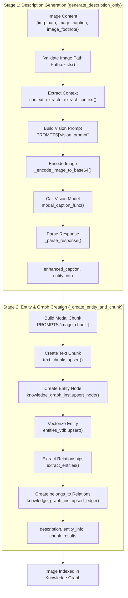
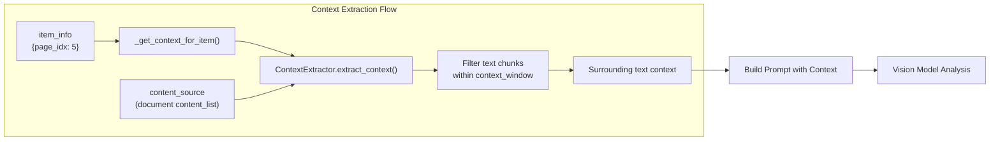
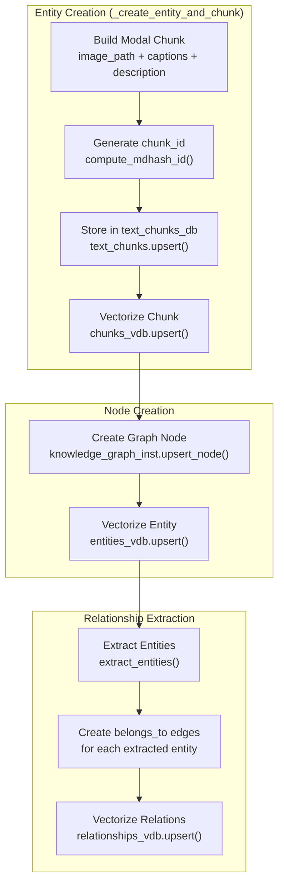

<!-- source: DeepWiki mcp.deepwiki.com · repo HKUDS/RAG-Anything · page 5.2 Image Processing · fetched 2026-11-09 -->

# Image Processing

<details>
<summary>Relevant source files</summary>

The following files were used as context for generating this wiki page:

- [examples/image_format_test.py](examples/image_format_test.py)
- [examples/office_document_test.py](examples/office_document_test.py)
- [examples/text_format_test.py](examples/text_format_test.py)
- [raganything/modalprocessors.py](raganything/modalprocessors.py)

</details>


## Purpose and Scope

This page documents the image processing subsystem in RAG-Anything, specifically the `ImageModalProcessor` class and its integration with vision language models (VLMs) for analyzing and indexing image content. The system converts visual information into structured knowledge graph entities through vision model analysis and context-aware processing.

The pipeline supports a wide range of image formats including JPG, PNG, BMP, TIFF, GIF, and WebP [examples/image_format_test.py:66-75](). While MinerU natively supports JPG and PNG, RAG-Anything handles conversion for other formats using Pillow [examples/image_format_test.py:93-102]().

For information about the base processor architecture and inheritance structure, see **5.1 Modal Processor Architecture**. For other content types, see **5.3 Table Processing**, **5.4 Equation Processing**, and **5.6 Context Extraction**.

## ImageModalProcessor Architecture

The `ImageModalProcessor` class inherits from `BaseModalProcessor` and specializes in handling image content by integrating vision language models for visual understanding.

**Key Responsibilities:**
- Encode images to base64 format for VLM transmission [raganything/modalprocessors.py:814-823]().
- Generate detailed visual descriptions using vision models [raganything/modalprocessors.py:907-915]().
- Extract context from surrounding document content using `ContextExtractor` [raganything/modalprocessors.py:874-899]().
- Create image entities in the knowledge graph [raganything/modalprocessors.py:965-980]().
- Establish relationships between image entities and extracted concepts [raganything/modalprocessors.py:739-770]().

### Class Hierarchy and Interactions

```mermaid
classDiagram
    class BaseModalProcessor {
        +LightRAG lightrag
        +modal_caption_func
        +ContextExtractor context_extractor
        +set_content_source()
        +_get_context_for_item()
        +_create_entity_and_chunk()
        +_process_chunk_for_extraction()
    }
    
    class ImageModalProcessor {
        +_encode_image_to_base64()
        +generate_description_only()
        +process_multimodal_content()
        +_parse_response()
    }
    
    class ContextExtractor {
        +ContextConfig config
        +extract_context()
        +_extract_from_content_list()
        +_truncate_context()
    }
    
    class LightRAG {
        +text_chunks
        +chunks_vdb
        +entities_vdb
        +knowledge_graph_inst
        +embedding_func
    }
    
    BaseModalProcessor <|-- ImageModalProcessor
    BaseModalProcessor --> ContextExtractor
    BaseModalProcessor --> LightRAG
    ImageModalProcessor --> "vision_model_func"
```

**Sources:** [raganything/modalprocessors.py:796-1030](), [raganything/modalprocessors.py:360-401]()

## Image Encoding and Vision Model Integration

### Base64 Encoding

Images must be encoded to base64 format before transmission to vision models. The `_encode_image_to_base64()` method handles this conversion by reading the file as binary and using the `base64` library [raganything/modalprocessors.py:814-823]().

### Vision Model Function

The `modal_caption_func` (typically provided as `vision_model_func`) must support image data input. The function signature expects:

```python
modal_caption_func(
    prompt: str,
    image_data: str,  # base64 encoded image
    system_prompt: str = None,
    **kwargs
) -> str
```

The vision model receives both the text prompt and the base64-encoded image for multimodal analysis [raganything/modalprocessors.py:907-911]().

**Sources:** [raganything/modalprocessors.py:814-823](), [raganything/modalprocessors.py:907-911]()

## Image Processing Workflow

### Two-Stage Processing

Image processing follows a two-stage pipeline that separates description generation from entity relationship extraction:



**Sources:** [raganything/modalprocessors.py:824-928](), [raganything/modalprocessors.py:930-991](), [raganything/modalprocessors.py:465-545]()

### Processing Methods

| Method | Stage | Batch Mode | Purpose |
|--------|-------|------------|---------|
| `generate_description_only()` | 1 | Yes | Generate description without immediate graph insertion [raganything/modalprocessors.py:824-928]() |
| `process_multimodal_content()` | 1+2 | Optional | Complete processing including entity/relation extraction [raganything/modalprocessors.py:930-991]() |

## Image Content Format

### Input Structure

The image content can be provided in multiple formats, supporting both standard and legacy keys [raganything/modalprocessors.py:846-872]():

```python
# Dictionary format (standard)
{
    "img_path": "/absolute/path/to/image.jpg",  # Required
    "image_caption": ["Figure 1: Architecture"],  # Optional
    "image_footnote": ["Source: Author"]  # Optional
}

# Alternative key names (legacy support)
{
    "img_path": "/path/to/image.jpg",
    "img_caption": ["..."], 
    "img_footnote": ["..."]
}
```

**Sources:** [raganything/modalprocessors.py:846-872](), [raganything/modalprocessors.py:949-963]()

### Output Structure

The processor generates two primary outputs:
1. **Enhanced Caption**: Detailed visual description from VLM analysis [raganything/modalprocessors.py:993-1029]().
2. **Entity Info**: Dictionary containing `entity_name` (with "(image)" suffix), `entity_type`, and `summary` [raganything/modalprocessors.py:1009-1017]().

## Prompt Templates and Context-Aware Processing

### Vision Analysis Prompts

The system uses structured JSON prompts to ensure consistent VLM responses. The templates `vision_prompt` and `vision_prompt_with_context` guide the model to output JSON containing `detailed_description` and `entity_info` [raganything/prompt.py:32-89]().

### Context-Aware Analysis

When `item_info` is provided, the processor extracts surrounding content to enrich image analysis [raganything/modalprocessors.py:874-899]().



**Sources:** [raganything/modalprocessors.py:874-899](), [raganything/modalprocessors.py:417-440](), [raganything/modalprocessors.py:49-358]()

## Entity and Knowledge Graph Integration

### Entity Creation Process

After generating the image description, the processor creates a structured entity in the knowledge graph via `_create_entity_and_chunk` [raganything/modalprocessors.py:465-545]().



**Sources:** [raganything/modalprocessors.py:465-545](), [raganything/modalprocessors.py:699-793]()

### Belongs-To Relationships

The processor automatically creates `belongs_to` relationships linking concepts extracted from the image description back to the image entity itself [raganything/modalprocessors.py:739-770]().

## Error Handling and Fallbacks

### Robust JSON Parsing

The `_parse_response()` method uses six distinct strategies to handle VLM response variations, including stripping thinking tags (e.g., `<think>`), extracting from code blocks, and balancing braces [raganything/modalprocessors.py:547-697]().

### Validation and Error Recovery

If the image path is invalid or the VLM call fails, the system recovers by creating a fallback entity based on the available metadata or a content hash [raganything/modalprocessors.py:918-928](), [raganything/modalprocessors.py:1019-1029]().

**Sources:** [raganything/modalprocessors.py:547-697](), [raganything/modalprocessors.py:918-928](), [raganything/modalprocessors.py:1019-1029]()

---

