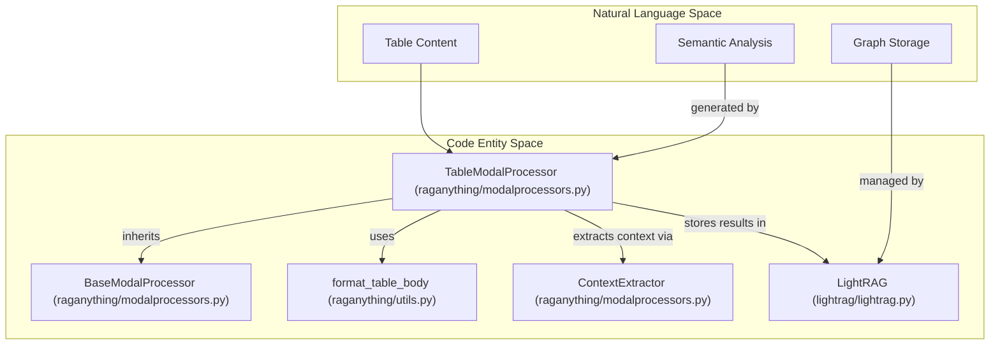
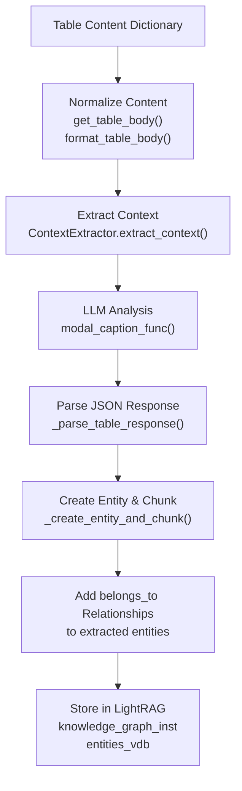

<!-- source: DeepWiki mcp.deepwiki.com · repo HKUDS/RAG-Anything · page 5.3 Table Processing · fetched 2026-11-09 -->

# Table Processing

Relevant source files

The following files were used as context for generating this wiki page:

- [raganything/modalprocessors.py](raganything/modalprocessors.py)
- [raganything/utils.py](raganything/utils.py)

## Purpose and Scope

This document describes the table processing capabilities in RAG-Anything, specifically how the `TableModalProcessor` class analyzes tabular data, interprets structured information, and integrates tables into the knowledge graph. For general modal processor architecture, see [Modal Processor Architecture](5.1).

The `TableModalProcessor` specializes in:
- Parsing markdown-formatted tables and list-of-lists data structures.
- Extracting statistical patterns and data trends via LLM-based semantic interpretations.
- Creating table entities with "belongs_to" relationships to extracted entities.
- Context-aware table analysis using surrounding document content.
- Formatting structured data into clean Markdown for LLM consumption.

Sources: [raganything/modalprocessors.py:1032-1223](), [raganything/utils.py:36-61]()

---

## TableModalProcessor Class Overview

The `TableModalProcessor` extends `BaseModalProcessor` to provide specialized handling for tabular content. Unlike image processing which requires vision models, table processing uses standard LLM capabilities to analyze structured data patterns.

### Class Structure and Dependency Flow

The following diagram bridges the Natural Language concepts of "Table Processing" with the specific code entities involved.

Sources: [raganything/modalprocessors.py:1032-1033](), [raganything/modalprocessors.py:360-401](), [raganything/utils.py:36-61]()

---

## Table Content Structure and Utilities

### Input Format and Normalization

Tables processed by `TableModalProcessor` are expected in a dictionary format. RAG-Anything provides utility functions in `raganything/utils.py` to handle variations in parser outputs.

| Field | Source Utility | Description |
|-------|----------------|-------------|
| `table_body` | `get_table_body` | Reads content from `table_body`, `table_data`, or `text` fields. [raganything/utils.py:27-34]() |
| `table_caption` | `normalize_caption_list` | Normalizes strings or lists into a clean list of strings. [raganything/utils.py:16-24]() |
| `table_body` (rendered) | `format_table_body` | Converts strings or list-of-lists into Markdown tables. [raganything/utils.py:36-61]() |

### Markdown Rendering Implementation

The `format_table_body` function ensures the LLM sees structured rows instead of a Python representation:

1. **Strings**: Passed through unchanged. [raganything/utils.py:44-45]()
2. **List-of-Lists**: Rendered as a Markdown table with `|` separators and a `| --- |` header separator. [raganything/utils.py:49-58]()
3. **Other Lists**: Joined by newlines. [raganything/utils.py:59]()

Sources: [raganything/utils.py:16-61](), [raganything/modalprocessors.py:1056-1068]()

---

## Table Processing Workflow

The table processing workflow consists of two main stages: description generation and entity creation.

Sources: [raganything/modalprocessors.py:1125-1186](), [raganything/modalprocessors.py:699-793](), [raganything/utils.py:36-61]()

---

## Context-Aware Analysis

Tables are analyzed with awareness of surrounding document content. The `ContextExtractor` retrieves text from nearby pages or chunks using the `ContextConfig`.

### Prompt Selection Logic

The processor selects between two prompt templates based on context availability:
- **`table_prompt_with_context`**: Used if `context_extractor` is present and returns content. [raganything/modalprocessors.py:1085-1098]()
- **`table_prompt`**: Standard analysis without surrounding text. [raganything/modalprocessors.py:1076-1083]()

The `ContextExtractor` can operate in `page` mode (surrounding pages) or `chunk` mode (surrounding content blocks). [raganything/modalprocessors.py:132-137]()

Sources: [raganything/modalprocessors.py:40-54](), [raganything/modalprocessors.py:1070-1098](), [raganything/prompt.py:101-160]()

---

## Response Parsing and Robustness

### _parse_table_response()

The `_parse_table_response` method uses the `_robust_json_parse` logic from the base class to handle LLM hallucinations or formatting errors.

**Analysis Components Requested:**
- **detailed_description**: Comprehensive analysis of structure, trends, and significance. [raganything/prompt.py:101-160]()
- **entity_info**: A structured object containing `entity_name`, `entity_type` (fixed as "table"), and a concise `summary`. [raganything/modalprocessors.py:1191-1211]()

**Error Handling Strategy:**
If JSON parsing fails after multiple cleaning attempts (fixing quotes, trailing commas, etc.), the processor falls back to a generated entity name based on the MD5 hash of the response. [raganything/modalprocessors.py:1213-1223]()

Sources: [raganything/modalprocessors.py:1187-1223](), [raganything/modalprocessors.py:547-698]()

---

## Knowledge Graph Integration

### Entity and Relationship Creation

After the LLM generates the `detailed_description`, the processor integrates the data into the LightRAG knowledge graph:

1. **Chunk Creation**: A specialized `table_chunk` is created containing the raw Markdown table, captions, footnotes, and the LLM analysis. [raganything/modalprocessors.py:1158-1164]()
2. **Entity Extraction**: The `extract_entities` function is called on the generated description to identify domain-specific entities mentioned within the table analysis. [raganything/modalprocessors.py:736-745]()
3. **Belongs_to Relationships**: For every entity extracted from the table's description, a `belongs_to` relationship is created linking it to the primary Table Entity. [raganything/modalprocessors.py:747-770]()

### Relationship Schema
The `belongs_to` edge uses a high weight (10.0) to signify a strong structural containment relationship. [raganything/modalprocessors.py:756]()

Sources: [raganything/modalprocessors.py:736-770](), [raganything/modalprocessors.py:1166-1173](), [raganything/prompt.py:283-289]()

---

## Batch Processing and Performance

### Stage Flow for Tables

In the `ProcessorMixin` pipeline, tables are handled via `_process_multimodal_content_batch_type_aware`.

- **Stage 4**: Parallel execution of `generate_description_only` for all tables in the document. [raganything/processor.py:646-654]()
- **Stage 5**: Creation of entities and chunks. If `batch_mode=True`, the storage flush and graph merging are deferred to optimize performance. [raganything/modalprocessors.py:773-792]()

### Caching
The system uses `hashing_kv` to cache LLM responses for table analysis. If the same table (based on content hash) is processed again with the same prompt, the cached description is reused. [raganything/modalprocessors.py:389-391]()

Sources: [raganything/modalprocessors.py:773-792](), [raganything/processor.py:646-654]()

---

