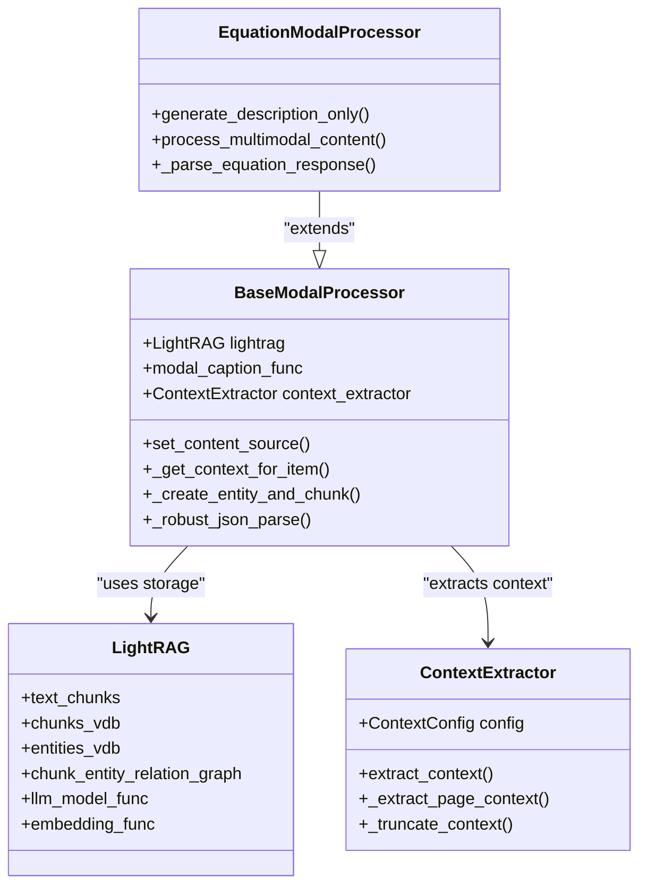
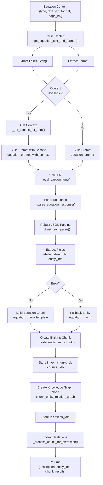

<!-- source: DeepWiki mcp.deepwiki.com · repo HKUDS/RAG-Anything · page 5.4 Equation Processing · fetched 2026-11-09 -->

# Equation Processing

<details>
<summary>Relevant source files</summary>

The following files were used as context for generating this wiki page:

- [raganything/modalprocessors.py](raganything/modalprocessors.py)
- [raganything/omml_extractor.py](raganything/omml_extractor.py)
- [raganything/utils.py](raganything/utils.py)
- [tests/test_doc_status_creation.py](tests/test_doc_status_creation.py)
- [tests/test_omml_extractor.py](tests/test_omml_extractor.py)

</details>


This page documents the `EquationModalProcessor` implementation, which handles LaTeX mathematical formulas extracted from documents. The processor performs semantic analysis of equations, extracts mathematical meaning, and integrates them into the knowledge graph with proper entity relationships. It also details the specialized OMML-to-LaTeX conversion utility used for DOCX files.

For handling other multimodal content types, see [Image Processing](#5.2) and [Table Processing](#5.3). For the base processor architecture, see [Modal Processor Architecture](#5.1).

---

## Overview

The `EquationModalProcessor` class specializes in processing mathematical equations and formulas. Unlike image and table processors that rely on visual analysis, equation processing focuses on mathematical interpretation and semantic understanding of LaTeX expressions.

**Key capabilities:**
- Parsing LaTeX formula syntax from document content [raganything/modalprocessors.py:1250-1261]()
- LLM-based semantic analysis of mathematical expressions [raganything/modalprocessors.py:1268-1286]()
- Variable definition and operation identification [raganything/prompt.py:163-188]()
- Context-aware interpretation of equations [raganything/modalprocessors.py:1263-1265]()
- Integration with knowledge graph as specialized entities [raganything/modalprocessors.py:1389-1393]()
- Robust error handling for malformed LaTeX [raganything/modalprocessors.py:547-688]()
- OMML-to-LaTeX conversion for DOCX math preservation [raganything/omml_extractor.py:10-28]()

**Sources:** [raganything/modalprocessors.py:8-10](), [raganything/modalprocessors.py:1226-1408](), [raganything/omml_extractor.py:1-38]()

---

## Equation Processor Class Hierarchy



**Diagram: EquationModalProcessor Class Structure**

The `EquationModalProcessor` inherits storage access and context extraction capabilities from `BaseModalProcessor`, while implementing equation-specific processing logic.

**Sources:** [raganything/modalprocessors.py:360-401](), [raganything/modalprocessors.py:1226-1228]()

---

## Equation Content Format and Extraction

Equations follow a standard format. The utility `get_equation_text_and_format` handles various alias fields (e.g., `text`, `latex`, `equation`) to ensure compatibility across different parsers.

| Field | Type | Description |
|-------|------|-------------|
| `type` | string | Always `"equation"` for equation content |
| `text` | string | LaTeX formula string (highest priority) [raganything/utils.py:72-78]() |
| `latex` | string | Alias for LaTeX content [raganything/utils.py:73-82]() |
| `equation` | string | Fallback alias [raganything/utils.py:74-84]() |
| `text_format` | string | Format identifier (defaults to `"latex"`) [raganything/utils.py:75-82]() |

### OMML-to-LaTeX (DOCX Support)
For DOCX files, equations are stored as Office Math Markup Language (OMML). The `omml_extractor` module converts these to LaTeX to prevent loss during PDF conversion.

**Key Conversion Rules:**
- **Fractions:** `<m:f>` becomes `\frac{num}{den}` [raganything/omml_extractor.py:284-290]().
- **Scripts:** `<m:sSup>` (superscript) and `<m:sSub>` (subscript) [raganything/omml_extractor.py:292-316]().
- **N-ary Operators:** Summation (`\sum`), Integrals (`\int`), etc., are mapped from Unicode codepoints [raganything/omml_extractor.py:62-79]().
- **Matrices:** `<m:m>` converted to `\begin{matrix} ... \end{matrix}` [raganything/omml_extractor.py:392-411]().

**Sources:** [raganything/utils.py:63-89](), [raganything/omml_extractor.py:40-105](), [raganything/omml_extractor.py:270-430]()

---

## Equation Processing Pipeline



**Diagram: Complete Equation Processing Flow**

The pipeline uses `get_equation_text_and_format` [raganything/utils.py:63]() to normalize input before calling the LLM via `modal_caption_func` [raganything/modalprocessors.py:1290]().

**Sources:** [raganything/modalprocessors.py:1313-1369](), [raganything/modalprocessors.py:1229-1311](), [raganything/utils.py:63-89]()

---

## LLM-Based Semantic Analysis

### Prompt Construction

The processor uses specialized prompts to extract mathematical meaning from LaTeX formulas:

**Without Context:**
```python
# Template from PROMPTS["equation_prompt"]
"""Please analyze this mathematical equation and provide a JSON response...

Equation Information:
Equation: {equation_text}
Format: {equation_format}
"""
```

**With Context:**
```python
# Template from PROMPTS["equation_prompt_with_context"]
"""Please analyze this mathematical equation considering the surrounding context...

Context from surrounding content:
{context}

Equation Information:
Equation: {equation_text}
Format: {equation_format}
"""
```

**Sources:** [raganything/prompt.py:162-220](), [raganything/modalprocessors.py:1268-1286]()

---

## Robust JSON Parsing

Mathematical LaTeX contains many special characters (backslashes, braces) that frequently break standard JSON parsing. The processor uses a multi-strategy approach:

1. **Direct Parsing:** Attempts standard `json.loads()`.
2. **Candidate Extraction:** Uses `_extract_all_json_candidates()` to find JSON blocks within model output, stripping thinking tags [raganything/modalprocessors.py:573-616]().
3. **LaTeX Quote Fixing:** Specifically escapes backslashes in LaTeX strings (e.g., `\alpha` becomes `\\alpha`) to prevent JSON errors [raganything/modalprocessors.py:642-655]().
4. **Regex Fallback:** As a last resort, `_extract_fields_with_regex` pulls fields directly using patterns [raganything/modalprocessors.py:657-688]().

**Sources:** [raganything/modalprocessors.py:547-688]()

---

## Entity Creation and Knowledge Graph Integration

### Chunk Creation
The processor builds a formatted text chunk using the `equation_chunk` template [raganything/prompt.py:291-295]():

```python
modal_chunk = PROMPTS["equation_chunk"].format(
    equation_text=equation_text,
    equation_format=equation_format,
    enhanced_caption=enhanced_caption,
)
```

### Storage Operations
The chunk is stored in `chunks_vdb` and the equation is added as a node to the `chunk_entity_relation_graph` [raganything/modalprocessors.py:720-745](). Relationships are then extracted from the enhanced description to link the equation to other concepts in the document [raganything/modalprocessors.py:756-771]().

**Sources:** [raganything/modalprocessors.py:465-545](), [raganything/modalprocessors.py:699-793]()

---

## Two-Phase Processing

### Phase 1: Description Generation
The `generate_description_only()` method performs analysis without entity extraction [raganything/modalprocessors.py:1229-1311](). This is used in batch processing stage 1.

### Phase 2: Complete Processing
The `process_multimodal_content()` method performs full processing, including KG integration and storage [raganything/modalprocessors.py:1313-1369]().

---

## Limitations

1. **OCR Dependency:** Equations in image form must be converted to LaTeX by the parser (e.g., MinerU) before this processor can handle them.
2. **Complex Notation:** Highly specialized mathematical notation may be misinterpreted if the LLM lacks specific domain training.
3. **JSON Sensitivity:** Despite robust parsing, extremely long or nested LaTeX strings can still cause parsing timeouts or failures.

**Sources:** [raganything/modalprocessors.py:1226-1408](), [raganything/omml_extractor.py:24-28]()

---

