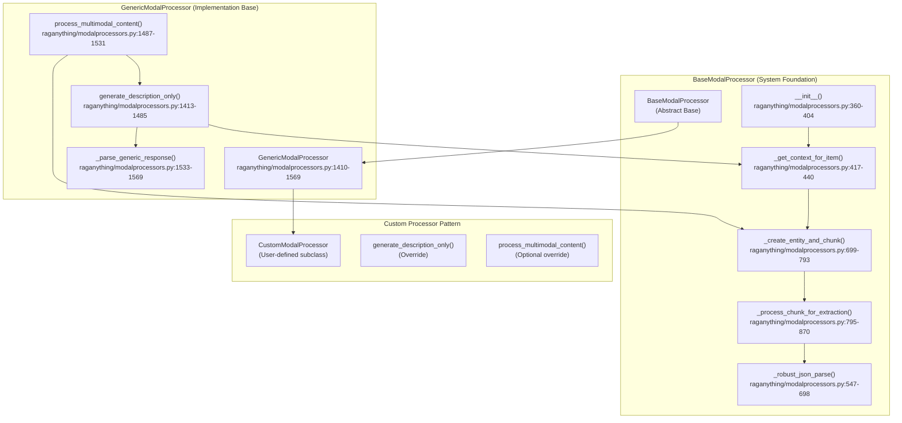
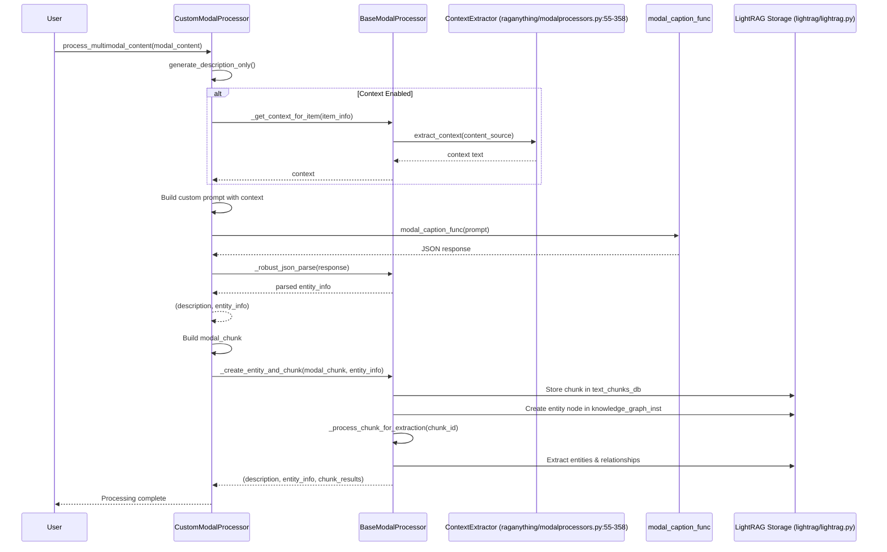

<!-- source: DeepWiki mcp.deepwiki.com · repo HKUDS/RAG-Anything · page 5.5 Custom Modal Processors · fetched 2026-11-09 -->

# Custom Modal Processors

<details>
<summary>Relevant source files</summary>

The following files were used as context for generating this wiki page:

- [docs/context_aware_processing.md](docs/context_aware_processing.md)
- [examples/insert_content_list_example.py](examples/insert_content_list_example.py)
- [examples/modalprocessors_example.py](examples/modalprocessors_example.py)
- [raganything/batch_parser.py](raganything/batch_parser.py)
- [raganything/modalprocessors.py](raganything/modalprocessors.py)
- [tests/test_custom_parser.py](tests/test_custom_parser.py)
- [tests/test_embedding_examples.py](tests/test_embedding_examples.py)

</details>


This page provides a comprehensive guide to creating custom modal processors for handling domain-specific or specialized content types beyond the built-in image, table, and equation processors. Custom modal processors enable RAG-Anything to extend its multimodal capabilities to any content type while maintaining consistency with the knowledge graph integration.

For information about the base modal processor architecture and lifecycle, see [Modal Processor Architecture](#5.1). For specific implementations of built-in processors, see [Image Processing](#5.2), [Table Processing](#5.3), and [Equation Processing](#5.4).

---

## Overview

The `GenericModalProcessor` class serves as both a functional processor for generic content types and an extensible base class for creating custom processors. It implements the full modal processor lifecycle while providing customization points for domain-specific analysis logic.

**Key Capabilities:**
- Process arbitrary content types with custom analysis logic.
- Integrate with context extraction for content-aware processing.
- Generate structured entities for knowledge graph integration.
- Support both batch and immediate processing modes.
- Leverage custom LLM prompts for specialized analysis.

Sources: [raganything/modalprocessors.py:9-10](), [raganything/modalprocessors.py:1410-1569]()

---

## GenericModalProcessor Architecture

### System to Code Entity Mapping

The following diagram bridges the conceptual modal processing space with the specific code entities defined in the `raganything/modalprocessors.py` file.



**Inheritance Hierarchy**

| Component | Purpose | Key Methods |
|-----------|---------|-------------|
| `BaseModalProcessor` | Abstract base with shared infrastructure | `_create_entity_and_chunk()`, `_get_context_for_item()`, `_robust_json_parse()` |
| `GenericModalProcessor` | Default implementation for any content type | `generate_description_only()`, `process_multimodal_content()` |
| Custom Processors | Domain-specific extensions | Override `generate_description_only()`, optionally override `process_multimodal_content()` |

Sources: [raganything/modalprocessors.py:360-404](), [raganything/modalprocessors.py:1410-1569]()

---

## Extension Points

### Required Method: generate_description_only

This method generates a text description and entity metadata for the content without performing entity/relationship extraction. It is used during batch processing stage 1 and forms the foundation of all modal processing.

**Method Signature:**
```python
async def generate_description_only(
    self,
    modal_content: Any,           # Content to process
    content_type: str,            # Type identifier (e.g., "code", "chart")
    item_info: Dict[str, Any] = None,  # For context extraction (page_idx, index)
    entity_name: str = None       # Optional predefined entity name
) -> Tuple[str, Dict[str, Any]]  # Returns (description, entity_info)
```

**Return Format:**
```python
# entity_info structure
{
    "entity_name": "unique_entity_identifier",
    "entity_type": "content_type",
    "summary": "concise summary (max 100 words)"
}
```

Sources: [raganything/modalprocessors.py:442-463](), [raganything/modalprocessors.py:1413-1485]()

### Optional Method: process_multimodal_content

This method performs full processing including entity creation, chunk storage, and knowledge graph integration. Most custom processors can rely on the base implementation, only overriding `generate_description_only()`.

**Method Signature:**
```python
async def process_multimodal_content(
    self,
    modal_content: Any,
    content_type: str,
    file_path: str = "manual_creation",
    entity_name: str = None,
    item_info: Dict[str, Any] = None,
    batch_mode: bool = False,
    doc_id: str = None,
    chunk_order_index: int = 0
) -> Tuple[str, Dict[str, Any], List]
```

Sources: [raganything/modalprocessors.py:1487-1531]()

---

## Processing Flow Diagram

### Data Flow and Pipeline Integration

This sequence diagram illustrates how a custom processor interacts with the `ContextExtractor` and the underlying `LightRAG` storage systems.



Sources: [raganything/modalprocessors.py:1487-1531](), [raganything/modalprocessors.py:465-545](), [raganything/modalprocessors.py:699-793]()

---

## Context Integration

Custom processors can leverage the `ContextExtractor` to obtain surrounding content for context-aware analysis. The context extractor supports multiple content formats and extraction modes.

### Using Context in Custom Processors

```python
# Context is automatically available via _get_context_for_item()
context = self._get_context_for_item(item_info)

if context:
    # Use context-aware prompt
    prompt = PROMPTS["custom_prompt_with_context"].format(
        context=context,
        content=modal_content,
        entity_name=entity_name
    )
```

**Context Configuration:**

The `ContextExtractor` is initialized with a `ContextConfig` object that controls extraction behavior:

| Parameter | Default | Description |
|-----------|---------|-------------|
| `context_window` | 1 | Number of pages/chunks before and after |
| `context_mode` | "page" | Extraction mode: "page", "chunk", or "token" |
| `max_context_tokens` | 2000 | Maximum context length |
| `include_headers` | True | Include document section headers |
| `include_captions` | True | Include image/table captions |
| `filter_content_types` | ["text"] | Content types to include in context |

Sources: [raganything/modalprocessors.py:417-440](), [raganything/modalprocessors.py:33-47](), [raganything/modalprocessors.py:49-358](), [docs/context_aware_processing.md:43-54]()

---

## Complete Implementation Example

### Code Snippet Processor Example

This example demonstrates a complete custom processor for analyzing code snippets, extending `GenericModalProcessor`.

```python
from raganything.modalprocessors import GenericModalProcessor
from raganything.prompt import PROMPTS
from typing import Dict, Any, Tuple
from lightrag.utils import logger

class CodeSnippetProcessor(GenericModalProcessor):
    """Processor for analyzing code snippets with language-specific insights"""
    
    async def generate_description_only(
        self,
        modal_content: Any,
        content_type: str,
        item_info: Dict[str, Any] = None,
        entity_name: str = None,
    ) -> Tuple[str, Dict[str, Any]]:
        """Generate code analysis description"""
        try:
            # Parse content
            code_content = modal_content.get("code", "") if isinstance(modal_content, dict) else str(modal_content)
            
            # Extract context
            context = self._get_context_for_item(item_info) if item_info else ""
            
            # Build prompt using existing template logic
            prompt_key = "generic_prompt_with_context" if context else "generic_prompt"
            prompt = PROMPTS[prompt_key].format(
                context=context,
                entity_name=entity_name or "code_snippet",
                content=code_content,
                content_type="code_snippet"
            )
            
            # Call LLM
            response = await self.modal_caption_func(prompt)
            
            # Parse response using base utility
            description, entity_info = self._parse_generic_response(
                response, entity_name, "code_snippet"
            )
            
            return description, entity_info
            
        except Exception as e:
            logger.error(f"Error: {e}")
            return str(modal_content), {"entity_name": entity_name, "entity_type": "code_snippet"}
```

Sources: [raganything/modalprocessors.py:1410-1569](), [examples/modalprocessors_example.py:144-165]()

---

## Best Practices

### 1. Robust JSON Parsing
Always use the inherited `_robust_json_parse()` method [raganything/modalprocessors.py:547-698](). It implements multiple fallback strategies including code block extraction and balanced brace matching to handle LLM outputs that aren't perfectly formatted JSON.

### 2. Batch Mode Support
Custom processors should respect the `batch_mode` flag [raganything/modalprocessors.py:1487-1531](). When `batch_mode` is True, `_create_entity_and_chunk` avoids immediate indexing to improve performance during large document ingestions.

### 3. Error Fallbacks
Implement meaningful fallbacks in `generate_description_only` [raganything/modalprocessors.py:1413-1485](). If the LLM fails or the response is unparseable, return a basic summary of the raw content to prevent the entire pipeline from failing.

Sources: [raganything/modalprocessors.py:547-698](), [raganything/modalprocessors.py:1413-1531]()

---

