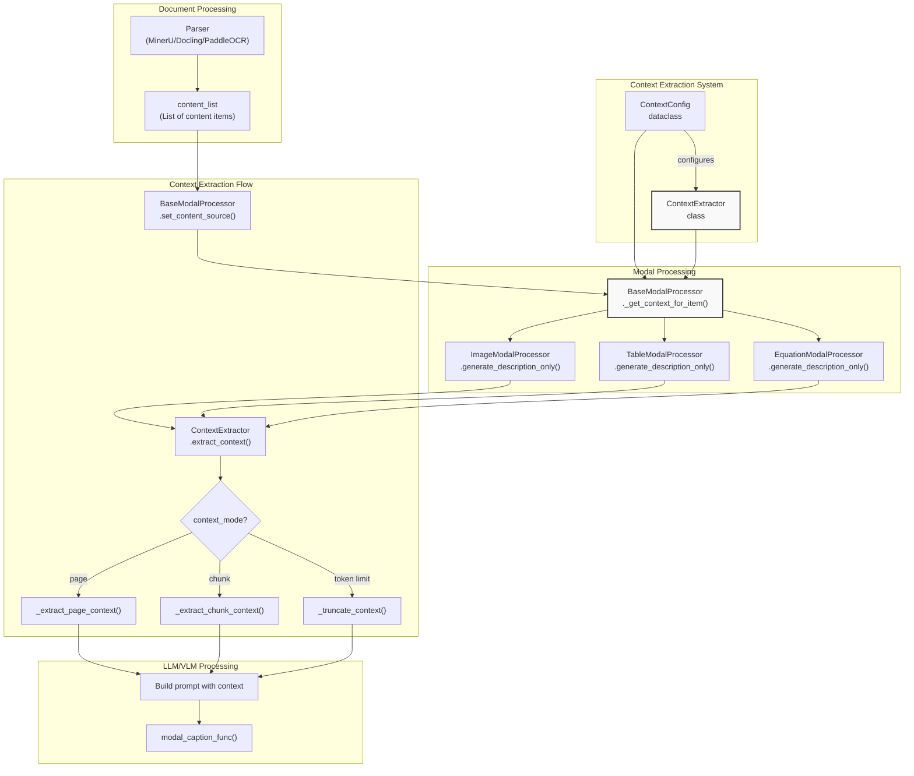
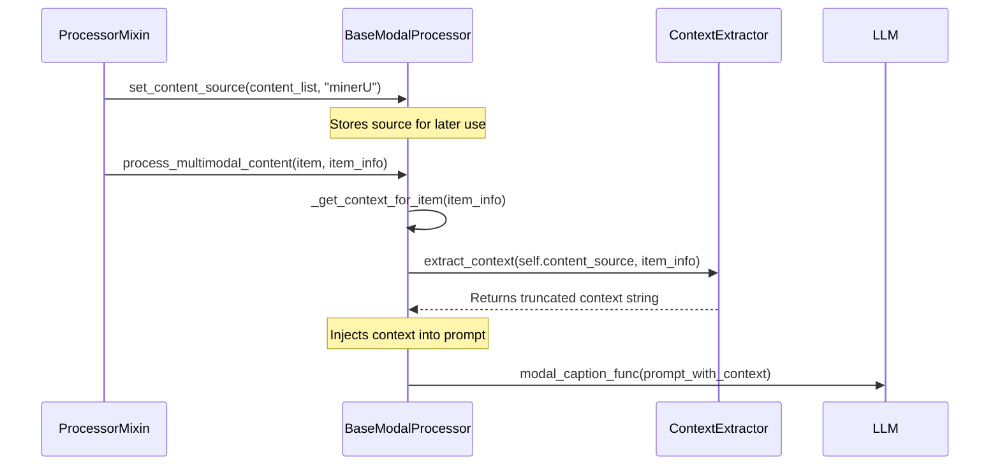

<!-- source: DeepWiki mcp.deepwiki.com · repo HKUDS/RAG-Anything · page 5.6 Context Extraction · fetched 2026-11-09 -->

# Context Extraction

<details>
<summary>Relevant source files</summary>

The following files were used as context for generating this wiki page:

- [docs/context_aware_processing.md](docs/context_aware_processing.md)
- [examples/insert_content_list_example.py](examples/insert_content_list_example.py)
- [examples/modalprocessors_example.py](examples/modalprocessors_example.py)
- [raganything/config.py](raganything/config.py)
- [raganything/modalprocessors.py](raganything/modalprocessors.py)
- [tests/test_embedding_examples.py](tests/test_embedding_examples.py)

</details>


## Purpose and Scope

Context extraction is a critical component of RAG-Anything's multimodal processing pipeline that enriches modal content (images, tables, equations) with surrounding textual information. This system enables modal processors to generate more accurate and contextually-aware descriptions by providing LLMs and VLMs with relevant surrounding content from the document.

This page covers the `ContextExtractor` class, `ContextConfig` dataclass, and their integration with modal processors.

**Sources:** [raganything/modalprocessors.py:1-48]()

---

## System Overview

The context extraction system extracts text content surrounding multimodal items to provide additional context when generating descriptions. This context-aware approach significantly improves the quality of generated descriptions and entity relationships.

### Context Extraction in the Processing Pipeline



**Sources:** [raganything/modalprocessors.py:49-441](), [docs/context_aware_processing.md:174-189]()

---

## ContextConfig Dataclass

The `ContextConfig` dataclass provides configuration options for context extraction behavior. These settings can be initialized via `RAGAnythingConfig` or passed directly to the extractor.

### Configuration Parameters

| Parameter | Type | Default | Description |
|-----------|------|---------|-------------|
| `context_window` | `int` | `1` | Number of pages/chunks to include on each side of the target item. |
| `context_mode` | `str` | `"page"` | Extraction mode: `"page"`, `"chunk"`, or `"token"`. |
| `max_context_tokens` | `int` | `2000` | Maximum number of tokens in extracted context. |
| `include_headers` | `bool` | `True` | Whether to include document headers/titles in context. |
| `include_captions` | `bool` | `True` | Whether to include image/table captions in context. |
| `filter_content_types` | `List[str]` | `["text"]` | Content types to include in context extraction. |

**Sources:** [raganything/modalprocessors.py:39-54](), [raganything/config.py:78-107]()

---

## ContextExtractor Class

The `ContextExtractor` class implements context extraction logic with support for multiple content source formats and extraction modes.

### Initialization

The `ContextExtractor` is initialized with a configuration and optional tokenizer:

```python
def __init__(self, config: ContextConfig = None, tokenizer=None):
    """Initialize context extractor
    
    Args:
        config: Context extraction configuration
        tokenizer: Tokenizer for accurate token counting
    """
    self.config = config or ContextConfig()
    self.tokenizer = tokenizer
```

**Sources:** [raganything/modalprocessors.py:58-66]()

### Main Entry Point: `extract_context`

The `extract_context` method serves as a universal interface, automatically detecting the format of the `content_source`.

| Format Hint | Input Type | Internal Method |
|-------------|------------|-----------------|
| `minerU` | `List[Dict]` | `_extract_from_content_list` |
| `text_chunks`| `List[str]` | `_extract_from_text_chunks` |
| `text` | `str` | `_extract_from_text_source` |
| `auto` | Any | Dynamic Detection |

**Sources:** [raganything/modalprocessors.py:68-118]()

---

## Context Extraction Modes

### Page Mode (`context_mode="page"`)

Page mode extracts context based on page boundaries. It uses the `page_idx` field found in MinerU-style content lists.

**Implementation Logic:**
1. Identifies the `current_page` from `current_item_info`. [raganything/modalprocessors.py:151]()
2. Calculates `start_page` and `end_page` using `context_window`. [raganything/modalprocessors.py:154-155]()
3. Iterates through the list, collecting items where `item_type` is in `filter_content_types`. [raganything/modalprocessors.py:163-167]()
4. Prepends `[Page X]` markers to content from pages other than the current one. [raganything/modalprocessors.py:170-172]()

**Sources:** [raganything/modalprocessors.py:139-177]()

### Chunk Mode (`context_mode="chunk"`)

Chunk mode extracts context based on sequential item indices, suitable for pre-chunked data or non-paginated documents.

**Implementation Logic:**
1. Identifies the `current_index` from `current_item_info`. [raganything/modalprocessors.py:191]()
2. Calculates index range `[current_index - window, current_index + window]`. [raganything/modalprocessors.py:194-195]()
3. Collects text from surrounding items, excluding the target item itself. [raganything/modalprocessors.py:198-204]()

**Sources:** [raganything/modalprocessors.py:179-204]()

---

## Text Extraction and Truncation

### `_extract_text_from_item`

This internal method converts various content types into text strings for the context block:
- **Text**: Returns the text. If `include_headers` is True and `text_level > 0`, it adds Markdown header symbols (`#`). [raganything/modalprocessors.py:214-220]()
- **Image**: Returns the caption in brackets `[Image: caption]` if `include_captions` is True. [raganything/modalprocessors.py:222-226]()
- **Table**: Returns the caption in brackets `[Table: caption]` if `include_captions` is True. [raganything/modalprocessors.py:228-232]()

**Sources:** [raganything/modalprocessors.py:206-236]()

### `_truncate_context`

To prevent exceeding LLM context limits, the extractor truncates the final string:
1. **Token-based**: If a tokenizer is provided, it encodes the string and truncates to `max_context_tokens`. [raganything/modalprocessors.py:315-322]()
2. **Smart Boundary Preservation**: It attempts to truncate at the last period (`.`) or newline (`\n`) if they appear within the last 20% of the truncated text to avoid cutting off mid-sentence. [raganything/modalprocessors.py:325-333]()
3. **Character-based**: Fallback to character slicing if no tokenizer is available. [raganything/modalprocessors.py:336-357]()

**Sources:** [raganything/modalprocessors.py:308-357]()

---

## Integration with Modal Processors

The `BaseModalProcessor` class manages the lifecycle of context extraction for specific modal items.



**Key Integration Points:**
- **Storage**: `BaseModalProcessor` stores the `content_source` and `content_format`. [raganything/modalprocessors.py:406-415]()
- **Retrieval**: The `_get_context_for_item` method calls the `ContextExtractor` using the stored source. [raganything/modalprocessors.py:417-440]()
- **Prompt Injection**: Specialized prompts (e.g., `image_prompt_with_context`) are selected when context is available. [raganything/modalprocessors.py:824-850]()

**Sources:** [raganything/modalprocessors.py:363-440](), [raganything/modalprocessors.py:824-916]()

---

## Configuration via Environment Variables

The context extraction behavior can be controlled globally via `.env` variables, which are mapped to `RAGAnythingConfig`.

| Env Variable | RAGAnythingConfig Field |
|--------------|-------------------------|
| `CONTEXT_WINDOW` | `context_window` |
| `CONTEXT_MODE` | `context_mode` |
| `MAX_CONTEXT_TOKENS` | `max_context_tokens` |
| `INCLUDE_HEADERS` | `include_headers` |
| `INCLUDE_CAPTIONS` | `include_captions` |
| `CONTEXT_FILTER_CONTENT_TYPES` | `context_filter_content_types` |

**Sources:** [raganything/config.py:78-107](), [docs/context_aware_processing.md:56-67]()

---

